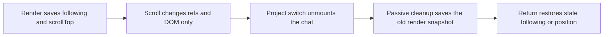
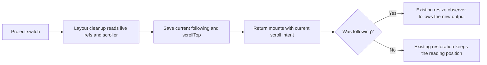
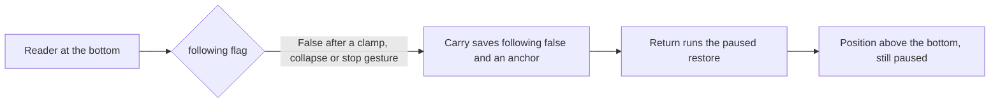
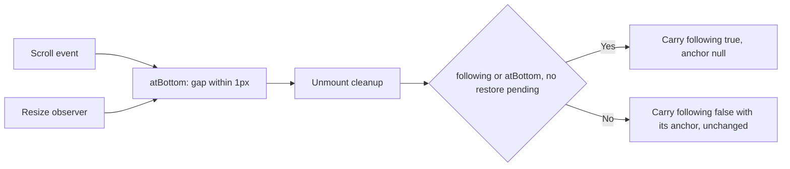

# Keep chat following across project switches

## Status

| Unit                   | Status                                                                                       |
| ---------------------- | -------------------------------------------------------------------------------------------- |
| Investigation          | Stale render snapshot found in `Session.tsx`; no runtime reproduction.                       |
| Implementation         | Written: capture live scroll state during layout cleanup.                                    |
| Review                 | Source diff reviewed; React's deletion path runs layout cleanup before child ref detachment. |
| Build and installation | Production build passed; signed app installed in `/Applications/Chorus.app`.                 |
| Verification           | Installed signature passed; tests, typecheck, lint, format and launch NOT RUN.               |
| Follow-up 2026-10-19   | Bottom-state carry written in `Session.tsx`; source-traced only, runtime cause NOT VERIFIED. |
| Follow-up verification | Tests, typecheck, lint, format, build, install and app launch NOT RUN.                       |

## Current / Issue



`resumeFollowing`, `stopFollowing` and the resize observer do not require a render.
`latest.current` samples their state only during render. The carry cleanup uses
that sample, after the scroller has been detached. `App.keepCarry` preserves this
snapshot and `Session` restores its `following` flag on mount.

## Proposed



## Code Changes

### `apps/desktop/src/renderer/src/Session.tsx`

```tsx
useLayoutEffect(
  () => () => {
    props.onCarry(conversationId, {
      ...latest.current,
      following: following.current,
      scrollTop: score.current?.scrollTop ?? latest.current.scrollTop,
      ...box.current,
      ...(openCardRef.current === null ? {} : { card: openCardRef.current }),
    })
  },
  [conversationId, props.onCarry]
)
```

Keep the existing carry schema, transcript catch-up, observer and gesture rules.
No additional render, timer, observer or scroll listener is needed.

Runtime verification remains outstanding: resume following, switch projects
before another render, then return during a response; also switch while reading
history and confirm the position stays where it was.

## Follow-up 2026-10-19 — at the bottom carries as following

### Current / Issue



The live capture above is correct; the flag it captures can be stale.
`resumeFollowing` needs a downward scroll that ends within 1px
(`Session.tsx` `onScroll` and `onWheel`). Reaching the bottom by moving up —
content below shrinking, an activity group closing, the pane getting taller —
never resumes. Stop gestures (any upward wheel delta, the scrolling keys,
opening an activity group) can leave it false without leaving the bottom.

The carry then saves `following: false` with an anchor. On return the paused
restore runs on a fresh DOM where completed agent history rows stand at their
160px `content-visibility` placeholder, and output that arrived while the
project was in the background sits below the restored position. Both read as
"back in the middle".

### Proposed



The snapshot is taken where layout is coherent — the scroll handler and the
resize observer that already exist — never in the unmount cleanup, which runs
after React has inserted the next project's header and so measures a pane of a
different height. It is not updated while a paused restore is pending, while the
scroller has no height, or, on the resize path, before the first transcript read
lands. A pending restore keeps carrying `restoreFrom`, as before. The 1px
tolerance, the gestures and the resume rules are unchanged.

### Code Changes

#### `apps/desktop/src/renderer/src/Session.tsx`

```tsx
const atBottom = useRef(following.current)

const follow = new ResizeObserver(() => {
  if (!following.current) {
    if (!restorePending.current && readDone.current && el.clientHeight > 0) {
      atBottom.current = el.scrollHeight - el.scrollTop - el.clientHeight <= 1
    }
    captureAnchor()
    return
  }
  el.scrollTop = el.scrollHeight
  pinnedTop.current = el.scrollTop
  atBottom.current = true
})

onScroll={(e) => {
  lastTop.current = top
  if (!restorePending.current && el.clientHeight > 0) atBottom.current = gap <= 1
}}

useLayoutEffect(
  () => () => {
    const pending = restorePending.current
    const followingNow = following.current || (!pending && atBottom.current)
    props.onCarry(conversationId, {
      following: followingNow,
      anchor: followingNow ? null : pending ? restoreFrom.current.anchor : (held?.anchor ?? null),
    })
  },
  [conversationId, props.onCarry]
)
```

No schema, IPC, render, observer, timer or listener is added.

### Acceptance

| Case                                 | Expected                                                           |
| ------------------------------------ | ------------------------------------------------------------------ |
| At the bottom with the flag false    | Carry `following: true`, `anchor: null`; return pins to the bottom |
| Reading history away from the bottom | Carry `following: false` with its anchor, unchanged                |
| Restore unfinished, rapid A/B/A      | Carry `restoreFrom` and `following: false`, unchanged              |
| Output arrives while backgrounded    | A bottom carry returns following and pins after the catch-up read  |
| Over-budget transcript               | `trimCarry` drops the view only; the bottom intent survives        |
| Several conversations                | Each `Session` keeps its own snapshot                              |

Runtime verification remains outstanding and NOT VERIFIED: reach the bottom by
collapsing an activity group, switch projects and return, with and without new
output in between; then repeat while reading history and while a restore is
still pending. The separate paused-reader defect — an anchor near the bottom
unreachable against placeholder heights, then the pixel fallback — is not
addressed here.
