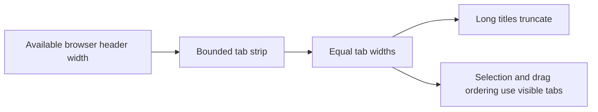
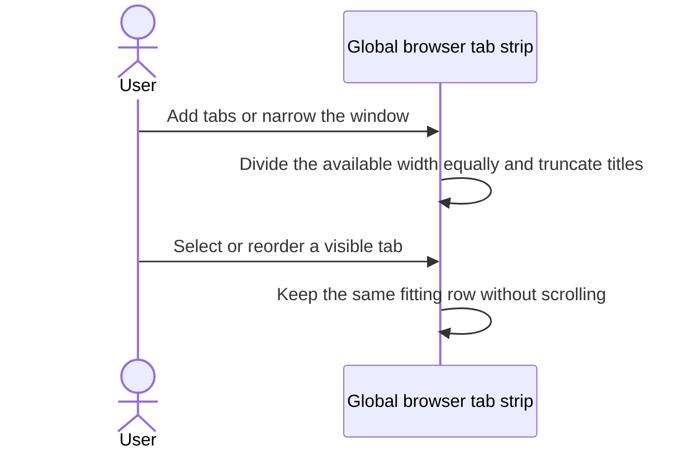

# Global browser tabs fit their available width

## Status

| Unit           | Result                                                                               |
| -------------- | ------------------------------------------------------------------------------------ |
| Scope          | Global browser tabs share their available width equally without scrolling            |
| Implementation | Equal-width follow-up written and diff reviewed; runtime behavior unverified         |
| Tab boundaries | Written and diff reviewed: visible tab outlines and gaps; live appearance unverified |
| Verification   | Local build and installation passed; tests and live appearance unverified            |
| Width cap      | 2026-11-12: `.web-tab` keeps `flex: 1 1 0` and gains `max-width: 200px`              |
| Group sizing   | 2026-11-12: group basis is `min(70%, tabs × 203px + 48px)`, from the tab count       |
| Effect         | 2026-11-12: unused room goes to project tabs; the group sits by `+`. Not run         |

## Current / Issue

```css
.web-tabs {
  overflow: clip;
}
.web-tab {
  flex: 0 1 auto;
  max-width: 220px;
}
.web-tab-main {
  max-width: 186px;
}
```

Tabs already shrink without scrolling, but their title lengths still determine their relative widths.

## Proposed

Each tab has a persistent rounded border enclosing its title and close button. A small gap separates neighboring tabs. The active tab retains its accent border.



## Code Changes

### `apps/desktop/src/renderer/src/styles.css`

```css
.web-tabs {
  flex: 1 1 auto;
  gap: var(--step);
  min-width: 0;
  overflow: clip;
}

.web-tab {
  flex: 1 1 0;
  min-width: 0;
  overflow: clip;
  border: 1px solid var(--border-strong);
}

.web-tab-main {
  flex: 1 1 auto;
  min-width: 0;
  overflow: hidden;
}
```

Use the existing title ellipsis. Remove the tab and main-button width ceilings so every tab fills its equal share. The add button keeps its existing fixed width.

### `apps/desktop/src/renderer/src/workspace/WebTabStrip.tsx`

Remove selected-tab scrolling, drag edge scrolling, and scroll-offset bookkeeping. Compute insertion markers and drag translations directly from the tab rectangles. Keyboard focus uses `focus({ preventScroll: true })`.

## Final Flow



Manual verification remains: equal widths with mixed title lengths, few and many browser tabs, narrow windows, selection, keyboard focus, closing, adding, and drag reordering.

Source and diffs were reviewed against the pre-edit working copies. Existing changes were retained. On 2026-10-15, the dependency build, signed arm64 packaging and installation passed. The current session was kept running; a relaunch loads the new tab boundaries. Tests, standalone typechecks and live UI checks were not run.
