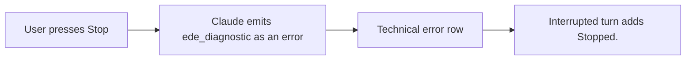
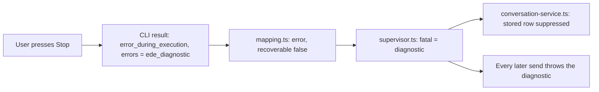
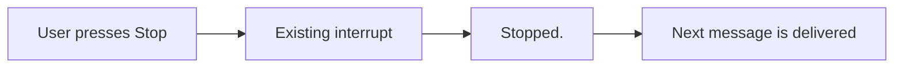

# Short Stop notice

## Status

| Unit                     | Result                                                                                             |
| ------------------------ | -------------------------------------------------------------------------------------------------- |
| Scope                    | Requested: user Stop shows only Stopped. instead of a cancellation diagnostic                      |
| Implementation           | Written and diff reviewed; unverified                                                              |
| Verification             | Tests, builds and live UI checks not requested                                                     |
| Follow-up, 2026-10-22    | Requested: a Stop must not leave the agent refusing every later message                            |
| Follow-up implementation | Adapter correction, idle-Stop correction and regression cases written; unrun                       |
| Follow-up verification   | Tests, builds and live checks not requested; full-relaunch report remains unexplained and unscoped |

## Current / Issue



Stored examples show `[ede_diagnostic] result_type=user ...` immediately before `turn.completed` with `status: interrupted` and `userInitiated: true`. The renderer already supplies the requested Stopped. text.

### Follow-up: the hidden error still disables the session



On the observed Stop path, the CLI (2.1.303) returned the diagnostic as the only entry in an `error_during_execution` result's `errors`. Its readable source builds it when a turn ends aborted (`aborted_streaming` or `aborted_tools`) and the last message is not assistant text, and strips it from its own user-facing error lists. One minified branch of that condition was not resolved, so other emissions are not ruled out. `mapping.ts` reports every non-`error_max_turns` result failure as `recoverable: false`. `SupervisedSession.consume` stores any such error as `fatal` before `ConversationService` sees it, and since 2026-10-17 `send()` rejects with `fatal` while it is set. The service filter below therefore hid the row and left the session refusing every later message, with the diagnostic as the error text. A renderer reload keeps the main-process session, so it does not clear the state.

Recorded on 2026-10-22: after a Claude Stop at 14:04:15, four messages were accepted and none delivered, including one sent after a reload.

## Proposed

Suppress this specific diagnostic while the service is processing a user interrupt. Keep ordinary failures and non-interrupted diagnostics intact.

### Follow-up: correct it in the Claude adapter

Remove `[ede_diagnostic]` entries from a `result`'s `errors` while a Stop is pending, before the result is mapped. A diagnostic-only result then emits no `error`, only its `interrupted` completion, so the supervisor never latches it. Any other entry in the same result is still reported.

A Stop is pending only when it arrives during an open turn. The runtime's Stop reaches idle participants too; for them the CLI is still asked to stop, so the queued-message receipt is unchanged, but nothing is left pending. The pending Stop ends with the first turn completion of any status. A Stop that arrives as the turn completes normally must not hide the next turn's failure, and a Stop request the CLI rejects must not hide that turn's failure.

Deliberately not done here: relaxing the supervisor's general `fatal` guard, the separate case of a Codex capacity error disabling Codex, and the full-relaunch report. The service filter stays for compatibility.

## Code Changes

### `packages/orchestrator/src/conversation-service.ts`

```ts
if (this.interruptRequested && event.message.startsWith('[ede_diagnostic]')) return
```

### `packages/orchestrator/src/conversation-service.test.ts`

Extend the existing interrupt test with the observed diagnostic. Keep the same diagnostic visible in the genuine-failure control. These checks remain unrun.

### Follow-up: `packages/adapter-claude/src/claude-adapter.ts`

```ts
if (this.turnOpen) this.interruptRequested = true

const narrowed =
  kind === 'result' && this.interruptRequested ? withoutStopDiagnostics(message) : undefined
const events = mapSdkMessage((narrowed?.message ?? message) as never, { ... })
for (const event of events) {
  if (narrowed?.onlyDiagnostics === true && event.type === 'error') continue
  this.emit(this.correctInterrupt(event))
}
```

`withoutStopDiagnostics` returns `undefined` when `errors` holds no diagnostic, `onlyDiagnostics: true` when nothing else remains, and otherwise a copy of the result whose `errors` keeps only the other string entries. `correctInterrupt` clears the pending Stop on every `turn.completed`, relabelling only a non-completed one. `interrupt()` clears it when the CLI rejects the request.

### Follow-up: `packages/adapter-claude/src/interrupt.test.ts`

Real adapter, SDK messages fed by hand as complete `SDKResultError` and `SDKResultSuccess` values, usage included. Acceptance criteria, each a case, all unrun:

- A requested Stop with only diagnostic errors emits an `interrupted` completion and no `error`.
- The next message is accepted and its turn completes without an error.
- The same diagnostic without a requested Stop stays visible, and the turn reads `failed`.
- A genuine error alone during a Stop stays visible.
- A diagnostic mixed with a genuine error keeps the genuine error and drops the diagnostic.
- A Stop that lands as the turn completes normally does not hide the next turn's failure.
- A rejected Stop request does not hide that turn's failure.
- A Stop sent to an idle agent does not hide the next turn's failure.

## Final Flow



Task baseline: `/private/tmp/chorus-stop-notice-1ov3xwwj`. Follow-up baseline: `/private/tmp/chorus-stop-cancellation-m5aopbr5`.
