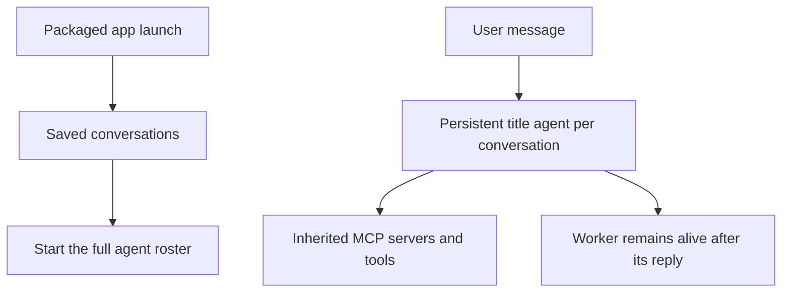
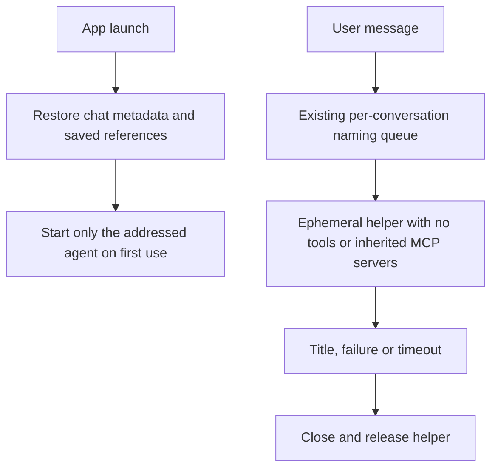
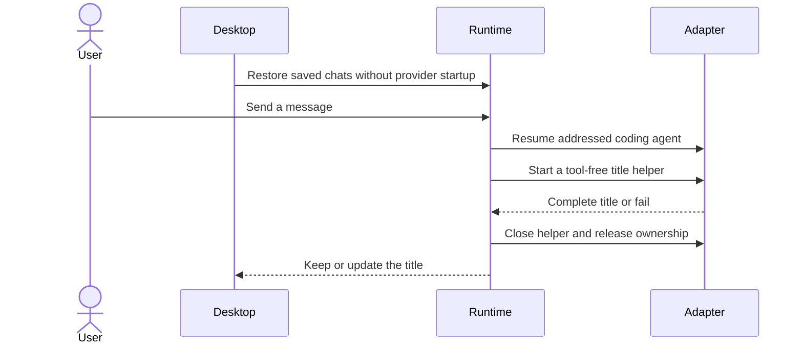

# Dormant restoration and tool-free title generation

Scope selected in chat on 2026-10-18. A later follow-up authorized a local build, completed with the shutdown changes. Installation was subsequently authorized with the current app kept running. Tests, standalone typechecks and release remain unrequested.

## Current / Issue



The desktop passes `deferRestoredAgents: devServerUrl !== undefined`; `ChorusRuntime.reopen` already implements dormant records and `startSeat` resumes their saved references. Naming helpers currently start ordinary adapter sessions and retain successful sessions until the conversation closes.

## Proposed



Keep existing fallback order, model selection and current-title context. Preserve normal and discussion agent configuration. Preserve existing per-chat serialization; a global naming queue would couple every chat to one provider's startup and needs a separate cancellation design. Protect naming against chat closure, shutdown and late startup completion.

## Code Changes

### `apps/desktop/src/main/index.ts`

```ts
const opened = ChorusRuntime.open(app.getPath('userData'), log, undefined, {
  deferRestoredAgents: true,
})
```

### `packages/agent-protocol/src/adapter.ts`

```ts
readonly toolPolicy?: 'readOnly' | 'none'
```

### `packages/adapter-claude/src/claude-adapter.ts`

The `none` profile skips explicit Chorus MCP construction, advertises `tools: []`, uses `strictMcpConfig: true`, isolates settings/hooks/plugins, and sets `persistSession: false`. It rejects tool requests and skips startup quota-probe timers. Existing provider init/result usage reads remain unchanged. Track open auxiliary sessions for shutdown and remove their registry references when they close. DeepSeek uses this same adapter.

### `packages/adapter-codex/src/codex-adapter.ts`

The pinned Codex 0.147.0 protocol has no tool allowlist and cannot guarantee this profile: its builtin `apply_patch` registration is independent of disabling shell tools. `start`, `resume` and `fork` now refuse `toolPolicy: 'none'` before creating a connection. Claude/DeepSeek remain eligible title providers; if neither succeeds, the existing/default title remains. Normal Codex coding sessions remain available.

### `apps/desktop/src/main/runtime.ts`

```ts
const session = await adapter.start({
  cwd: conversation.cwd,
  sandbox: { mode: 'readOnly', writableRoots: [], networkAccess: false },
  toolPolicy: 'none',
  instructions: NAMER_INSTRUCTIONS,
  ...(model === '' ? {} : { model }),
})
```

Every naming request closes its helper in `finally`, including success, unusable output, failure, timeout and owner loss. Conversation closure settles any pending naming request and closes its current helper. Shutdown cancels naming before adapters and storage are disposed. Late startup completion must close its session and must not rename a closed conversation.

### Existing focused tests

Update `aside.test.ts` for fresh helpers on subsequent requests and add coverage for no-tool options, success cleanup, startup failure/timeout, late completion after close, and shutdown. Preserve `deferred-restore.test.ts` coverage of resume references, lazy provider startup, retry/fallback and cancellation. Adapter tests must cover tool exclusion and ordinary-session compatibility. Write the checks but leave them unrun until requested.

## Status

| Area                                 | State                                                                                                                          |
| ------------------------------------ | ------------------------------------------------------------------------------------------------------------------------------ |
| Dormant desktop restoration          | Implemented; production startup enables the existing dormant path                                                              |
| Tool-free auxiliary provider profile | Implemented for Claude/DeepSeek; unsupported Codex auxiliary profile refused before startup                                    |
| Disposable title helpers             | Implemented; response/startup deadlines, awaited cleanup and late-owner guards                                                 |
| Static code review                   | Completed by two independent reviewers; no actionable findings                                                                 |
| Regression cases                     | Written for isolation, cleanup, fallback, startup timeout ownership, late completion and shutdown; unrun                       |
| Local macOS arm64 build              | Succeeded with the shutdown changes; `apps/desktop/release/mac-arm64/Chorus.app`                                               |
| Tests and standalone typechecks      | Not run; not requested                                                                                                         |
| Installation                         | Installed `/Applications/Chorus.app` with keep-running mode; old process remains on the preserved bundle until manual relaunch |
| Measured memory savings              | Unverified                                                                                                                     |

## Final Flow


