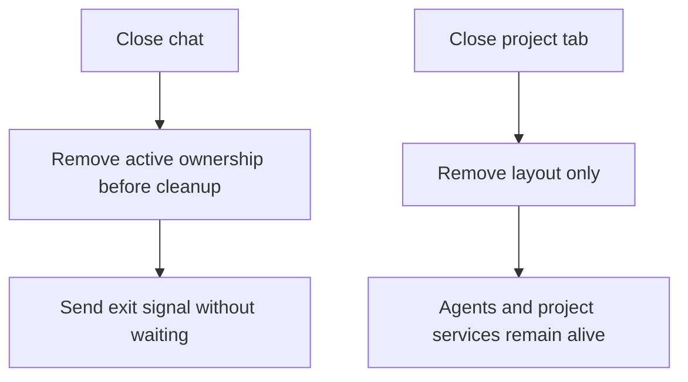
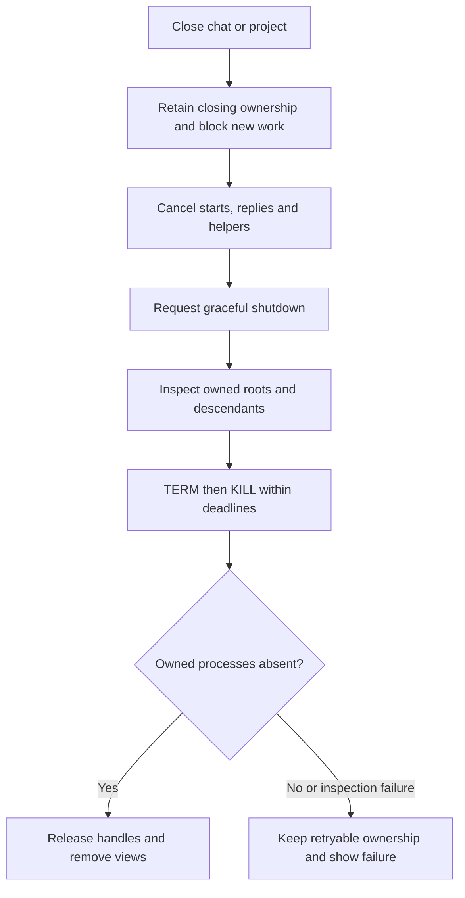

# Confirmed chat and project shutdown

Authorized in chat on 2026-10-18. Local build authorized in the follow-up request. Installation was subsequently authorized with the current app kept running. Tests, standalone typechecks and app launches remain unrequested.

## Current / Issue



## Proposed



Project closure includes all its chats, auxiliary agents, terminals, project run, traffic listener, logcat source and editor extension hosts. Preserve saved history and other projects. Closing the last chat follows project closure, preserving the existing tab-removal behavior.

## Code Changes

### NEW: `packages/shared/src/process-tree.ts`

```ts
export interface OwnedProcessTree {
  capture(): Promise<void>
  stop(graceful?: () => void | Promise<void>): Promise<void>
}
```

Record process identity and ancestry before graceful shutdown. Provider roots use dedicated POSIX process groups. Signal only revalidated owned identities or groups anchored by a matched owned process; reject on unavailable inspection or surviving processes. Retain rejected cleanup for retry. Observed descendants remain owned after reparenting. Arbitrarily daemonized processes that escape before observation cannot be guaranteed by Node process inspection; never use global name or working-directory matches.

### `packages/adapter-claude/src/claude-adapter.ts`, `packages/adapter-codex/src/transport.ts`

```ts
await owned.stop(() => query.close())
```

Capture actual SDK/transport child processes and await their exit. Preserve handles until cleanup succeeds. Closing providers must include their observed MCP and tool children.

### `apps/desktop/src/main/runtime.ts`

```ts
async closeProject(projectId: string): Promise<void>
async closeConversation(conversationId: string): Promise<void>
```

Both operations are single-flight and retryable. Retain conversation records until every owned cleanup settles successfully. Cancel late startups and await their eventual owned cleanup. Project close stops services without calling `projects.forget` or permanently disposing reopenable project resources.

### `apps/desktop/src/main/terminal.ts`, `apps/desktop/src/main/project-run.ts`

```ts
await this.terminals.stopSession(conversationId)
await this.terminals.stopProject(projectId)
```

PTY cleanup captures the owned tree before signalling, waits for actual disappearance, and retires the terminal only after confirmation. Project run closure uses its existing process-group escalation and rejects incomplete cleanup.

### `apps/desktop/src/main/workbench-surface.ts`, `apps/desktop/src/main/workbench-host.ts`

Use supported editor disconnect APIs and per-surface terminal process IDs. Attest local extension-host ownership through a minimal built-in extension with a per-surface nonce and report file; validate ancestry against the owned shared server. Close only that project’s trees; stop the shared server when the final project leaves.

### `apps/desktop/src/shared/ipc.ts`, `apps/desktop/src/main/ipc.ts`, `apps/desktop/src/preload/index.ts`

```ts
await runtime.closeProject(projectId)
```

The project-close handler also awaits editor cleanup before publishing success. Every window receives successful project closure; cleanup failure remains visible and retryable.

### `apps/desktop/src/renderer/src/App.tsx`, `apps/desktop/src/renderer/src/workspace/Workspace.tsx`

Retain existing busy/draft confirmation. Show closing state, await the backend result, then remove the chat/project. Route project tab close, keyboard close and detached-window close through the same ownership shutdown path. Switching tabs and remounting views remain view operations.

## Status

| Area                                                             | State                                                                                                                          |
| ---------------------------------------------------------------- | ------------------------------------------------------------------------------------------------------------------------------ |
| Chat/project close actions                                       | Implemented with awaited success, visible failure and retry                                                                    |
| History and other projects                                       | Preserved; ordinary close never forgets registry/history                                                                       |
| Provider and tool processes                                      | Captured ownership, bounded graceful/TERM/KILL cleanup, exit inspection and retained retry handles                             |
| Pending starts and replacement paths                             | Startup, history reopen, promotion, answer-style replacement and delayed renderer acknowledgements covered                     |
| Terminals and project run                                        | Owned roots retained through replacement and failed cleanup; reopen stays available after success                              |
| Embedded local editor                                            | PID attestation, final terminal capture, supported disconnect and confirmed owned-tree/view exit                               |
| Shared editor server                                             | Stops only when its last project lease is released                                                                             |
| Traffic, logcat and Android forwarding                           | Project-scoped cleanup; shared device server preserved                                                                         |
| Regression source                                                | Written for ownership, retry, pending starts, close acknowledgements and isolation; unrun                                      |
| Static review                                                    | Completed across runtime, providers, editor, UI/native and IPC paths; reported findings addressed                              |
| Local macOS arm64 build                                          | Succeeded: workspace dependency compilation, companion extension, electron-vite and electron-builder directory package         |
| Tests, standalone typechecks, formatting and live process probes | Not run; not requested                                                                                                         |
| Build artifact                                                   | `apps/desktop/release/mac-arm64/Chorus.app`; packaging exited 0                                                                |
| Installation                                                     | Installed `/Applications/Chorus.app` with keep-running mode; old process remains on the preserved bundle until manual relaunch |

Known boundary: remote editor exit cannot be verified by this local implementation and reports failure. Daemons that fully escape ownership before sampling cannot be safely attributed. Ambiguous detectable ownership and inspection failures reject closure; POSIX birth fingerprints have second precision. Windows CIM/handle behavior remains unverified.

Project close keeps every chat's note and draft journal; only closing a single chat deletes its note. An editor process tree that never established ownership, because the process had already exited or is not a descendant of the server, is logged rather than failing the close: stopping it can never succeed, so failing would strand the project until a full quit. Failing to stop an owned tree, close the view, disconnect a remote editor or release the server rejects the close and stays retryable. Android forwarding forgets a device once the tracker lists it as gone, and counts a removal as done when `adb` reports the device not found.

### `packages/orchestrator/src/supervisor.ts`

Failed resume-event attachment and invalid persistent forks close the acquired provider before throwing. A failed physical cleanup propagates its retry handle rather than starting a replacement.

### `apps/desktop/src/main/adb-reverse.ts`

```ts
await this.adbReverse.syncConfirmed(this.traffic.capturingPorts())
```

Await removed-port work and final owned tracker exit. Preserve shared device-server processes. Failed or late removals remain retryable.

## Close-pending overlay

The close-pending message currently occupies a flex row before the workspace in
both main and detached windows. Showing it therefore reduces the workspace's
height and shifts the UI while cleanup is pending. The user requested an
absolute overlay and confirmed that it should float over the workspace.

Give only the pending message its own positioning class in `App.tsx`, with the
stage as its containing block in `styles.css`. Keep it full-width below the main
window's masthead, or at the top of a detached window, without reserving layout
space. Use the existing `useShellOverlay` hook while it is visible so native
editor views cannot cover the message. Preserve the message, status role and
shutdown behavior. Error notices remain outside this change.

Status: Implemented in `App.tsx` and `styles.css`. Visual behavior remains
unverified. No tests, builds or app runs were requested or performed.

## Final Flow

```mermaid
sequenceDiagram
    actor User
    participant UI
    participant Runtime
    participant Owners
    User->>UI: Close chat or project
    UI->>Runtime: Stop owned work
    Runtime->>Owners: Cancel, capture and stop
    Owners-->>Runtime: Exit confirmed or cleanup failure
    alt Confirmed
        Runtime-->>UI: Closed
        UI->>UI: Remove views; preserve history
    else Unconfirmed
        Runtime-->>UI: Failure details
        UI->>UI: Keep close action available for retry
    end
```
