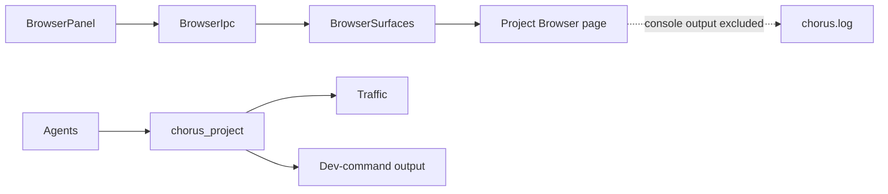
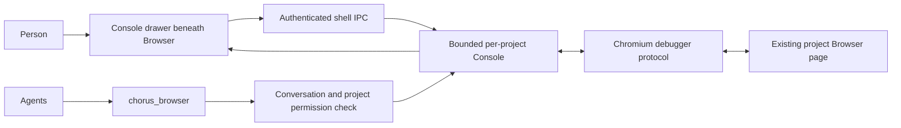
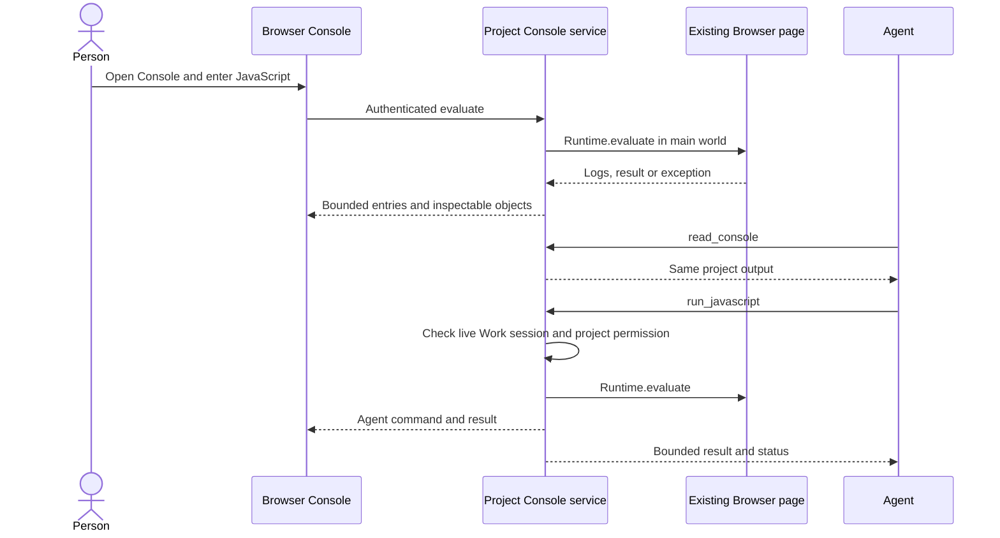

# Interactive Browser Console

## Current / Issue



`BrowserSurfaces` owns project pages and unrelated global web tabs separately (`main/browser-surface.ts`). `BrowserPanel` measures the native page from its `browser-body` element. `discussionOpts` currently strips note writes, while `chorus_project` promises read-only access.

## Proposed



Use the existing project Browser page. Never open a page on an agent's behalf. Prefer the detached project's owner when present, otherwise main; resolve at invocation time. Human actions must target the Browser record displayed in their panel. Global web tabs, popups, workers and cross-process iframe attachment are outside this task.

The person can run JavaScript. Agents can read the Console in Discussion and Work, and run JavaScript in Work when the project permits writes and the conversation is not in its existing planning mode. Recheck the live conversation, project and permission profile at invocation; an unavailable or closing conversation fails closed. Ephemeral forks and tool-free sessions do not receive execution access. Traffic and terminal tools stay read-only.

Keep recent output across navigation and panel remounts, with navigation markers. Clear explicitly discards it. Store output in bounded memory, outside `chorus.log` and conversation events; ordinary agent tool-call recording retains its existing behavior.

## Code Changes

### NEW: `apps/desktop/src/shared/console-ipc.ts`

Define zod-validated entries (including an explicit truncation flag), remote-value summaries, source locations, actor labels, status and request/response/push contracts. Main owns opaque inspection handles; shell payloads contain no raw CDP object IDs.

```ts
export type ConsoleState = 'no-page' | 'connecting' | 'ready' | 'paused' | 'unavailable'

export interface ConsoleLocation {
  readonly url: string
  readonly line: number
  readonly column: number
}

export interface ConsoleValue {
  readonly text: string
  readonly type: string
  readonly subtype: string | null
  readonly handle: string | null
}
```

Channels cover subscribe/snapshot, unsubscribe, evaluate, expand and clear; pushes carry subscription identity, entries/state/clear or a resync instruction. Main checks the registered shell's main frame, adopted project, and detached-project role. Keep requests, snapshots and queued pushes bounded.

### NEW: `apps/desktop/src/main/browser-console.ts`

One Console service owns project rings and project-page sources. Use `Runtime.consoleAPICalled`, `Runtime.exceptionThrown` and `Log.entryAdded`, with small hand-written zod schemas and existing dependencies. Bound entries, text, stacks, handles, expansion depth/property count and total bytes. Coalesce pushes and report dropped output under floods. Release evicted object handles and their inspected descendants.

```ts
const command = {
  expression,
  replMode: true,
  awaitPromise: true,
  generatePreview: true,
  objectGroup,
  timeout: timeoutMs,
  uniqueContextId,
  includeCommandLineAPI: actor === 'user',
  userGesture: actor === 'user',
}
const raw: unknown = await contents.debugger.sendCommand('Runtime.evaluate', command)
```

Execute in the main frame's default world, identified through the root frame and default execution context; never select an isolated preload context or an iframe's default context. Wait for that identity before accepting evaluation and always send its `uniqueContextId`. Do not wrap user expressions in a function. Keep top-level declarations and await support. Parse every CDP response before use. Return structured results/errors/timeouts/interruption; a timeout must not claim to undo asynchronous effects already started. Bound actual unresolved protocol requests as well as callers waiting for them. Human commands use a 30-second bound; agent commands default to 5 seconds, up to 30 seconds. Protocol failures and Clear are distinct outcomes; busy/invalid requests fail without execution.

`Runtime.getProperties` expands own/internal properties without calling getters. Show the first bounded set of indexed array values as well as ordinary properties. Opaque handles carry project/source/generation ownership and become unavailable after navigation, Clear, source destruction or debugger detach. A late evaluation/expansion response cannot repopulate a cleared or replaced generation. Clear releases evaluation groups and console handles, then discards Chromium's stored Console entries. Command history survives Clear. A page's `console.clear()` is recorded as a page event and leaves preserved output intact.

Debugger attachment must not block initial navigation: Electron documents that commands issued before navigation may remain pending. Keep attach/enable asynchronous. Pause gracefully when DevTools takes the debugger, report that status, and reattach after DevTools closes without replaying duplicate messages or undoing Clear. Preserve existing DevTools actions.

### `apps/desktop/src/main/browser-surface.ts`

Add optional project-page mount/release callbacks to `BrowserSurfaceDeps`, called only for the primary project view. Release the Console source before closing a view. Preserve current web-tab, popup, security and password behavior. Project disposal releases all its sources and their listeners/object groups before removing the store; late events cannot recreate the disposed store.

### NEW: `apps/desktop/src/main/console-ipc.ts`

Follow `TrafficIpc` shell roles and bounded subscription delivery. Scope every read/action/handle to its project and displayed Browser source. A snapshot handoff must preserve newer pushes and Clear ordering, including resync and unmount/remount; keep delivery gated until the renderer has applied and acknowledged its snapshot. Revoke subscriptions on shell navigation/destruction and remove handlers at shutdown.

### `apps/desktop/src/preload/index.ts`, `apps/desktop/src/shared/ipc.ts`, `apps/desktop/src/main/index.ts`

Expose typed Console methods on the existing `window.chorus` bridge. Construct and late-bind the Console service to runtime; register/release shells beside Browser and Traffic. Close the service at shutdown. Dispose project stores when projects close or are forgotten, while retaining output during Browser remount/detach/redock.

### NEW: `apps/desktop/src/renderer/src/ConsolePanel.tsx`

Render logs, command/results, actor tags, timestamps, source locations, expandable values, levels/text filters, Clear, empty/error/paused states and command input. Use React text only. Subscribe only when visible. Rebuild from a snapshot after resync. Enter submits, Shift+Enter inserts a line, and Up/Down at input boundaries recalls human command history from the project store. Keep a submitted command/result pair associated under concurrent agents. Expose pending execution state without freezing log updates.

### `apps/desktop/src/renderer/src/BrowserPanel.tsx`, `apps/desktop/src/renderer/src/styles.css`, `apps/desktop/src/renderer/src/i18n/en.json`

Add a Console toggle and inline drawer outside the measured `browser-body`. The existing resize measurement shrinks the native page when the drawer opens. Use current theme tokens and translation keys. Any recursive value renderer goes in its own component file. Avoid new overlays, row-layout migrations, dependencies or preferences unrelated to this feature.

### NEW: `packages/agent-protocol/src/browser-tools.ts`

```ts
export interface BrowserConsoleAccess {
  readonly read: (request: {
    readonly count: number
    readonly skip: number
    readonly levels?: readonly string[]
  }) => Promise<string>
  readonly run?: (request: {
    readonly expression: string
    readonly timeoutMs: number
  }) => Promise<string>
}

export function readOnlyBrowser(access: BrowserConsoleAccess): BrowserConsoleAccess {
  return { read: access.read }
}
```

Follow `note-tools.ts` validation/optional-write dispatch. Export the namespace `chorus_browser`, `read_console` and `run_javascript`. Count defaults to 50 (maximum 200), skip to 0 (maximum 1000); expression maximum 64 KiB, timeout defaults to 5000 ms (100–30000 ms). Bound agent output to 64 KiB with explicit truncation. Read results include page URL/status and actor/source/location; run results distinguish thrown errors, timeout, unavailable page, debugger pause and interrupted navigation. Human-readable object previews are sufficient for agent results; retain inspection handles for the human UI.

### `packages/agent-protocol/src/adapter.ts`, `packages/agent-protocol/src/index.ts`, NEW: `packages/adapter-claude/src/browser-tool.ts`, `packages/adapter-claude/src/claude-adapter.ts`, `packages/adapter-codex/src/codex-adapter.ts`

Add optional Browser access to `SessionOpts`. Wire the Claude SDK server and Codex dynamic tools beside existing note/project tools; ClaudeAdapter also supplies DeepSeek. Respect read-only/tool-free/ephemeral-fork restrictions. Extend existing tool-availability notices. Existing Codex threads may require a new conversation to register new dynamic tools; report that limitation.

### `apps/desktop/src/main/runtime.ts`

Late-bind the Console service. `sessionOptsFor` provides project-bound access with agent identity and invocation-time checks. `discussionOpts` applies `readOnlyBrowser`; do not add execution to aside/tool-free paths. Permission changes and project/conversation closure revoke execution immediately. Project closure/forgetting releases the Console store.

### Acceptance and later verification

| Required behavior                                                                            | Runtime status | Source evidence and later verification                                                                                                  |
| -------------------------------------------------------------------------------------------- | -------------- | --------------------------------------------------------------------------------------------------------------------------------------- |
| Console shows page logs, warnings, errors, objects and source locations                      | NOT VERIFIED   | Implemented in `main/browser-console.ts` and `ConsolePanel.tsx`; page emission and display still need an authorized run                 |
| Human commands support history, multiline, page globals, objects, promises and thrown errors | NOT VERIFIED   | Implemented in `ConsolePanel.tsx`, `console-stream.ts` and `BrowserConsoles.evaluate`; manual Console flow remains unrun                |
| Agents read/run in the same project Console, with actor labels                               | NOT VERIFIED   | `browser-tools.ts`, both adapters and runtime binding are reviewed; Claude, Codex and DeepSeek calls remain unrun                       |
| Discussion/read-only/fork/tool-free restrictions hold, including profile changes             | NOT VERIFIED   | Runtime and adapter gates reviewed; `browser-console-access.test.ts` and `browser-tools.test.ts` written, unrun                         |
| Missing pages, reload, Clear, crashes, stale handles and DevTools pause recover correctly    | NOT VERIFIED   | `browser-console.test.ts`, `console-ipc.test.ts` and `console-stream.test.ts` written, unrun; manual Browser flow remains unrun         |
| Project/detached ownership and unrelated tabs remain isolated                                | NOT VERIFIED   | Project-only Browser hooks and shell/source gates reviewed; ownership tests written, unrun; detach/redock flow remains unrun            |
| Floods and large values stay bounded; no HTML injection or automatic getter invocation       | NOT VERIFIED   | Ring/request/handle bounds and React rendering reviewed; focused service tests written, unrun; large-property transport remains a limit |
| Traffic/dev-terminal behavior and existing edits remain intact                               | NOT VERIFIED   | Task diffs reviewed against preserved baselines; no Traffic/dev-terminal tools changed; runtime regression checks remain unrun          |

No tests, typechecks, builds, app launches or UI verification are authorized. Codex reviews source and complete task changes; runtime acceptance remains NOT VERIFIED until the user requests a run. Add only meaningful focused tests where needed; do not execute them.

| Work                                                | Status                                         |
| --------------------------------------------------- | ---------------------------------------------- |
| Research and independent design challenge           | Complete                                       |
| Plan and decisions                                  | Complete                                       |
| Main Console and shell bridge                       | Implemented; runtime behavior unverified       |
| Browser drawer, agent tools and runtime integration | Implemented; runtime behavior unverified       |
| Independent integrated review                       | Complete; source review PASS after corrections |
| Runtime verification                                | Not run; not authorized                        |

Delivery is reviewed local changes. No tests, typechecks, lint/format checks, builds, launches, commits or publishing ran. Claude implemented the product changes; Codex authored this plan and reviewed the integrated changes and correction diffs. No native subagents were launched.

The Console is opened with Browser's Console button. Existing Codex threads do not acquire newly added dynamic tools; start a new conversation after a future build to receive them. A failed snapshot handoff reports an unreachable Console and recovers by reopening the drawer. Inspecting an object with very many properties still requires Chromium's complete `getProperties` response before the retained set is capped. Worker and cross-process iframe attachment remain outside this implementation.

Protocol references: [Electron Debugger](https://www.electronjs.org/docs/latest/api/debugger), [Chromium Runtime protocol source](https://raw.githubusercontent.com/ChromeDevTools/devtools-protocol/master/pdl/js_protocol.pdl), [Chromium Page agent](https://raw.githubusercontent.com/chromium/chromium/main/third_party/blink/renderer/core/inspector/inspector_page_agent.cc). The Page agent returns the root frame tree without an enable guard; use that frame identity rather than equating a Target ID to a frame ID. These sources define the proposed protocol usage; installed behavior remains unverified.

## Final Flow


