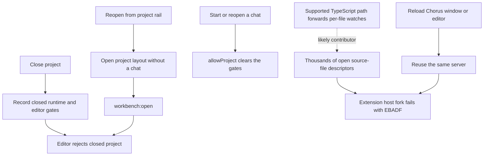
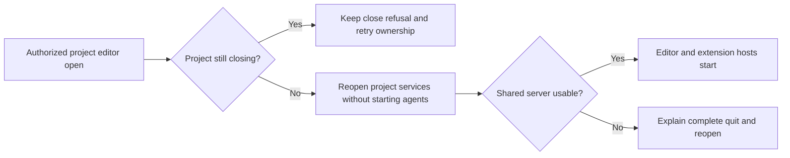

# Reliable editor reopening and extension hosts

## Current / Issue



Confirmed source defect: `App.tsx`'s `showProject` only changes the workspace
store. `runtime.ts` clears project close gates only from chat startup/reopening.
`workbench-surface.ts` therefore rejects the user's reopened project with the
exact supplied screenshot message: "This project is closed or still closing."

Confirmed incident: the installed editor server's log repeatedly reports
`ExtensionHostConnection errored` / `spawn EBADF` at `Module.fork`. Passive
inspection found about 14,600 open file entries, mostly project sources, in the
shared server. The process has been alive since October 23. Window/editor reloads
reuse it. The exact ownership of each duplicate watch remains unproven.

The installed TypeScript extension's `readUseVsCodeWatcher` enables forwarding
when `tsserver.watchOptions` is `"vscode"`, unless an explicit experimental
setting or certain watcher exclusions override that choice. An object selects
TypeScript's own watcher. The unified `js/ts` setting reader currently ignores
its default layer and falls back to `typescript`; that fallback includes defaults.
Changing the experimental setting's default alone would not fix this path.

The installed client and server match: monaco-vscode-api 33.0.9, VS Code 1.121.0,
VSCodium REH 1.121.03429. Keep those pins.

## Proposed

```mermaid
sequenceDiagram
    actor User
    participant Shell
    participant Surface as Workbench surface
    participant Runtime as Project runtime
    User->>Shell: Reopen adopted project
    Shell->>Surface: workbench:open(projectId)
    Surface->>Surface: Redeem project and validate window access
    Surface->>Runtime: openProject(projectId)
    Runtime->>Runtime: Refuse while closing; otherwise clear closed gates
    Surface->>Surface: Acquire healthy server and create editor
```

Use the existing project lifecycle transition when its editor opens, independently
of chat creation. Keep registry lookup and window access validation ahead of any
state mutation. Keep pending closure authoritative and preserve its retry path.

Use the documented TypeScript watcher setting as an overridable workbench
default. This moves TypeScript's individual source watches out of the shared
server into tsserver, preserving workspace file events, existing exclusions and
explicit user settings. It isolates the shared server from this watcher path;
it does not prove which extension created each descriptor in the incident.

When the shared server reports inability to spawn, reject subsequent acquisitions
with an accurate localized error. Explain that extensions, file watching and
source control may stop, and that recovery requires completely quitting Chorus
and reopening it. Associate degradation with the child that produced the error;
late output from a retired child must not taint a replacement. A fresh owned
server has its own state. The currently running degraded server needs a complete
quit once; changing source does not repair that live process.

Decision for the plan checkpoint: existing editors stay open, but reloading their
window recreates them and would encounter this refusal. A partly usable editor
would then become an error until complete quit/reopen or closing every project
and starting a new server. A degraded child remains refused even if its descriptor
count later drops. This makes failure explicit instead of repeating an extension
activation attempt known to fail; it does not discard existing editor buffers.

Preserve open files, terminals, extension installations, user settings, remote
projects and other projects' state. This fix does not automatically kill/restart
the shared server, add dependencies, change the client/server versions, limit
background project editors, package, install, commit or push.

The user subsequently requested a build and installation on the Office Mac.
That delivery is recorded in Status below; it does not authorize tests or an app
launch.

User follow-up: always retain a project's messages when it is closed so its last
conversations can be restored. Project close must only stop owned processes and
remove live views. It must never call `forgetProject`, delete event-log rows or
remove the registered project. History must continue to list the same conversation
IDs and reopening one must display its existing messages, including after a full
application quit/reopen. The existing History path starts fresh agent processes
with transcript catch-up; this fix preserves that behavior rather than resuming
terminated provider threads or automatically opening every historical chat.

## Code Changes

### `apps/desktop/src/main/runtime.ts`

Expose the existing transition as `openProject(projectId: string): void`, and
reuse it from conversation startup/reopening. Validate the project root and both
closing guards before clearing the closed state or reopening project services.

```ts
openProject(projectId: string): void {
  if (this.closing) throw new Error('Chorus is shutting down')
  if (this.closingProjects.has(projectId)) {
    throw new Error('This project is closing; retry its close action before reopening it')
  }
  const place = this.projects.workbenchTarget(projectId)
  reopenWorkbenchProject(place)
  this.closedProjects.delete(projectId)
  this.runner.allowProject(projectId)
  this.terminals.allowProject(projectId)
  this.traffic.allowProject(projectId)
}
```

Existing lifecycle error messages above retain their current wording; any new
user-facing messages use translation keys.

### `apps/desktop/src/main/workbench-surface.ts`, `apps/desktop/src/main/index.ts`

Add a project-open callback beside the existing read-only project-place resolver.
Invoke it inside `openSurface`, after `redeem` has checked registry and window
access, before checking closed state or acquiring a server. The chooser-grant path
keeps its existing capability and closed-project rules. Wire the callback to
`opened.openProject(projectId)` in `index.ts`; do not make the place resolver
mutate project state.

### `apps/desktop/src/renderer/src/workbench/services.ts`

Add both supported setting names to the existing configuration defaults. The
deprecated name is still required by the installed extension's fallback reader;
the unified name preserves the same intent for a future reader. Revisit both
paths when upgrading the pinned server.

```ts
'typescript.tsserver.watchOptions': {},
'js/ts.tsserver.watchOptions': {},
```

### `apps/desktop/src/main/workbench-host.ts`, `apps/desktop/src/renderer/src/i18n/en.json`

Use the existing `CANNOT_FORK` detection to mark the emitting child unavailable
for new acquisitions. Compare against the active child's identity before leasing
its runtime. Retired-child output must not mark a replacement or show a stale
warning. Keep current views alive. Use the existing `mainT` from `main/i18n.ts`
for the warning and refusal; make complete quit/reopen distinct from a
window/editor reload. Show the warning once per affected active child.

### Existing regression source

Write focused cases, without executing them, using the existing runtime, surface
and host test patterns. Cover closed-project reopening without a chat, pending
close refusal, access refusal before the open callback, and rejection of a
degraded runtime with successful recovery after an idle stop and fresh start.
Include a late error chunk from the retired child to cover replacement isolation.
Use `conversation-start.test.ts`, `workbench-surface.test.ts` and
`workbench-host.test.ts`; there is no existing renderer services unit harness.
Strengthen the runtime history case with actual user/agent message preservation,
unchanged conversation/project identity, and reopening the same conversation from
History after closing its project. Cover durable reading after reopening the
runtime against the same store using existing test lifecycle patterns.

## Final Flow



## Acceptance and verification

| Criterion                                                                                                                                       | Source evidence and remaining runtime evidence                                                                                                                                          | State        |
| ----------------------------------------------------------------------------------------------------------------------------------------------- | --------------------------------------------------------------------------------------------------------------------------------------------------------------------------------------- | ------------ |
| Closed project opens from its rail tile without starting a chat or restarting Chorus                                                            | Reviewed runtime.openProject and the authorized surface callback; runtime/surface regression source written. UI flow and cases unrun                                                    | NOT VERIFIED |
| Project closure in progress still refuses new work, including failed-close retries                                                              | Closing-state guards retained; pending/failed-close cases written. Shutdown restore now skips remaining rooms. Cases unrun                                                              | NOT VERIFIED |
| Invalid projects and unauthorized windows cannot reopen services                                                                                | Reviewed redeem-before-callback ordering and wrote refusal cases. Cases unrun                                                                                                           | NOT VERIFIED |
| Project close preserves every recorded message and allows the same conversations to be restored from History, including after restarting Chorus | Close still performs no log/project deletion; real-store regression source checks user/agent text and identical conversation/project IDs before and after a runtime restart. Case unrun | NOT VERIFIED |
| TypeScript no longer sends one watch per source file into the shared server by default                                                          | Reviewed installed extension readers/schema and both configuration defaults. Actual descriptor reduction unmeasured                                                                     | NOT VERIFIED |
| Workspace watcher behavior and explicit user/workspace settings survive                                                                         | Workspace watcher settings untouched; installed TypeScript reader and default precedence reviewed. Real settings flow unrun                                                             | NOT VERIFIED |
| A server that cannot fork is refused with useful recovery instructions                                                                          | Reviewed per-child detection, pre-lease/post-start refusal, retirement and localized messages; three host cases written. Cases unrun                                                    | NOT VERIFIED |
| Remote projects, existing editors, terminals and installed extensions remain intact                                                             | No automatic host restart or installed data changes; integrated source review completed. Runtime flow unrun                                                                             | NOT VERIFIED |

No tests, standalone typechecks, lint/format gates, app launches, screenshots or
verification harnesses were requested or run. The later authorized build and
installation completed on the Office Mac; runtime acceptance above remains
unverified.

## Sources

- [libuv issue: macOS high descriptor spawn EBADF](https://github.com/libuv/libuv/issues/5204).
- [Upstream fallback proposal, still open when inspected](https://github.com/libuv/libuv/pull/5324).
- [VS Code file watcher internals](https://github.com/microsoft/vscode/wiki/File-Watcher-Internals).
- [VS Code standardization of the TypeScript watcher setting](https://github.com/microsoft/vscode/issues/230144).
- Installed TypeScript extension: `workbench/1.121.03429-darwin-arm64/extensions/typescript-language-features/dist/extension.js` under the Chorus profile.
- Existing local plan `73-confirmed-chat-project-shutdown.md` and working-tree lifecycle changes remain preserved.

## Status

| Stage                   | State                                                                                                                                                                                                                                                          |
| ----------------------- | -------------------------------------------------------------------------------------------------------------------------------------------------------------------------------------------------------------------------------------------------------------- |
| Diagnosis               | Codex and claude independently read source; screenshot, logs and passive process inspection reconciled                                                                                                                                                         |
| Plan review             | Claude reviewed; Codex checked the installed setting schema/readers and accepted targeted TypeScript settings, per-child degradation and authorization ordering                                                                                                |
| Implementation          | Local changes written in the six planned product files and three existing regression files; retaining messages and restoring the same conversations remain explicit requirements                                                                               |
| Independent review      | Codex read every task diff against the saved pre-batch copies and the affected lifecycle paths; corrected the history fixture's roster, shutdown skip behavior and process-identity fixture. No remaining supported finding in the scoped changes              |
| Regression source       | Five runtime cases, five surface cases and three host cases authored; all unrun                                                                                                                                                                                |
| Executable verification | Regression tests, standalone checks and runtime flows not run; not requested                                                                                                                                                                                   |
| Build                   | Authorized follow-up on officemac: dependency build 8/8 successful (cached); Electron/Vite production build and macOS arm64 package completed; local code signing completed                                                                                    |
| Installation            | Installed `/Applications/Chorus.app` with `CHORUS_INSTALL_KEEP_RUNNING=1`; installer signature verification completed and command exited 0. Old bundle retained at `/Applications/Chorus.app.replaced-1792916844257`. Profile, messages and settings untouched |
| Activation              | App not restarted or launched. Full manual quit/reopen is needed to load the installed code; extension loading remains unverified                                                                                                                              |
| Delivery                | Local build/install only; no staging, commit or push                                                                                                                                                                                                           |

The host regression fixture now distinguishes process-identity snapshots from
the orphan reaper's command-table snapshots and supplies stable fake process
birth, parent and group identities. Whether Vitest inlines the workspace package
so that the child-process mock reaches it is still unverified. The TypeScript
two-key rationale stays in this plan under the user's no-new-code-comments rule.

Separate pre-existing issue, outside this change: ordinary surface destruction
does not remove its entry from `processSurfaces`; a later project close can walk
stale entries left by a window reload. No correction to that map was included.
