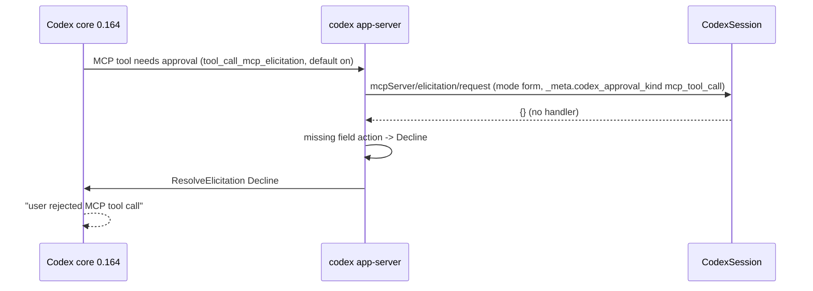
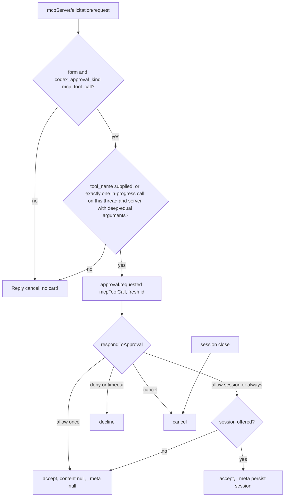
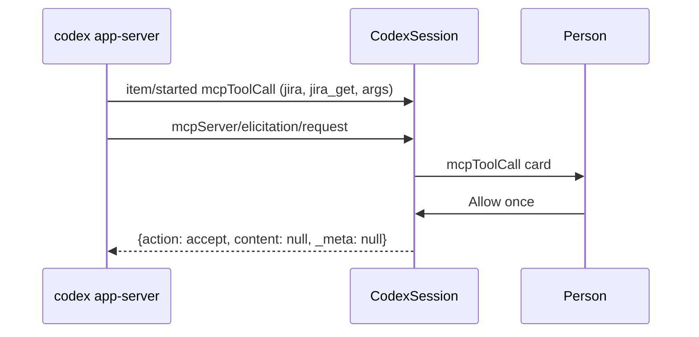

# Codex MCP tool approvals reach the person

## Current / Issue



Confirmed defect. `handleServerRequest` in `codex-adapter.ts` handles dynamic
tools, questions and three approval methods, then answers every other server
request with `{}`. Codex 0.164 sends every MCP tool approval as
`mcpServer/elicitation/request`: `tool_call_mcp_elicitation` is Stable and
enabled by default. App-server cannot deserialize `{}` as
`McpServerElicitationRequestResponse`, substitutes `Decline`, and core reports
"user rejected MCP tool call". No card is ever shown.

Runtime record, `~/.codex/logs_2.sqlite`: the Jira reads on 2026-10-25 logged
`ResolveElicitation { request_id: "mcp_tool_call_approval_exec-…", decision: Decline }`
at 16:03:08 and 16:08:19 on the conversation's Codex thread. Other processes
logged `failed to deserialize McpServerElicitationRequestResponse: missing field action`.

The approval's `_meta` carries `persist`, `tool_title`, `tool_description` and
`tool_params`, but 0.164 does not send the raw tool name. Chorus's remembered
grant is keyed `agent:mcpToolCall:<server> <toolName>`, so a title or the prompt
sentence is not a safe identity.

## Proposed



Reuse the existing `mcpToolCall` card, policy rules and remembered grants. No new
event type, renderer, protocol or i18n change.

Deliberately not done: generic form fields, `openai/form`, URL mode, other
approval kinds, MCP calls in the transcript, `serverRequest/resolved`.
Unsupported elicitations receive `cancel`. Chorus never sends `persist: "always"`,
so Codex never edits the user's config. Chorus's own remembered grant still covers
"always".

`rememberItem` stays ahead of the thread filter, because a worker's file-change
card needs the worker's item (`conformance.test.ts`). Each remembered item now
records its thread, and correlation requires the request's own thread.

## Code Changes

### `packages/adapter-codex/src/mapping.ts`

```ts
export const ELICITATION_METHOD = 'mcpServer/elicitation/request'

export interface RememberedItem {
  readonly threadId: string | null
  readonly item: ThreadItem
}

export function mapElicitationApproval(
  params: unknown,
  ctx: MapContext,
  remembered: Iterable<RememberedItem>,
  id: ApprovalId
): { readonly request: McpToolCallApproval; readonly offersSession: boolean } | null
```

It filters calls by thread, server and `inProgress` status, and compares arguments
with `isDeepStrictEqual` from `node:util`. It takes the tool name only when
`_meta.tool_name` is supplied or exactly one tool matches.

```ts
export function toElicitationResponse(
  decision: string,
  offersSession: boolean
): McpServerElicitationRequestResponse {
  switch (decision) {
    case 'accept':
      return { action: 'accept', content: null, _meta: null }
    case 'acceptForSession':
      return {
        action: 'accept',
        content: null,
        _meta: offersSession ? { persist: 'session' } : null,
      }
    case 'cancel':
      return ELICITATION_CANCEL
    default:
      return { action: 'decline', content: null, _meta: null }
  }
}
```

### `packages/adapter-codex/src/codex-adapter.ts`

```ts
if (method === ELICITATION_METHOD) return this.handleElicitation(params)
```

`handleElicitation` uses `newApprovalId()` and holds the request in
`openApprovals`. It also tracks the id in `openElicitations`, so `close()`
cancels only these. `recentItems` stores `{ threadId, item }`. The file-change
lookup reads `.item`.

### NEW: `packages/adapter-codex/src/elicitation.test.ts`

The tests use a fake transport and cover:

- the real empty-schema `_meta` shape
- the request staying pending until answered
- typed allow, deny, cancel and timeout replies
- offered and unoffered session persistence
- concurrent requests and repeated requests
- the same server with different tools
- ambiguous, finished and missing calls
- foreign-thread calls
- worker correlation
- close cancellation with a command approval left untouched
- cancellation of URL mode, `openai/form`, kind-less forms and other approval kinds

## Final Flow



## Acceptance and verification

- A Codex MCP approval shows the existing card and waits.
- Each answer maps to the typed response shown above.
- Timeout never accepts.
- Session persistence is sent only when offered, and `persist: "always"` is never sent.
- Unresolvable identity and unsupported requests are answered `cancel`.
- Command, file-change, permission and question paths are unchanged.

Not verified: that `item/started` precedes the elicitation on the wire in 0.164 is
read from source (`notify_mcp_tool_call_started` runs before
`maybe_request_mcp_tool_approval`), not observed. Approvals for Codex Apps
connectors whose rendered template replaces `tool_params` will not match the raw
arguments, so they are cancelled unless `tool_name` is sent.

## Sources

- `openai/codex` tag `rust-v0.164.0`: `core/src/mcp_tool_call.rs` (approval
  request, meta builder, response parsing), `app-server/src/bespoke_event_handling.rs`
  (response deserialization fallback), `features/src/lib.rs`
  (`tool_call_mcp_elicitation`), `protocol/src/mcp_approval_meta.rs` (meta keys).
- Generated bindings: `McpServerElicitationRequestParams`, `McpServerElicitationRequestResponse`.
- `~/.codex/logs_2.sqlite`, read-only.

## Status

| Stage                   | State                                                                                      |
| ----------------------- | ------------------------------------------------------------------------------------------ |
| Diagnosis               | Source chain and runtime decline records confirmed                                         |
| Plan                    | Approved by Codex for this scope                                                           |
| Implementation          | Implemented locally; source reviewed; runtime NOT VERIFIED                                 |
| Regression source       | `elicitation.test.ts` authored; NOT RUN                                                    |
| Typecheck, lint, format | NOT RUN                                                                                    |
| Build and install       | PASS — 2026-10-25; signed local build installed with the original app process kept running |
| Runtime acceptance      | NOT RUN — owner will relaunch later                                                        |
