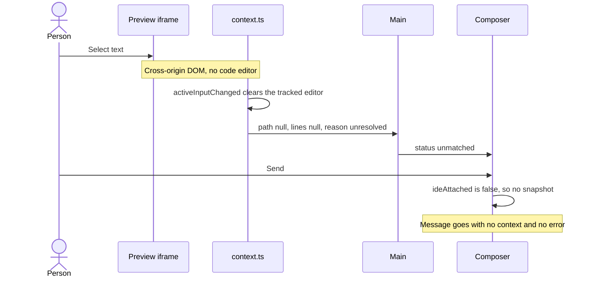
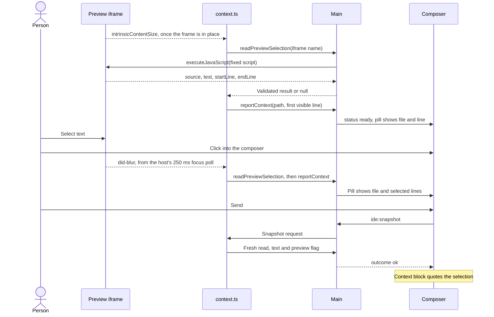
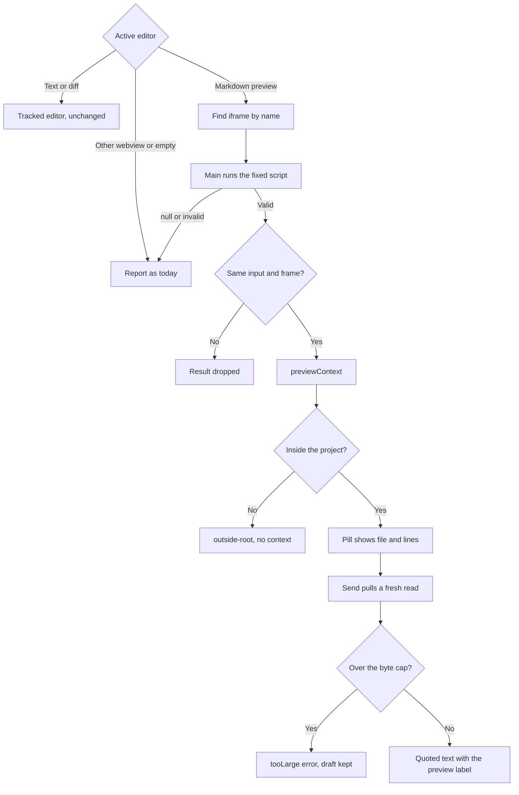

# Markdown preview selection reaches the agent

## Current / Issue



`WebviewInput.resource` uses the `webview-panel` scheme, which `resolveDocument`
refuses. The only reader of a selection is `ICodeEditor.getSelection()`.

## Proposed

Main reads the selection out of the active preview's frame, using a fixed script.
The surface decides when to ask and which frame, then builds the same
`WorkbenchContext` shape the editor already reports. No extension and no bridge
in hosted content.



Why this route:

| Option                                             | Verdict        | Reason                                                                                                                                |
| -------------------------------------------------- | -------------- | ------------------------------------------------------------------------------------------------------------------------------------- |
| `webFrameMain.executeJavaScript` from main         | **Chosen**     | No third-party change, no bridge in hosted content, sender already validated                                                          |
| An `IWebview` or `IOverlayWebview` member          | Does not exist | They expose focus, messages, state and clipboard actions, with no selected-text getter                                                |
| Markdown preview messages                          | Does not exist | Its handlers cover scrolling and clicks, not selected text                                                                            |
| `markdown.previewScripts` from a bundled extension | Rejected       | `acquireVsCodeApi` is already taken by `media/index.js`, so it needs a new transport; `context.ts` records why an extension is weaker |
| Patching `pre/index.html`                          | Rejected       | Forks a vendored asset and breaks on every Code-OSS bump                                                                              |
| `IWebview.copy()` then read the clipboard          | Rejected       | Overwrites the person's clipboard                                                                                                     |
| CDP through `webContents.debugger`                 | Rejected       | Conflicts with DevTools, far more machinery                                                                                           |

Facts this rests on:

- `webviewElement.js:370` sets `element.name = this.id`, so a frame is addressable
  by name. `origin` is documented as "may not be unique", so it cannot separate
  two previews.
- `pre/index.html` reaches `getActiveFrame().contentDocument`, so the host frame
  can read the inner document.
- The preview writes `data-settings` with the document's own `source` URI into
  `#vscode-markdown-preview-data`. Driving the app showed it is `file:`, not
  `vscode-remote:` as first assumed, because the remote extension host rewrites URIs.
  `resolveDocument` accepts both, but working copies are keyed on `vscode-remote:`, so
  the unsaved check matches on path.
- Blocks carry `.code-line[data-line]`, 0-based, with a trailing empty sentinel at
  `lineCount`. Raw HTML gets an empty marker **before** it, and front matter gets none.
- `pre/index.html:1086-1108` names the frame `active-frame` and then posts
  `updated-intrinsic-content-size`. `WebviewElement` and `OverlayWebview` forward it
  through the public `intrinsicContentSize` observable, which is the readiness signal.
- `createWebviewPanel` passes no `retainContextWhenHidden`, so a hidden preview has
  no frame to read, and returning to it creates a new frame with a new name.
- `IWebviewService.activeWebview` clears on blur, so it cannot stand in for the
  active editor input once focus is in the composer.
- `WorkbenchSnapshotResult` has no runtime schema, because main casts it.
  `IdeSnapshotResult` is parsed by main and by the shell preload, so it must gain the
  new field.

### Acceptance criteria

1. Selecting in a project `.md` preview and sending gives the agent the file,
   line range and selected text.
2. The pill shows `file:lines` once focus leaves the preview.
3. No selection in a preview: the pill and context name the file and the line at the
   top of the viewport, with no quoted text.
4. Two previews side by side: only the active one is read.
5. Switching to a text editor reports that editor exactly as today.
6. Other webviews (PDF, DOCX, Excalidraw) behave exactly as today.
7. A preview of a file outside the project reports `outside-root`, as an editor does.
8. A selection over `MAX_SELECTED_BYTES` gets the existing `tooLarge` error.
9. A restored session with a preview already active reports without a click, however
   late the frame loads.
10. A failed read answers within the existing snapshot budget. The composer shows its
    existing error and keeps the draft.
11. A switch of tab during a read never reports or quotes the previous preview.
12. Selected text maps to its own source block, including a parent list item with a
    nested child, a triple-click ending at the next block, raw HTML and front matter.
13. A preview selection never decorates an approval refusal.

### Deliberately not doing

- Other webviews, including PDF and DOCX.
- Exact character positions. Lines are the enclosing block.
- Mapping rendered text back to raw Markdown.
- A model version on a preview. The extension debounces rendering, so the current
  model version may not match what is on screen. The agent reads the file before
  editing.
- The external VS Code bridge.

## Code Changes

### `apps/desktop/src/main/preview-selection.ts` (new)

The script stays a string literal, because a serialised function picks up bundler
helpers. It looks at the selected characters of each text node, so a boundary at
offset zero selects nothing and a parent keeps its own line. Text with no enclosing
marker takes the nearest marker before it, which is the raw HTML block's own marker;
front matter has none before it and starts at line 1.

```ts
export const READ_PREVIEW_SELECTION = String.raw`(() => {
  const frame = document.getElementById('active-frame')
  const doc = frame?.contentDocument
  const win = frame?.contentWindow
  const data = doc?.getElementById('vscode-markdown-preview-data')
  if (!doc || !win || !data) return null
  const { source } = JSON.parse(data.getAttribute('data-settings') ?? '{}')
  if (typeof source !== 'string') return null
  const markers = Array.from(doc.querySelectorAll('.code-line[data-line]'))
  const lineOf = (marker) => Number(marker.getAttribute('data-line'))
  const sentinel = markers[markers.length - 1]
  const lineCount = sentinel === undefined ? 1 : Math.max(1, lineOf(sentinel))
  const display = (line) => Math.min(line + 1, lineCount)
  const atViewportTop = () => {
    const above = markers.filter((marker) => marker.getBoundingClientRect().top <= 0)
    const top =
      above[above.length - 1] ??
      (doc.querySelector('.frontmatter, .frontmatter-error') === null ? markers[0] : undefined)
    const line = display(top === undefined ? 0 : lineOf(top))
    return { source, text: '', startLine: line, endLine: line }
  }
  const selection = win.getSelection()
  const text = selection?.toString() ?? ''
  if (text.trim() === '' || selection.rangeCount === 0) return atViewportTop()
  const range = selection.getRangeAt(0)
  const ancestor = range.commonAncestorContainer
  const root = ancestor.nodeType === 1 ? ancestor : ancestor.parentNode
  const walker = doc.createTreeWalker(root, 4)
  let first = null
  let last = null
  for (let node = walker.nextNode(); node !== null; node = walker.nextNode()) {
    if (!range.intersectsNode(node)) continue
    const from = node === range.startContainer ? range.startOffset : 0
    const to = node === range.endContainer ? range.endOffset : node.length
    if (node.data.slice(from, to).trim() === '') continue
    const marker =
      node.parentElement?.closest('.code-line[data-line]') ??
      markers.filter((candidate) => candidate.compareDocumentPosition(node) & 4).pop()
    const line = marker === undefined ? 0 : lineOf(marker)
    first = first === null ? line : Math.min(first, line)
    last = last === null ? line : Math.max(last, line)
  }
  if (first === null || last === null) return atViewportTop()
  const next = markers.find((marker) => lineOf(marker) > last)
  return {
    source,
    text,
    startLine: display(first),
    endLine: next === undefined ? display(last) : lineOf(next),
  }
})()`
```

### `apps/desktop/src/shared/workbench-ipc.ts`

`preview` stays off the strict `WorkbenchContext`, so the push never carries it.

```ts
export const WORKBENCH_PREVIEW_SELECTION_CHANNEL = 'workbench:preview-selection'

export const PreviewSelection = z
  .object({
    source: z.string().min(1),
    text: z.string(),
    startLine: z.number().int().min(1),
    endLine: z.number().int().min(1),
  })
  .strict()
export type PreviewSelection = z.infer<typeof PreviewSelection>

export type WorkbenchSnapshot = WorkbenchContext & {
  readonly text: string
  readonly preview?: true
}

export interface WorkbenchSnapshotResult {
  readonly requestId: string
  readonly snapshot: WorkbenchSnapshot | null
}
```

On the surface API, add
`readPreviewSelection: (frameName: string) => Promise<PreviewSelection | null>`, and
return `WorkbenchSnapshot` from the `onSnapshotRequest` handler.

### `apps/desktop/src/preload/workbench.ts`

The sandboxed preload cannot import zod at runtime, so it checks each field by hand
and keeps its own copy of the channel name. Main does the strict validation.
`readPreviewSelection` also joins the exact-order member list in
`apps/desktop/src/preload/workbench.test.ts`, right after `readClipboard`.

```ts
readPreviewSelection: async (frameName): Promise<PreviewSelection | null> => {
  const raw: unknown = await ipcRenderer.invoke(PREVIEW_SELECTION_CHANNEL, frameName)
  if (typeof raw !== 'object' || raw === null) return null
  const { source, text, startLine, endLine } = raw as Record<string, unknown>
  if (
    typeof source !== 'string' ||
    source === '' ||
    typeof text !== 'string' ||
    typeof startLine !== 'number' ||
    !Number.isInteger(startLine) ||
    startLine < 1 ||
    typeof endLine !== 'number' ||
    !Number.isInteger(endLine) ||
    endLine < 1
  ) {
    return null
  }
  return { source, text, startLine, endLine }
},
```

### `apps/desktop/src/main/workbench-surface.ts`

Direct children of the surface's main frame only, so nothing a webview nests can
answer to the name. The surface names a frame; it cannot supply the script.

```ts
ipcMain.handle(
  WORKBENCH_PREVIEW_SELECTION_CHANNEL,
  async (event, frameName: unknown): Promise<PreviewSelection | null> => {
    if (!byContents.has(event.sender) || !fromMainFrame(event))
      throw new Error('unknown workbench surface')
    if (typeof frameName !== 'string' || frameName === '')
      throw new Error('Frame name must be text')
    const frame = event.sender.mainFrame.frames.find((child) => child.name === frameName)
    if (frame === undefined) return null
    const raw: unknown = await Promise.race([
      frame.executeJavaScript(READ_PREVIEW_SELECTION).catch(() => null),
      new Promise((resolve) => setTimeout(() => resolve(null), 500)),
    ])
    const parsed = PreviewSelection.safeParse(raw)
    return parsed.success ? parsed.data : null
  }
)
```

### `apps/desktop/src/renderer/src/workbench/context.ts`

The view types are the ones the extension's own `when` clauses name as `webviewId`.
`container` throws after disposal, and this never calls `claim()`.

```ts
const PREVIEW_VIEW_TYPES = new Set(['markdown.preview', 'vscode.markdown.preview.editor'])

function previewWebview(input: unknown): IOverlayWebview | null {
  const webview = (input as { webview?: IOverlayWebview } | null)?.webview
  return webview !== undefined && PREVIEW_VIEW_TYPES.has(webview.providedViewType ?? '')
    ? webview
    : null
}

function previewFrameName(webview: IOverlayWebview): string | null {
  try {
    return webview.container.querySelector('iframe')?.name ?? null
  } catch {
    return null
  }
}

async function readActivePreview(editors: IEditorService): Promise<PreviewSelection | null> {
  const input = editors.activeEditor ?? null
  const activation = previewActivation
  const webview = previewWebview(input)
  const frameName = webview === null ? null : previewFrameName(webview)
  if (webview === null || frameName === null) return null
  const read = await window.chorusWorkbench.readPreviewSelection(frameName).catch(() => null)
  return activation === previewActivation &&
    editors.activeEditor === input &&
    previewFrameName(webview) === frameName
    ? read
    : null
}

function previewContext(
  projectRoot: string,
  editorTypeId: string,
  read: PreviewSelection,
  workingCopies: IWorkingCopyService
): WorkbenchContext {
  const uri = URI.parse(read.source)
  const document = resolveActive(projectRoot, editorTypeId, uri)
  return {
    relativePath: document.relativePath,
    provenance: document.provenance,
    scheme: document.scheme,
    editorTypeId: document.editorTypeId,
    reason: document.reason,
    startLine: read.startLine,
    endLine: read.endLine,
    isEmpty: read.text === '',
    isDirty: workingCopies.dirtyWorkingCopies.some((copy) => copy.resource.path === uri.path),
    languageId: 'markdown',
    selectedBytes: new TextEncoder().encode(read.text).length,
    version: null,
  }
}
```

`readEditorSnapshot`, ahead of the tracker read. A null read falls through to the
existing body, which refuses the `webview-panel` resource and reports no path.

```ts
const preview = await readActivePreview(editors)
if (preview !== null) {
  return {
    ...previewContext(projectRoot, editors.activeEditor?.typeId ?? '', preview, workingCopies),
    text: preview.text,
    ...(preview.text === '' ? {} : { preview: true as const }),
  }
}
```

`reportEditorContext`. `report()` uses `lastPreview` when it is set, so it stays
synchronous and keeps its dedupe. The size signal is only used until the first
successful read, so dragging a divider does not read on every frame. A failed read
keeps the last good value within one activation: dropping it would turn the pill off
and make Send skip the snapshot, so the failure would never reach the person.
`previewActivation` is module-level so a snapshot and a report share one generation,
which also catches a return to the same tab.

```ts
let lastPreview: PreviewSelection | null = null
let previewRefresh = 0
const previewEvents = new DisposableStore()

const refreshPreview = (): void => {
  const refresh = ++previewRefresh
  void readActivePreview(editors).then((read) => {
    if (refresh !== previewRefresh) return
    lastPreview = read ?? lastPreview
    report()
  })
}

const watchPreview = (): void => {
  previewEvents.clear()
  previewRefresh += 1
  previewActivation += 1
  lastPreview = null
  const webview = previewWebview(editors.activeEditor ?? null)
  if (webview === null) return
  previewEvents.add(webview.onDidFocus(refreshPreview))
  previewEvents.add(webview.onDidBlur(refreshPreview))
  previewEvents.add(
    webview.onDidDispose(() => {
      previewRefresh += 1
      previewActivation += 1
      lastPreview = null
      report()
    })
  )
  previewEvents.add(
    autorun((reader) => {
      reader.readObservable(webview.intrinsicContentSize)
      if (lastPreview === null) refreshPreview()
    })
  )
}
```

`watchPreview()` runs at startup and first in `onDidActiveEditorChange`.

### `apps/desktop/src/shared/ipc.ts` and `apps/desktop/src/main/ipc.ts`

```ts
preview: z.literal(true).optional(),
```

```ts
...(embedded.preview === true ? { preview: true as const } : {}),
```

### `apps/desktop/src/main/runtime.ts`

`withSelection` labels any selected text with the approval's filename, and a preview
selection would newly qualify.

```ts
if (snapshot === undefined || snapshot === null || snapshot.preview === true) return decision
```

### `apps/desktop/src/renderer/src/editor-context.ts`, `Composer.tsx`, `i18n/en.json`

```ts
const rendered = block.preview === true ? ` (${labels.preview})` : ''
const head = `${labels.heading}: \`${reference}\`${at}${suffix}${rendered}`
```

```ts
preview: t('ide.preview'),
```

```json
"preview": "from the rendered preview; lines are the enclosing block"
```

### Tests, written and not run until asked

- `apps/desktop/src/main/preview-selection.test.ts`, jsdom: a parent and nested child
  selected together, a triple-click ending at the next block's offset 0, a selection
  ending at offset 0 of the next block's text node, raw HTML, front matter, the
  sentinel, no selection.
- `apps/desktop/src/renderer/src/editor-context.test.ts`: the preview label, plus
  `preview` on the shared `labels`.

## Final Flow



## Verification

`apps/desktop/e2e/preview-selection-drive.mjs` drives a separate Electron build on
temporary profiles, with real mouse input, real focus moves and one real `claude`
turn. Last run: 46 of 46 checks held.

| Acceptance criterion               | Result       | Evidence                                                                                   |
| ---------------------------------- | ------------ | ------------------------------------------------------------------------------------------ |
| 1. Agent gets file, lines and text | PASS         | The logged message carries them, and the agent replied with the selected text              |
| 2. Pill after focus leaves         | PASS         | `readme.md:7-9 → readme.md:13-14`, and it does not move while focus stays                  |
| 3. No selection                    | PASS         | Pill `readme.md:1`, nothing quoted                                                         |
| 4. Two previews side by side       | PASS         | Panel and custom editor at once, only the active one read                                  |
| 5. Text editor unchanged           | PASS         | Raw text, lines and a model version, no preview flag                                       |
| 6. Other webviews unchanged        | NOT VERIFIED | Only by reading the view type filter                                                       |
| 7. File outside the project        | NOT VERIFIED | Only by reading `resolveActive`                                                            |
| 8. Over the byte cap               | PASS         | 103,288 bytes gives `tooLarge`                                                             |
| 9. Restored session                | PASS         | Pill returns with no click, from `workbench.editors.webviewInput`                          |
| 10. Failed read                    | NOT VERIFIED | Only by reading; no failure was injected                                                   |
| 11. Tab switch during a read       | NOT VERIFIED | Only by reading the generation guard                                                       |
| 12. Line mapping                   | PASS         | Nested list, raw HTML and front matter against the real render; triple-click by real mouse |
| 13. Approval refusal               | NOT VERIFIED | Only by reading the guard in `withSelection`                                               |

The unsaved check failed without the path match (`isDirty: false` while the tab showed
unsaved) and passes with it.

The pill's timing varies by design. If the preview did not already hold focus, the
first click updates it through `did-focus`. Otherwise it waits for focus to leave.

## Decisions

- Pill timing: it updates when focus changes, not while dragging. Send always reads
  fresh.
- Quoted text: rendered text exactly as selected, not raw Markdown.
