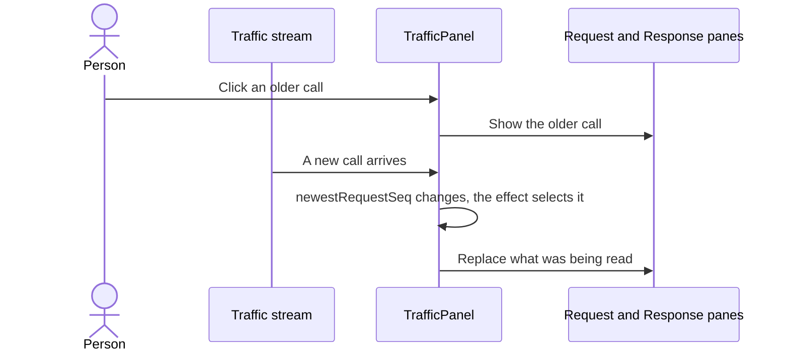
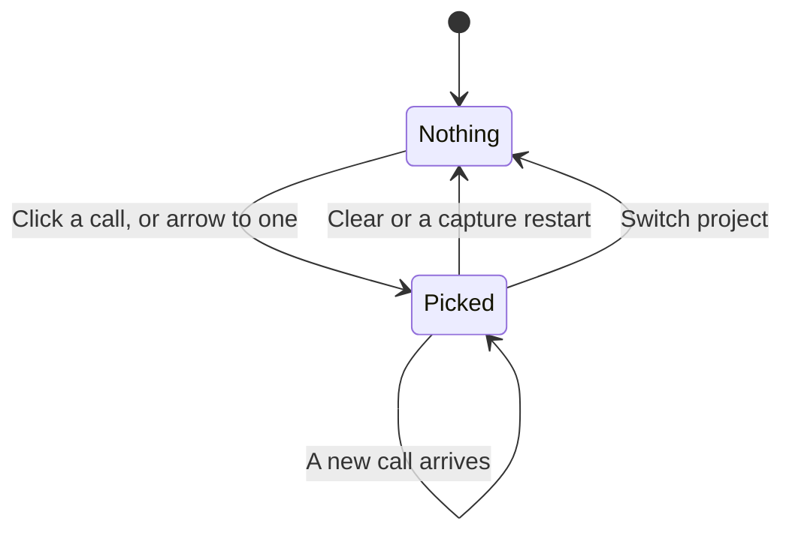
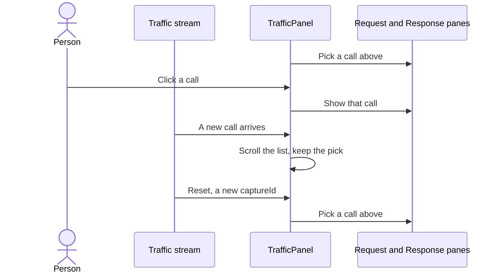

# Traffic stops selecting the newest call

## Status

| Unit           | Result                                                                                                                                  |
| -------------- | --------------------------------------------------------------------------------------------------------------------------------------- |
| Scope          | Selection belongs to the person; the list still scrolls to the newest                                                                   |
| Implementation | Written and source reviewed; runtime behaviour unverified                                                                               |
| Verification   | Not run; tests and the app have not been driven for this change                                                                         |
| Supersedes     | The selection half of plan 40; its scrolling stands                                                                                     |
| Ported         | Applied to `feat/chorus-vscode-extension` 2026-11-06 by `git apply` from `~/code/workbench`'s uncommitted diff; changed lines identical |

## Current / Issue



## Proposed



`Nothing` shows the existing `traffic.noSelection` text in the inspector.

### Deliberately not doing

- Changing the scroll. The list still follows the newest row, as plan 40 made it.
- Selecting the first call of a capture, which is what the panel did before plan 40.
- Keeping a pick across a remount. It lives in the panel's own state.

## Code Changes

### `apps/desktop/src/renderer/src/TrafficPanel.tsx`

`newestRequestSeq` goes, and the effect keeps only the reset. It has to stay: a
sequence restarts at 0 on Clear and belongs to one project, so an old pick could
otherwise name a different call.

```tsx
useEffect(() => {
  setSelectedSeq(null)
}, [projectId, stream.projectId, stream.captureId])
```

`selected` already looks a row up in `stream.rows`, not in the visible list. A picked
call that the call limit or a search hides keeps its panes and loses its highlight.

### `apps/desktop/src/renderer/src/TrafficPanel.test.tsx`

`selects the first call of the project being switched to` is replaced by three tests
in `picking a call`, written and not run:

```tsx
it('selects nothing until a call is picked, and a newer call leaves the pick alone', async () => {
  const emit = installWithPushes({ p1: [httpRow(1), httpRow(2)] })
  const { container } = render(<TrafficPanel projectId="p1" terminals={[]} />)
  await act(() => Promise.resolve())

  expect(pickedSeq(container)).toBeNull()
  expect(container.querySelector('.traffic-inspector--empty')).not.toBeNull()

  await pick(container, 1)
  emit({
    kind: 'rows',
    projectId: 'p1',
    subscriptionId: 'sub-p1',
    captureId: 'cap-p1',
    seq: 3,
    rows: [httpRow(3)],
  })

  expect(pickedSeq(container)).toBe('1')
})
```

The other two reuse a sequence across a Clear and across a project switch, and expect
no selection.

### `apps/desktop/e2e/traffic-drive.mjs`

The first inspector check now expects nothing selected, then clicks the last row, which
is the call the later checks were already reading. The `/gz` step clicks its row
unconditionally.

Not changed: `and it does not move a list somebody has scrolled away from` looks stale
since plan 40, because the list now always scrolls to the newest row.

## Final Flow


