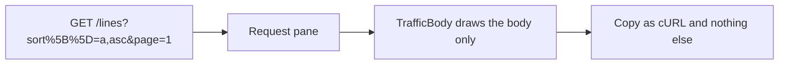
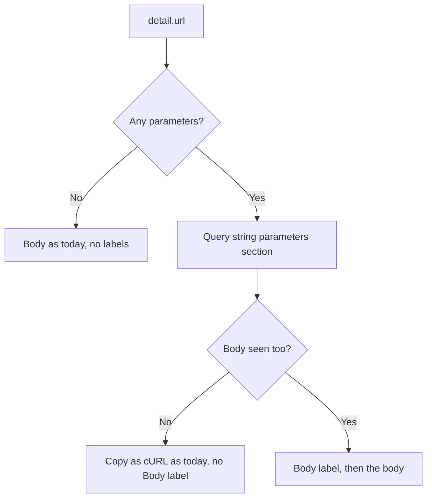
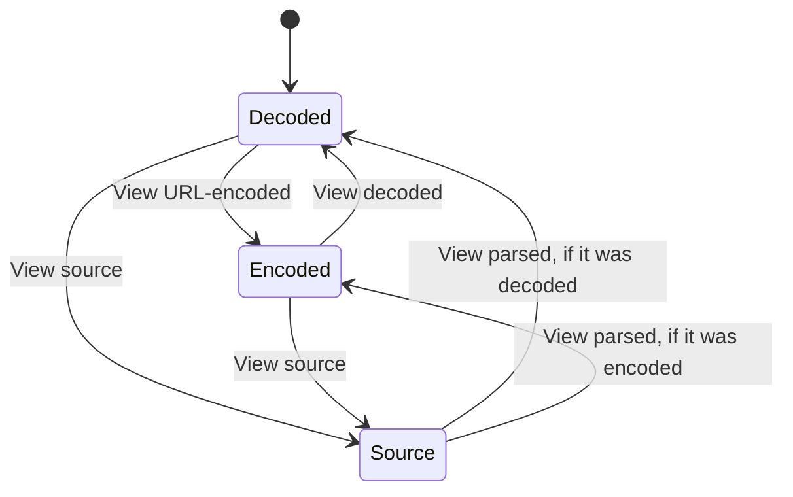
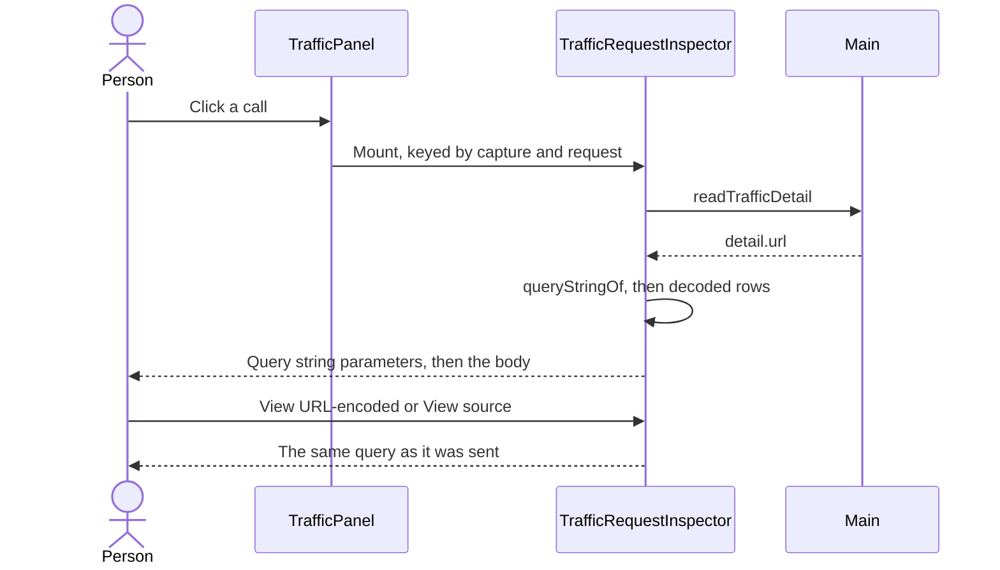

# Traffic shows query string parameters

## Status

| Unit           | Result                                                                                                                                                      |
| -------------- | ----------------------------------------------------------------------------------------------------------------------------------------------------------- |
| Scope          | The Request pane lists a call's query, as Chrome's Payload does                                                                                             |
| Endpoint list  | The Endpoint column drops the query, on the row and on hover                                                                                                |
| Implementation | Written and source reviewed; runtime behaviour unverified                                                                                                   |
| Verification   | Not run; tests and the app have not been driven for this change                                                                                             |
| Ported         | Applied to `feat/chorus-vscode-extension` 2026-11-06 by `git apply` from `~/code/workbench`'s uncommitted diff; changed lines identical. Plan 78 not ported |

## Current / Issue



## Proposed





The section takes Chrome's heading, its two buttons and one row per occurrence, so a
repeated name is two rows and not an array. Values are plain text with no JSON quoting,
and an empty value reads `(empty)`.

### Differences from Chrome

| Case             | Chrome                     | Here                            |
| ---------------- | -------------------------- | ------------------------------- |
| Malformed `%zz`  | `(unable to decode value)` | Shown as sent                   |
| Another call     | Its own panel state        | Both buttons return to defaults |
| Name of the body | `Request Payload`          | `Body`, only beside a query     |

### Deliberately not doing

- Masking. A `?token=` shows in full in this section.
- Changing Copy as cURL, which already carries the query in its URL.
- Changing search, which still matches the query, or `read_traffic`, which has its own
  `pathOf` in `project-read.ts` and still returns it.

## Code Changes

### `apps/desktop/src/renderer/src/traffic-body.ts`

`detail.url` is the raw `req.url`, so the source view is what the app sent. The decoded
rows reuse `formFields`.

```ts
export const encodedFields = (text: string): readonly (readonly [string, string])[] =>
  text
    .split('&')
    .filter((part) => part !== '')
    .map((part): readonly [string, string] => {
      const at = part.indexOf('=')
      return at === -1 ? [part, ''] : [part.slice(0, at), part.slice(at + 1)]
    })

export const queryStringOf = (url: string): string => {
  const [beforeFragment = ''] = url.split('#', 1)
  const start = beforeFragment.indexOf('?')
  return start === -1 ? '' : beforeFragment.slice(start + 1)
}
```

### `apps/desktop/src/renderer/src/TrafficRequestInspector.tsx`

```tsx
const [querySource, setQuerySource] = useState(false)
const [queryEncoded, setQueryEncoded] = useState(false)

const query = detail === null ? '' : queryStringOf(detail.url)
const queryRows = (queryEncoded ? encodedFields(query) : formFields(query)).map(
  ([name, value]): readonly [string, string] => [
    name,
    value === '' ? t('traffic.emptyValue') : value,
  ]
)
```

The buttons sit in the `summary`, so each calls `event.preventDefault()` to stop a press
from also folding the section.

```tsx
{
  queryRows.length > 0 && (
    <details className="traffic-query" open>
      <summary>
        {t('traffic.queryParameters')}
        <button
          type="button"
          className="traffic-tab"
          onClick={(event) => {
            event.preventDefault()
            setQuerySource((shown) => !shown)
          }}
        >
          {querySource ? t('traffic.viewParsed') : t('traffic.viewSource')}
        </button>
        {!querySource && (
          <button
            type="button"
            className="traffic-tab"
            onClick={(event) => {
              event.preventDefault()
              setQueryEncoded((shown) => !shown)
            }}
          >
            {queryEncoded ? t('traffic.viewDecoded') : t('traffic.viewEncoded')}
          </button>
        )}
      </summary>
      {querySource ? <pre className="traffic-body-text">{query}</pre> : pairList(queryRows)}
    </details>
  )
}

{
  queryRows.length > 0 && detail.requestBody.observedBytes > 0 && (
    <h3 className="traffic-label">{t('traffic.bodyHeading')}</h3>
  )
}
```

### `apps/desktop/src/renderer/src/i18n/en.json`

```json
"queryParameters": "Query string parameters",
"viewSource": "View source",
"viewParsed": "View parsed",
"viewEncoded": "View URL-encoded",
"viewDecoded": "View decoded",
"emptyValue": "(empty)",
"bodyHeading": "Body",
```

### `apps/desktop/src/renderer/src/styles.css`

`.traffic-query` does not reuse `.traffic-fold`, because `traffic-drive.mjs` finds
Headers and timing as the request pane's first `.traffic-fold`.

```css
.traffic-query {
  flex: 0 0 auto;
}

.traffic-query > summary {
  padding: var(--step) calc(var(--step) * 2);
  color: var(--text-secondary);
  font-size: 11px;
  font-weight: 600;
  cursor: pointer;
}

.traffic-query > summary .traffic-tab {
  margin-left: calc(var(--step) * 2);
  border-color: var(--border-default);
  border-radius: 999px;
  font-weight: 400;
}
```

### `apps/desktop/src/renderer/src/traffic-filter.ts`

The section above is now where a query is read, so the list stops repeating it.
`TrafficEndpoint`'s hover repeats the row's label, so it drops the query too, and calls
that differ only by query look the same until one is clicked.

```ts
export const pathOf = (url: string, hiddenPathPrefix = ''): string => {
  let path: string
  try {
    path = new URL(url).pathname
  } catch {
    const [beforeQuery = ''] = url.split('?', 1)
    path = beforeQuery
  }
  const prefix = hiddenPathPrefix.trim().replace(/\/+$/, '')
  if (!prefix.startsWith('/') || /[?#]/.test(prefix)) return path
  if (path === prefix) return '/'
  return path.startsWith(`${prefix}/`) ? path.slice(prefix.length) : path
}
```

### Tests, written and not run

- `apps/desktop/src/renderer/src/traffic-body.test.ts`: `queryStringOf` on absolute and
  relative URLs, a fragment and no query; `encodedFields` on repeats, a bare name, an
  empty value and a value holding `=`.
- `apps/desktop/src/renderer/src/TrafficRequestInspector.test.tsx`: decoded rows with no
  body label, both views, the body label beside a query, and nothing drawn with no query.
- `apps/desktop/src/renderer/src/traffic-filter.test.ts`: `pathOf` drops the query from
  absolute and relative URLs, with and without a prefix.

## Final Flow


