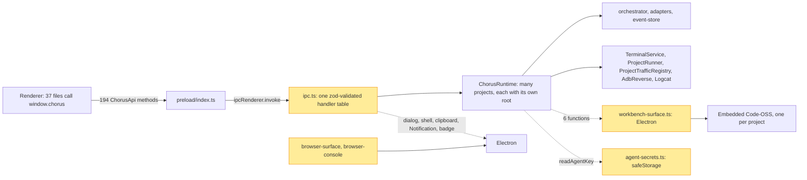
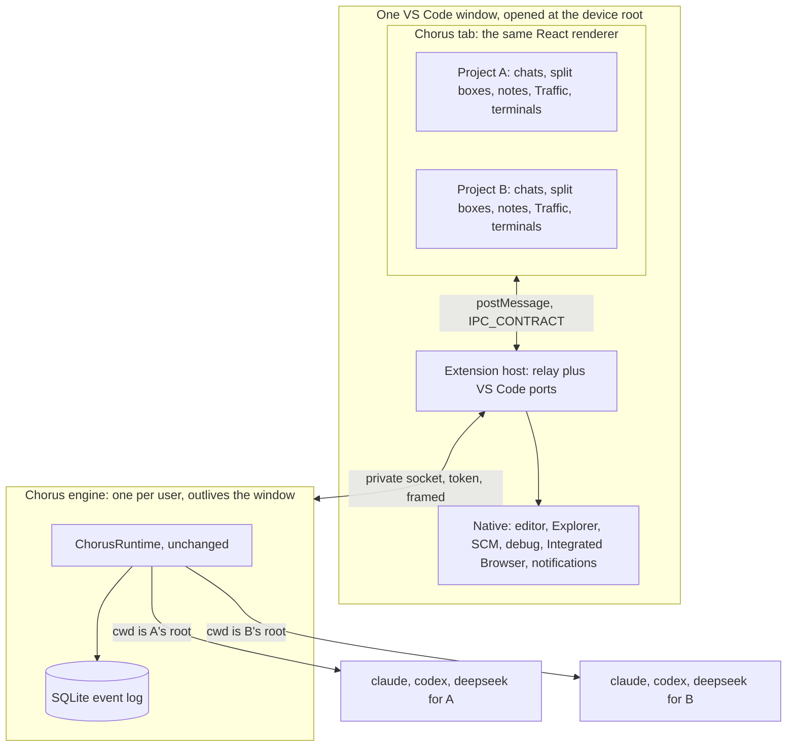
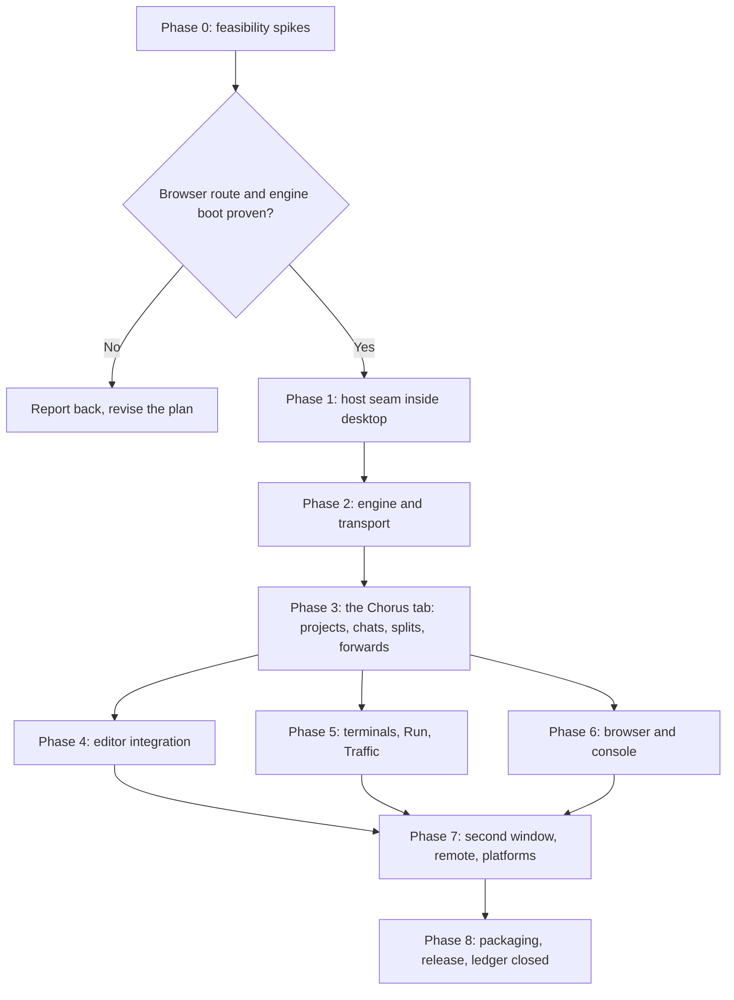
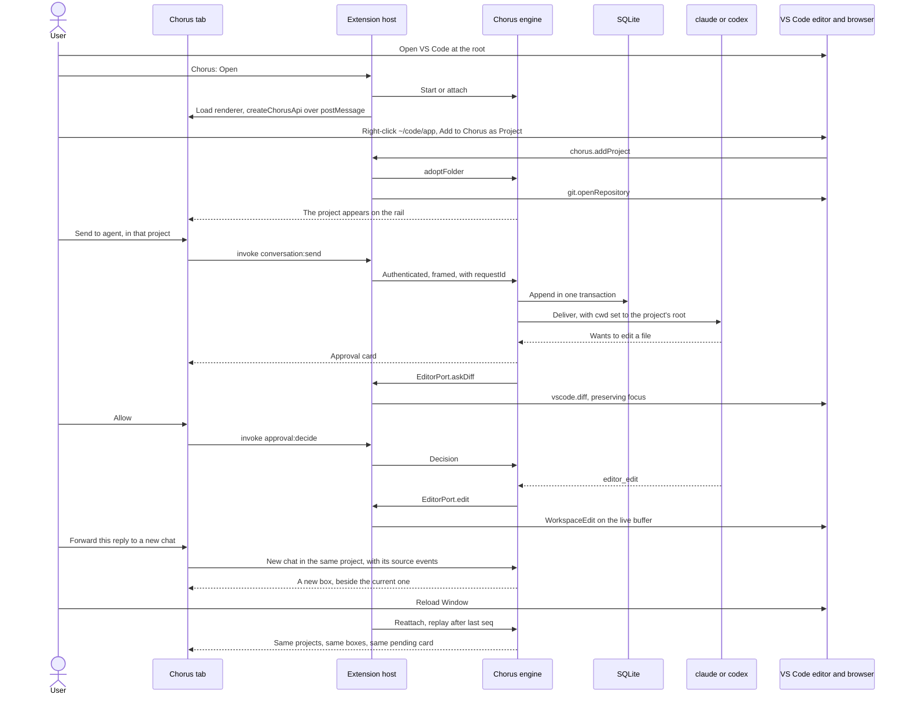

# Chorus as a full VS Code extension

## Status

| Unit               | Result                                                                                              |
| ------------------ | --------------------------------------------------------------------------------------------------- |
| Scope              | Research and plan. No product code is written by this document                                      |
| Source evidence    | Read from this repo, the `chorus-extension` repo on GitHub, and `microsoft/vscode`                  |
| Feature ledger     | Complete from a read-only sweep: 211 features. Static reading, nothing launched                     |
| Feasibility spikes | Run. Results below. Sections further down keep their original wording as the plan that was approved |
| User decisions     | 2026-11-05: all settled. Replanned around one window with many projects. See Decisions              |
| codex challenge    | Two rounds, from source and docs, the second on the one-window model. Supported findings applied    |
| Approval           | Approved 2026-11-05. Built and verified, see Final verification. Nothing is committed               |

## Build log

The user approved a full build on 2026-11-05. It runs in the worktree `~/code/workbench-vscode` on branch
`feat/chorus-vscode-extension`, from `35648fd`, so the uncommitted Traffic work in `~/code/workbench` is untouched. Nothing is
committed, pushed or published without the user asking.

**Phase 0, observed in VS Code 1.145.0 Stable on an M4 Mac, isolated profile:**

| Test                  | Result                                                                                                                                                                                                                                  | Consequence                                                                                               |
| --------------------- | --------------------------------------------------------------------------------------------------------------------------------------------------------------------------------------------------------------------------------------- | --------------------------------------------------------------------------------------------------------- |
| Browser API on Stable | **Pass.** With `--enable-proposed-api`: `openBrowserTab`, `Target.getTargets`, `Target.attachToTarget` with `flatten`, `Runtime.consoleAPICalled` with values, `Runtime.evaluate`, `Page.navigate`, `onDidChangeBrowserTabState`, close | Route 1 is the route. The `argv.json` form is still to be observed at install                             |
| Stable fallback       | **Not usable as tried.** `requestCDPProxy` on the launch session did not answer within a minute                                                                                                                                         | Not pursued, since a private VSIX was chosen. If the flag is missing, Chorus says so and offers to set it |
| Native modules        | **Pass.** `better-sqlite3` and `node-pty` load under VS Code's own Node 24 (`ELECTRON_RUN_AS_NODE`), from the worktree. The test printed `ELECTRON_RUN_AS_NODE=1` in the child shell                                                    | Confirms the environment scrub is needed. The VSIX layout and the real runtime are tested in later phases |
| VS Code at `/`        | **Not a blocker.** 70 seconds idle: 2 to 5% CPU in total, about 1.2 GB across 9 processes, no watcher errors, Git scan harmless. Search and heavy file churn not measured                                                               | The user's root window stands                                                                             |

**Deviation: no move into `packages/`.** `apps/engine` and `apps/extension` import from `apps/desktop/src` directly, and esbuild
bundles it. The move was only ever tidiness, and it would collide with the uncommitted Traffic work on every renderer file. The
one-code-two-hosts property holds without it. Forbidding `electron` moves from a package boundary to a test over the import closure.

**Later build decisions, each from evidence:**

| Decision                                                                                                               | Why                                                                                                                                                                               |
| ---------------------------------------------------------------------------------------------------------------------- | --------------------------------------------------------------------------------------------------------------------------------------------------------------------------------- |
| Project terminals stay in the webview, with no `Pseudoterminal` bridge                                                 | `TerminalView` over the engine's `TerminalService` already gives each project its own shells, with `vim` proven. A bridge would have added code and lost the per-project grouping |
| One editor route, `EditorPort`. `IdeBridge` is not hosted                                                              | `conversationsForPlace` already routes reports by project. A second socket adds nothing                                                                                           |
| A Chorus-owned Markdown preview, with the built-in preview as a named gap                                              | No route out of the built-in preview's frame was found. `markdown.api.render` in a webview gives the same selection mapping                                                       |
| Route 2 for the browser dropped                                                                                        | `requestCDPProxy` did not answer as tried, and a private VSIX makes route 1 sufficient. Without the flag, Chorus explains and offers to set it                                    |
| The extension connects at startup only if its data directory exists                                                    | A window that never used Chorus must not spawn an engine                                                                                                                          |
| A native notification is sent only when Chorus is not showing in a focused window, to the most recently focused window | Otherwise the in-page toast shows, and one event never raises two prompts                                                                                                         |

**Who did what:** codex wrote Phases 1 to 3, 5 and most of 4 and 6, then hit a model capacity error. The user asked claude to take over, and claude
finished Phase 4 and 6 verification and wrote attention, window identity, secret propagation, the coverage record, docs and the release job.

## Final verification

Observed on 2026-11-05 in VS Code 1.145.0 Stable on an M4 Mac, with real `claude` and `codex` agents, on the final VSIX.

| Check                               | Result                                                                                                                                                          |
| ----------------------------------- | --------------------------------------------------------------------------------------------------------------------------------------------------------------- |
| Scripted drivers                    | shell 25, editor 12, browser 10, polish 7, window 10 (at the real `/`), remote 5 (real Remote-SSH to a loopback server), argv 2                                 |
| Permanent `argv.json` route         | Pass. A real page opened in VS Code's browser tab with no command-line flag                                                                                     |
| Desktop regression                  | `project-close-drive`: all held. Three older desktop specs fail the same way on the untouched base                                                              |
| Unanswered calls, before and after  | Before: `getAppInfo`, `probeAgents`, `profiles`, `refreshLimits` never answered. After: all answer within 582 ms                                                |
| By hand, in a clean copy of VS Code | Trust page, Chorus opening with real clicks, the native folder dialog, typed message, Return, real agent reply with the right path, updating over a live engine |

**Hands-on testing found what the drivers could not.** They reach the app through a debugging protocol, so they never see a native sheet, and nothing
asserted these calls were answered.

| Found by hand                                                        | Cause                                                                                                                                                                                                                   | Fix                                                                                                               |
| -------------------------------------------------------------------- | ----------------------------------------------------------------------------------------------------------------------------------------------------------------------------------------------------------------------- | ----------------------------------------------------------------------------------------------------------------- |
| "Chorus could not connect to its engine", 180 s into every session   | `z.unknown()` in zod 4 rejects a missing key, and JSON drops `request: undefined`. Seven no-request channels failed validation and `receive` dropped them unanswered. Named by an instrumented build: `policy:profiles` | Those wire fields are optional. A message that fails validation is answered at once. A guard covers every channel |
| The agent status, profile list, version and Re-check usage were dead | The same seven channels                                                                                                                                                                                                 | The same fix                                                                                                      |
| A modal "Git: i.toLowerCase is not a function" on every add          | `git.openRepository` takes a string path and was given a `Uri`. Git shows the modal itself, so a `catch` cannot stop it                                                                                                 | Pass the path. The window driver asserts the project opens in Source Control                                      |
| A folder dialog left open three minutes would report a failure       | Dialogs ran under the 180 s and 300 s request timers                                                                                                                                                                    | Calls that wait on a person have no timer, and end only if the window goes. A real timeout now says so            |

**VS Code shares state across every copy on a machine, which isolated profiles do not cover.** `~/.vscode-shared/sharedStorage/state.vscdb` holds folder trust
and recent folders, and `~/.vscode/argv.json` is rewritten by each window from its telemetry level. Trusting `/` in a test window trusted it for the real
one, and telemetry off in test profiles turned crash reporting off for it. The drivers now run in portable mode, which keeps both private, and `argv-drive`
asserts that. It is also why the README recommends opening home rather than `/`: trust applies to every window.

**Not verified:**

- Windows and Linux, and the `release.yml` job, have never run.
- Inline completions are unit tested only, for want of a key.
- A real mouse drag to split, a real wheel scroll along the row, and Explorer's right-click. The computer-use tool cannot do coordinate input reliably on
  macOS, so these were driven with synthetic events or a command only.
- Opening a repository in Source Control on the remote side was not observed. The path sent is the remote path.

**Known and left alone:** after an engine restart a chat can show "claude left". Startup recovery in the shared event store closes a session row whose ref was
never recorded. It is in the base code and in the desktop app's own history, and the agent resumes on the next message.

## What was wrong last time

From the user, 2026-11-05: **forwarded chats and split chats did not match Chorus, and it was not project based.** VS Code
should run from the device root, chats should be divided into projects inside that one window, and each project's agents
should know their own path.

The old repository confirms all of it:

| What the user hit                 | Evidence in `mohammadtmohsen/chorus-extension`                                                                                                                                                                | What this plan does instead                                          |
| --------------------------------- | ------------------------------------------------------------------------------------------------------------------------------------------------------------------------------------------------------------- | -------------------------------------------------------------------- |
| Not project based                 | The engine requires `--root <dir>` (`apps/engine/src/command.ts:13`) and "serves exactly one project root, bound at startup". `conversation.create` carries no project. A message says "Open a single folder" | One engine for all projects. A project is not a window               |
| Forwarded chats did not match     | No forwarding code in any app or package. The only match for "forward" is unrelated, in `command.ts`                                                                                                          | The real `Session.tsx`, `useConversationStarts`, `forwarded-work.ts` |
| Split chats did not match         | No split or tree code in the webview. `Conversation.tsx` is 84 lines                                                                                                                                          | The real `ConversationTree`, `layout.ts`, `useConversationDrag`      |
| The cause underneath both         | `collaboration-runtime/src/runtime.ts` is 860 lines against `apps/desktop/src/main/runtime.ts` at 7,545. `Composer` was 72 against 1,821. Its plan said "never copy the entire `ChorusRuntime`"               | Run the real runtime and the real renderer                           |
| Features out of scope by decision | "Outside this plan: ... traffic tools, app notes, asides, translation tools"                                                                                                                                  | A ledger, and a compile-time check on the API                        |

These parts of it were proven on a real install and are reused rather than re-derived:

| Proven in `chorus-extension`                                                  | Where                                             |
| ----------------------------------------------------------------------------- | ------------------------------------------------- |
| The engine runs on VS Code's own Node (`ELECTRON_RUN_AS_NODE`), macOS         | Plan, Milestone 1 status                          |
| `better-sqlite3` loads a N-API prebuild under plain Node and Electron-as-Node | Plan, Milestone 0                                 |
| A platform VSIX with one prebuild took native payload from 8.64 MB to 1.25 MB | Plan, Milestone 1                                 |
| macOS socket paths fail silently past about 104 bytes                         | Plan, Milestone 1, measured at 116                |
| Reload Window is invisible to the engine; one conversation, not six           | Plan, Milestone 3 status                          |
| Socket framing, reconnect and a `requestId` ledger                            | `packages/transport`, `event-store/src/ledger.ts` |

## Current / Issue



Measured for this plan by parsing imports with the TypeScript compiler, static only:

| Fact                                                | Value                                                                                                                                                               |
| --------------------------------------------------- | ------------------------------------------------------------------------------------------------------------------------------------------------------------------- |
| User-visible features                               | 211: 150 need no host API, 45 use an Electron API, 16 depend on the embedded Code-OSS                                                                               |
| `main/` files importing `electron` directly         | 24 of 72                                                                                                                                                            |
| Links from the runtime's closure into the seam      | Three: `runtime.ts` uses 6 functions from `workbench-surface.ts` on 10 lines and `readAgentKey` on 2; `project-service.ts` uses `approveProjectRoot`, which is pure |
| `runtime.ts` closure with those two modules removed | 36 files. No Electron. External imports: `@xterm/headless`, `@xterm/addon-serialize`, `i18next`, `zod`. `node-pty` is a lazy `require` (`terminal.ts:1027`)         |
| Stays inside that Electron-free closure             | `terminal`, `project-run`, `traffic`, `project-traffic`, `adb-reverse`, `logcat`, `forwarded-work`, `live-replies`, `project-service`, `settings`, `edit-preview`   |
| Renderer files importing `electron`                 | 0                                                                                                                                                                   |
| `window.chorus` call sites                          | 262, in 37 files. `window.chorusWorkbench` is 38 more, all in `renderer/src/workbench/`, which the extension drops                                                  |
| `IPC_CONTRACT` entries                              | 96 in `shared/ipc.ts`, with separate contracts for traffic, browser, console and run                                                                                |

So almost everything Chorus _is_ already runs without Electron or Code-OSS. The Electron parts are windows, the embedded
editor and the browser, and those are what VS Code replaces.

Import analysis shows where Electron is, not what else assumes one app. `ipc.ts` also owns authorization, OS interactions,
subscriptions, focus routing and document lifetime, and `terminal.ts`, `open-projects.ts` and the renderer assume one owner
per terminal and one workspace snapshot. The plan treats those as design work, below.

## Proposed



**The whole idea in one line: keep the runtime and the renderer, and replace only what sits between them and the
operating system.** A feature added to Chorus then arrives in both hosts by construction, which is also why forwarded and
split chats match: they are the same files.

### One window, many projects

The engine never reads which folder the window opened. A project is what it already is on desktop: a root that you added.

| Question                                    | Answer                                                                                                                                                                                                                                                   | Evidence                                                                                                                        |
| ------------------------------------------- | -------------------------------------------------------------------------------------------------------------------------------------------------------------------------------------------------------------------------------------------------------- | ------------------------------------------------------------------------------------------------------------------------------- |
| What makes a project?                       | You add it: the rail's add button, or right-click a folder in Explorer, "Add to Chorus as Project". **Opening a window never creates one**                                                                                                               | `ProjectService.adopt`, unchanged                                                                                               |
| Where do its agents run, and do they know?  | In the project's own root, whatever the window opened. It is their working directory, and every path rule and tool is scoped to it                                                                                                                       | `cwd: this.projects.resolveAgentCwd(projectId)` (`runtime.ts:3720`); both adapters pass `opts.cwd`                              |
| Which project does the open file belong to? | Any project whose root contains it. The composer pill appears only in chats of that project; a file from another project never reaches them, not even as a path                                                                                          | `reportFor` with one deliberate rule changed, see Code Changes; `conversationsForPlace` routes it                               |
| Does a project need its folder open?        | No. A local project works from any window, because VS Code opens, diffs and edits by absolute path. It does not get that folder's own VS Code configuration, see below                                                                                   | Stable API. Spike                                                                                                               |
| Terminals                                   | Each project keeps its Terminal box inside it, as on desktop: same Run slot, same shells, engine-owned, with that project's working directory and Traffic variable. VS Code's terminal is still there for anything else                                  | `TerminalService`, `envFor` calling `shellEnv(projectId)` (`runtime.ts:1101`). Traffic must be prepared first, see Code Changes |
| Source control                              | Adding a project calls `git.openRepository(root)`. VS Code's default scan depth of 1 would miss most projects under a root. Each project's repository then shows in the one SCM view                                                                     | `extensions/git/src/commands.ts:1217`, `git.repositoryScanMaxDepth`                                                             |
| Browser                                     | A tab belongs to the project that opened it, so `chorus_browser` reads the right page. A tab opened any other way belongs to the last focused Chorus project. Ownership is fixed when the tab is created                                                 | New, see `BrowserSource`                                                                                                        |
| A background project's edit                 | Its diff opens by itself only for the focused Chorus project, in a chosen editor group. For any other project it opens when you open its approval card. `preserveFocus` is not enough: it keeps your keyboard focus but still changes the visible editor | New rule. Desktop has one editor per project, so it never had this. `editorCommands.ts`, `editorGroupView.ts`                   |

**Inside a project, this matches desktop exactly:**

| Behaviour          | Desktop today, which the extension runs as is                                                                                                                                                                                                                                                                                                                | Source                                                                     |
| ------------------ | ------------------------------------------------------------------------------------------------------------------------------------------------------------------------------------------------------------------------------------------------------------------------------------------------------------------------------------------------------------ | -------------------------------------------------------------------------- |
| New chat           | Gets its own box, to the right of the focused box                                                                                                                                                                                                                                                                                                            | `openBox`, `layout.ts:1141`                                                |
| Split              | Drag a chat header to an edge. Sashes resize, double-click evens a branch. The arrangement is saved per project                                                                                                                                                                                                                                              | `useConversationDrag`, `ConversationTree`, `conversationGroups`            |
| Forward            | From a reply or a selection, opens a new chat in the same project, with an objective and its source events, beside the current one                                                                                                                                                                                                                           | `Session.tsx:1476`, `useConversationStarts`, `reconcileConversationGroups` |
| Forward tracking   | "This is the forwarded work" marks the task, and the parent's agents read its status through `read_transcript`                                                                                                                                                                                                                                               | `TaskProgress.tsx`, `forwarded-work.ts`                                    |
| Sideways scrolling | Boxes are at least 500px wide, and the row scrolls sideways through chats, Traffic and Terminal with the wheel, trackpad or a drag. Scroll position is saved per project. It is plain DOM, so no change to VS Code is needed. The one difference: on desktop the editor is the first box in the row, and here the editor is VS Code's, beside the Chorus tab | `routeRowWheel`, `row-drag.ts`, `BOX_WIDTH`, `rowScroll`                   |

A code trace found no dependence on native views or the embedded editor in either path. **One real defect comes along:** dragging a
chat onto a chat in another project's pane is accepted, and it drops out of the saved arrangement. It is an existing desktop bug
(`useConversationDrag.ts:196`, `moveBox`), inferred from the code rather than reproduced. A chat belongs to exactly one project, so the
fix refuses that drop, and the plan makes it in the shared code.

**Opening at the root has costs that belong to VS Code, not Chorus.** Worth knowing, and the plan does not fight them:

| Cost                  | Detail                                                                                                                                                                                                                                                 | Status     |
| --------------------- | ------------------------------------------------------------------------------------------------------------------------------------------------------------------------------------------------------------------------------------------------------ | ---------- |
| File watching         | VS Code [watches an open folder recursively](https://github.com/microsoft/vscode/wiki/File-Watcher-Issues), with FSEvents on macOS. A whole disk is unmeasured, and reports suggest `files.watcherExclude` may filter events without reducing the work | Spike      |
| A project's `.vscode` | [Settings, tasks and launch configurations](https://code.visualstudio.com/docs/editing/workspaces/workspaces) belong to workspace folders. A Chorus project under the root is not one, so its own `.vscode` does not apply                             | Limitation |
| Language features     | Language services work from what the window opened, so a project under the root may behave differently from opening it directly                                                                                                                        | Spike      |
| Search                | Covers everything under the root until you scope it                                                                                                                                                                                                    | Known      |

If the root is too slow, opening `~/code` instead changes nothing in Chorus. If a project's `.vscode` matters, adding it to the same
window as a workspace folder gives it back, through VS Code's multi-root support. The engine does not care either way, and none of these
is a blocker on the evidence so far.

### Why this shape

"Industry standard" has to be split, because the precedents do not all support the same thing.

| Part of this plan                                                   | Standing                                                                                                                                                                                                                                                    |
| ------------------------------------------------------------------- | ----------------------------------------------------------------------------------------------------------------------------------------------------------------------------------------------------------------------------------------------------------- |
| Webview UI over a host-agnostic core, typed protocols               | Standard. [Continue](https://github.com/continuedev/continue/tree/main/core/protocol) and [Cline](https://github.com/cline/cline) both ship it, for VS Code and other clients                                                                               |
| Agent work in a separate process                                    | Common. [`codex app-server`](https://learn.chatgpt.com/docs/app-server) is "the interface Codex uses to power rich clients (for example, the Codex VS Code extension)"; [Claude Code](https://code.claude.com/docs/en/vs-code) bundles and launches its CLI |
| Not universal                                                       | Continue constructs `Core` in the extension host with `InProcessMessenger`, and Cline constructs its `Controller` in the webview provider                                                                                                                   |
| A long-lived engine that outlives every window                      | **This plan's own requirement, not an industry default.** Running agents, pending approvals, Run and the Traffic proxy must survive Reload Window. `chorus-extension` showed this for a conversation; Run and Traffic are untested                          |
| Multi-agent room, traffic proxy, console over a VS Code browser tab | **No precedent found.** Parity on this feature set is this plan's claim until the spikes pass                                                                                                                                                               |

| Rejected                                 | Why                                                                                                                     |
| ---------------------------------------- | ----------------------------------------------------------------------------------------------------------------------- |
| Runtime inside the extension host        | Reload Window kills live agents and approval queues; a native SQLite writer on a host shared with every other extension |
| A port of part of the runtime            | Tried. It is why forwarded and split chats did not match                                                                |
| One engine per folder                    | Tried. It is why it was not project based                                                                               |
| VS Code Chat API, `chatSessionsProvider` | The sessions API is proposed; neither can host a shared multi-agent transcript, approval cards, Traffic or notes        |
| Webview talking straight to the engine   | Puts the token in the webview, and VS Code's docs prefer message passing                                                |
| Forking Code-OSS                         | That is what Chorus Workbench already is                                                                                |
| `extensionKind: ["workspace"]`           | Moves agents onto the remote machine. Today they run locally; see below                                                 |

### The feature ledger

Every feature from the sweep, by where it goes. **Shell** is the same React in a webview. **Engine** is the same Node service.
**VS Code** means the native feature replaces it and Chorus's code is not built. **Port** is a small new adapter. **Dropped**
was accepted by the user on 2026-11-05. **Gap** is a remaining exception.

The sweep records some things as absent today, so parity does not add them: no model or effort picker in the composer, no
plan-mode control in the composer, no UI to stop a background task, no skills browser.

| Area (features)                                         | Shell or Engine                                                                                                                                                                                                                                                     | Port                                                                                                                                                  | VS Code                                                                                                                                    | Dropped or Gap                                                                            |
| ------------------------------------------------------- | ------------------------------------------------------------------------------------------------------------------------------------------------------------------------------------------------------------------------------------------------------------------- | ----------------------------------------------------------------------------------------------------------------------------------------------------- | ------------------------------------------------------------------------------------------------------------------------------------------ | ----------------------------------------------------------------------------------------- |
| Rail, project tabs, onboarding (15)                     | Rail, tile readout, reorder, project card, project settings, remove project, project tabs, rename, close project, header row, first-run and no-agent screens, session restore                                                                                       | Add project and missing-folder recovery through `showOpenDialog`, plus Explorer's right-click                                                         | Masthead as a window drag region                                                                                                           |                                                                                           |
| Panes, row, detached windows (10)                       | Pane splits, tab drag, sash, horizontal row, width controls, collapse, layout persistence. The row keeps conversations, Traffic and Terminal; its editor and browser boxes go, and it starts at origin zero                                                         |                                                                                                                                                       | Detach and redock become Move into New Window (spike). Native-view overlay handling is not needed: nothing native sits over a webview      |                                                                                           |
| Conversation tree and groups (8)                        | All: tree, box drag, new, rename, topic title, end, start over, state marks                                                                                                                                                                                         |                                                                                                                                                       |                                                                                                                                            |                                                                                           |
| Composer (20)                                           | Mentions, file completion, slash commands, `/team`, live commands, pasted images, sent tiles, note image drop, drafts, recall, send and steer, Work/Chat, answer style, plan toggle on the card, session defaults, note toggle, collaboration preview, placeholders | Attachments through `showOpenDialog` and Explorer drag. Editor context pill through `EditorPort`                                                      |                                                                                                                                            | Gap: dragging a folder from the OS has no path (spike)                                    |
| Transcript (27)                                         | All entry kinds, markdown, right-to-left, Mermaid, issue links, streaming, waiting row, follow and restore, paging, clamp, selection offer, explain, translate, go ahead, errors                                                                                    | Code copy, external links through `WindowPort`. File links through `vscode.open` with a range                                                         |                                                                                                                                            |                                                                                           |
| Approvals and questions (9)                             | All: approval card, decisions, edit card, remembered grants, profiles, universal rules, policy record, question card, help on a question                                                                                                                            |                                                                                                                                                       |                                                                                                                                            |                                                                                           |
| Progress, background work, usage, context (10)          | All: task panel, time remaining, revision note, per-agent block, end tracking, background list, subagents, limits rail, usage panel, context usage                                                                                                                  |                                                                                                                                                       |                                                                                                                                            |                                                                                           |
| Handoffs, collaboration, forwards, asides, live (10)    | All: automatic handoffs, collaboration, forward to new chat, forwarded tracking, aside, restate, aside exits, live replies, discussion, recovery notices                                                                                                            |                                                                                                                                                       |                                                                                                                                            |                                                                                           |
| Notes (10)                                              | Conversation note, conflict, project notes, app note, kept notes, rich editor, send selection, resize grips                                                                                                                                                         | Journal: no sync IPC in a webview, see below. Images: no custom scheme, so `asWebviewUri` or data URLs, picked through `showOpenDialog`               |                                                                                                                                            |                                                                                           |
| History, settings, accounts, MCP, plugins, secrets (13) | History and reopen, settings sheet, agents found, accounts, MCP health, plugins, skills button, session defaults, explain language, bilingual default                                                                                                               | Secrets, DeepSeek key and TypeSafe key move from `safeStorage` to `SecretStorage`, pushed to the engine                                               |                                                                                                                                            |                                                                                           |
| Terminals and Run (8)                                   | Project Terminal box, kill confirmation, clear, Run button, Run setup, Run with capture                                                                                                                                                                             |                                                                                                                                                       | Global terminal, editor terminal                                                                                                           |                                                                                           |
| Traffic (15)                                            | Proxy, setup fields, sources, logcat, adb reverse, legacy prompt, lag recovery, list, controls, inspector, headers fold, body viewer, split, budgets. Env injection through `shellEnv` for project shells                                                           |                                                                                                                                                       |                                                                                                                                            | Gap: a plain VS Code terminal does not get the variable. A copyable line is already shown |
| Browser and Console (16)                                | Favorites, settings store, Console output, input and value inspection, over CDP                                                                                                                                                                                     | `BrowserSource`, `CdpTransport`, favorites opened through `openBrowserTab`                                                                            | Project browser, web tabs, toolbar, find, zoom, DevTools, context menu, popups, whole-browser reveal. Reopen closed tab unverified         | Dropped: downloads, passwords, swipe navigation                                           |
| Embedded editor and companion (17)                      | Completion provider and keys in Settings                                                                                                                                                                                                                            | Editor context, ask diff, `editor_edit`, inline completions, diagnostics to composer as a command and code action                                     | Embedded workbench, editor server, extensions, extension registry, persistence, editor secrets, OAuth return, clipboard, install companion | Gap: Markdown preview selection (spike)                                                   |
| Remote projects (4)                                     | Remote limits, unchanged                                                                                                                                                                                                                                            | Adding a project in a Remote-SSH window takes host and root from its URI; local agent folder through a local picker (spike)                           | Remote editor server becomes Remote-SSH                                                                                                    |                                                                                           |
| Notifications, appearance, diagnostics (10)             | In-app toasts while the shell is visible, unread tracking, i18n, log viewer                                                                                                                                                                                         | Banners and one-click decisions through `showInformationMessage` with buttons. Badge through a small `chorus.attention` tree view. Diagnostics export | Theme and window scale become VS Code's own. Toast window not needed                                                                       | Gap: no OS-level banner when VS Code is not focused                                       |
| Security (9)                                            | Safe rendering, credential masking                                                                                                                                                                                                                                  | Socket token and schema validation replace the shell sender check. CSP moves to the webview. Engine lifecycle replaces the quit gate                  | Navigation allowlist, permission denial and browser address guard become VS Code's                                                         | Gap: Workspace Trust turns on, see below                                                  |

Total: 211. The `ChorusApi` guard in Code Changes keeps the API covered for features added later.

### The browser, which is the largest unknown

VS Code 1.145 has `vscode.proposed.browser.d.ts`, present at tag `1.145.0`: `window.openBrowserTab(url)`,
`BrowserTab.startCDPSession()`. That is exactly what `browser-console.ts` needs, because it already speaks CDP through
`webContents.debugger`.

| Route                                                                           | Status                                                                                                                                                                                                                                                                                                                                                                                     |
| ------------------------------------------------------------------------------- | ------------------------------------------------------------------------------------------------------------------------------------------------------------------------------------------------------------------------------------------------------------------------------------------------------------------------------------------------------------------------------------------ |
| **1. `openBrowserTab` plus `startCDPSession`**                                  | Proposed, and the route a private VSIX can use. [Docs](https://code.visualstudio.com/api/advanced-topics/using-proposed-api) say Insiders only, **but** the source does not gate `--enable-proposed-api` by quality, and `argv.json` accepts `enable-proposed-api`: `extensionsProposedApi.ts`, `mainImpl.ts:281`. So a sideloaded VSIX on Stable should work after setting it once. Spike |
| **2. `editor-browser` debug session plus `extension.js-debug.requestCDPProxy`** | The fallback, with no flags. Good source evidence: VS Code 1.145 pins js-debug 1.140.0, whose `editorBrowserLauncher.ts` uses `openBrowserTab` and `startCDPSession`, and whose adapter serves `requestCDPProxy`. Suppressed debug UI, reconnect and multiple tabs are unverified. Spike                                                                                                   |
| 3. External Chrome over CDP                                                     | Always possible, but it is not "VS Code's browser". Last resort                                                                                                                                                                                                                                                                                                                            |

Facts from `microsoft/vscode` source that shape the port:

- `mainThreadBrowsers.ts` `$startCDPSession` shows no consent prompt, so **Chorus's own approval is the only gate on
  `run_javascript`**. The product's "Share with Agent" rule covers its built-in tools.
- `cdp/proxy.ts` behaves as a browser-level endpoint: `Target.attachToTarget` with `flatten`, messages routed by
  `sessionId`. Electron's `debugger` is already bound to one target, so the transport has to attach first.
- `cdp/proxy.ts` answers `Browser.setDownloadBehavior` with `{}`, and no download handling turned up in `browserSession.ts`,
  `browserView.ts` or `browserViewMainService.ts`. The user accepted losing the download panel; what VS Code does when a
  page downloads a file is still worth seeing in the spike.
- `browserView.ts` has find in page and zoom, so those are genuinely native.
- Chorus today has one shared profile, `persist:chorus-browser` (`browser-surface.ts:80`), not one per project. The
  `workbench.browser.dataStorage` setting's `global` value is the closest match. Whether `openBrowserTab` honours it is a spike.
- The two routes have different protocol shapes. Route 1 needs `Target.attachToTarget`. Route 2 is one already attached target,
  sends no events until `JsDebug.subscribe`, and returns a path that authenticates the socket. So they are separate adapters,
  and js-debug's `editorBrowserSessionTransport.ts` is a working reference for route 1.

**Porting the console is more than swapping `sendCommand`.** `browser-console.ts` also relies on `WebContents` identity,
destruction, navigation, crashes, DevTools state and URL reads (lines 799 to 848, 897 to 905, 1172 to 1176, 1995 to 2017). Those
drive cancellation, object-handle validity and which page an agent reads. They become a `BrowserSource` contract in Code Changes,
which preserves project association, generations and handle invalidation. The proposal exposes no DevTools state, so the "paused
while DevTools is open" behaviour is unverified.

The proposal can change in any VS Code release, and Stable updates itself. So the route is chosen at runtime, the result is shown
in the status bar, and `@vscode/dts` is pinned per the docs' guidance.

### Remote, windows and trust

**Remote keeps today's meaning, which is why the extension is `extensionKind: ["ui"]`.** A remote project today is `host` plus
remote `root` plus a local `agentCwd`: `project:adoptRemote` asks where to "Run agents here". The editor is remote and the agents
are local. VS Code's `ui` kind is that shape: the extension and engine run on this machine, and a Remote-SSH window provides the
remote editor through API calls that route for it. So:

- One engine and one history for every project, local and remote.
- No server builds, no `alpine` or `linux-arm64` VSIX, no CLIs or credentials on a colleague's machine.
- `remote-workbench.ts` and `remote-tunnel.ts` are not built. Remote-SSH replaces them, and it is already recorded as working
  against `tpa-be` (`~/.claude/CLAUDE.md`, verified 2026-09-07).
- Workspace extensions cannot reach locally attached devices per VS Code's docs, and `ui` kind avoids that for adb.

The extension must keep each resource's scheme and authority rather than rebuild paths from strings. The spike covers this.

**A second window is supported, but it is not the design case.** The engine serves any window that connects, because each is a
client with its own identity. Layout and open projects are saved per client rather than in one `open-projects.json`
(`open-projects.ts:84`). Editor requests go to the most recently focused client, using `chooseWindow`, which already exists. A
terminal has one controlling view: each `attach` bumps `session.epoch` and the older view goes stale (`terminal.ts:421`), which is
acceptable if the older window is told.

**Workspace Trust covers less than it appears to.** Desktop turns it off as policy. Here `untrustedWorkspaces` unsupported means the
extension is disabled in an untrusted window, and `workspace.isTrusted` only describes the
[current workspace](https://code.visualstudio.com/api/extension-guides/workspace-trust#workspace-trust-api). A window at the root
that is trusted should cover what is under it. A project outside it is governed as on desktop: you added it, and its permission
profile, read only by default, applies.

### Webview rules that follow from VS Code's docs

| Rule                                                                                                                                                                                                                                                   | Consequence                                                                                                                                                                                                         |
| ------------------------------------------------------------------------------------------------------------------------------------------------------------------------------------------------------------------------------------------------------ | ------------------------------------------------------------------------------------------------------------------------------------------------------------------------------------------------------------------- |
| Retained hidden webviews stay live: `Webview.postMessage` delivers "in the background with `retainContextWhenHidden`", and `overlayWebview.ts` keeps them. The `WebviewPanelOptions` comment says the opposite and is the one contradicted by the code | Messages still reach a retained shell. Replay from the last applied `seq` remains for disposal, reload and window moves. A hidden shell cannot show anything, so **attention must be native**                       |
| Moving a webview to another window recreates it, even when retained (`overlayWebview.ts`, `claim`)                                                                                                                                                     | Move into New Window restarts the page. Drafts, notes, selection and scroll must come back through `SessionCarry`, `getState` and replay. The spike covers this, not just that the move works                       |
| `retainContextWhenHidden` "has a high memory overhead"                                                                                                                                                                                                 | Allowed for the one shell. It holds every project, so there is one webview however many projects are open                                                                                                           |
| Workers load only from `data:` or `blob:` URIs                                                                                                                                                                                                         | Only `monaco-setup.ts` and `workbench/workers.ts` create workers, and neither is built. `FileIcon.tsx` imports `monaco-setup` but has no caller                                                                     |
| No synchronous channel into a webview                                                                                                                                                                                                                  | The note journal is the single `ipcRenderer.sendSync` in the app, and `NoteJournalSlot` calls it synchronously. This is a design change, see Code Changes. `setState` alone is not enough: it dies with the panel   |
| Webview `localStorage` is not a durable store                                                                                                                                                                                                          | `chorus:message-mode:*` in `Composer.tsx` and `useConversationStarts.ts` moves to the engine. Inferred from the docs' guidance; spike                                                                               |
| CSP uses `webview.cspSource`; `style-src` needs `'unsafe-inline'`, as `main/security.ts` already allows                                                                                                                                                | The `chorus-note:` scheme cannot exist; note images go through `asWebviewUri` or data URLs                                                                                                                          |
| Webview key events are forwarded to the workbench                                                                                                                                                                                                      | ⌘W closes a project and ⌘K is a chord in Chorus, and both mean something else in VS Code. VS Code keeps its bindings; Chorus's move to contributed keybindings. A shell in a project terminal needs its keys. Spike |

### Known gaps, stated now

| Feature                                     | What happens                                                                                                                                                 |
| ------------------------------------------- | ------------------------------------------------------------------------------------------------------------------------------------------------------------ |
| Dock badge, and banners over other apps     | `chorus.attention` badge, status bar, VS Code notifications. An OS banner needs a separate mechanism from the engine, and a click could not focus the window |
| Markdown preview selection (plan 77)        | Today main runs `executeJavaScript` in the preview frame; an extension has no such reach. Spike, else Chorus's own preview built on `markdown.api.render`    |
| Dragging a folder from the OS into composer | A webview `File` has no path. Files work through `stashFile`; folders use the `+` menu                                                                       |
| A plain VS Code terminal and Traffic        | It does not get the project's Traffic variable, because `environmentVariableCollection` scopes to a workspace folder and a project is not one                |
| Stored secrets                              | `safeStorage` values are not readable outside Electron. Keys are entered again                                                                               |
| Updates                                     | A private VSIX has no gallery auto-update. You install a new one from GitHub Releases                                                                        |

## Code Changes

Paths are proposals where marked NEW. Nothing here exists yet.

```text
apps/
  desktop/            Electron host. Behaviour unchanged
  engine/             NEW  Node process: bootstrap, socket server, client registry, lifecycle
  extension/          NEW  VS Code host: activation, ports, relay, webview
  vscode-extension/   existing bridge. Its editor-context and diagnostics code moves to extension/
packages/
  host-contract/      NEW  from apps/desktop/src/shared: IPC contracts, ChorusApi, createChorusApi
  host-runtime/       NEW  from apps/desktop/src/main: the Electron-free closure plus HostPorts
  ui/                 NEW  from apps/desktop/src/renderer, minus workbench/
  transport/          NEW  from chorus-extension, with frames over its 1 MB limit
```

The repository stays one workspace, so there is no registry, no token and no copy. `chorus-core` publishes copies of packages
that Workbench does not consume today (`workspace:*` in `apps/desktop/package.json`).

### NEW: `packages/host-runtime/src/ports.ts`

```ts
import type {
  SecretId,
  WorkbenchAskDiffRequest,
  WorkbenchAskDiffResult,
  WorkbenchEditRequest,
  WorkbenchEditResult,
  WorkbenchSnapshotResult,
} from '@chorus/host-contract'

export interface WorkbenchPlace {
  readonly host: string
  readonly root: string
}

export interface EditorPort {
  hasSurface(place: WorkbenchPlace): boolean
  refreshTerminalEnv(): void
  reopenProject(place: WorkbenchPlace): void
  askDiff(
    projectRoot: string,
    request: Omit<WorkbenchAskDiffRequest, 'requestId'>
  ): Promise<WorkbenchAskDiffResult>
  edit(
    place: WorkbenchPlace,
    edit: Omit<WorkbenchEditRequest, 'requestId'>
  ): Promise<WorkbenchEditResult>
  snapshot(place: WorkbenchPlace): Promise<WorkbenchSnapshotResult['snapshot'] | undefined>
}

export interface SecretsPort {
  read(id: SecretId): string | null
  isSet(id: SecretId): boolean
  write(id: SecretId, value: string): void
  clear(id: SecretId): void
}

export interface WindowPort {
  pickDirectory(options: { readonly title: string }): Promise<string | null>
  pickFiles(options: { readonly title: string }): Promise<readonly string[]>
  writeClipboard(text: string): void
  revealInFolder(path: string): void
  openExternal(url: string): void
  notify(notice: { readonly title: string; readonly body: string }): void
  setAttentionCount(count: number): void
}

export interface HostPorts {
  readonly userDataPath: string
  readonly editor: EditorPort
  readonly secrets: SecretsPort
  readonly windows: WindowPort
}
```

`EditorPort` keeps the names the runtime calls today, and `hasSurface` changes meaning in the extension: it is true when a
connected window is showing that project in Chorus, not when the folder is the window's workspace. `readAgentKey` is synchronous and
`SecretStorage` is not, so the extension pushes keys to the engine on connect and the engine holds them in memory.
`chorus-extension` already did this for DeepSeek.

`approveProjectRoot` moves out of `workbench-surface.ts` into `project-service.ts`, since it is pure.

### `apps/desktop/src/main/runtime.ts`

```ts
static open(
  ports: HostPorts,
  log: Logger,
  adapters?: Map<AgentId, AgentAdapter>,
  options: { readonly deferRestoredAgents?: boolean } = {}
): ChorusRuntime {
  const path = join(ports.userDataPath, DATABASE_FILE)
  const { db, store, recovered } = openOrRecover(path, ports.userDataPath)
```

Desktop passes ports that wrap today's `workbench-surface.ts` and `agent-secrets.ts`, so its behaviour does not change. The guard
against sliding back is `no-restricted-imports` for `electron` on `packages/host-runtime` and `packages/ui` in `eslint.config.mjs`.

### `apps/desktop/src/main/ipc.ts`

```ts
export interface ShellClient {
  readonly id: string
  send(channel: string, payload: unknown): void
  isGone(): boolean
  onGone(listener: () => void): () => void
}

export async function dispatch<C extends IpcChannel>(
  handlers: IpcHandlers,
  channel: C,
  rawRequest: unknown
): Promise<IpcResponse<C>> {
  const schema = IPC_CONTRACT[channel]
  const request = schema.request.safeParse(rawRequest)
  if (!request.success) {
    throw new Error(`Invalid request on "${channel}": ${request.error.message}`)
  }
  const response = schema.response.safeParse(await handlers[channel](request.data as never))
  if (!response.success) {
    throw new Error(`Invalid response on "${channel}": ${response.error.message}`)
  }
  return response.data as IpcResponse<C>
}
```

Electron keeps `ipcMain.handle` around `dispatch` with its `isShellSender` check. The engine calls `dispatch` from an authenticated
socket. `traffic-ipc`, `console-ipc`, `run-ipc` and `browser-ipc` take a `ShellClient` where they take a `WebContents` today.

### NEW: `packages/host-contract/src/create-chorus-api.ts`

`preload/index.ts` lines 217 to 680 move here once, so the desktop and the webview cannot drift.

```ts
export interface ShellTransport {
  invoke(channel: string, request: unknown): Promise<unknown>
  on(channel: string, listener: (payload: unknown) => void): () => void
  pathForFile(file: File): string | null
}

export function createChorusApi(transport: ShellTransport): ChorusApi {
  const invoke =
    <C extends IpcChannel>(channel: C) =>
    async (request?: unknown): Promise<IpcResponse<C>> => {
      const raw = await transport.invoke(channel, request)
      const parsed = IPC_CONTRACT[channel].response.safeParse(raw)
      if (!parsed.success) {
        throw new Error(`Malformed response on "${channel}": ${parsed.error.message}`)
      }
      return parsed.data as IpcResponse<C>
    }

  return {
    getAppInfo: invoke('app:getInfo'),
    probeAgents: invoke('agents:probe'),
  } satisfies Partial<ChorusApi> as ChorusApi
}
```

The real function has every method and drops the `Partial` cast.

### NEW: `apps/extension/src/parity.ts`

```ts
import type { ChorusApi } from '@chorus/host-contract'

export type Parity = 'engine' | 'port' | 'vscode' | 'waived'

export const PARITY: Record<keyof ChorusApi, Parity> = {
  getAppInfo: 'engine',
  sendMessage: 'engine',
  decideApproval: 'engine',
  chooseDirectory: 'port',
  copyText: 'port',
  openWorkbench: 'vscode',
  setWorkbenchBounds: 'vscode',
  prepareDetach: 'vscode',
  readBrowserDownloads: 'waived',
}
```

The real record has all 194 entries, so **a new `ChorusApi` method does not compile until someone decides how the extension answers
it**. That is what keeps the API covered after this plan ends, and the first attempt had nothing like it. It proves coverage of the
API, not that the 211 behaviours work; those are checked against the ledger.

### `apps/desktop/src/shared/ipc.ts`

```ts
export const HostCapabilities = z.object({
  embeddedEditor: z.boolean(),
  nativeBrowserViews: z.boolean(),
  detachedWindows: z.boolean(),
  globalTerminal: z.boolean(),
  ownTheme: z.boolean(),
})
export type HostCapabilities = z.infer<typeof HostCapabilities>
```

`AppInfo` carries these. Components gate on them once, so the renderer has no idea which host it is in beyond what it may show.

`embeddedEditor` is more than hiding `WorkbenchFrame`, because the row's arithmetic assumes an editor in front of it.
`EditorPane.tsx:205` computes `rowOrigin` from the editor's width and `hooks.ts:356` restores scroll against that origin. So the whole
editor prefix is conditional: width, gutter, divider and resize actions. With no embedded editor, the row starts at zero.

```ts
const editorCapacity = capabilities.embeddedEditor ? clampEditorWidth(windowWidth, windowWidth) : 0
const editorWidth = capabilities.embeddedEditor
  ? editorWidthIn(windowWidth, editorFraction, availableWidth)
  : 0
const rowOrigin = editorCapacity - editorWidth
```

### `apps/desktop/src/renderer/src/workspace/useConversationDrag.ts`

```ts
function targetAt(
  x: number,
  y: number,
  fromGroupId: string,
  projectId: string
): ConversationDropTarget | null {
  const under = document.elementFromPoint(x, y)
  const column = under?.closest<HTMLElement>('.conversation-column')
  const groupId = column?.dataset['group']
  if (column === null || column === undefined || groupId === undefined) return null
  if (column.dataset['project'] !== projectId || groupId === fromGroupId) return null
```

`ConversationColumn` sets `data-project`, and `moveBox` in `layout.ts` also returns early when `targetPaneId` is not in the arrangement,
before it lifts anything. Both hosts get this, since it is shared code.

### `apps/desktop/src/main/runtime.ts`, opening a project shell

`shellEnv` only reads Traffic's current state. What prepares a listener today is the embedded editor asking for its terminal environment
(`workbench-surface.ts:1984` to `ensureTerminalEnv`). With that gone, a shell opened after an engine restart and before Run would start
without the variable. So the shell asks first, independent of any editor:

```ts
if (ref.scope === 'shell') {
  await this.traffic.prepare(ref.projectId).catch((error: unknown) => {
    this.log.warn('traffic was not ready for a project shell', { error: String(error) })
  })
}
return await this.terminals.attach(ref, size)
```

A failed preparation must not stop a shell opening, so it is logged and the shell starts without the variable.

### `apps/desktop/src/main/project-service.ts`

Adopting `/` itself would default its name to an empty `basename` and fail the store's schema (`projects.ts:273`). Opening VS Code at `/`
does not trigger this, since opening a window creates no project, but adding `/` as a project should not fail with a validation error.

```ts
const chosen = trimmed === '' ? basename(canonicalRoot) || canonicalRoot : trimmed
```

### NEW: `apps/extension/src/projects.ts`

```ts
export function registerProjectCommands(
  context: vscode.ExtensionContext,
  engine: EngineClient
): void {
  context.subscriptions.push(
    vscode.commands.registerCommand('chorus.addProject', async (folder?: vscode.Uri) => {
      const chosen = folder ?? (await pickFolder())
      if (chosen === undefined) return
      const project = await engine.adoptFolder(chosen)
      await vscode.commands
        .executeCommand('git.openRepository', project.canonicalRoot)
        .then(undefined, () => undefined)
      await revealShell(project.id)
    })
  )
}

async function pickFolder(): Promise<vscode.Uri | undefined> {
  const picked = await vscode.window.showOpenDialog({
    canSelectFiles: false,
    canSelectFolders: true,
    canSelectMany: false,
    defaultUri: vscode.workspace.workspaceFolders?.[0]?.uri,
    openLabel: vscode.l10n.t('Add project'),
  })
  return picked?.[0]
}
```

`project:adopt` stays as it is for the rail's button and takes no path from the webview: the engine asks `WindowPort.pickDirectory`.
Explorer's right-click comes through the extension host, which is trusted, so `adoptFolder` is a host command, not a webview channel.

### `apps/extension/src/editor-context.ts`, moved from `apps/vscode-extension/src/`

The bridge's document code moves, and it cannot move unchanged. It carries a deliberate rule against exactly what you asked for:

```ts
if (!facts.workspaceFolders.some((f) => isInside(f, root) && isInside(root, f))) {
  return bare('unmatched')
}
```

"Equality, not containment", because opening the parent of a project would widen what gets reported. At `/`, no project would ever match.
So membership comes from Chorus's project list instead of the window's folders, which keeps the privacy property: only a file inside a
project you added is reported, and only to that project.

```ts
export function reportFor(
  root: string,
  isTrusted: boolean,
  editor: EditorLike | null,
  source: 'current' | 'cached'
): RootReport {
  const bare = (status: IdeStatus): RootReport => ({ root, status, editor: null })

  if (!isTrusted) return bare('untrusted')
  if (editor === null || !isSupported(editor)) return bare('unsupported')
  if (!isInside(root, editor.filePath)) return bare('unmatched')

  const metadata = metadataFor(editor, source)
  if (metadata.selection.selectedBytes > MAX_SELECTED_BYTES) {
    return { root, status: 'tooLarge', editor: metadata }
  }
  return { root, status: 'ready', editor: metadata }
}
```

Three more changes come with it:

- The Send-time pull repeats the same rule on its own (`extension.ts:153`), so it changes too. Fixing only the pill would leave sending broken.
- `facts()` drops every non-`file` folder (`extension.ts:93`), which remote projects need. Identity uses the resource's scheme and authority,
  as `document-identity.ts` already does.
- Diagnostics choose the first containing root (`diagnostic-pick.ts:145`). With nested projects such as `~/code` and `~/code/workbench`,
  the deepest one wins, so ownership does not depend on list order. The composer's context reports to both, because the file is in both.

**One route, not two.** `ide:snapshot` tries the embedded editor first, and an answer there stops the fallback to the bridge (`ipc.ts:1063`).
The extension has one source, `EditorPort`: it pushes the same `WorkbenchContextReport` the embedded editor sends, `conversationsForPlace`
routes it to that project's chats, and `EditorPort.snapshot` answers the pull. `IdeBridge` is not hosted, and there is no second socket.
`withSelection`, which quotes your selection into a refusal, keeps working because it uses the same port.

### NEW: `apps/extension/src/webview/transport.ts`

```ts
const vscodeApi = acquireVsCodeApi()
const pending = new Map<string, { resolve(v: unknown): void; reject(e: Error): void }>()
const listeners = new Map<string, Set<(payload: unknown) => void>>()

window.addEventListener('message', ({ data }: MessageEvent<RelayToWebview>) => {
  if (data.kind === 'answer') {
    const waiting = pending.get(data.id)
    pending.delete(data.id)
    if (data.error === undefined) waiting?.resolve(data.value)
    else waiting?.reject(new Error(data.error))
    return
  }
  listeners.get(data.channel)?.forEach((listener) => listener(data.payload))
})

export const webviewTransport: ShellTransport = {
  invoke: (channel, request) =>
    new Promise((resolve, reject) => {
      const id = crypto.randomUUID()
      pending.set(id, { resolve, reject })
      vscodeApi.postMessage({ kind: 'invoke', id, channel, request })
    }),
  on: (channel, listener) => {
    const set = listeners.get(channel) ?? new Set()
    listeners.set(channel, set)
    set.add(listener)
    return () => set.delete(listener)
  },
  pathForFile: () => null,
}

window.chorus = createChorusApi(webviewTransport)
```

A file dropped from the OS has no path here. `stashFile` already accepts base64, so that route survives.

### NEW: `apps/extension/src/webview/note-journal.ts`

`ChorusApi` exposes the journal synchronously, and `NoteJournalSlot` reads and compares during construction and on commit
(`useConversationNote.ts:364`). The webview keeps that shape with a mirror loaded before the note mounts, and the engine stays the
authority. Writes are ordered and acknowledged, and an out-of-date answer surfaces through the journal health the note already has.
`setState` also holds the mirror, as a second copy only. This needs a new `prepareConversationNoteJournal` on `ChorusApi`, so it is a
renderer contract change.

```ts
export class MirroredJournalBackend implements JournalBackend {
  constructor(
    private current: string | null,
    private readonly enqueue: (expected: string | null, next: string | null) => void
  ) {}

  read(): JournalAnswer {
    return { ok: true, matched: true, current: this.current }
  }

  compare(expected: string | null, next: string | null): JournalAnswer {
    if (expected !== this.current) return { ok: true, matched: false, current: this.current }
    this.enqueue(expected, next)
    this.current = next
    return { ok: true, matched: true, current: next }
  }

  rebase(authoritative: string | null): void {
    this.current = authoritative
  }
}
```

### NEW: `apps/engine/src/child-environment.ts`

This follows VS Code's own `sanitizeProcessEnvironment`, including what it keeps, and restores what its terminal environment restores
on macOS (`terminalEnvironment.ts`).

```ts
const REMOVED = [
  /^ELECTRON_.+$/,
  /^VSCODE_(?!(PORTABLE|SHELL_LOGIN|ENV_REPLACE|ENV_APPEND|ENV_PREPEND)).+$/,
  /^SNAP(|_.*)$/,
  /^GDK_PIXBUF_.+$/,
]

export function prepareChildEnvironment(env: NodeJS.ProcessEnv): void {
  if (process.platform === 'darwin') {
    if (env.VSCODE_NODE_OPTIONS !== undefined) env.NODE_OPTIONS = env.VSCODE_NODE_OPTIONS
    if (env.VSCODE_NODE_REPL_EXTERNAL_MODULE !== undefined) {
      env.NODE_REPL_EXTERNAL_MODULE = env.VSCODE_NODE_REPL_EXTERNAL_MODULE
    }
  }
  for (const name of Object.keys(env)) {
    if (REMOVED.some((pattern) => pattern.test(name))) delete env[name]
  }
}
```

### NEW: `apps/engine/src/main.ts`

```ts
prepareChildEnvironment(process.env)

const args = parseEngineArgs(process.argv.slice(2))
await repairSpawnHelper(args.nativeRoot)
const lock = acquireDataDirectoryLock(args.userDataPath)
if (lock === null) process.exit(0)

const clients = new ClientRegistry()
const runtime = ChorusRuntime.open(
  {
    userDataPath: args.userDataPath,
    editor: new RemoteEditorPort(clients),
    secrets: new PushedSecrets(clients),
    windows: new RemoteWindowPort(clients),
  },
  createLogger(args.userDataPath),
  undefined,
  { deferRestoredAgents: true }
)
const handlers = buildHandlers(runtime)
await serveClients({ lock, clients, handlers })
```

Three lines there exist because of traps already hit:

- `ELECTRON_RUN_AS_NODE` must not reach children: `scripts/without-env.mjs` documents what it does to anything Electron-based, and
  neither `terminal.ts` nor `command.ts` strips it today, because desktop never has it set.
- A window's `VSCODE_*` hooks would otherwise reach every agent and shell, in an engine that belongs to no one window.
- `spawn-helper` ships mode 0644 (see CLAUDE.md), and a VSIX is a zip. Repaired at start; whether the bit survives install is a spike.

**The single-writer guarantee is the data-directory lock, and it knows nothing about builds.** The old extension must not be copied
here: it refused a descriptor from another build, then derived a different socket from that build over the same data directory
(`apps/engine/src/layout.ts`), so two builds could both write. Upgrades work like this:

| Situation                                    | What happens                                                                                     |
| -------------------------------------------- | ------------------------------------------------------------------------------------------------ |
| Client and engine speak the same protocol    | Attach, whatever the builds are                                                                  |
| Protocols differ, or the runtime has changed | The engine keeps running. The client shows "Chorus needs to restart", with what is still running |
| Nothing is running                           | The engine exits and the client starts a new one                                                 |
| Work or a pending approval is active         | Replacement waits. `chorus-extension` recorded this half as never implemented                    |

VS Code can replace its own binary at the same path, so comparing `process.execPath` strings is not enough; the check uses the
runtime's version as well. The engine also breaks the old 1 MB frame limit, because Traffic bodies and transcript pages can exceed it.

The engine's data lives in the extension's `globalStorageUri`, separate from the desktop's `chorus.v2.db`. **It starts empty**, by the
user's decision, and it never opens the desktop's files.

### NEW: `apps/extension/package.json`

```json
{
  "name": "chorus",
  "publisher": "mohammadtmohsen",
  "main": "./dist/extension.cjs",
  "extensionKind": ["ui"],
  "engines": { "vscode": "^1.145.0" },
  "enabledApiProposals": ["browser"],
  "capabilities": {
    "untrustedWorkspaces": { "supported": false },
    "virtualWorkspaces": { "supported": false }
  },
  "activationEvents": ["onStartupFinished", "onWebviewPanel:chorus.shell"],
  "contributes": {
    "viewsContainers": {
      "activitybar": [{ "id": "chorus", "title": "Chorus", "icon": "media/chorus.svg" }]
    },
    "views": {
      "chorus": [{ "id": "chorus.attention", "name": "Waiting on you" }]
    },
    "commands": [
      { "command": "chorus.open", "title": "Chorus: Open" },
      { "command": "chorus.addProject", "title": "Add to Chorus as Project" },
      { "command": "chorus.sendDiagnostic", "title": "Chorus: Send This Problem" }
    ],
    "menus": {
      "explorer/context": [
        {
          "command": "chorus.addProject",
          "when": "explorerResourceIsFolder",
          "group": "z_chorus"
        }
      ]
    }
  }
}
```

The manifest declares the proposal; when it is not enabled, VS Code strips it and the extension still activates
(`extensionsProposedApi.ts`). So one VSIX works either way, and the browser route is chosen at runtime.

The new extension must not share an id with the existing bridge, `chorus.chorus-vscode`, and the two should not be active together.

### NEW: `apps/extension/src/browser/cdp-session.ts`

```ts
export class BrowserTabCdp implements CdpTransport {
  private readonly waiting = new Map<
    number,
    { resolve(v: unknown): void; reject(e: Error): void }
  >()
  private nextId = 1
  private targetSession: string | null = null

  constructor(private readonly session: vscode.BrowserCDPSession) {
    session.onDidReceiveMessage((message) => {
      this.receive(message as CdpMessage)
    })
  }

  async attach(): Promise<void> {
    const { targetInfos } = (await this.send('Target.getTargets')) as TargetList
    const page = targetInfos.find((target) => target.type === 'page')
    if (page === undefined) throw new Error('This browser tab has no page')
    const { sessionId } = (await this.send('Target.attachToTarget', {
      targetId: page.targetId,
      flatten: true,
    })) as { sessionId: string }
    this.targetSession = sessionId
  }

  sendCommand(method: string, params?: object): Promise<unknown> {
    return this.send(method, params, this.targetSession ?? undefined)
  }

  private send(method: string, params?: object, sessionId?: string): Promise<unknown> {
    const id = this.nextId++
    return new Promise((resolve, reject) => {
      this.waiting.set(id, { resolve, reject })
      void this.session.sendMessage({ id, method, params, sessionId })
    })
  }
}
```

This is route 1. Route 2 gets its own adapter over the proxied WebSocket.

### NEW: `packages/host-runtime/src/browser-source.ts`

`browser-console.ts` takes this instead of a `WebContents`. Its bounds, handles and redaction stay.

```ts
export interface BrowserSource {
  readonly id: string
  readonly projectId: string | null
  readonly transport: CdpTransport
  url(): string
  isGone(): boolean
  onNavigated(listener: (url: string) => void): () => void
  onCrashed(listener: () => void): () => void
  onGone(listener: () => void): () => void
  onInspectorChanged(listener: (open: boolean) => void): () => void
}
```

On desktop these wrap `did-navigate`, `render-process-gone`, `destroyed` and the DevTools events. In the extension they come from
`onDidChangeBrowserTabState`, `onDidCloseBrowserTab` and CDP events. The project is the one that opened the tab, or otherwise the last
focused Chorus project, and it does not change after the tab is created.

## Delivery

Phases are sized by what they touch. No durations are claimed until the first phase has measured something.

**Phase 1 does the seams before any file moves.** The moves into `packages/` are mechanical and come last in the phase, as their own
commit, because they collide with the Traffic work uncommitted on the current branch. They can start only from a merged `main`.



| Phase                               | Delivers                                                                                                                                                                                                 | Exit evidence                                                                                                                                            | Size |
| ----------------------------------- | -------------------------------------------------------------------------------------------------------------------------------------------------------------------------------------------------------- | -------------------------------------------------------------------------------------------------------------------------------------------------------- | ---- |
| 0. Feasibility spikes               | Throwaway code outside the product, one answer per unknown below                                                                                                                                         | A written pass or fail per spike, observed in VS Code 1.145 Stable                                                                                       | S    |
| 1. Host seam in desktop             | `HostPorts`, `dispatch`, `ShellClient`, `createChorusApi`, `HostCapabilities`, `BrowserSource`, `approveProjectRoot` moved. Then the `packages/` move                                                    | Desktop behaves as before: `pnpm check`, its e2e driver. Lint forbids `electron` in the new packages                                                     | L    |
| 2. Engine and transport             | `apps/engine`: data-directory lock, descriptor, socket, auth, client identity, per-client layout, upgrade fencing, child environment, replay from `seq`, `requestId` ledger, idle exit, frames over 1 MB | Headless over fake adapters: two projects at once, send, handoff, approval, interrupt, reopen, two clients, two builds, kill and restart                 | M    |
| 3. The Chorus tab                   | `window.chorus` over the relay; every Shell and Engine cell of the ledger except Traffic and terminals; add project; row without an editor; cross-project drop refused; `PARITY` record; note journal    | Window at root, two projects, an agent in each reporting its own path. **Forward and split compared side by side with desktop.** Reload mid-stream       | L    |
| 4. Editor integration               | Document code moved and adapted, one `EditorPort` route, ask diff, `editor_edit`, inline completions, file links, `git.openRepository`, background-project rule, Markdown preview answer                 | A file in A shows in A's chats and not B's, at Send as well as in the pill; agent edit lands in a dirty buffer; B's diff waits for its card              | M    |
| 5. Terminals, Run, Traffic          | `TerminalService` under the engine with `node-pty`, shell prepares Traffic first, Terminal box and Traffic in the shell, adb reverse, logcat, `chorus_project` tools                                     | `tpa-mobile` traffic appears; `read_traffic` and `read_terminal` answer; `vim` works in a project terminal; first shell after a restart has the variable | S    |
| 6. Browser and console              | Tab open and ownership, `BrowserSource` and route adapters, Console panel, `chorus_browser` tools, favorites                                                                                             | Agent in project A reads A's page console and runs JavaScript behind the existing approval; a navigation invalidates old handles                         | L    |
| 7. Second window, remote, platforms | Native attention, focus routing, Remote-SSH projects, Windows and Linux clients                                                                                                                          | Two windows one engine; agents local, edit in a remote file                                                                                              | M    |
| 8. Packaging and release            | `darwin-arm64`, `darwin-x64`, `win32-x64`, `linux-x64` VSIX on GitHub Releases through `release.yml`, install docs including `enable-proposed-api`, ledger closed, a `verify:extension` driver           | Clean profile install with no checkout; every `PARITY` entry implemented, replaced or waived by the user                                                 | S    |

### Phase 0 spikes

| Spike                        | Question                                                                                                                                                                                    | If it fails                                                                      |
| ---------------------------- | ------------------------------------------------------------------------------------------------------------------------------------------------------------------------------------------- | -------------------------------------------------------------------------------- |
| VS Code at the root          | Open `/` and then `~` on this Mac. Idle CPU and memory, Explorer, search, file watching, permission prompts, Git with several repositories, TypeScript features in a project under the root | Recommend a narrower folder. Nothing in Chorus changes                           |
| Browser API on Stable        | Does `argv.json` `enable-proposed-api` enable `browser` on Stable 1.145? Console events, `Runtime.evaluate`, a background tab, Reload Window, a download                                    | Route 2                                                                          |
| Stable browser route         | Does `requestCDPProxy` serve an `editor-browser` session? With the debug UI suppressed?                                                                                                     | Route 1 only                                                                     |
| Engine boot                  | Does the real `ChorusRuntime` start under `ELECTRON_RUN_AS_NODE` on an empty database? `node-pty` and `spawn-helper` from an unpacked VSIX?                                                 | Bundle a pinned Node. The architecture stands                                    |
| Renderer in a webview        | CSP, Mermaid, Tiptap, note images. Sideways scrolling by wheel and trackpad. Time to first paint, retained memory with several projects, streaming through two hops against the desktop     | Direct transport for hot channels, or a lighter shell                            |
| Webview behaviour            | Move into New Window and what survives it, replay after disposal, ⌘W and ⌘K, drag from Explorer and the OS, `localStorage` durability                                                       | Each becomes a named gap                                                         |
| A terminal in a webview      | `vim`, `htop`, Ctrl-keys: do VS Code's bindings steal keys meant for the shell?                                                                                                             | Draw project terminals through `vscode.Pseudoterminal`, with `close()` as detach |
| `ui` kind in a remote window | Editor APIs, diff, `WorkspaceEdit` and a local folder picker in a Remote-SSH window, against a safe host                                                                                    | Reconsider remote semantics before Phase 7                                       |
| Markdown preview selection   | Can `markdown.previewScripts` report a selection anywhere the extension can read?                                                                                                           | Chorus's own preview, or a named gap                                             |

## Later verification

**None of this runs until the user asks.** It defines what "done" will be checked against.

| Acceptance criterion                                                                                               | Check                                                |
| ------------------------------------------------------------------------------------------------------------------ | ---------------------------------------------------- |
| With VS Code open at the root, chats divide into projects in one window                                            | By hand, and driver over `@vscode/test-electron`     |
| An agent in project A and an agent in project B each report their own path, and work at the same time              | Same driver                                          |
| A file open in A shows in A's composer, is attached at Send, and never reaches a chat in B                         | Same driver                                          |
| With nested projects, a diagnostic goes to the deepest one, whatever the list order                                | Unit test                                            |
| A background project's diff does not change the visible editor until its card is opened                            | Same driver                                          |
| **Forwarded chats match desktop:** from a reply and a selection, placement, objective, tracking, `read_transcript` | Side by side with desktop, by hand                   |
| **Split chats match desktop:** drag to split, sash, even out, reorder, saved across Reload Window                  | Side by side with desktop, by hand                   |
| Dragging a chat onto another project's chat does nothing, and the chat stays where it was                          | Same driver, on both hosts                           |
| The row starts at the first conversation, with no blank editor space and correct scroll restore                    | Same driver                                          |
| **Chats scroll sideways as on desktop:** wheel, trackpad and drag, position restored per project                   | Side by side with desktop, by hand                   |
| The first project shell after an engine restart has the Traffic variable; a failed preparation still opens a shell | Same driver                                          |
| Every `ChorusApi` method is classified; an unclassified one does not compile                                       | `tsc` on `parity.ts`                                 |
| Every ledger row is implemented, replaced natively, or waived by the user in writing                               | Ledger review                                        |
| Two agents, handoff, approval, question, edit, Stop in one VS Code conversation                                    | Driver                                               |
| Reload Window mid-stream and mid-approval resumes with one transcript and the same pending card                    | Driver                                               |
| Closing every VS Code window during a turn leaves the turn running; reopening shows it                             | Driver                                               |
| Reload Window does not stop Run; `vim` works in a project terminal                                                 | Driver, and by hand                                  |
| Move into New Window keeps the draft, the note, the transcript position and pending cards                          | Driver                                               |
| A note edit survives closing the panel before the acknowledgement; two windows on one note conflict visibly        | Driver                                               |
| A second window attaches; its layout is its own; the older terminal view is told when it loses control             | Driver                                               |
| Two builds never write the same database; a pending approval defers an engine replacement                          | Headless, in Phase 2                                 |
| Traffic records real calls, and `read_traffic` returns them                                                        | `tpa-mobile` on a device, by hand                    |
| `read_console` and `run_javascript` work on a project's Integrated Browser tab, behind approval                    | Driver                                               |
| A navigation or crash cancels console work and invalidates old object handles                                      | Driver                                               |
| A Remote-SSH project: agents run locally, the edit lands in the remote buffer                                      | By hand, against a safe host, not a colleague's tree |
| A child shell keeps `NODE_OPTIONS` restored as VS Code restores it, and has no window IPC hook                     | Assertion on the child environment                   |
| The VSIX installs on a clean profile with no repository present                                                    | `verify:extension`                                   |
| Desktop is unchanged, and the desktop's database is never opened                                                   | `pnpm check`, then `pnpm e2e`                        |
| No agent process outlives its engine; the engine exits when idle                                                   | `reap`-style assertion                               |

## Deliberately not doing

- Restyling or patching VS Code's own interface. No API allows it, and [custom CSS loaders](https://github.com/be5invis/vscode-custom-css/issues/66) work by patching VS Code's files, which triggers a corrupt-install warning and is undone by updates. Everything Chorus styles is inside its own tab.
- Importing desktop history. The extension starts fresh, by the user's decision.
- Browser downloads, saved passwords and swipe navigation, by the user's decision. Passwords come back only if missed.
- The Marketplace. Private VSIX on GitHub Releases, by the user's decision.
- Retiring Chorus Workbench or the `chorus` chat product. That is a separate decision after parity is shown.
- Sharing one live database between the desktop and the extension. One writer per file.
- Agents running on the remote machine. VS Code's more usual model, and a possible later mode; not today's behaviour.
- Cursor, Windsurf or VSCodium support. Route 1 is VS Code's own API; the rest may work but is not a target.
- Web or `vscode.dev`. Agents need local processes.
- Touching `chorus-extension` or `chorus-core`. What happens to those repositories is the user's call.

## Decisions

**Decided by the user, 2026-11-05. None remain open:**

| Question                              | Decision                                                                                                                                        |
| ------------------------------------- | ----------------------------------------------------------------------------------------------------------------------------------------------- |
| What was wrong before                 | Forwarded and split chats did not match, and it was not project based                                                                           |
| Distribution                          | Private VSIX on GitHub Releases                                                                                                                 |
| Interface                             | One Chorus tab holds every project                                                                                                              |
| Inside a project                      | Match desktop first: each chat in its own box, split and scrolled sideways. A tab strip can follow, since `WorkspacePane` already stores `tabs` |
| Where the code lives                  | This repo, as new `apps/` and `packages/`                                                                                                       |
| Where agents run for a remote project | Locally, with the editor remote, as today                                                                                                       |
| A project outside the window's root   | As desktop: you added it, and its permission profile applies                                                                                    |
| Browser                               | Lose downloads and swipe. Drop passwords unless missed                                                                                          |
| History                               | Start fresh                                                                                                                                     |
| Sideways scrolling                    | Inside the Chorus tab, as on desktop. VS Code's own interface is not restyled                                                                   |

**The next step needs the user's go-ahead:** Phase 0, the first step that runs anything.

## Final Flow



## Sources

- [VS Code: using proposed API](https://code.visualstudio.com/api/advanced-topics/using-proposed-api)
- [VS Code: remote extensions](https://code.visualstudio.com/api/advanced-topics/remote-extensions)
- [VS Code: webview guide](https://code.visualstudio.com/api/extension-guides/webview)
- [VS Code: publishing and platform-specific extensions](https://code.visualstudio.com/api/working-with-extensions/publishing-extension)
- [VS Code: Integrated Browser](https://code.visualstudio.com/docs/debugtest/integrated-browser)
- [VS Code: Workspace Trust](https://code.visualstudio.com/api/extension-guides/workspace-trust)
- [VS Code: workspaces](https://code.visualstudio.com/docs/editing/workspaces/workspaces), [file watcher issues](https://github.com/microsoft/vscode/wiki/File-Watcher-Issues), [watcher excludes report](https://github.com/microsoft/vscode/issues/50408)
- `microsoft/vscode` at `1.145.0`: `src/vscode-dts/vscode.proposed.browser.d.ts`, `src/vs/workbench/api/browser/mainThreadBrowsers.ts`, `src/vs/platform/browserView/common/cdp/proxy.ts`, `src/vs/platform/browserView/electron-main/browserView.ts`, `src/vs/workbench/services/extensions/common/extensionsProposedApi.ts`, `src/mainImpl.ts`, `src/vs/workbench/contrib/webview/browser/overlayWebview.ts`, `src/vs/workbench/contrib/terminal/common/terminalEnvironment.ts`, `src/vs/base/common/processes.ts`, `extensions/git/src/commands.ts`, `extensions/git/package.json`, `product.json`
- `microsoft/vscode-js-debug` at `v1.140.0`: [extension authors](https://github.com/microsoft/vscode-js-debug/blob/v1.140.0/EXTENSION_AUTHORS.md), `src/targets/browser/editorBrowserLauncher.ts`, `src/ui/requestCDPProxy.ts`
- [Codex App Server](https://learn.chatgpt.com/docs/app-server), [Claude Code in VS Code](https://code.claude.com/docs/en/vs-code), [Continue](https://github.com/continuedev/continue/tree/main/core/protocol), `extensions/vscode/src/extension/VsCodeExtension.ts`, [Cline](https://github.com/cline/cline), `apps/vscode/src/core/webview/WebviewProvider.ts`
