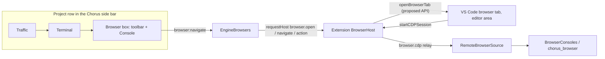
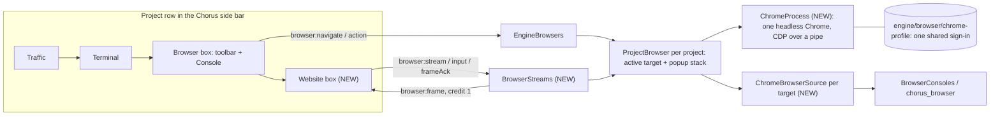
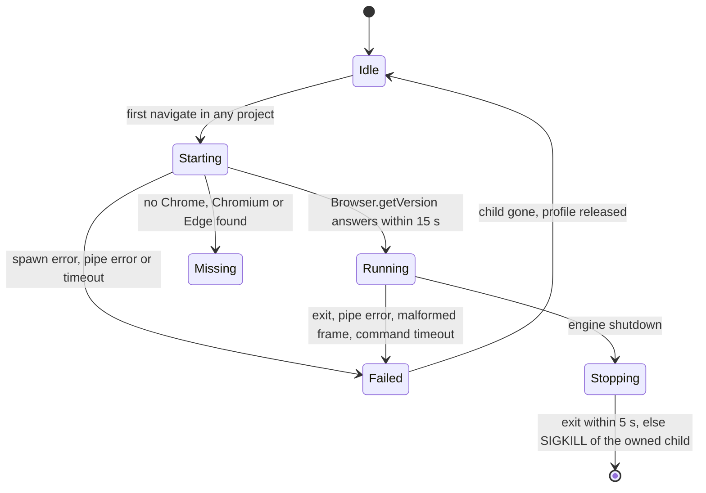
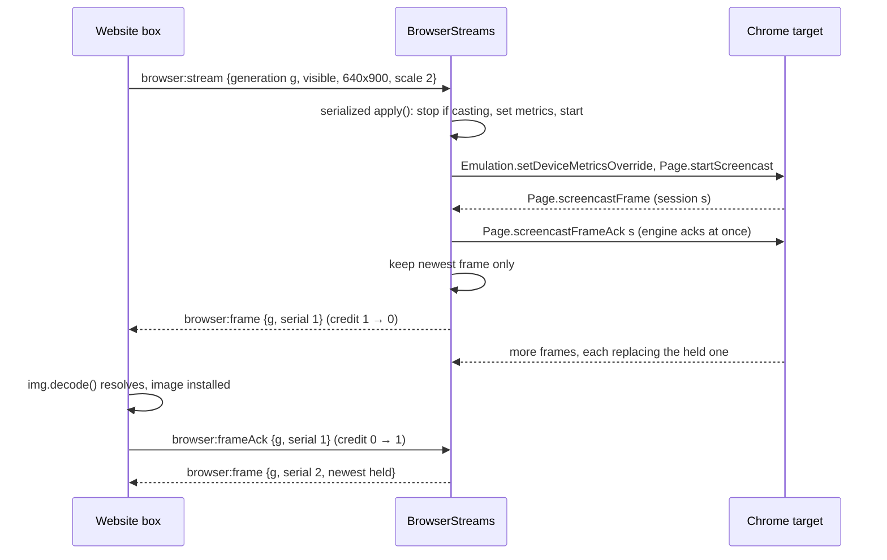
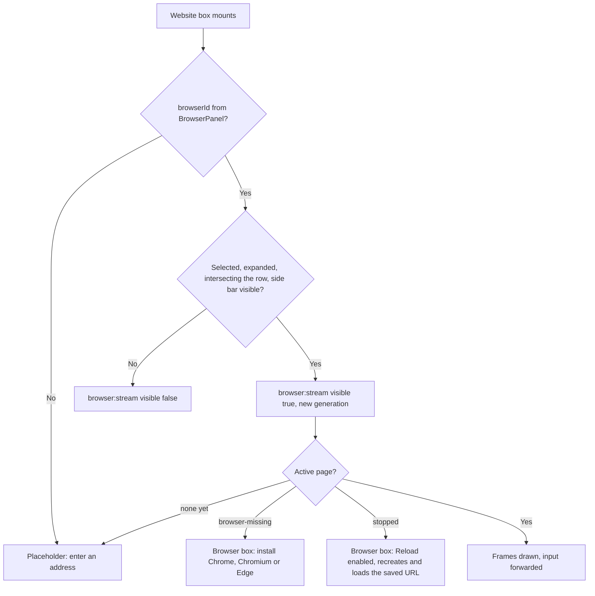

# 81 — The website box: one engine-owned Chrome, one browser per project

Status: **draft, revised after codex's challenge, awaiting approval.** No product code written. Builds on plan 80 (Chorus for VS Code).

| Phase | What ships | Status |
|---|---|---|
| 1 | Engine owns Chrome; Browser box and Console drive a project's Chrome page | Done 2026-11-06: installed; user saw title, Back/Reload and Console logs; Chrome confirmed on its own profile loading `localhost:30010`. Gap found: the Browser box keeps a stale id after an engine restart until the window reloads |
| 2 | Website box: live stream, mouse, wheel, keyboard, paste, copy, IME | Installed 2026-11-06; user saw the live page in the website box. User confirmed typing, Backspace and ⌘A in the login field. IME, paste and copy not yet confirmed. Reconnect fixes for the Browser, Console and Traffic boxes installed; Traffic confirmed showing calls |
| 3 | Page surfaces: popups, dropdowns, dialogs, file chooser | Implemented 2026-11-06 and reviewed (activation epochs, isolated-world bridge with a createIsolatedWorld fallback, Console follows the active page under the browser id). Installed 2026-11-06; user confirmed the photo upload opens VS Code's picker and works. Native dropdowns, dialogs and popups not yet confirmed |
| 4 | VS Code browser-tab route deleted, proposed API dropped | Not started |
| — | Restart Chorus restarts while project runs are active, and starts them again | Done 2026-11-06: installed; the engine restarted and `dev:clean` was started again by itself one second later |

Decided by the user on 2026-11-06:

- Row order per project, as on desktop: Traffic → Terminal → Browser box (toolbar and Console, kept) → **website box (new)**.
- The website box shows the same page the Console and `chorus_browser` read.
- **Chrome is the only browser for a project.** Project pages stop opening as VS Code browser tabs.
- One sign-in shared by every project.
- Dropdown menus are in scope.

Evidence that decided the route, both runs isolated, 2026-11-06:

| Spike | Result |
|---|---|
| Stream a VS Code browser tab (`/tmp/chorus-spike-hidden-tab`) | 0 frames and a frozen page whenever the tab is not on screen; 300 frames per 5 s when visible |
| Headless Chrome 157 over a pipe (`/tmp/chorus-spike-chrome`) | ~50–60 fps for two pages at once; click-to-frame 36 ms; `insertText` of `ASCII Hello مرحبا 😀` exact; wheel, shared cookie and cookie-after-restart pass; popup, alert and file-chooser events arrive; **native `<select>` popup never appears in frames** |

What the spikes did **not** measure, and Phase 2 must: the full socket → extension → webview → `` path, JPEG at the box's real size and scale, and the keydown/IME mapping below. The spike used `insertText` only.

## Current / Issue



The page lives in an editor tab, outside the project. A hidden tab paints nothing, so it cannot be streamed into the row.

## Proposed



### Identity and ownership

| Thing | Identity | Who changes it |
|---|---|---|
| `ProjectBrowser` | One per **project**, keyed by `projectId` (was `workspaceKey:projectId`), so `chorus_browser`'s project-only routing finds exactly one browser | Created on first `attach` |
| `ChromePage` | One per Chrome target, with `targetId`, `sessionId` and a `generation` that increments on every new page | Created only by `navigate`, `restore`, or `reload` when no page is live |
| Active target | Top of the project's stack: the main page, or the newest open popup | `Target.targetCreated` with a known `openerId` pushes; destroy/detach pops |
| Controller | The peer whose Console source is mounted | Only explicit user actions: `attach`, `navigate`, `act`, `input`, `selectChoose`, `dialogAnswer`. **Never** `stream` or `frameAck` |
| Viewers | Every peer that attached; all receive `browser:push` state | `attach` adds, `release` removes |
| Stream subscription | `(peer, browserId, generation)` held by `BrowserStreams` | The website box's `browser:stream` calls |

### Chrome lifecycle



A `start()` during `Stopping` waits for the exit promise, so a replacement never races the old process for the profile's singleton lock. Engine death needs no extra handling: Chrome schedules its own shutdown when the debugging pipe closes ([`remote_debugging_server.cc:325`](https://github.com/chromium/chromium/blob/a733b5afbb3ba618844ff8876b89ad1a774b2f18/chrome/browser/devtools/remote_debugging_server.cc#L325)).

### Stream contract



- Chrome's `sessionId` is a **screencast-session token**, not a frame number, and `maxFramesInFlight` defaults to 3 ([`page_handler.cc:1679`](https://github.com/chromium/chromium/blob/a733b5afbb3ba618844ff8876b89ad1a774b2f18/content/browser/devtools/protocol/page_handler.cc#L1679), [`:1784`](https://github.com/chromium/chromium/blob/a733b5afbb3ba618844ff8876b89ad1a774b2f18/content/browser/devtools/protocol/page_handler.cc#L1784)). So the engine acks Chrome itself and runs its own credit-1 protocol to the renderer, with its own `serial`.
- A second `startScreencast` while one runs is rejected ([`page_handler.cc:1646`](https://github.com/chromium/chromium/blob/a733b5afbb3ba618844ff8876b89ad1a774b2f18/content/browser/devtools/protocol/page_handler.cc#L1646)). `apply()` is one serialized loop per page that reads the **desired** state after every await, stops before restarting on a geometry change, and drops results from an older generation.
- **Byte budget:** the stream is capped at 2.4 MP (`maxWidth × maxHeight`) at quality 70. A frame whose base64 exceeds 1.5 MiB is dropped and the next start uses quality 50. Phase 2 measures the real sizes.
- A page casts only while some subscription is visible **and** its peer's view is visible. View visibility reaches the engine through the existing `focus` message, extended with `viewVisible`.
- Frames never enter `ShellMessageQueue` or the webview's pre-listener buffer. An undeliverable frame is dropped.
- Credit is reset to 1 by a new `browser:stream`, by the peer's view becoming visible again, and by the active target changing. A dropped frame can never stall a box for good.
- **Identity:**
  - Every website-box instance sends a random `instance`, and generations are compared only within one instance, so a remounted box is never behind its predecessor's cleanup.
  - Every frame carries the active page's `epoch` (`ChromePage.generation`). The renderer discards a decode that finishes after a newer epoch arrived or after the page stopped being live.

## Code Changes

### NEW `apps/engine/src/chrome-process.ts`

```ts
import { spawn, type ChildProcess } from 'node:child_process'
import { existsSync, mkdirSync } from 'node:fs'
import { join } from 'node:path'
import { Readable, Writable } from 'node:stream'
import { z } from 'zod'

const CANDIDATES: Partial<Record<NodeJS.Platform, readonly string[]>> = {
  darwin: [
    '/Applications/Google Chrome.app/Contents/MacOS/Google Chrome',
    '/Applications/Chromium.app/Contents/MacOS/Chromium',
    '/Applications/Microsoft Edge.app/Contents/MacOS/Microsoft Edge',
  ],
  win32: [
    join(process.env['PROGRAMFILES'] ?? 'C:\\Program Files', 'Google', 'Chrome', 'Application', 'chrome.exe'),
    join(process.env['LOCALAPPDATA'] ?? '', 'Google', 'Chrome', 'Application', 'chrome.exe'),
    join(process.env['PROGRAMFILES(X86)'] ?? 'C:\\Program Files (x86)', 'Microsoft', 'Edge', 'Application', 'msedge.exe'),
  ],
  linux: ['/usr/bin/google-chrome', '/usr/bin/chromium', '/usr/bin/chromium-browser', '/usr/bin/microsoft-edge'],
}

export function findChrome(): string | null {
  return (CANDIDATES[process.platform] ?? []).find((path) => existsSync(path)) ?? null
}

const COMMAND_TIMEOUT_MS = 15_000
const CLOSE_TIMEOUT_MS = 5_000
const KILL_TIMEOUT_MS = 2_000
const STDERR_LINES = 40

const CdpMessage = z.object({
  id: z.number().optional(),
  result: z.unknown().optional(),
  error: z.object({ message: z.string() }).optional(),
  method: z.string().optional(),
  params: z.unknown().optional(),
  sessionId: z.string().optional(),
})

export type CdpListener = (method: string, params: unknown, sessionId: string | undefined) => void

interface Pending {
  readonly resolve: (value: unknown) => void
  readonly reject: (error: Error) => void
  readonly timer: ReturnType<typeof setTimeout>
}

export class ChromeProcess {
  private child: ChildProcess | null = null
  private input: Writable | null = null
  private buffer = ''
  private nextId = 0
  private starting: Promise<void> | null = null
  private exited: Promise<void> = Promise.resolve()
  private stopping = false
  private generation = 0
  private readonly stderr: string[] = []
  private readonly pending = new Map<number, Pending>()
  private readonly listeners = new Set<CdpListener>()
  private readonly exits = new Set<(reason: string) => void>()

  constructor(
    private readonly profile: string,
    private readonly log: (message: string, fields: Record<string, unknown>) => void
  ) {}

  start(): Promise<void> {
    if (this.stopping) return Promise.reject(new Error('browser-stopping'))
    this.starting ??= this.exited.then(() => this.launch()).catch((error: unknown) => {
      this.starting = null
      throw error
    })
    return this.starting
  }

  private async launch(): Promise<void> {
    const executable = findChrome()
    if (executable === null) throw new Error('browser-missing')
    mkdirSync(this.profile, { recursive: true, mode: 0o700 })
    const child = spawn(
      executable,
      [
        '--headless=new',
        `--user-data-dir=${this.profile}`,
        '--remote-debugging-pipe',
        '--use-mock-keychain',
        '--password-store=basic',
        '--no-first-run',
        '--no-default-browser-check',
        'about:blank',
      ],
      { stdio: ['ignore', 'ignore', 'pipe', 'pipe', 'pipe'] }
    )
    const generation = ++this.generation
    const failed = (reason: string): void => {
      if (generation === this.generation) this.fail(reason)
    }
    this.exited = new Promise((resolve) => {
      child.once('exit', () => {
        resolve()
      })
      child.once('error', () => {
        resolve()
      })
    })
    child.once('exit', (code, signal) => {
      failed(`exit ${String(code)} ${String(signal)}`)
    })
    child.once('error', (error) => {
      failed(error.message)
    })
    const input = child.stdio[3]
    const output = child.stdio[4]
    if (!(input instanceof Writable) || !(output instanceof Readable)) {
      child.kill('SIGKILL')
      throw new Error('browser-pipe')
    }
    this.child = child
    this.input = input
    this.buffer = ''
    input.on('error', (error) => {
      failed(error.message)
    })
    output.on('error', (error) => {
      failed(error.message)
    })
    child.stderr?.setEncoding('utf8')
    child.stderr?.on('data', (chunk: string) => {
      this.stderr.push(...chunk.split('\n').filter((line) => line !== ''))
      this.stderr.splice(0, Math.max(0, this.stderr.length - STDERR_LINES))
    })
    output.setEncoding('utf8')
    output.on('data', (chunk: string) => {
      if (generation === this.generation) this.read(chunk)
    })
    try {
      await this.send('Browser.getVersion', {})
      await this.send('Target.setDiscoverTargets', { discover: true })
    } catch (error) {
      failed('startup failed')
      throw error
    }
  }

  send(method: string, params: Readonly<Record<string, unknown>>, sessionId?: string): Promise<unknown> {
    const input = this.input
    if (input === null) return Promise.reject(new Error('browser-stopped'))
    const id = ++this.nextId
    return new Promise((resolve, reject) => {
      const timer = setTimeout(() => {
        this.pending.delete(id)
        reject(new Error('browser-timeout'))
      }, COMMAND_TIMEOUT_MS)
      this.pending.set(id, { resolve, reject, timer })
      input.write(`${JSON.stringify({ id, method, params, ...(sessionId === undefined ? {} : { sessionId }) })}\0`)
    })
  }

  onEvent(listener: CdpListener): () => void {
    this.listeners.add(listener)
    return () => {
      this.listeners.delete(listener)
    }
  }

  onExit(listener: (reason: string) => void): () => void {
    this.exits.add(listener)
    return () => {
      this.exits.delete(listener)
    }
  }

  async close(): Promise<void> {
    this.stopping = true
    await this.starting?.catch(() => undefined)
    const child = this.child
    if (child !== null) {
      void this.send('Browser.close', {}).catch(() => undefined)
      if (!(await within(this.exited, CLOSE_TIMEOUT_MS))) child.kill('SIGKILL')
      await within(this.exited, KILL_TIMEOUT_MS)
    }
    this.stopping = false
  }

  private read(chunk: string): void {
    this.buffer += chunk
    for (let end = this.buffer.indexOf('\0'); end >= 0; end = this.buffer.indexOf('\0')) {
      const raw = this.buffer.slice(0, end)
      this.buffer = this.buffer.slice(end + 1)
      const parsed = CdpMessage.safeParse(safeJson(raw))
      if (!parsed.success) {
        this.fail('malformed message')
        return
      }
      this.dispatch(parsed.data)
    }
  }

  private dispatch(message: z.infer<typeof CdpMessage>): void {
    if (message.id !== undefined) {
      const waiting = this.pending.get(message.id)
      if (waiting === undefined) return
      this.pending.delete(message.id)
      clearTimeout(waiting.timer)
      if (message.error !== undefined) waiting.reject(new Error(message.error.message))
      else waiting.resolve(message.result)
      return
    }
    if (message.method === undefined) return
    for (const listener of this.listeners) {
      try {
        listener(message.method, message.params, message.sessionId)
      } catch (error) {
        this.log('browser listener failed', { method: message.method, error: String(error) })
      }
    }
  }

  private fail(reason: string): void {
    const child = this.child
    if (child === null) return
    this.child = null
    this.input = null
    this.starting = null
    this.buffer = ''
    if (child.exitCode === null && child.signalCode === null) child.kill('SIGKILL')
    for (const waiting of this.pending.values()) {
      clearTimeout(waiting.timer)
      waiting.reject(new Error('browser-stopped'))
    }
    this.pending.clear()
    if (!this.stopping) this.log('browser stopped', { reason, stderr: this.stderr.slice() })
    for (const listener of this.exits) listener(reason)
  }
}

function safeJson(raw: string): unknown {
  try {
    return JSON.parse(raw)
  } catch {
    return null
  }
}

function within(promise: Promise<void>, ms: number): Promise<boolean> {
  return Promise.race([
    promise.then(() => true),
    new Promise<boolean>((resolve) => setTimeout(() => resolve(false), ms)),
  ])
}
```

- `fail` is the one idempotent failure path. Exit, spawn error, either pipe's error, a malformed message and a failed or timed-out handshake all end there.
- Every callback is tied to the **child generation** it was registered for, so a late event from an old child can never fail or kill its replacement.
- `exited` settles on `exit` **or** `error`, so a spawn that never starts still completes.
- `close()` first waits for a pending `start()`. It then gives the close request and the exit **one** 5 s deadline, then a `SIGKILL` of the owned child, then a 2 s bound.

### NEW `apps/engine/src/chrome-browser-source.ts`

A `ChromePage` is one target. A `ChromeBrowserSource` is that target as one Console sees it, for one controller. The Console captures `owner` at `mount` and calls `transport.detach()` on release (`browser-console.ts:795`, `:835`), so detaching a source never closes the page session.

```ts
import type { BrowserSource, CdpTransport } from '../../desktop/src/main/browser-source.js'
import type { ShellClient } from '../../desktop/src/main/shell-client.js'
import type { ChromeProcess } from './chrome-process.js'

export class ChromePage {
  private closed = false
  url = 'about:blank'

  constructor(
    private readonly chrome: ChromeProcess,
    readonly targetId: string,
    readonly sessionId: string,
    readonly generation: number,
    readonly openerId: string | null
  ) {}

  send(method: string, params: Readonly<Record<string, unknown>>): Promise<unknown> {
    return this.closed
      ? Promise.reject(new Error('browser-disconnected'))
      : this.chrome.send(method, params, this.sessionId)
  }

  onEvent(listener: (method: string, params: unknown) => void): () => void {
    return this.chrome.onEvent((method, params, sessionId) => {
      if (sessionId === this.sessionId) listener(method, params)
    })
  }

  isClosed(): boolean {
    return this.closed
  }

  markClosed(): void {
    this.closed = true
  }
}

class PageTransport implements CdpTransport {
  private attached = false
  private readonly detached = new Set<() => void>()

  constructor(private readonly page: ChromePage) {}

  attach(): void {
    if (this.page.isClosed()) throw new Error('browser-disconnected')
    this.attached = true
  }
  isAttached(): boolean {
    return this.attached && !this.page.isClosed()
  }
  detach = (): void => {
    this.attached = false
  }
  sendCommand = (method: string, params: Readonly<Record<string, unknown>>): Promise<unknown> =>
    this.isAttached() ? this.page.send(method, params) : Promise.reject(new Error('browser-disconnected'))
  onMessage(listener: (method: string, params: unknown) => void): () => void {
    return this.page.onEvent(listener)
  }
  onDetached(listener: () => void): () => void {
    this.detached.add(listener)
    return () => {
      this.detached.delete(listener)
    }
  }
  disconnect(): void {
    this.attached = false
    for (const listener of this.detached) listener()
  }
}

export class ChromeBrowserSource implements BrowserSource {
  readonly transport: PageTransport
  private gone = false
  private readonly navigated = new Set<(url: string) => void>()
  private readonly removed = new Set<() => void>()

  constructor(
    readonly id: string,
    readonly projectId: string,
    readonly owner: ShellClient,
    readonly page: ChromePage
  ) {
    this.transport = new PageTransport(page)
  }
  url(): string {
    return this.page.url
  }
  isGone(): boolean {
    return this.gone || this.page.isClosed()
  }
  isInspectorOpen(): boolean {
    return false
  }
  navigatedTo(url: string): void {
    for (const listener of this.navigated) listener(url)
  }
  close(): void {
    if (this.gone) return
    this.gone = true
    this.transport.disconnect()
    for (const listener of this.removed) listener()
  }
  onNavigated(listener: (url: string) => void): () => void {
    this.navigated.add(listener)
    return () => {
      this.navigated.delete(listener)
    }
  }
  onCrashed(): () => void {
    return () => undefined
  }
  onGone(listener: () => void): () => void {
    this.removed.add(listener)
    return () => {
      this.removed.delete(listener)
    }
  }
  onInspectorChanged(): () => void {
    return () => undefined
  }
}
```

The source's `id` is `${browserId}:${targetId}`. A popup gets its own source, mounted after its opener's, so `BrowserConsoles.preferred(projectId)` picks the popup while it is open (`browser-console.ts:1996-2006`) and falls back to the opener when it closes.

### `apps/engine/src/browser-surfaces.ts`

`RecordState` becomes a project browser. The record map is keyed by `projectId`.

```ts
interface ProjectBrowser {
  readonly id: string
  readonly projectId: string
  controller: EnginePeer | null
  readonly peers: Set<EnginePeer>
  creating: Promise<ChromePage> | null
  readonly stack: ChromePage[]
  generation: number
  state: BrowserState
  select: { readonly token: string; readonly contextId: number; readonly page: ChromePage } | null
  dialog: { readonly token: string; readonly page: ChromePage } | null
}
```

Page creation lives in one place, behind a creation promise, and a page is exposed only after initialisation succeeds.

```ts
  private ensurePage(record: ProjectBrowser): Promise<ChromePage> {
    const live = record.stack[0]
    if (live !== undefined && !live.isClosed()) return Promise.resolve(live)
    record.creating ??= this.createPage(record, null).finally(() => {
      record.creating = null
    })
    return record.creating
  }

  private async createPage(record: ProjectBrowser, openerId: string | null, existing?: string): Promise<ChromePage> {
    await this.chrome.start()
    const targetId =
      existing ??
      TargetCreated.parse(await this.chrome.send('Target.createTarget', { url: 'about:blank', newWindow: true })).targetId
    let page: ChromePage | null = null
    try {
      const { sessionId } = TargetAttached.parse(await this.chrome.send('Target.attachToTarget', { targetId, flatten: true }))
      record.generation += 1
      page = new ChromePage(this.chrome, targetId, sessionId, record.generation, openerId)
      await page.send('Runtime.addBinding', { name: SELECT_BINDING, executionContextName: CHORUS_WORLD })
      await Promise.all([
        page.send('Page.enable', {}),
        page.send('Page.setLifecycleEventsEnabled', { enabled: true }),
        page.send('Page.setInterceptFileChooserDialog', { enabled: true }),
        page.send('Page.addScriptToEvaluateOnNewDocument', { source: SELECT_BRIDGE, worldName: CHORUS_WORLD, runImmediately: true }),
      ])
    } catch (error) {
      page?.markClosed()
      await this.chrome.send('Target.closeTarget', { targetId }).catch(() => undefined)
      throw error
    }
    page.onEvent((method, params) => {
      this.pageEvent(record, page, method, params)
    })
    if (openerId === null) record.stack.splice(0, record.stack.length, page)
    else record.stack.push(page)
    this.mountSource(record, page)
    this.streams.activeChanged(record.id)
    return page
  }
```

Attachment sits inside the cleanup `try`, so a failed attach or init closes the target it created. The binding is added before the bridge, and `runImmediately: true` also installs the bridge in a popup's **already-loaded** document. `runImmediately` is experimental; if it does not cover isolated worlds, the fallback is `Page.createIsolatedWorld` for the main frame plus `Runtime.evaluate` of `SELECT_BRIDGE` in the returned context.

Only `navigate`, `restore` and recovery `reload` call `ensurePage`. Everything else reads `this.active(record)`, which returns the top of the stack or `null`, and does nothing for `null`. So no inactive project ever spawns a blank page.

```ts
  private active(record: ProjectBrowser): ChromePage | null {
    for (let index = record.stack.length - 1; index >= 0; index -= 1) {
      const page = record.stack[index]
      if (page !== undefined && !page.isClosed()) return page
    }
    return null
  }
```

Two entry points replace `record(owner, id)`:

```ts
  private viewed(owner: ShellClient, id: string): ProjectBrowser {
    const record = this.byId.get(id)
    if (record === undefined || !record.peers.has(owner as EnginePeer)) throw new Error(messages.extension.browserUnavailable)
    return record
  }

  private controlled(owner: ShellClient, id: string): ProjectBrowser {
    const record = this.viewed(owner, id)
    const peer = owner as EnginePeer
    if (record.controller !== peer) {
      record.controller = peer
      for (const page of record.stack) if (!page.isClosed()) this.mountSource(record, page)
    }
    return record
  }
```

`stream` and `frameAck` use `viewed`. `attach`, `navigate`, `act`, `input`, `selectChoose` and `dialogAnswer` use `controlled`. A late acknowledgement from one window can no longer take the Console away from another.

A person using the Console box is also an explicit action. Every Console request from a window passes through `consoleBrowser(peer, browserId)` (`server.ts:263`), which calls `controlled(peer, browserId)` before routing. So the Console's owner check for human evaluation (`browser-console.ts:895`) passes for the window the person typed in.

`publish(record)` sends `browser:push` to every peer in `record.peers`, not to one owner.

`act` on the active page:

| Action | CDP |
|---|---|
| `back`, `forward` | `Page.getNavigationHistory`, then `Page.navigateToHistoryEntry` with the neighbouring `entryId` |
| `reload` | `Page.reload` on a live page; **with no live page, `navigate(record, savedLastUrl)`** |
| `stop` | `Page.stopLoading` |
| `focus` | `streams.reveal(record)`, which pushes `{ kind: 'command', command: 'reveal' }` so the row scrolls to the website box |
| `external` | Unchanged, `requestHost('openExternal')` |
| `close` | Close every target in the stack with `Target.closeTarget` |

Events that maintain `BrowserState` for the **active** page. Root-session events are routed by `targetId` through `ChromeProcess.onEvent` with `sessionId === undefined`.

| Event | Session | State change |
|---|---|---|
| `Page.frameNavigated` (no `parentId`) | page | `url`, `documentId = targetId:loaderId`, `source.navigatedTo`, `settings.setLastUrl` (main page only) |
| `Page.navigatedWithinDocument` | page | `url`, then history refresh |
| `Page.lifecycleEvent` `load` | page | `status: 'ready'`, then `Page.getNavigationHistory` for `canGoBack` and `canGoForward` |
| `Target.targetInfoChanged` | root | `title` and `url` for the matching `targetId` |
| `Target.targetCreated`, `type: 'page'`, `openerId` in a stack | root | `createPage(record, openerId, targetId)`: the popup becomes active |
| `Target.targetDestroyed` / `Target.detachedFromTarget` | root | Mark the page closed, release its source, pop it; the opener becomes active |
| `Inspector.targetCrashed` | page | `status: 'error'`, `live: false`, `error.code = BROWSER_STOPPED_CODE` |
| `Page.javascriptDialogOpening` | page | `record.dialog`, push `dialog` |
| `Page.javascriptDialogClosed`, any main-frame navigation | page | Clear `record.dialog` and `record.select`, push `null` for each |
| `Runtime.bindingCalled` `chorusSelect` | page | Validate (below), set `record.select`, push `select` |
| `Page.fileChooserOpened` | page | `requestHost('browser.pickFiles')` to the controller; empty result does nothing, which keeps the field's current selection |

`stopped(reason)`, wired to `chrome.onExit`, marks every page closed, releases every source, empties every stack, and publishes `status: 'error'` with `BROWSER_STOPPED_CODE` and `live: false`.

`attach` reports availability as `findChrome() !== null`, and the missing state uses `BROWSER_MISSING_CODE`. `consoleBrowser(owner, id)` returns the active page's source id.

`close()` (engine shutdown, `server.ts:543`) calls `streams.close()`, `stopped('shutdown')`, then `await this.chrome.close()`, which is bounded by `CLOSE_TIMEOUT_MS`.

### NEW `apps/engine/src/browser-streams.ts`

```ts
interface Subscription {
  readonly peer: EnginePeer
  readonly browserId: string
  instance: string
  generation: number
  visible: boolean
  width: number
  height: number
  scale: number
  credit: number
  serial: number
  held: { readonly epoch: number; readonly data: string; readonly width: number; readonly height: number } | null
}

interface Cast {
  page: ChromePage | null
  token: number | null
  geometry: string | null
  quality: number
  running: Promise<void> | null
  dirty: boolean
}

export class BrowserStreams {
  private readonly subscriptions = new Map<string, Subscription>()
  private readonly casts = new Map<string, Cast>()
  private readonly hiddenPeers = new Set<EnginePeer>()

  constructor(private readonly active: (browserId: string) => ChromePage | null) {}

  stream(peer: EnginePeer, request: BrowserStreamRequest): void {
    const key = `${peer.id}:${request.browserId}`
    const existing = this.subscriptions.get(key)
    const sameInstance = existing?.instance === request.instance
    if (existing !== undefined && sameInstance && request.generation < existing.generation) return
    this.subscriptions.set(key, {
      peer,
      browserId: request.browserId,
      instance: request.instance,
      generation: request.generation,
      visible: request.visible,
      width: request.width,
      height: request.height,
      scale: request.scale,
      credit: 1,
      serial: sameInstance ? existing.serial : 0,
      held: null,
    })
    this.schedule(request.browserId)
  }

  ack(peer: EnginePeer, browserId: string, instance: string, generation: number, serial: number): void {
    const subscription = this.subscriptions.get(`${peer.id}:${browserId}`)
    if (
      subscription?.instance !== instance ||
      subscription.generation !== generation ||
      subscription.serial !== serial
    )
      return
    subscription.credit = 1
    this.deliver(subscription)
  }

  viewVisibility(peer: EnginePeer, visible: boolean): void {
    if (visible) this.hiddenPeers.delete(peer)
    else this.hiddenPeers.add(peer)
    for (const subscription of this.subscriptions.values())
      if (subscription.peer === peer) {
        if (visible) {
          subscription.credit = 1
          subscription.held = null
        }
        this.schedule(subscription.browserId)
      }
  }

  release(peer: EnginePeer): void {
    this.hiddenPeers.delete(peer)
    for (const [key, subscription] of this.subscriptions)
      if (subscription.peer === peer) {
        this.subscriptions.delete(key)
        this.schedule(subscription.browserId)
      }
  }

  activeChanged(browserId: string): void {
    for (const subscription of this.subscriptions.values())
      if (subscription.browserId === browserId) {
        subscription.held = null
        subscription.credit = 1
      }
    this.schedule(browserId)
  }

  frame(browserId: string, page: ChromePage, params: unknown): void {
    const frame = ScreencastFrame.parse(params)
    void page.send('Page.screencastFrameAck', { sessionId: frame.sessionId }).catch(() => undefined)
    const cast = this.casts.get(browserId)
    if (cast?.page !== page) return
    cast.token ??= frame.sessionId
    if (cast.token !== frame.sessionId) return
    if (frame.data.length > FRAME_BYTE_LIMIT) {
      cast.quality = LOW_QUALITY
      cast.geometry = null
      this.schedule(browserId)
      return
    }
    for (const subscription of this.subscriptions.values()) {
      if (subscription.browserId !== browserId || !this.showing(subscription)) continue
      subscription.held = {
        epoch: page.generation,
        data: frame.data,
        width: frame.metadata.deviceWidth,
        height: frame.metadata.deviceHeight,
      }
      this.deliver(subscription)
    }
  }

  private deliver(subscription: Subscription): void {
    if (subscription.credit === 0 || subscription.held === null) return
    const held = subscription.held
    subscription.held = null
    subscription.credit = 0
    subscription.serial += 1
    subscription.peer.send(BROWSER_FRAME_CHANNEL, {
      browserId: subscription.browserId,
      instance: subscription.instance,
      generation: subscription.generation,
      epoch: held.epoch,
      serial: subscription.serial,
      data: held.data,
      width: held.width,
      height: held.height,
    })
  }

  private showing(subscription: Subscription): boolean {
    return subscription.visible && !this.hiddenPeers.has(subscription.peer) && !subscription.peer.isGone()
  }

  private schedule(browserId: string): void {
    const cast = this.casts.get(browserId) ?? { page: null, token: null, geometry: null, quality: HIGH_QUALITY, running: null, dirty: false }
    this.casts.set(browserId, cast)
    cast.dirty = true
    cast.running ??= this.apply(browserId, cast).finally(() => {
      cast.running = null
      if (cast.dirty) this.schedule(browserId)
    })
  }

  private async apply(browserId: string, cast: Cast): Promise<void> {
    while (cast.dirty) {
      cast.dirty = false
      const page = this.active(browserId)
      const viewer = [...this.subscriptions.values()]
        .filter((subscription) => subscription.browserId === browserId && this.showing(subscription))
        .at(-1)
      const geometry =
        viewer === undefined || page === null
          ? null
          : `${String(viewer.width)}x${String(viewer.height)}@${String(viewer.scale)}`
      if (cast.page !== null && (cast.page !== page || cast.geometry !== geometry)) {
        await cast.page.send('Page.stopScreencast', {}).catch(() => undefined)
        cast.page = null
        cast.token = null
        cast.geometry = null
      }
      if (page === null || viewer === undefined || geometry === null || cast.dirty) continue
      if (cast.page === page && cast.geometry === geometry) continue
      const scale = Math.min(viewer.scale, Math.sqrt(MAX_STREAM_PIXELS / (viewer.width * viewer.height)))
      try {
        await page.send('Emulation.setDeviceMetricsOverride', {
          width: viewer.width,
          height: viewer.height,
          deviceScaleFactor: viewer.scale,
          mobile: false,
        })
        if (cast.dirty) continue
        cast.page = page
        cast.geometry = geometry
        cast.token = null
        await page.send('Page.startScreencast', {
          format: 'jpeg',
          quality: cast.quality,
          maxWidth: Math.round(viewer.width * scale),
          maxHeight: Math.round(viewer.height * scale),
        })
      } catch {
        cast.page = null
        cast.geometry = null
      }
    }
  }
}
```

`cast.token` is taken from the first `Page.screencastFrame` after a start, and frames carrying an older token are acked but not shown. The constants:

```ts
const MAX_STREAM_PIXELS = 2_400_000
const FRAME_BYTE_LIMIT = 1_500_000
const HIGH_QUALITY = 70
const LOW_QUALITY = 50
```

### NEW `apps/engine/src/chrome-page-scripts.ts`

The bridge runs in the isolated `chorus` world, created per frame by `addScriptToEvaluateOnNewDocument` with `worldName`. The binding exists only there (`Runtime.addBinding` `executionContextName`), so page scripts can neither see nor call it. It reacts only to trusted events, which Chorus's own `Input.*` dispatches are and page-created events are not.

```ts
export const CHORUS_WORLD = 'chorus'
export const SELECT_BINDING = 'chorusSelect'

export const SELECT_BRIDGE = `(() => {
  const selects = new Map()
  const selectFrom = (event) => event.composedPath().find((node) => node instanceof HTMLSelectElement) ?? null
  const eligible = (select) => select !== null && !select.multiple && select.size <= 1 && !select.disabled
  const open = (select) => {
    const token = [...crypto.getRandomValues(new Uint8Array(16))].map((byte) => byte.toString(16).padStart(2, '0')).join('')
    selects.clear()
    selects.set(token, select)
    select.focus()
    const box = select.getBoundingClientRect()
    globalThis.${SELECT_BINDING}(JSON.stringify({
      token,
      selectedIndex: select.selectedIndex,
      rect: { x: box.left, y: box.bottom, width: box.width },
      options: [...select.options].map((option) => ({
        label: option.label,
        disabled: option.disabled || (option.parentElement instanceof HTMLOptGroupElement && option.parentElement.disabled),
        group: option.parentElement instanceof HTMLOptGroupElement ? option.parentElement.label : null,
      })),
    }))
  }
  document.addEventListener('mousedown', (event) => {
    const select = selectFrom(event)
    if (!event.isTrusted || event.button !== 0 || !eligible(select)) return
    event.preventDefault()
    open(select)
  }, true)
  document.addEventListener('keydown', (event) => {
    const select = selectFrom(event)
    if (!event.isTrusted || !eligible(select)) return
    const opens = event.key === ' ' || event.key === 'F4' || (event.altKey && (event.key === 'ArrowDown' || event.key === 'ArrowUp'))
    if (!opens) return
    event.preventDefault()
    open(select)
  }, true)
  globalThis.chorusChooseSelect = (token, index) => {
    const select = selects.get(token)
    selects.clear()
    if (!(select instanceof HTMLSelectElement) || !select.isConnected || !eligible(select)) return false
    const option = select.options[index]
    if (option === undefined || option.disabled) return false
    select.selectedIndex = index
    select.dispatchEvent(new Event('input', { bubbles: true }))
    select.dispatchEvent(new Event('change', { bubbles: true }))
    return true
  }
})()`

export const chooseSelectExpression = (token: string, index: number): string =>
  `globalThis.chorusChooseSelect(${JSON.stringify(token)}, ${String(index)})`
```

`pageEvent` accepts a `Runtime.bindingCalled` only when its `executionContextId` belongs to the `chorus` world of the page that sent it (tracked from `Runtime.executionContextCreated` with `auxData.isDefault === false` and `name === CHORUS_WORLD`). `selectChoose` evaluates `chooseSelectExpression` in that `contextId` and checks the token matches `record.select.token`. An `index` of `-1` only clears the prompt and returns focus to the select. React's change path for `<select>` listens to the bubbling `change` event (`react-dom-client.development.js:19600`); whether that holds for every form library is a Phase 3 check.

Same-process iframes get their own `chorus` world, so their selects work. Their `rect` is relative to the iframe, which is offset by the frame's position from `DOM.getBoxModel` of the frame owner. Cross-site iframes (separate targets) are out of scope.

### `apps/desktop/src/shared/browser-ipc.ts`

```ts
export const BROWSER_FRAME_CHANNEL = 'browser:frame'
export const BROWSER_MISSING_CODE = -201
export const BROWSER_STOPPED_CODE = -202

const BrowserOk = z.object({ ok: z.literal(true) }).strict()
const Modifiers = z.number().int().min(0).max(15)
const Generation = z.number().int().min(0)
const Buttons = z.number().int().min(0).max(31)

export const BrowserInputEvent = z.discriminatedUnion('kind', [
  z.object({
    kind: z.literal('mouse'),
    type: z.enum(['mousePressed', 'mouseReleased', 'mouseMoved']),
    x: z.number(),
    y: z.number(),
    button: z.enum(['none', 'left', 'middle', 'right']),
    buttons: Buttons,
    clickCount: z.number().int().min(0).max(3),
    modifiers: Modifiers,
  }).strict(),
  z.object({
    kind: z.literal('wheel'),
    x: z.number(),
    y: z.number(),
    deltaX: z.number(),
    deltaY: z.number(),
    modifiers: Modifiers,
  }).strict(),
  z.object({
    kind: z.literal('key'),
    type: z.enum(['rawKeyDown', 'keyDown', 'keyUp']),
    key: z.string().max(32),
    code: z.string().max(32),
    text: z.string().max(8).optional(),
    keyCode: z.number().int().min(0).max(255),
    autoRepeat: z.boolean(),
    modifiers: Modifiers,
  }).strict(),
  z.object({ kind: z.literal('text'), text: z.string().min(1).max(10_000) }).strict(),
])
export type BrowserInputEvent = z.infer<typeof BrowserInputEvent>

const Instance = z.string().uuid()
const SelectToken = z.string().regex(/^[0-9a-f]{32}$/)

export const BrowserStreamRequest = z.object({
  browserId: BrowserId,
  instance: Instance,
  generation: Generation,
  visible: z.boolean(),
  width: z.number().int().min(1).max(8192),
  height: z.number().int().min(1).max(8192),
  scale: z.number().min(1).max(4),
}).strict()
export type BrowserStreamRequest = z.infer<typeof BrowserStreamRequest>

export const BrowserFrame = z.object({
  browserId: BrowserId,
  instance: Instance,
  generation: Generation,
  epoch: z.number().int().min(1),
  serial: z.number().int().min(1),
  data: z.string(),
  width: z.number(),
  height: z.number(),
}).strict()
export type BrowserFrame = z.infer<typeof BrowserFrame>
```

Added to `BROWSER_CONTRACT`:

```ts
  'browser:stream': { request: BrowserStreamRequest, response: BrowserOk },
  'browser:input': {
    request: z.object({ browserId: BrowserId, event: BrowserInputEvent }).strict(),
    response: BrowserOk,
  },
  'browser:frameAck': {
    request: z.object({
      browserId: BrowserId,
      instance: Instance,
      generation: Generation,
      serial: z.number().int().min(1),
    }).strict(),
    response: BrowserOk,
  },
  'browser:selectChoose': {
    request: z.object({ browserId: BrowserId, token: SelectToken, index: z.number().int().min(-1) }).strict(),
    response: BrowserOk,
  },
  'browser:dialogAnswer': {
    request: z.object({
      browserId: BrowserId,
      token: z.string().uuid(),
      accept: z.boolean(),
      text: z.string().max(10_000).optional(),
    }).strict(),
    response: BrowserOk,
  },
  'browser:selection': {
    request: z.object({ browserId: BrowserId }).strict(),
    response: z.object({ text: z.string().max(100_000) }).strict(),
  },
```

`BrowserPush` gains:

```ts
  z.object({
    kind: z.literal('select'),
    browserId: BrowserId,
    select: z.object({
      token: SelectToken,
      selectedIndex: z.number().int(),
      rect: z.object({ x: z.number(), y: z.number(), width: z.number() }),
      options: z.array(z.object({ label: z.string().max(1_000), disabled: z.boolean(), group: z.string().max(1_000).nullable() })).max(2_000),
    }).nullable(),
  }).strict(),
  z.object({
    kind: z.literal('dialog'),
    browserId: BrowserId,
    dialog: z.object({
      token: z.string().uuid(),
      type: z.enum(['alert', 'confirm', 'prompt', 'beforeunload']),
      message: z.string().max(10_000),
      defaultPrompt: z.string().max(10_000),
    }).nullable(),
  }).strict(),
```

`BrowserWebCommand` gains `'reveal'`. `BrowserApi` gains the seven methods listed under `create-chorus-api.ts`. The select token is 32 hex characters from `crypto.getRandomValues`, which, unlike `crypto.randomUUID`, also exists in pages served over plain HTTP. The dialog token is a UUID issued by the engine.

### NEW `apps/desktop/src/main/browser-stream-port.ts`

A separate port, so the desktop's `BrowserSurfaces` gains nothing. Desktop passes no `streams`, and the six channels refuse there with `not-eligible`.

```ts
import type { ShellClient } from './shell-client.js'
import type { BrowserInputEvent, BrowserStreamRequest } from '../shared/browser-ipc.js'

export interface BrowserStreamPort {
  stream(owner: ShellClient, request: BrowserStreamRequest): void
  ack(owner: ShellClient, browserId: string, instance: string, generation: number, serial: number): void
  input(owner: ShellClient, browserId: string, event: BrowserInputEvent): Promise<void>
  chooseSelect(owner: ShellClient, browserId: string, token: string, index: number): Promise<void>
  answerDialog(owner: ShellClient, browserId: string, token: string, accept: boolean, text: string | undefined): Promise<void>
  selection(owner: ShellClient, browserId: string): Promise<string>
}
```

### `apps/desktop/src/main/browser-ipc.ts`

```ts
    this.handle('browser:stream', BROWSER_CONTRACT['browser:stream'], (owner, request) => {
      if (streams === undefined) throw new Error('not-eligible')
      streams.stream(owner, request)
      return { ok: true as const }
    })
    this.handle('browser:input', BROWSER_CONTRACT['browser:input'], async (owner, request) => {
      if (streams === undefined) throw new Error('not-eligible')
      await streams.input(owner, request.browserId, request.event)
      return { ok: true as const }
    })
```

The same shape covers `browser:frameAck`, `browser:selectChoose`, `browser:dialogAnswer` and `browser:selection`. `releaseShell(owner)` also calls `streams?.release(owner)`.

### `apps/engine/src/server.ts` and `apps/engine/src/protocol.ts`

```ts
  const browser = new BrowserIpc(
    {
      isAdopted: (id) => runtime.projects.get(id) !== null,
      downloads: { list: () => [], act: () => null },
      surfaces: browserSources.port,
      streams: browserSources.streams,
    },
    registrar
  )
```

The `focus` client message (`protocol.ts:95`) gains `viewVisible: z.boolean().default(true)`. The `case 'focus'` arm (`server.ts:398`) calls `browserSources.viewVisibility(current, message.viewVisible)`.

### `apps/extension/src/extension.ts` and `apps/extension/src/engine-client.ts`

`focus()` (`extension.ts:667`) passes `this.view?.visible === true` as `viewVisible`, and `EngineClient.focus` (`engine-client.ts:305`) forwards it. `viewVisibilityChanged` already calls `focus()`.

`post()` drops undeliverable frames instead of queueing them:

```ts
  private post(message: ShellHostMessage): void {
    if (!this.opened) return
    const view = this.view
    const deliverable = view !== null && this.ready && view.visible
    if (!deliverable && message.kind === 'push' && message.channel === BROWSER_FRAME_CHANNEL) return
    if (!deliverable) {
      this.queue.add(message)
      return
    }
```

The one host call Chrome still needs from VS Code:

```ts
      case 'browser.pickFiles': {
        const { many } = z.object({ many: z.boolean() }).parse(params)
        const picked = await vscode.window.showOpenDialog({ canSelectFiles: true, canSelectFolders: false, canSelectMany: many })
        return { paths: (picked ?? []).filter((uri) => uri.scheme === 'file').map((uri) => uri.fsPath) }
      }
```

### `apps/extension/src/webview/main.ts`

The pre-listener buffer (`main.ts:54`) never buffers `BROWSER_FRAME_CHANNEL`. A frame that arrives with no listener is dropped; the box's next `browser:stream` resets credit.

### `apps/desktop/src/shared/host-capabilities.ts`

```ts
export const HostCapabilities = z.object({
  embeddedEditor: z.boolean(),
  nativeBrowserViews: z.boolean(),
  streamedBrowser: z.boolean(),
  detachedWindows: z.boolean(),
  globalTerminal: z.boolean(),
  ownTheme: z.boolean(),
})
```

`DESKTOP_CAPABILITIES.streamedBrowser` is `false`; `EXTENSION_CAPABILITIES.streamedBrowser` is `true`.

### `apps/desktop/src/shared/create-chorus-api.ts`

```ts
    streamBrowser: invokeBrowser('browser:stream'),
    browserInput: invokeBrowser('browser:input'),
    ackBrowserFrame: invokeBrowser('browser:frameAck'),
    chooseBrowserSelect: invokeBrowser('browser:selectChoose'),
    answerBrowserDialog: invokeBrowser('browser:dialogAnswer'),
    browserSelection: invokeBrowser('browser:selection'),
    onBrowserFrame: (listener) => {
      const wrapped = (payload: unknown): void => {
        const parsed = BrowserFrame.safeParse(payload)
        if (parsed.success) listener(parsed.data)
      }
      return transport.on(BROWSER_FRAME_CHANNEL, wrapped)
    },
```

### Input ownership in the renderer

Two capture-phase handlers run before any website handler and must step aside for it. Both test one attribute that only the website surface carries, so the desktop, which never renders it, is unchanged.

```ts
export const WEBSITE_SURFACE_ATTRIBUTE = 'data-website-surface'

export function insideWebsiteSurface(target: EventTarget | null): boolean {
  return target instanceof Element && target.closest(`[${WEBSITE_SURFACE_ATTRIBUTE}]`) !== null
}
```

`apps/desktop/src/renderer/src/workspace/Workspace.tsx`, first line of `onKeyDown` (`Workspace.tsx:~420`, registered with capture at `:497`):

```ts
      if (insideWebsiteSurface(event.target)) return
```

`apps/desktop/src/renderer/src/workspace/row-drag.ts`, first line of `routeRowWheel`'s `onWheel` (`row-drag.ts:24`):

```ts
    if (insideWebsiteSurface(event.target)) return
```

The two helpers live in NEW `apps/desktop/src/renderer/src/website-surface.ts`, beside `modifiersOf`, `buttonOf`, `buttonsOf`, `wheelPixels` (line and page `deltaMode` converted to pixels) and `keyEventFor`. All are pure and exported for tests.

### Keyboard, text, IME and clipboard

The focus target is a transparent `<textarea>` inside the surface. It is the editing host that VS Code's webview clipboard routing and the OS IME need ([webview `pre/index.html`](https://github.com/microsoft/vscode/blob/1.145.0/src/vs/workbench/contrib/webview/browser/pre/index.html#L609)). It is positioned at the last pointer-down point so the IME candidate window appears there.

| User does | Renderer | Chrome receives |
|---|---|---|
| Printable key, not composing | `keydown`: `rawKeyDown` without text. `beforeinput insertText`: `preventDefault`, send `text` | `rawKeyDown`, then `Input.insertText` |
| Enter | `keyDown` with `text: '\r'` | Submits forms, inserts newlines |
| Backspace, Delete, arrows, Tab, Escape, Home, End, PageUp, PageDown | `rawKeyDown` / `keyUp` with `keyCode` | Editing and navigation |
| ⌘/Ctrl + letter, except C, V, X | `rawKeyDown` / `keyUp` with modifiers | Page shortcuts |
| ⌘V / Ctrl+V | Not prevented and not stopped. VS Code's clipboard routing pastes into the focused textarea; a native `paste` listener calls `preventDefault` and sends `clipboardData` text | `Input.insertText` |
| ⌘C / Ctrl+C | Not prevented. The textarea already holds the page's selection, refreshed on every `mouseup` and `keyup` through `browser:selection` (`window.getSelection().toString()` in the `chorus` world), so VS Code copies it | Nothing |
| ⌘X / Ctrl+X | As copy, then `rawKeyDown` Delete | Delete |
| IME composition | `compositionstart` stops forwarding keys; `compositionend`: send `text` with `event.data`, clear the textarea, restore the selection mirror | `Input.insertText` once |
| Blur, `pointercancel`, `lostpointercapture` | `mouseReleased` for a held button; `keyUp` for held modifiers | Clean state |

`autoRepeat` comes from `event.repeat`. A `keydown` with `event.isComposing` or key `Process` is never forwarded.

### NEW `apps/desktop/src/renderer/src/useBrowserScreencast.ts`

```ts
export function useBrowserScreencast(
  browserId: string | null,
  selected: boolean,
  row: RefObject<HTMLElement | null>
) {
  const surface = useRef<HTMLDivElement | null>(null)
  const editor = useRef<HTMLTextAreaElement | null>(null)
  const instance = useRef(crypto.randomUUID())
  const generation = useRef(0)
  const epoch = useRef(0)
  const live = useRef(false)
  const composing = useRef(false)
  const [frame, setFrame] = useState<{ readonly url: string; readonly width: number; readonly height: number } | null>(null)
  const [select, setSelect] = useState<BrowserSelectPrompt | null>(null)
  const [dialog, setDialog] = useState<BrowserDialogPrompt | null>(null)
  const [intersecting, setIntersecting] = useState(false)
  const visible = selected && intersecting

  useEffect(() => {
    setFrame(null)
    setSelect(null)
    setDialog(null)
  }, [browserId])

  useEffect(() => {
    const node = surface.current
    if (node === null) return undefined
    const observer = new IntersectionObserver(([entry]) => {
      setIntersecting(entry?.isIntersecting === true)
    }, { root: row.current })
    observer.observe(node)
    return () => {
      observer.disconnect()
    }
  }, [row])

  useEffect(() => {
    if (browserId === null) return undefined
    return window.chorus.onBrowserFrame((pushed) => {
      if (
        pushed.browserId !== browserId ||
        pushed.instance !== instance.current ||
        pushed.generation !== generation.current ||
        pushed.epoch < epoch.current
      )
        return
      epoch.current = pushed.epoch
      live.current = true
      const image = new Image()
      image.src = `data:image/jpeg;base64,${pushed.data}`
      void image
        .decode()
        .then(() => {
          if (pushed.generation !== generation.current || pushed.epoch !== epoch.current || !live.current) return
          setFrame({ url: image.src, width: pushed.width, height: pushed.height })
        })
        .finally(() => {
          void window.chorus.ackBrowserFrame({
            browserId,
            instance: pushed.instance,
            generation: pushed.generation,
            serial: pushed.serial,
          })
        })
    })
  }, [browserId])

  useEffect(() => {
    if (browserId === null) return undefined
    return window.chorus.onBrowser((pushed) => {
      if (pushed.browserId !== browserId) return
      if (pushed.kind === 'select') setSelect(pushed.select)
      else if (pushed.kind === 'dialog') setDialog(pushed.dialog)
      else if (pushed.kind === 'state' && !pushed.state.live) {
        live.current = false
        setFrame(null)
      }
    })
  }, [browserId])

  useEffect(() => {
    const node = surface.current
    if (browserId === null || node === null) return undefined
    const report = (): void => {
      const { width, height } = node.getBoundingClientRect()
      generation.current += 1
      void window.chorus.streamBrowser({
        browserId,
        instance: instance.current,
        generation: generation.current,
        visible: visible && width >= 1 && height >= 1,
        width: Math.max(1, Math.round(width)),
        height: Math.max(1, Math.round(height)),
        scale: Math.min(4, Math.max(1, window.devicePixelRatio)),
      })
    }
    const observer = new ResizeObserver(report)
    observer.observe(node)
    report()
    return () => {
      observer.disconnect()
      generation.current += 1
      void window.chorus.streamBrowser({
        browserId,
        instance: instance.current,
        generation: generation.current,
        visible: false,
        width: 1,
        height: 1,
        scale: 1,
      })
    }
  }, [browserId, visible])

  const point = useCallback(
    (clientX: number, clientY: number) => {
      const node = surface.current
      if (node === null || frame === null) return { x: 0, y: 0 }
      const box = node.getBoundingClientRect()
      return {
        x: ((clientX - box.left) * frame.width) / box.width,
        y: ((clientY - box.top) * frame.height) / box.height,
      }
    },
    [frame]
  )

  const send = useCallback(
    (event: BrowserInputEvent) => {
      if (browserId !== null && frame !== null) void window.chorus.browserInput({ browserId, event })
    },
    [browserId, frame]
  )

  useEffect(() => {
    const area = editor.current
    const stage = surface.current
    if (area === null || stage === null) return undefined
    const text = (value: string): void => {
      if (value !== '') send({ kind: 'text', text: value })
    }
    const onBeforeInput = (event: InputEvent): void => {
      if (event.isComposing) return
      if (event.inputType !== 'insertText' && event.inputType !== 'insertReplacementText') return
      event.preventDefault()
      text(event.data ?? event.dataTransfer?.getData('text/plain') ?? '')
    }
    const onPaste = (event: ClipboardEvent): void => {
      event.preventDefault()
      text(event.clipboardData?.getData('text/plain') ?? '')
    }
    const onCompositionStart = (): void => {
      composing.current = true
    }
    const onCompositionEnd = (event: CompositionEvent): void => {
      composing.current = false
      text(event.data)
      area.value = ''
      void mirrorSelection(browserId, area)
    }
    const onWheel = (event: WheelEvent): void => {
      event.preventDefault()
      send({ kind: 'wheel', ...point(event.clientX, event.clientY), ...wheelPixels(event), modifiers: modifiersOf(event) })
    }
    area.addEventListener('beforeinput', onBeforeInput)
    area.addEventListener('paste', onPaste)
    area.addEventListener('compositionstart', onCompositionStart)
    area.addEventListener('compositionend', onCompositionEnd)
    stage.addEventListener('wheel', onWheel, { passive: false })
    return () => {
      area.removeEventListener('beforeinput', onBeforeInput)
      area.removeEventListener('paste', onPaste)
      area.removeEventListener('compositionstart', onCompositionStart)
      area.removeEventListener('compositionend', onCompositionEnd)
      stage.removeEventListener('wheel', onWheel)
    }
  }, [browserId, send, point])

  return { surface, editor, composing, frame, select, dialog, point, send, setSelect, setDialog, visible }
}
```

Text, paste, composition and wheel use **native** listeners. React synthesises `onBeforeInput` from `keypress`, `textInput`, `compositionend` and `paste` (`react-dom-client.development.js:27428`, `:19738`), so its event is not the `InputEvent` this needs. React also registers wheel listeners as passive (`:19251`), so `preventDefault` would be ignored. This effect sits after `send` and `point`, because a callback read before its `const` throws on first render (the TDZ trap in `CLAUDE.md`).

The coordinate invariant is that `.website-frame` fills `.website-surface` exactly (`object-fit: fill`, no padding or border), and `point()` maps through the frame's own CSS size (`metadata.deviceWidth/Height`). So a click stays correct during the frames between a resize and the restarted cast.

### NEW `apps/desktop/src/renderer/src/BrowserScreencast.tsx`

One component. The menu and the dialog are JSX blocks inside it, not components, because nothing else renders them.

```tsx
export function BrowserScreencast(props: {
  readonly browserId: string | null
  readonly selected: boolean
  readonly collapsed: boolean
  readonly row: RefObject<HTMLElement | null>
  readonly onToggleCollapsed: () => void
}) {
  const { t } = useTranslation()
  const view = useBrowserScreencast(props.browserId, props.selected && !props.collapsed, props.row)
  const editor = view.editor
  const [highlight, setHighlight] = useState(0)
  const [answer, setAnswer] = useState('')

  const choose = (index: number): void => {
    const prompt = view.select
    if (prompt === null || props.browserId === null) return
    void window.chorus.chooseBrowserSelect({ browserId: props.browserId, token: prompt.token, index })
    view.setSelect(null)
    editor.current?.focus()
  }

  const reply = (accept: boolean): void => {
    const prompt = view.dialog
    if (prompt === null || props.browserId === null) return
    void window.chorus.answerBrowserDialog({
      browserId: props.browserId,
      token: prompt.token,
      accept,
      ...(prompt.type === 'prompt' && accept ? { text: answer } : {}),
    })
    view.setDialog(null)
    editor.current?.focus()
  }

  return (
    <div className="website-panel" hidden={!props.selected} data-collapsed={props.collapsed}>
      <header className="website-header">
        <span className="website-title">{t('website.title')}</span>
        <button
          type="button"
          className="website-collapse"
          aria-label={props.collapsed ? t('website.expand') : t('website.collapse')}
          title={props.collapsed ? t('website.expand') : t('website.collapse')}
          onClick={props.onToggleCollapsed}
        >
          <span aria-hidden="true">{props.collapsed ? '▸' : '◂'}</span>
        </button>
      </header>
      <div className="website-stage" {...{ [WEBSITE_SURFACE_ATTRIBUTE]: '' }}>
      <div
        className="website-surface"
        ref={view.surface}
        onPointerDown={(event) => {
          event.currentTarget.setPointerCapture(event.pointerId)
          placeEditor(editor.current, event)
          editor.current?.focus()
          view.send({ kind: 'mouse', type: 'mousePressed', ...view.point(event.clientX, event.clientY), button: buttonOf(event.button), buttons: buttonsOf(event.buttons), clickCount: Math.min(3, event.detail), modifiers: modifiersOf(event) })
        }}
        onPointerUp={(event) => {
          view.send({ kind: 'mouse', type: 'mouseReleased', ...view.point(event.clientX, event.clientY), button: buttonOf(event.button), buttons: buttonsOf(event.buttons), clickCount: Math.min(3, event.detail), modifiers: modifiersOf(event) })
          void mirrorSelection(props.browserId, editor.current)
        }}
        onPointerMove={(event) => {
          view.send({ kind: 'mouse', type: 'mouseMoved', ...view.point(event.clientX, event.clientY), button: 'none', buttons: buttonsOf(event.buttons), clickCount: 0, modifiers: modifiersOf(event) })
        }}
        onPointerCancel={() => {
          view.send({ kind: 'mouse', type: 'mouseReleased', x: 0, y: 0, button: 'left', buttons: 0, clickCount: 0, modifiers: 0 })
        }}
      >
        <textarea
          ref={editor}
          className="website-editor"
          aria-label={t('website.surface')}
          spellCheck={false}
          autoCapitalize="off"
          onKeyDown={(event) => {
            if (view.composing.current || event.nativeEvent.isComposing || event.key === 'Process') return
            const key = keyEventFor(event.nativeEvent, 'down')
            if (key === null) return
            event.stopPropagation()
            if (!printable(event.nativeEvent)) event.preventDefault()
            view.send(key)
          }}
          onKeyUp={(event) => {
            if (view.composing.current) return
            const key = keyEventFor(event.nativeEvent, 'up')
            if (key === null) return
            event.stopPropagation()
            view.send(key)
            void mirrorSelection(props.browserId, editor.current)
          }}
        />
        {view.frame === null ? (
          <p className="website-placeholder">{t('website.empty')}</p>
        ) : (
          
        )}
      </div>
        {view.select !== null && (
          <ul
            className="website-select"
            role="listbox"
            tabIndex={-1}
            ref={(node) => node?.focus()}
            style={{ left: view.select.rect.x, top: view.select.rect.y, minWidth: view.select.rect.width }}
            onKeyDown={(event) => {
              event.stopPropagation()
              const options = view.select?.options ?? []
              if (event.key === 'Escape') choose(-1)
              else if (event.key === 'Enter') choose(highlight)
              else if (event.key === 'ArrowDown') setHighlight(nextEnabled(options, highlight, 1))
              else if (event.key === 'ArrowUp') setHighlight(nextEnabled(options, highlight, -1))
              else return
              event.preventDefault()
            }}
            onBlur={() => {
              choose(-1)
            }}
          >
            {view.select.options.map((option, index) => (
              <li
                key={index}
                role="option"
                aria-selected={index === highlight}
                aria-disabled={option.disabled}
                data-group={option.group ?? undefined}
                onPointerDown={(event) => {
                  event.preventDefault()
                  event.stopPropagation()
                  if (!option.disabled) choose(index)
                }}
              >
                {option.label}
              </li>
            ))}
          </ul>
        )}
        {view.dialog !== null && (
          <div
            className="website-dialog"
            role="alertdialog"
            aria-label={t(`website.dialog.${view.dialog.type}`)}
            aria-modal="true"
            onKeyDown={(event) => {
              event.stopPropagation()
              if (event.key === 'Escape') reply(view.dialog?.type === 'alert')
              else if (event.key === 'Enter') reply(true)
            }}
          >
            <p>{view.dialog.message}</p>
            {view.dialog.type === 'prompt' && (
              <input
                autoFocus
                value={answer}
                onChange={(event) => {
                  setAnswer(event.target.value)
                }}
              />
            )}
            <div className="website-dialog-actions">
              {view.dialog.type !== 'alert' && (
                <button type="button" onClick={() => reply(false)}>
                  {t('website.dialog.cancel')}
                </button>
              )}
              <button type="button" autoFocus={view.dialog.type !== 'prompt'} onClick={() => reply(true)}>
                {t(view.dialog.type === 'beforeunload' ? 'website.dialog.leave' : 'website.dialog.ok')}
              </button>
            </div>
          </div>
        )}
      </div>
    </div>
  )
}
```

When a select prompt arrives, `highlight` starts at its `selectedIndex`, and `answer` resets to the dialog's `defaultPrompt`. `keyEventFor` returns `null` for ⌘/Ctrl+C, V and X, which are left to VS Code's clipboard routing. `printable` is true for a single-character key with no Ctrl or Meta, the only keys whose default is allowed so `beforeinput` fires. `placeEditor`, `mirrorSelection`, `nextEnabled` and `printable` sit with the other pure helpers in `website-surface.ts`.

- **The overlays are siblings of `.website-surface` inside `.website-stage`, not its children.** A pointer-down on a menu option or dialog button never reaches the surface's capture-and-forward handlers. The stage carries `data-website-surface`, so Chorus's own capture handlers skip the overlays too.
- **Key ownership:**
  - Website keys stop propagating, so neither Chorus nor VS Code's webview key forwarder (which does not check `defaultPrevented`) acts on them.
  - ⌘/Ctrl+C, V and X are the exception. `keyEventFor` returns `null`, so they bubble to VS Code's clipboard routing.
  - The menu and the dialog stop propagation on their own roots, which covers the prompt's text field.
- The menu and dialog are DOM over the image, inside the webview, so `useShellOverlay` does not apply.

### `apps/desktop/src/renderer/src/workspace/EditorPane.tsx`

After the `browser-box` section (`EditorPane.tsx:696-723`):

```tsx
            {projectId !== null && capabilities.streamedBrowser && (
              <>
                {rowSash}
                <section
                  className="website-box"
                  data-collapsed={websiteCollapsed}
                  style={{ flex: `0 0 ${String(websiteCollapsed ? COLLAPSED_BROWSER_WIDTH : rowWidth)}px` }}
                >
                  {pane.tabs.map((id) => (
                    <BrowserScreencast
                      key={id}
                      browserId={browserIds[id] ?? null}
                      selected={id === projectId}
                      collapsed={collapsedWebsites[id] === true}
                      row={scroller}
                      onToggleCollapsed={() => {
                        flushSync(() => {
                          setWebsiteCollapsed(id, collapsedWebsites[id] !== true)
                        })
                        commitLayout()
                      }}
                    />
                  ))}
                </section>
              </>
            )}
```

`BrowserPanel` reports its `browserId` through a new `onBrowserId` prop, so both boxes share one record:

```tsx
  const reportBrowserId = useCallback((id: string, browserId: string | null) => {
    setBrowserIds((current) => (current[id] === browserId ? current : { ...current, [id]: browserId }))
  }, [])
```

`BrowserPanel` calls it after `attach` resolves and with `null` in its cleanup. Every `BrowserPanel` stays mounted per tab with `hidden` (`BrowserPanel.tsx:468`), and every `BrowserScreencast` does the same, so a project's page state survives a switch. The `website-box` `rowSash` reuses the existing `rowWidth` slot.

### Collapse persistence

| File | Change |
|---|---|
| `apps/desktop/src/shared/workspace-layout.ts` (`:277`) | `collapsedWebsites: z.record(z.string(), z.boolean()).default({})` beside `collapsedBrowsers` |
| `apps/desktop/src/renderer/src/workspace/layout.ts` (`:179`) | Carry `collapsedWebsites` wherever a project slice moves with `collapsedBrowsers` |
| Workspace store | `setWebsiteCollapsed(projectId, collapsed)`, mirroring `setBrowserCollapsed`, and include it in the snapshot |

### `apps/desktop/src/renderer/src/BrowserPanel.tsx`

- Its `onBrowser` switch handles `select` and `dialog` as explicit no-ops, because the website box owns them.
- With `streamedBrowser`, Reload is enabled when `state.error?.code` is `BROWSER_STOPPED_CODE` or `BROWSER_MISSING_CODE`, even though `live` is false (`BrowserPanel.tsx:540`). The engine's `reload` with no live page recreates it and loads the saved URL; if Chrome is still missing, the same message returns.
- A `{ kind: 'command', command: 'reveal' }` push calls `onReveal` for the website box.
- Placeholder text becomes `extension.browserWebsiteHelp`, and `BROWSER_MISSING_CODE` replaces `BROWSER_PROPOSAL_MISSING_CODE`, with no Enable button.

### `apps/desktop/src/renderer/src/styles.css`

`.website-box`, `.website-panel`, `.website-header`, `.website-stage` (`position: relative; flex: 1`), `.website-surface` (`position: absolute; inset: 0; overflow: hidden; touch-action: none`), `.website-frame` (`position: absolute; inset: 0; width: 100%; height: 100%; object-fit: fill`), `.website-editor` (`position: absolute; width: 1px; height: 1px; opacity: 0; resize: none`), `.website-select`, `.website-dialog`. All are scoped under `.website-box`, which the desktop never renders.

### `apps/desktop/src/renderer/src/i18n/en.json`

```json
  "website": {
    "title": "Website",
    "surface": "Website page",
    "expand": "Expand website",
    "collapse": "Collapse website",
    "empty": "Enter an address in the Browser box to load a page here.",
    "dialog": {
      "alert": "Message from the page",
      "confirm": "The page asks you to confirm",
      "prompt": "The page asks for a value",
      "beforeunload": "Leave this page?",
      "ok": "OK",
      "cancel": "Cancel",
      "leave": "Leave"
    }
  }
```

```json
    "browserMissing": "Chorus needs Google Chrome, Chromium or Microsoft Edge to show websites. Install one, then press Reload.",
    "browserStopped": "The browser stopped. Press Reload to start it again.",
    "browserWebsiteHelp": "The page shows in the website box. Its Console appears here."
```

### Phase 4: deleted by ownership

| Owner | Goes |
|---|---|
| `apps/extension/src/browser/` | `host.ts`, `index.ts`, `cdp-session.ts` and their tests |
| `apps/extension/src/` | `browser-arguments.ts` and its test, `vscode.proposed.browser.d.ts` |
| `apps/extension/package.json` | `enabledApiProposals`, the `chorus.enableBrowserTools` command and its nls key |
| `apps/extension/src/extension.ts` | `enableBrowserTools`, `getBrowser`, `browserHost`, the reconnect `getBrowser().restore()` (`:206`), the `browser.*` host-call arms except `browser.pickFiles`, the `enableBrowser` receive branch, its command registration, `TEXT.browserEnabled`, `browserArgumentsFailed`, now-unused imports |
| `apps/extension/src/webview/main.ts` | The `chorus:enable-browser` listener (`:122`) |
| `apps/engine/src/` | `remote-browser-source.ts`, `browser-protocol.ts`; in `protocol.ts`, the `BrowserHostEvent` import and the `browserEvent` and `enableBrowser` schemas (`:4`); the `browserEvent` arm in `server.ts` (`:424`) |
| `apps/desktop/src/shared/browser-ipc.ts` | `BROWSER_PROPOSAL_MISSING_CODE` |
| `apps/desktop/src/renderer/src/` | `requestBrowserTools` in `host-actions.ts`, `extension.enableBrowser`, `extension.browserProposalMissing`, `extension.browserTabHelp` |
| `apps/extension/e2e/` | `browser-drive.mjs` and `argv-drive.mjs` rewritten against the Chrome route |
| `README.md` | The "Enable Browser Tools" step and the `argv.json` paragraph |

With no proposed API left, the VSIX no longer needs `enable-proposed-api` in `argv.json`. Each deletion is checked by searching for its identifier and its i18n key, not by absence of a button.

## Final Flow

```mermaid
sequenceDiagram
    actor User
    participant BB as Browser box
    participant WB as Website box
    participant Eng as EngineBrowsers / BrowserStreams
    participant Chr as Chrome

    User->>BB: Type an address
    BB->>Eng: browser:navigate (controller = this window)
    Eng->>Chr: ensurePage: createTarget, attach, init; Page.navigate
    Eng->>Eng: consoles.mount(ChromeBrowserSource)
    WB->>Eng: browser:stream {g1, visible, 640x900, scale 2}
    Eng->>Chr: setDeviceMetricsOverride, startScreencast
    loop While visible in the row and the side bar
        Chr-->>Eng: screencastFrame (engine acks at once, keeps newest)
        Eng-->>WB: browser:frame {g1, serial n}
        WB->>WB: decode, install
        WB->>Eng: browser:frameAck {g1, n}
    end
    User->>WB: Click a select
    Chr-->>Eng: Runtime.bindingCalled (chorus world, token)
    Eng-->>WB: browser:push select
    User->>WB: Arrow down, Enter
    WB->>Eng: browser:selectChoose {token, index}
    Eng->>Chr: Runtime.evaluate chorusChooseSelect in that context
    User->>WB: Click "Sign in with…"
    Chr-->>Eng: Target.targetCreated (openerId = main page)
    Eng->>Eng: popup pushed, becomes active; stream and Console follow
    Chr-->>Eng: Target.targetDestroyed (popup)
    Eng->>Eng: popped; main page active again
    User->>BB: Hide the Chorus side bar
    Eng->>Chr: stopScreencast (viewVisible false), pages keep running
```



## Acceptance

Verified later, only when the user asks, on the installed VSIX:

| # | Check |
|---|---|
| 1 | Each project row reads Traffic, Terminal, Browser box (toolbar and Console), website box |
| 2 | `tpa-web-1` loads in the website box, the user signs in once, and a second project on the same origin is already signed in |
| 3 | Sign-in survives quitting and reopening VS Code |
| 4 | Clicks and drag-selection land where pressed, at the box's real size, during and after a resize, on a Retina display |
| 5 | Typing English and Arabic, Enter, Backspace, arrows and Tab work; Arabic or Japanese IME commits once |
| 6 | ⌘V pastes from the OS clipboard; ⌘C copies the page's selection to the OS clipboard |
| 7 | ⌘W, ⌘K, ⌘1–4 and Shift-wheel inside the website box go to the page and never close the project or scroll the row |
| 8 | A `<select>` opens Chorus's menu by click, Space and Alt+Down; arrows, Enter and Escape work; choosing updates a React-controlled form |
| 9 | `alert`, `confirm`, `prompt` and `beforeunload` show with working buttons and answer the page |
| 10 | `<input type="file">` opens VS Code's picker; Cancel keeps the field's previous file |
| 11 | A login popup shows in the box, the Console reads it, and closing it returns to the opener |
| 12 | The Console shows the active page's logs, and `chorus_browser` `run_javascript` acts on it |
| 13 | Scrolling the row so the website box is off screen, collapsing it, hiding the side bar, or switching projects stops that stream; returning shows the page unchanged |
| 14 | Frame sizes at the box's real size and scale stay under 1.5 MiB; CPU of Chrome plus VS Code while streaming is recorded |
| 15 | Removing Chrome from its path shows the missing message; killing Chrome shows "The browser stopped", and Reload brings the saved page back |
| 16 | Quitting VS Code leaves no Chrome process on the Chorus profile within 5 s |
| 17 | No project page opens as a VS Code browser tab; `argv.json` no longer needs `enable-proposed-api` |
| 18 | Desktop Chorus behaves exactly as before: `streamedBrowser` is false, the native browser and the row are untouched |

## Not in this plan

- **DevTools for the page.** A pipe has no port for DevTools to reach. Opening a debugging port would let any local process drive a signed-in browser. The Console box covers logs and evaluation.
- **Downloads.** Still dropped, as plan 80 agreed.
- **Date, time and colour pickers, and selects inside cross-site iframes.** Native popups like `<select>`, invisible in frames.
- **Passwords and autofill.** The extension never had them.
- **Cursor shape.** The arrow cursor stays until the open decision below is taken.

## Open decisions

1. **Browsers to look for:** Chrome, Chromium and Edge (as written), or Chrome alone?
2. **Cursor shape over links and text fields:** a throttled `elementFromPoint` lookup in the `chorus` world, or keep the arrow?
3. **Chrome when idle:** keep it running for the engine's whole life (as written), or close it after a period with no website box on screen?
