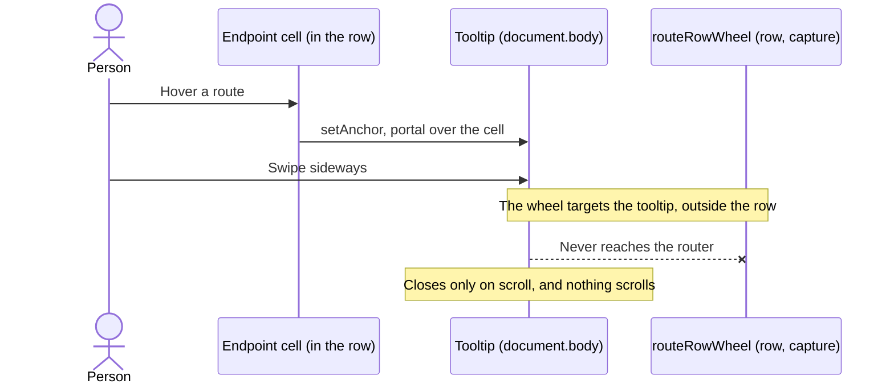
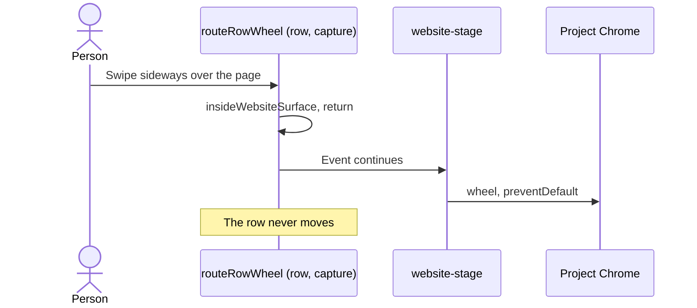
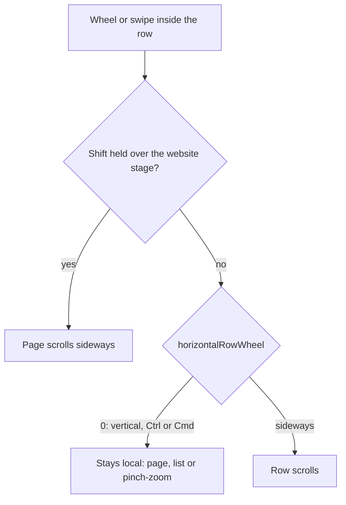
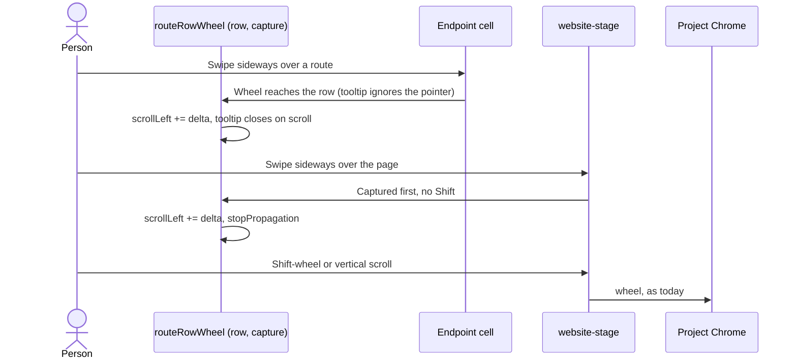

# Swipes keep moving the row over Traffic routes and the website

## Status

| Unit           | Result                                                                                                  |
| -------------- | ------------------------------------------------------------------------------------------------------- |
| Scope          | A sideways swipe moves the project row over a Traffic route and over the website box                    |
| Implementation | Written and source reviewed; runtime behaviour unverified                                               |
| Verification   | VSIX installed 2026-11-06; user passed hand checks 1–6; check 7 (desktop), tests and gate not run       |
| Amends         | Plan 81's `routeRowWheel` guard (`81-chorus-extension-website-box.md:1268-1272`). Its acceptance row 7 stands |

## Current / Issue

### Over a Traffic route

The full-route tooltip is portalled into `document.body` and drawn exactly over the Endpoint
cell, so it sits outside the row the wheel router listens on.



`apps/desktop/src/renderer/src/TrafficEndpoint.tsx:105-112`

```tsx
<div
  id={id}
  role="tooltip"
  className="traffic-url traffic-endpoint-tooltip"
  style={anchor}
  onPointerEnter={hold}
  onPointerLeave={leave}
>
```

### Over the website



`apps/desktop/src/renderer/src/workspace/row-drag.ts:26`

```ts
if (insideWebsiteSurface(event.target)) return
```

## Proposed



| Over the website stage                   | Goes to |
| ---------------------------------------- | ------- |
| Sideways trackpad swipe                  | Row     |
| Shift-wheel or Shift-swipe               | Page    |
| Vertical scroll                          | Page    |
| Pinch, Ctrl-wheel or Cmd-wheel           | Page    |

The tooltip stops taking pointer input, so a wheel over a route lands on the Endpoint cell, inside
the row, and the row's scroll closes the tooltip through its existing `scroll` listener.

### Deliberately not doing

- Removing the tooltip. Long routes still show in full on hover. Selecting text inside the
  tooltip goes; the cell's own text is unchanged.
- Desktop's native browser. Its page already sends sideways swipes to the row
  (`apps/desktop/src/preload/browser.ts:643-675`). It also sends Shift-wheel there, which the
  website box keeps for the page, as plan 81 row 7 requires.
- Page first, row at the page's edge. Every wheel event would wait on a round trip to Chrome.
- Keyboard routing. `Workspace.tsx`'s `insideWebsiteSurface` guard stays.
- `useShellOverlay` on the tooltip.

## Code Changes

### `apps/desktop/src/renderer/src/workspace/row-drag.ts`

```ts
export function routeRowWheel(row: HTMLElement): () => void {
  const onWheel = (event: WheelEvent): void => {
    if (event.shiftKey && insideWebsiteSurface(event.target)) return
    if (event.defaultPrevented) return
    const delta = horizontalRowWheel(event, row.clientWidth)
    if (delta === 0) return
    const strip = tabStripAt(event.target)
    const scrolled = strip !== null && stripCanMove(strip, delta) ? strip : row
    event.preventDefault()
    event.stopPropagation()
    scrolled.scrollLeft += delta
  }
  row.addEventListener('wheel', onWheel, { capture: true, passive: false })
  return () => {
    row.removeEventListener('wheel', onWheel, { capture: true })
  }
}
```

`stopPropagation` in the row's capture phase keeps the stage's own wheel listener
(`useBrowserScreencast.ts:435-450`) from also sending the swipe to Chrome.

### `apps/desktop/src/renderer/src/TrafficEndpoint.tsx`

The tooltip's pointer handlers go, since it no longer receives pointer events. The cell's
`onPointerEnter` and `onPointerLeave` alone open and close it.

```tsx
{anchor !== null &&
  createPortal(
    <div
      id={id}
      role="tooltip"
      className="traffic-url traffic-endpoint-tooltip"
      style={anchor}
    >
      {props.label}
    </div>,
    document.body
  )}
```

`cursor: style.cursor,` leaves the `setAnchor` style object, because the tooltip no longer
sets the pointer.

### `apps/desktop/src/renderer/src/styles.css`

`user-select: text` becomes `pointer-events: none`.

```css
.traffic-endpoint-tooltip {
  position: fixed;
  z-index: 90;
  box-sizing: border-box;
  width: max-content;
  max-width: none;
  overflow: visible;
  background: var(--bg-chrome);
  text-overflow: clip;
  white-space: nowrap;
  pointer-events: none;
}
```

### `docs/plans/81-chorus-extension-website-box.md`

The `row-drag.ts` snippet at lines 1268-1272 shows the new guard, followed by
`Amended by plan 82: a sideways swipe over the website moves the row; Shift-wheel stays with the page.`

## Verification, only when asked

By hand in VS Code, after a build and install you approve:

| #   | Check                                                                                  |
| --- | -------------------------------------------------------------------------------------- |
| 1   | A sideways swipe starting over an Endpoint cell moves the row, and the tooltip closes |
| 2   | Hovering a long route still shows the full route over the cell                         |
| 3   | Clicking a route selects it as before                                                  |
| 4   | A sideways swipe over the website moves the row                                        |
| 5   | Vertical scrolling and pinch-zoom over the website still act on the page               |
| 6   | Shift-wheel over a wide page scrolls the page sideways and leaves the row              |
| 7   | Desktop Chorus: a sideways swipe over a Traffic route moves the row                    |

Unit case for `apps/desktop/src/renderer/src/workspace/row-drag.test.ts`, inside
`describe('swiping along the row')`, with `WEBSITE_SURFACE_ATTRIBUTE` imported from
`'../website-surface.js'`:

```ts
it('moves the row for a sideways swipe over the website, and leaves Shift-wheel, scrolling and pinch to the page', () => {
  const stage = document.createElement('div')
  stage.setAttribute(WEBSITE_SURFACE_ATTRIBUTE, '')
  const page = document.createElement('div')
  stage.append(page)
  const scroller = row(stage)
  const stop = routeRowWheel(scroller)

  expect(swipe(page, { deltaX: 60, deltaY: 4 }).defaultPrevented).toBe(true)
  expect(scroller.scrollLeft).toBe(60)

  expect(swipe(page, { deltaX: 40, shiftKey: true }).defaultPrevented).toBe(false)
  expect(swipe(page, { deltaY: 80 }).defaultPrevented).toBe(false)
  expect(swipe(page, { deltaX: 60, ctrlKey: true }).defaultPrevented).toBe(false)
  expect(scroller.scrollLeft).toBe(60)
  stop()
})
```

jsdom does no hit-testing, so the tooltip half is proven by check 1, not by a unit test.

## Final Flow


