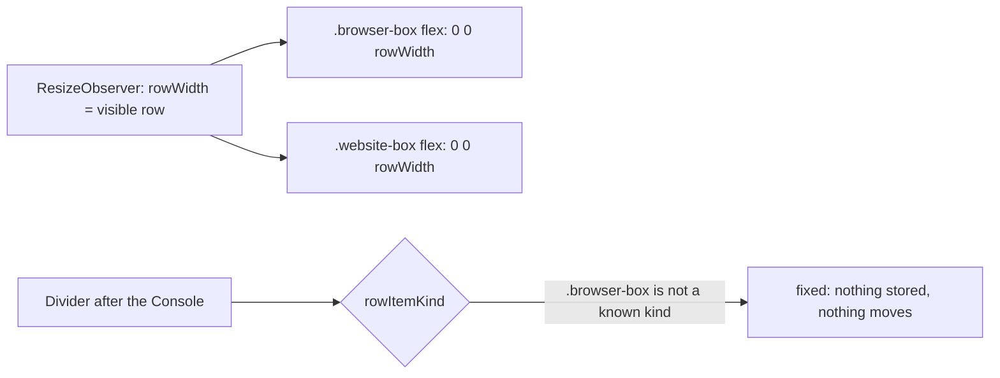
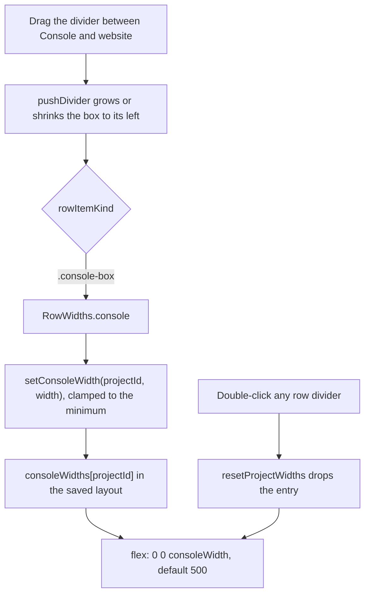
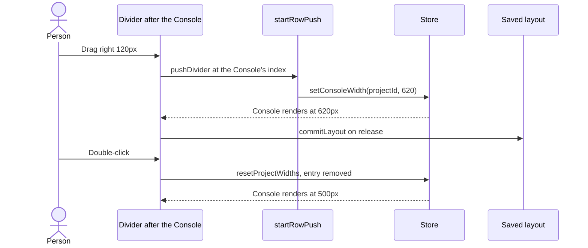

# The Console box is 500px and resizable, in VS Code

## Status

| Unit           | Result                                                                                                                                |
| -------------- | ------------------------------------------------------------------------------------------------------------------------------------- |
| Scope          | VS Code extension only: the Console box opens at 500px, drags wider or narrower, per project                                          |
| Implementation | Written and source reviewed; runtime behaviour unverified                                                                             |
| Verification   | VSIX installed 2026-11-06; hand checks pending. Test shapes to update: `open-projects.test.ts:73`, `row-drag.test.ts` RowWidths cases |
| Minimum        | 500px, like the other row boxes (user, 2026-11-06), so the Console only grows past its default                                        |

## Current / Issue



`apps/desktop/src/renderer/src/workspace/EditorPane.tsx:738`

```tsx
flex: `0 0 ${String(browserCollapsed ? COLLAPSED_BROWSER_WIDTH : rowWidth)}px`,
```

## Proposed



| Mode                   | Console box width                                      |
| ---------------------- | ------------------------------------------------------ |
| VS Code, never resized | 500px                                                  |
| VS Code, resized       | The dragged width, per project, kept across reloads    |
| VS Code, collapsed     | 100px, as today                                        |
| Desktop                | The visible row, as today; the box holds the live page |

### Deliberately not doing

- Desktop. Its box is the browser itself, so it keeps `rowWidth` and gets no `console-box` class.
- The website box. It stays as wide as the visible row.
- A maximum width. No other row box has one.

## Code Changes

`consoleWidths` mirrors `editorWidthFractions` at every touchpoint, so a width is saved, restored,
clamped on load, pruned with its project and cleared by reset in exactly the same places.

### `apps/desktop/src/shared/workspace-layout.ts`

```ts
export const CONSOLE_WIDTH = { default: 500, min: 500 } as const
```

In `WorkspaceSnapshot`, after `editorWidthFractions`, and in `ProjectLayoutSlice`, after
`editorWidthFraction`:

```ts
consoleWidths: z.record(z.string(), z.number()).default({}),
```

```ts
consoleWidth: z.number().optional(),
```

### `apps/desktop/src/renderer/src/workspace/layout.ts`

Beside `clampTrafficWidth` (`:965`):

```ts
export function clampConsoleWidth(width: number): number {
  if (!Number.isFinite(width)) return CONSOLE_WIDTH.default
  return Math.round(Math.max(CONSOLE_WIDTH.min, width))
}
```

`EMPTY_WORKSPACE` (`:165`), `sliceOf` (`:188`), `mergeSlice` (`:213`):

```ts
consoleWidths: {},
```

```ts
consoleWidth: workspace.consoleWidths[projectId],
```

```ts
consoleWidths: withEntry(workspace.consoleWidths, projectId, slice.consoleWidth),
```

`normalizeWorkspace` (`:414`) and the closed-project pruning (`:1311`):

```ts
consoleWidths: Object.fromEntries(
  Object.entries(workspace.consoleWidths).map(([projectId, width]) => [
    projectId,
    clampConsoleWidth(width),
  ])
),
```

```ts
consoleWidths: Object.fromEntries(
  Object.entries(workspace.consoleWidths).filter(([projectId]) =>
    allowedProjects.has(projectId)
  )
),
```

### `apps/desktop/src/renderer/src/workspace/store.ts`

The action type beside `setEditorWidthFraction` (`:338`), the snapshot field beside
`editorWidthFractions` (`:501`), the setter beside `setEditorWidthFraction` (`:1073`), and the
reset (`:1192`):

```ts
setConsoleWidth: (projectId: string, width: number) => void
```

```ts
consoleWidths: state.consoleWidths,
```

```ts
setConsoleWidth: (projectId, value) => {
  const width = clampConsoleWidth(value)
  if (get().consoleWidths[projectId] === width) return
  set((state) => ({ consoleWidths: { ...state.consoleWidths, [projectId]: width } }))
},
```

```ts
consoleWidths: Object.fromEntries(
  Object.entries(state.consoleWidths).filter(([id]) => id !== projectId)
),
```

### `apps/desktop/src/renderer/src/workspace/hooks.ts`

Beside `useEditorWidthFraction` (`:291`):

```ts
export function useConsoleWidth(projectId: string | null): number {
  return useWorkspaceStore((state) =>
    projectId === null
      ? CONSOLE_WIDTH.default
      : (state.consoleWidths[projectId] ?? CONSOLE_WIDTH.default)
  )
}
```

### `apps/desktop/src/renderer/src/workspace/row-drag.ts`

```ts
export interface RowWidths {
  readonly boxes: number[]
  readonly traffic: number | null
  readonly terminal: number | null
  readonly console: number | null
}

type RowItemKind = 'box' | 'traffic' | 'terminal' | 'console' | 'fixed'
```

In `rowItemKind`, after the collapsed check; in `rowItems`' minimums; in `rowWidths`:

```ts
if (element.classList.contains('console-box')) return 'console'
```

```ts
if (kind === 'console') return CONSOLE_WIDTH.min
```

```ts
const consoleAt = items.kinds.indexOf('console')
```

```ts
console: consoleAt < 0 ? null : (pushed[consoleAt] ?? null),
```

### `apps/desktop/src/renderer/src/workspace/EditorPane.tsx`

`setConsoleWidth` comes from the same store actions as `setTrafficWidth`.

```ts
const consoleWidth = useConsoleWidth(projectId)
```

```ts
const applyRow = (id: string) => (row: RowWidths) => {
  setConversationWidths(id, row.boxes)
  if (row.traffic !== null) setTrafficWidth(id, row.traffic)
  if (row.terminal !== null) setProjectTerminalWidth(id, row.terminal)
  if (row.console !== null) setConsoleWidth(id, row.console)
}
```

```tsx
<section
  className={capabilities.streamedBrowser ? 'browser-box console-box' : 'browser-box'}
  data-collapsed={browserCollapsed}
  style={{
    flex: `0 0 ${String(
      browserCollapsed
        ? COLLAPSED_BROWSER_WIDTH
        : capabilities.streamedBrowser
          ? consoleWidth
          : rowWidth
    )}px`,
  }}
>
```

## Compatibility

- `consoleWidths` is defaulted, so a saved layout from an older build still parses and opens at 500px.
- The schema is shared with the engine, so its bundle changes and Chorus needs **Restart and run again**.
- Existing tests that compare whole `RowWidths` objects or whole snapshots will need the new
  `console: null` and `consoleWidths: {}` fields. Codex lists them; they are updated only when asked.

## Verification, only when asked

| #   | Check                                                                           |
| --- | ------------------------------------------------------------------------------- |
| 1   | A project that was never resized shows the Console box at 500px                 |
| 2   | Dragging the divider between Console and website widens and narrows the Console |
| 3   | Dragging it back stops at 500px                                                 |
| 4   | The width survives Reload Window, and each project keeps its own                |
| 5   | Double-clicking a row divider puts it back to 500px                             |
| 6   | Collapse and expand still work                                                  |
| 7   | Desktop Chorus: the Browser box is unchanged                                    |

## Final Flow


