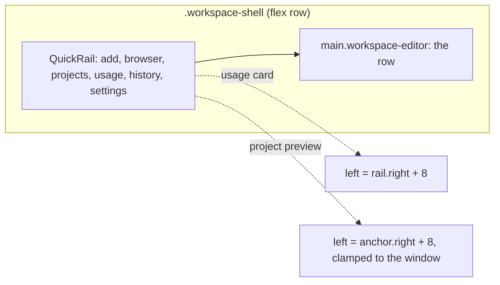
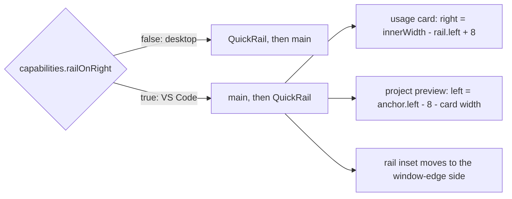
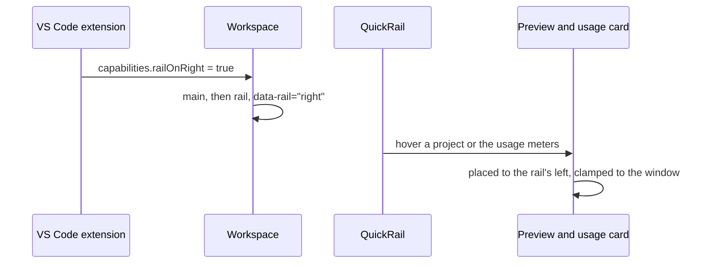

# The rail sits on the right in VS Code

## Status

| Unit           | Result                                                                                       |
| -------------- | -------------------------------------------------------------------------------------------- |
| Scope          | VS Code extension only: the whole quick rail moves to the right edge, as fixed as it is now  |
| Implementation | Written and source reviewed; runtime behaviour unverified                                    |
| Verification   | VSIX installed 2026-11-07; user passed checks 1–7; check 8 (desktop), tests and gate not run |

## Current / Issue



In VS Code, Chorus already lives in the secondary side bar at the window's right edge, so a rail on
the left sits between the editor and the row.

## Proposed



The rail is moved in the DOM, not with `row-reverse`, so Tab order still matches what is seen.

### Deliberately not doing

- Desktop. Its rail stays left, where its top inset clears the macOS window buttons.
- A setting to choose the side. The host decides.
- The drawer CSS (`.session-drawer`, `.workspace-sidebar-resize`). Nothing renders it.

## Code Changes

### `apps/desktop/src/shared/host-capabilities.ts`

```ts
export const HostCapabilities = z.object({
  embeddedEditor: z.boolean(),
  nativeBrowserViews: z.boolean(),
  streamedBrowser: z.boolean(),
  detachedWindows: z.boolean(),
  globalTerminal: z.boolean(),
  ownTheme: z.boolean(),
  railOnRight: z.boolean(),
})
```

`railOnRight: false` in `DESKTOP_CAPABILITIES`, `railOnRight: true` in `EXTENSION_CAPABILITIES`.

### `apps/desktop/src/renderer/src/workspace/Workspace.tsx`

The existing `<QuickRail … />` element, unchanged, is held in `rail` and placed by side; it stays
directly before or after `<main>`, ahead of `DragFeedback` and `ProjectPreviewHost`.

```tsx
const rail = <QuickRail /* the existing props, unchanged */ />

return (
  <div className="workspace-shell" data-rail={capabilities.railOnRight ? 'right' : 'left'}>
    {!capabilities.railOnRight && rail}
    <main className="workspace-editor" aria-label="Workspace">
      {/* unchanged */}
    </main>
    {capabilities.railOnRight && rail}
    <DragFeedback drag={drag.drag} />
    <ProjectPreviewHost /* unchanged */ />
  </div>
)
```

### `apps/desktop/src/renderer/src/styles.css`

The rail's inset is on its window-edge side; on the right it mirrors.

```css
.workspace-shell[data-rail='right'] .quick-rail {
  padding: var(--rail-top) calc(var(--step) * 2) calc(var(--step) * 2) 0;
}
```

Whatever spaces the row from the rail today is mirrored the same way, so the gap between them is
unchanged on the new side.

### `apps/desktop/src/renderer/src/workspace/QuickRail.tsx`

The usage card is placed by `right` when the rail is on the right; its measuring effect only
corrects `top`, so it keeps working with either side.

```ts
const [detail, setDetail] = useState<
  { top: number; left: number } | { top: number; right: number } | null
>(null)
```

```ts
setDetail(
  capabilities.railOnRight
    ? { top: Math.round(box.top), right: Math.round(window.innerWidth - box.left + 8) }
    : { top: Math.round(box.top), left: Math.round(box.right + 8) }
)
```

The tip's style spreads `detail` in place of `top: detail.top, left: detail.left`.

### `apps/desktop/src/renderer/src/workspace/ProjectPreviewCard.tsx`

```ts
const capabilities = useHostCapabilities()
```

```ts
const left = capabilities.railOnRight
  ? Math.max(margin, props.anchor.left - margin - box.width)
  : Math.min(props.anchor.right + margin, Math.max(margin, window.innerWidth - box.width - margin))
```

## Verification, only when asked

| #   | Check                                                                         |
| --- | ----------------------------------------------------------------------------- |
| 1   | In VS Code the rail is at the right edge, top to bottom as before             |
| 2   | It stays put while the row scrolls sideways                                   |
| 3   | The gap between the row and the rail matches today's gap on the left          |
| 4   | Hovering or pinning a project card opens its preview to the rail's left       |
| 5   | The Codex and Claude usage card opens to the rail's left, fully on screen     |
| 6   | Add project, browser, history and settings work as before                     |
| 7   | Dragging a project card from the rail into the row still works                |
| 8   | Desktop Chorus: the rail is still on the left, with its previews to the right |

## Final Flow


