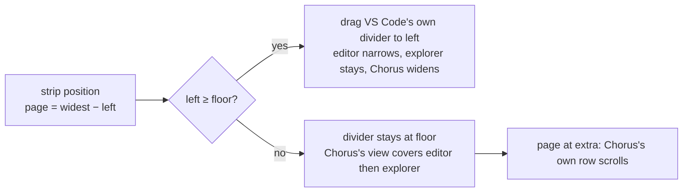
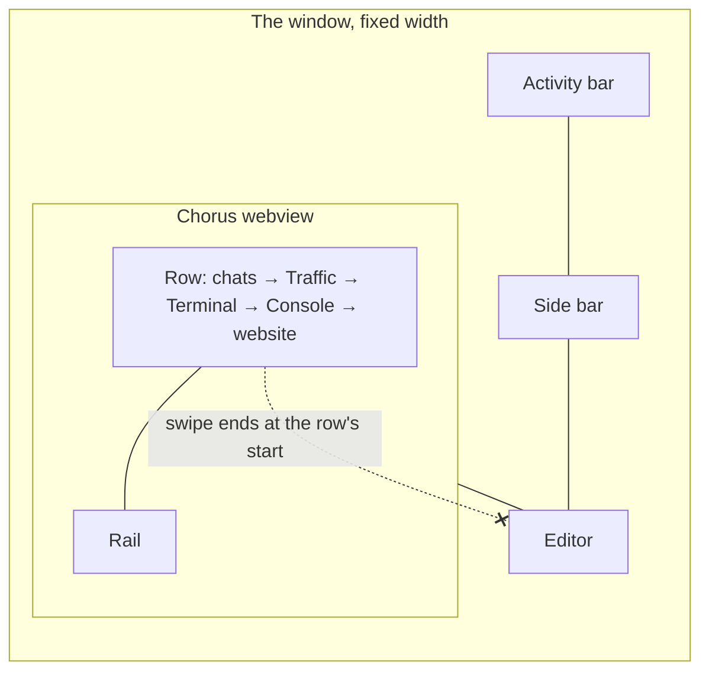
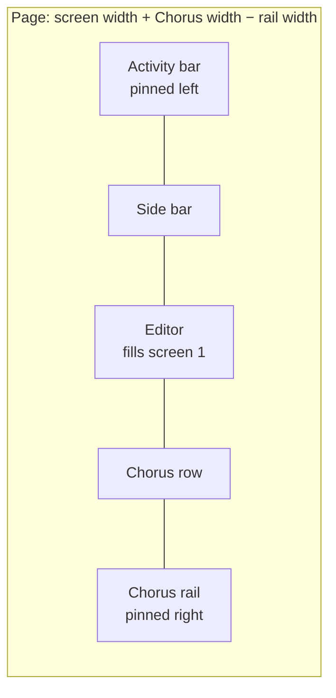
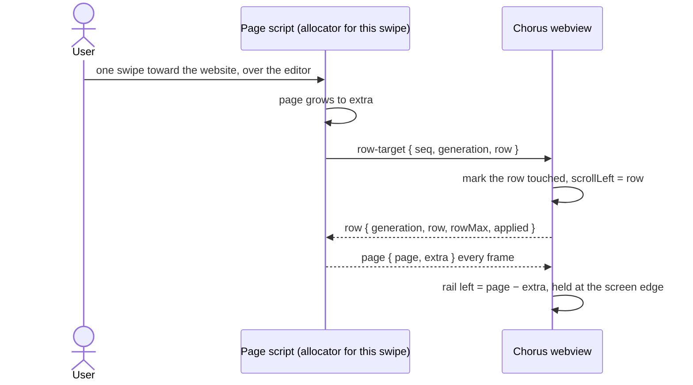
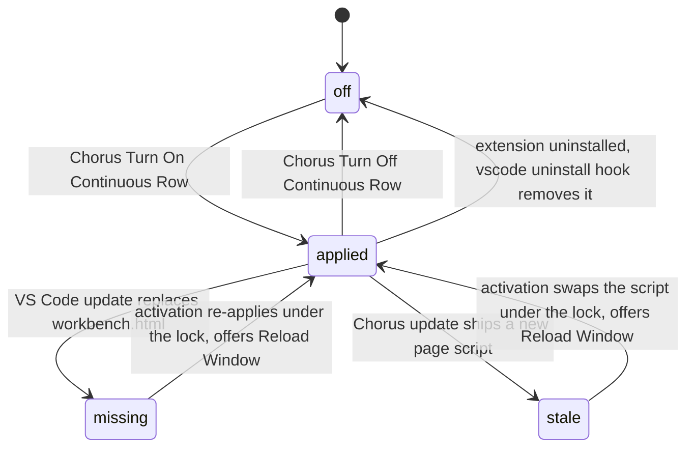
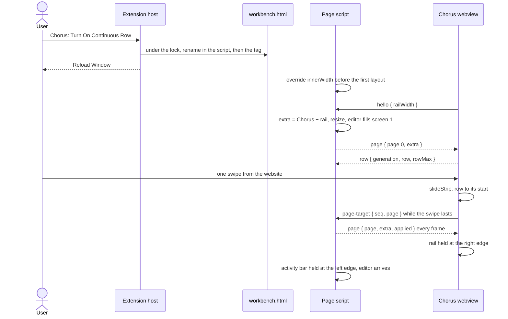

# 85 — One continuous row in VS Code: the editor slides with Chorus

## Status

| Unit            | Result                                                                                                                                                                        |
| --------------- | ----------------------------------------------------------------------------------------------------------------------------------------------------------------------------- |
| Scope           | VS Code extension only: Chorus patches VS Code's `workbench.html` so the editor and Chorus slide as one row                                                                   |
| Decided         | 2026-11-07 by the user, listed below                                                                                                                                          |
| Prototype       | The DevTools snippet (fake `innerWidth` + `resize` + capture wheel) worked in the user's VS Code 1.145.2                                                                      |
| codex challenge | 2026-11-07, 13 findings; every one resolved in this revision, see Review                                                                                                      |
| Implementation  | Revision 3 built and installed 2026-11-07, uncommitted. The extension patches three VS Code files (`workbench.html`, `mainImpl.js`, `preload-browserView.js`), see Revision 3 |
| Phase 0         | Not run. Runs only when asked                                                                                                                                                 |
| Verification    | Swipes checked live with screenshots on 2026-11-07, see Revision 3. Unit tests, typecheck and lint not run                                                                    |

## Revision 3, 2026-11-07 — what was really broken, and swipes over webviews and the browser

**Supersedes the sections below wherever they differ.** Everything here was checked live with synthetic trackpad swipes (a Swift `CGEvent` script, pixel deltas with gesture phases) and a screenshot after each, except the Markdown preview, which the user confirmed by hand.

### Causes and fixes

| #   | Symptom                                                                                                    | Cause                                                                                                                                                                                                                                                                                                                                                                                                           | Fix                                                                                                                                                                                                                                                                                                                                                                  |
| --- | ---------------------------------------------------------------------------------------------------------- | --------------------------------------------------------------------------------------------------------------------------------------------------------------------------------------------------------------------------------------------------------------------------------------------------------------------------------------------------------------------------------------------------------------- | -------------------------------------------------------------------------------------------------------------------------------------------------------------------------------------------------------------------------------------------------------------------------------------------------------------------------------------------------------------------- |
| 1   | A swipe over Chorus stopped at the first chat; the editor slid over Chorus's content instead of pushing it | VS Code ran a cached older `chorus-continuous-row.js`. A built VS Code serves its own files without `no-cache`, which it adds only in development (`mainImpl.js`: `isBuilt\|\|(s={...s,...vR})`), so Reload Window kept the old copy. That script sent `page` without `inset`; the bridge requires the field, dropped every message, never shifted Chorus's body and believed the page had nothing to give back | `patch.ts` writes the tag with the script's content hash, `chorus-continuous-row.js?v=<first 12 hex of sha256>`. Detection and removal match both the versioned and the unversioned tag, so an install carrying the old tag reads `stale` and is upgraded on activation                                                                                              |
| 2   | The bridge followed no row until a pane was clicked                                                        | `focusedPaneId` starts `null` (`layout.ts:156`), and the bridge accepted only the focused pane's row                                                                                                                                                                                                                                                                                                            | `stripPaneId()` and `stripRow()` in `main.ts` use the focused pane, or `firstRegisteredPane()` from `row-drag.ts` when none is focused                                                                                                                                                                                                                               |
| 3   | A swipe over a Markdown preview did nothing                                                                | `.md` files open in VS Code's built-in preview (the user's `"*.md": "vscode.markdown.preview.editor"`), a webview, so its wheels never reach the page. VS Code's wrapper reports every wheel as `did-scroll-wheel` over a private port (`pre/index.html:787-799`) that only notebooks act on                                                                                                                    | `page.ts` sees each `webview-ready` window message, listens on the same `MessagePort`, and slides on horizontal reports. Chorus's own webview is skipped                                                                                                                                                                                                             |
| 4   | A swipe over VS Code's built-in browser did nothing                                                        | The browser is a native view. Its preload forwards only key presses, and main's `input-event` carries no wheel deltas: a relay on it alone never fired                                                                                                                                                                                                                                                          | `patch.ts` patches two more VS Code files. `preload-browserView.js` sends trusted, mostly horizontal wheels on `vscode:browserView:chorusWheel`; `mainImpl.js` forwards them to the window as `vscode:chorusBrowserWheel` (the name lives in `protocol.ts`); `page.ts` listens through `window.vscode.ipcRenderer`. See "The browser relay is the extension's" below |
| 5   | The browser stayed drawn over Chorus while Chorus covered the editor                                       | A native view is composited above the page. VS Code's `browserOverlayManager` swaps the browser for a screenshot only when an element with one of its tracked classes is topmost at the overlap's corner, and it skips webview elements, so Chorus's frame never counts                                                                                                                                         | `page.ts` adds `#chorus-row-veil`, a 2px transparent strip carrying `spotlight-overlay` (tracked as "unknown", so no "Paused" message), placed 1px inside the browser's `.browser-container` within the covered span. It is shown and hidden through its own `style`, the only change the manager notices                                                            |

Nothing else in VS Code reacts to `spotlight-overlay`: onboarding keeps a reference to its own element, and the only other file using the class belongs to the Agents window.

### The browser relay is the extension's

The relay was first applied by hand to prove it; `patch.ts` now owns it, under the same switch, lock and per-install record as the `workbench.html` tag.

- **Exact text before a unique anchor.** Each relay is a fixed string inserted before an anchor that must occur exactly once: `e.ipc.on("vscode:browserView:keydown",o)` in `mainImpl.js`, and the browser preload's `keydown` listener. Turning off deletes exactly that string, so both files return byte for byte. The preload's line calls `require("electron").ipcRenderer` rather than the bundle's minified local name.
- **A changed VS Code is skipped, not refused.** If a file is missing or its anchor is not found exactly once, that relay is left out and everything else still applies: only swipes that start over VS Code's browser stop sliding. `workbench.html` keeps its shape check.
- **State.** A wanted relay that is absent while its anchor is present makes the patch `stale`, so a VS Code update that rewrites either file is repaired on the next activation. A leftover relay with the patch off makes it not `missing`, so it is removed.
- **A full quit, said plainly.** The main process and the preload load only at start, so a reload does not reach them. `setPatch` and `restorePatch` report whether either file changed (`restorePatch` returns `{ outcome, relaunch }`), and then `extension.ts` shows a new notice instead of the reload one: VS Code's own files changed, quit and reopen, with a **Quit VS Code** button (`workbench.action.quit`). Two strings in `en.json`: `relaunch` and `quit`.
- **Neither file is in `product.json`'s checksums**, so no further "corrupt" warning.

### Corrections to the record below

- "VS Code's logs showed the new page script was loaded, so this was not version skew" (Revision 2), and the 13:00 build recorded as loaded, rested on file times and logs, not on the code running. After cause 1, neither failure below can be read as a test of its design.
- "The reader requires the field, so an older page script is ignored, which makes the skew between an update's first and second reload harmless" is the mechanism that hid cause 1. With a cached script the skew is permanent, not one reload long.

### Verified live

| Swipe                                                                                              | Result                                                                                                               |
| -------------------------------------------------------------------------------------------------- | -------------------------------------------------------------------------------------------------------------------- |
| Over the editor, toward the website                                                                | The editor narrows to its minimum, then Chorus covers it with the first chat whole beside it                         |
| Over Chorus, both directions                                                                       | Hands off to the page; back, the row returns to the first chat before the editor widens, ending exactly at the start |
| Over the activity bar, out and back                                                                | Chorus covers the editor and explorer and stops at the activity bar; the row goes back first                         |
| Over VS Code's browser, both directions                                                            | The editor narrows and widens with the swipe                                                                         |
| Chorus to full width with the browser open, and back                                               | The browser hides under Chorus at every width and returns live                                                       |
| Over VS Code's browser after the extension applied the relay itself, one Quit VS Code and a reopen | The editor narrows and widens with the swipe; each VS Code file carries the relay exactly once                       |

### Not done yet

- Turn Off and uninstall removing the relay from VS Code's real files has not been checked live; only `patch.test.ts` covers it, and it has not been run.
- One continuous swipe that starts over the browser stops when the editor reaches its minimum; a second swipe carries on. The likely cause is the gesture being lost once the native view's edge passes under the pointer. Not verified.
- With two browsers side by side in split editors, only the first is hidden while Chorus covers them.
- Accepted for now: sideways-scrollable content inside a webview scrolls and slides at once, because a reported wheel cannot be cancelled.
- Unit tests, typecheck and lint have not been run since Revision 2, and codex has not reviewed this revision.

## Revision 2, 2026-11-07 — follow desktop: the editor narrows

**Supersedes the slide below wherever they differ.** The user tried the slide and asked for desktop's behaviour exactly: the editor narrows while the explorer stays visible, and one swipe is one global scroll whether it starts over the editor or over Chorus.

What desktop does, read from `EditorPane.tsx` (the gutter) and `editorViewport` in `layout.ts:1066`: the activity bar sits in a gutter outside the scroller; the workbench's native view keeps its left edge at the activity bar and its right edge follows the row, re-laid out down to `EDITOR_WIDTH.min` (500px for activity bar, explorer and editor together); below that the row covers it from the right until only the activity bar is left; the other way the editor widens to the full window.

Why the slide's fake width could not narrow the editor: VS Code's `SplitView.resize` takes a size change from the view nearest the end first unless a priority says otherwise, and the secondary side bar is last. A prototype that faked a narrower window shrank Chorus's side bar to a sliver and left the editor wide; the user's screenshot showed exactly that.

What it does instead:



- **Divider, not width.** `sash.ts` starts a drag on `mousedown` on the sash and follows `mousemove`/`mouseup` on the window, reading only `pageX` and never `isTrusted`. `page.ts` finds the vertical sash at the editor's right edge and drives it with synthetic mouse events; a drag ends 140ms after the last wheel, or at once on any real mouse event. VS Code keeps the new width, as after a hand drag, and a hand drag is followed.
- **Cover below the floor.** `floor = max(500, explorer right + 220)`. Below it the divider stays put and Chorus's overlay webview is moved over the editor (`left`, `width`, `clip-path: none`), with a plain strip over the tab bar above it.
- **One strip across both frames** with the existing protocol: `page = widest − left`, `extra = widest − activity bar right`; toward the website the editor narrows first, then Chorus's row scrolls; back, the row first, then the editor widens.
- **Removed:** the `innerWidth` override, page scrolling, the activity, title and status bar pins, the pop-up offsets, the rail shift and the rail reveal. Nothing slides, so none is needed; desktop's rail never moves the row. `QuickRail.tsx` and `styles.css` are back to `main`. `hello` carries only the session.
- **Limit:** Chorus stops at 180px at the widest-editor end, VS Code's own side-bar minimum, where desktop goes down to the rail alone.
- **Unverified:** everything at runtime, including whether a swipe that starts over Chorus keeps arriving while VS Code's drag turns off pointer events on webviews.

**Rail flicker, found by the user on the installed build, same day.** The rail blinked while swiping, and also while dragging the divider by hand. A screen recording (18s, 60 fps) measured frame by frame showed single-frame dips in the rail's brightness, and the frames themselves (#415–#417, #205–#207) show all of Chorus, rail included, drawn about 60px too far left with an empty band on the right for one frame. That is the browser showing a webview's previous picture in its resized box until the frame redraws, on every frame the width changes. Desktop never resizes a frame per frame, so it never shows this.

**Reverted the same day.** Installed, it broke scrolling: a black band appeared between the divider and Chorus, and the rail was pushed off screen. VS Code's logs showed the new page script was loaded, so this was not version skew. Chorus shifted its body, but VS Code's page did not hold or clip the frame. The suspect is `chorusContent()`, which needs a `position: fixed` ancestor of Chorus's iframe that may not exist for side-bar webviews. Next attempt only after a live-page check. Smoothness was then measured from the user's recording (60 fps, frames that changed): 22% of frames late while the editor narrows, 9% while only Chorus's row scrolls. The fix below is kept as a record of what was tried.

**Second attempt, after a live-page check.** The user ran a read-only console report while the broken build was still loaded. It showed VS Code's half working: Chorus's `div.webview-overlay-content` (`position: fixed`) was found and marked, held at left 48 / width 1429, and clipped with `inset(0 0 0 5px)`. So the failure was Chorus's half: it worked out its own shift from its mirror of the position, and that drifted from the real clip. Changes:

- **The page sends the exact clip value** (`inset` on every `page` message), and Chorus applies only that. The reader requires the field, so an older page script is ignored, which makes the skew between an update's first and second reload harmless. The page sends a non-zero `inset` only while it actually holds the frame.
- **Less work per frame (improvement 2).** The frame and cover values are custom properties on those two elements, not on `<html>`, so a frame does not restyle VS Code's whole page. The resize observer measures straight away for hand drags and skips its pass during the script's own drags.
- **Chorus's pinned overlays follow the shift.** `body` gets `margin-left: inset`. `.sheet-backdrop` and `.note-zoom` (`inset: 0`) get `left: inset`, `.zoom-badge` is re-centred on the visible part, and `.global-note` is capped to the visible width. Everything else is placed by script from element or pointer coordinates and needs nothing. `html` takes `--ground`, so any one-frame seam shows Chorus's colour, not black. All of it applies only under `html.continuous-row`.

Fix (tried, reverted): while active, Chorus's frame is held at full width, from the activity bar to the screen edge, and never resizes. `page.ts` clips it with `clip-path: inset(0 0 0 <hidden>)` in the same frame as the divider moves, and the clip also blocks clicks on the hidden part. Chorus shifts its `<body>` right by the hidden amount, which is `extra − page` from its own mirror, so swipes that start over Chorus shift with no delay. The body gets `contain: layout`, so Chorus's dialogs and cards position within the visible part. The rule applies only under `html.continuous-row`, which the webview adds, so desktop is untouched. Cost: swipes over the editor shift Chorus one message late, at worst a few pixels of Chorus's own background at the seam for one frame; and the frame is always nearly full screen.

**codex review of Revision 2, same day: six findings, all fixed in `page.ts`.** Codex confirmed the synthetic events match the installed sash handlers and that VS Code's layout during a drag is synchronous.

| #   | Finding                                                                                                                      | Fix                                                                                                                                                                                                                                                              |
| --- | ---------------------------------------------------------------------------------------------------------------------------- | ---------------------------------------------------------------------------------------------------------------------------------------------------------------------------------------------------------------------------------------------------------------- |
| 1   | P1: split editor groups raise the editor minimum, so the drag can squeeze the explorer or stop early while `left` runs ahead | After each drag, if the explorer shrank, the drag is pulled back by that much in the same frame (the sash measures from the drag's start, so the explorer is restored). Covering starts wherever the real divider stopped, and the applied position is published |
| 2   | P1: the cover could attach to a Chorus Markdown preview, which shares the extension id                                       | The iframe whose child frame sent `hello` is remembered and is the only one marked; old marks are cleared                                                                                                                                                        |
| 3   | P2: the header strip sat outside `.monaco-workbench`, without theme variables and above Quick Open                           | Appended inside `.monaco-workbench`                                                                                                                                                                                                                              |
| 4   | P2: a hand drag into the cover range was fought by a scripted drag                                                           | A trusted `mousedown` on a sash marks a hand drag; no scripted drag runs until its `mouseup`, and its position is adopted, uncovering                                                                                                                            |
| 5   | P2: a Panel docked right puts the editor's sash beside the Panel, not Chorus                                                 | The sash is found at Chorus's left edge, and the feature is inactive unless that edge meets the editor                                                                                                                                                           |
| 6   | P2: a target received while inactive was never acknowledged                                                                  | Acknowledged at once with the inactive snapshot                                                                                                                                                                                                                  |

Decided by the user on 2026-11-07:

- **Chorus applies the patch itself** (route B), with commands to turn it on and off.
- **The "installation appears to be corrupt" warning is dismissed**, never silenced. `product.json` is not touched.
- **One swipe crosses the whole row without stopping**, website to editor and editor to website.
- **Chorus keeps the width you drag it to**; the editor always fills the first screen.
- **After a VS Code update Chorus re-applies the patch by itself** and offers Reload Window.
- **Pinned while sliding:** VS Code's activity bar on the screen's left edge, Chorus's project rail on the screen's right edge.

Evidence this plan rests on, read from the installed VS Code 1.145.2:

| Fact                                                                                  | Where                                                                                               |
| ------------------------------------------------------------------------------------- | --------------------------------------------------------------------------------------------------- |
| The workbench lives in `body`, and for `body` the layout measures `window.innerWidth` | `desktop.main.ts` `new Workbench(mainWindow.document.body`; `iv()` in the bundle                    |
| A plain window `resize` re-runs the layout                                            | `G(It,re.RESIZE,()=>this.layoutService.layout())`                                                   |
| The grid gives width changes to the editor, so a wider page lands in the editor       | `proportionalLayout:false` (codex, installed bundle)                                                |
| The editor swallows sideways wheels by default                                        | `alwaysConsumeMouseWheel:!0`                                                                        |
| Scripts load only as files from VS Code's own folder; Trusted Types enforced          | `workbench.html` CSP: `script-src 'self' 'unsafe-eval' blob:`, `require-trusted-types-for 'script'` |
| Inline `<style>` is allowed                                                           | `style-src 'self' 'unsafe-inline'`                                                                  |
| The "corrupt" check hashes 10 files, `workbench.html` among them                      | `product.json` `checksums`                                                                          |
| The app folder is the user's own, so no `sudo`                                        | `drwxr-xr-x mohammadtaleb staff`                                                                    |
| The secondary side bar names its active view                                          | `data-active-composite="workbench.view.extension.chorus-sidebar"`                                   |
| Quick Open is centred by plain CSS, not a transform                                   | `.quick-input-widget{position:absolute;width:600px;…;left:50%}`                                     |
| Notifications sit by `right`, or by `left` when `.bottom-left`                        | `.notifications-toasts{…right:3px…}`, `.bottom-left{right:auto;left:3px}`                           |

## Current / Issue



Every VS Code part is cut from the window's width, so the editor and Chorus can never both be wider than the screen. A swipe in Chorus stops at the row's start; a swipe over the editor never reaches Chorus.

## Proposed

The page script tells VS Code the window is wider by Chorus's width minus the rail, lets the page scroll sideways, and pins two things to the screen.



| Name       | Value                                                       |
| ---------- | ----------------------------------------------------------- |
| `screen`   | the real `innerWidth`                                       |
| `chorus`   | width of `#workbench.parts.auxiliarybar`                    |
| `rail`     | width of Chorus's `.quick-rail`, sent by Chorus             |
| `extra`    | `chorus − rail`; the faked `innerWidth` is `screen + extra` |
| `page`     | the page's `scrollLeft`, `0 … extra`                        |
| `row`      | the focused Chorus row's `scrollLeft`, `0 … rowMax`         |
| rail shift | `page − extra`, applied to the rail inside the webview      |

At `page = 0` the screen shows the activity bar, side bar, editor, and the rail at the right edge. At `page = extra` it shows Chorus in full with the rail where it sits today.

### One strip, one allocator per swipe

The page and the row act as one strip. A swipe toward the website moves the page first, then the row; a swipe toward the editor moves the row first, then the page (`slideStrip`).

A swipe's wheel events all arrive in one frame, so **the frame receiving the swipe allocates every delta of it**. It keeps a mirror of the other side, moves its own scroller, and sends the other side an **absolute** target with a sequence number. The other side applies targets and reports its position with the last sequence it applied; a report older than the last target sent is ignored. Reversals mid-swipe therefore cannot leave the row advanced while the page is short of Chorus.

The row's targets also carry a **generation**: the registration number of the focused row. A project switch or a focus change registers a new row, and targets for an old one are dropped.

```mermaid
sequenceDiagram
    actor User
    participant Chorus as Chorus webview (allocator for this swipe)
    participant Page as Page script

    Note over Chorus,Page: page = 90, extra = 100, row = 0
    User->>Chorus: +30
    Chorus->>Chorus: slideStrip → page 100, row 20; row = 20
    Chorus->>Page: page-target { seq 1, page 100 }
    User->>Chorus: −30
    Chorus->>Chorus: slideStrip → page 90, row 0; row = 0
    Chorus->>Page: page-target { seq 2, page 90 }
    Page->>Page: apply seq 1, then seq 2 → page 90
    Page-->>Chorus: page { page 90, extra 100, applied 2 }
    Note over Chorus,Page: page = 90, row = 0, as one strip requires
```



### Turning it on, and after updates



Whether the user wants it is kept **per VS Code installation**, in `~/.chorus/vscode-continuous-row.json` keyed by app root, not in `globalState`, which is per profile. Every change happens under one lock file beside `workbench.html`, re-reading the state inside it, so two windows restoring at startup, or an enable racing a disable, end in one consistent file.

The page script is inert unless all hold: Chorus said hello, the secondary side bar shows Chorus, and the editor part is visible. So a window with Chorus hidden, another view in the side bar, or Chorus maximized behaves exactly as stock VS Code.

If VS Code ever fails to start after the patch: delete the line `<script src="./chorus-continuous-row.js"></script>` from `workbench.html`, or reinstall VS Code. A VS Code update also replaces the file.

## Code Changes

### NEW `apps/extension/src/continuous-row/protocol.ts`

Shared by the page script and the webview. No zod: the page runs under Trusted Types, and zod's `new Function` probe can raise a policy violation there. Pure, so it is unit tested.

```ts
export const CONTINUOUS_ROW = 'chorus-continuous-row'
export const CHORUS_COMPOSITE = 'workbench.view.extension.chorus-sidebar'
export const CHORUS_EXTENSION_ID = 'mohammadtmohsen.chorus'

type Envelope = { readonly source: typeof CONTINUOUS_ROW }

export type RowMessage = Envelope &
  (
    | { readonly kind: 'hello'; readonly railWidth: number }
    | {
        readonly kind: 'row'
        readonly generation: number
        readonly row: number
        readonly rowMax: number
        readonly applied: number
      }
    | { readonly kind: 'page-target'; readonly seq: number; readonly page: number }
  )

export type PageMessage = Envelope &
  (
    | {
        readonly kind: 'page'
        readonly page: number
        readonly extra: number
        readonly applied: number
      }
    | {
        readonly kind: 'row-target'
        readonly seq: number
        readonly generation: number
        readonly row: number
      }
  )

export interface Strip {
  readonly page: number
  readonly extra: number
  readonly row: number
  readonly rowMax: number
}

function envelope(data: unknown): object | null {
  return typeof data === 'object' && data !== null && Reflect.get(data, 'source') === CONTINUOUS_ROW
    ? data
    : null
}

function numbers<K extends string>(data: object, keys: readonly K[]): Record<K, number> | null {
  const picked: Partial<Record<K, number>> = {}
  for (const key of keys) {
    const value: unknown = Reflect.get(data, key)
    if (typeof value !== 'number' || !Number.isFinite(value)) return null
    picked[key] = value
  }
  return picked as Record<K, number>
}

export function readRowMessage(data: unknown): RowMessage | null {
  const message = envelope(data)
  if (message === null) return null
  const kind: unknown = Reflect.get(message, 'kind')
  if (kind === 'hello') {
    const read = numbers(message, ['railWidth'])
    return read === null || read.railWidth < 0 ? null : { source: CONTINUOUS_ROW, kind, ...read }
  }
  if (kind === 'row') {
    const read = numbers(message, ['generation', 'row', 'rowMax', 'applied'])
    return read === null ? null : { source: CONTINUOUS_ROW, kind, ...read }
  }
  if (kind === 'page-target') {
    const read = numbers(message, ['seq', 'page'])
    return read === null ? null : { source: CONTINUOUS_ROW, kind, ...read }
  }
  return null
}

export function readPageMessage(data: unknown): PageMessage | null {
  const message = envelope(data)
  if (message === null) return null
  const kind: unknown = Reflect.get(message, 'kind')
  if (kind === 'page') {
    const read = numbers(message, ['page', 'extra', 'applied'])
    return read === null ? null : { source: CONTINUOUS_ROW, kind, ...read }
  }
  if (kind === 'row-target') {
    const read = numbers(message, ['seq', 'generation', 'row'])
    return read === null ? null : { source: CONTINUOUS_ROW, kind, ...read }
  }
  return null
}

export function slideExtra(chorusWidth: number, railWidth: number): number {
  return Math.max(0, Math.round(chorusWidth - railWidth))
}

export function railShift(page: number, extra: number): number {
  return Math.min(0, Math.round(page - extra))
}

export function slideStrip(strip: Strip, delta: number): Strip {
  if (delta > 0) {
    const page = Math.min(strip.extra, strip.page + delta)
    const row = Math.min(strip.rowMax, strip.row + delta - (page - strip.page))
    return { ...strip, page, row }
  }
  const row = Math.max(0, strip.row + delta)
  const page = Math.max(0, strip.page + delta - (row - strip.row))
  return { ...strip, page, row }
}
```

### NEW `apps/extension/src/continuous-row/page.ts`

Bundled to `dist/continuous-row.js`, loaded by `workbench.html` before `workbench.js`, so the `innerWidth` override is in place before the first layout. Overlays are moved with `left` and margins, never transforms: Quick Open animates with transforms and relies on having no containing block for its item hovers. The rule for Quick Open carries no `!important`, so an anchored Quick Open's inline `left` still wins.

Shift and Alt wheels over the editor stay with the editor: they are how a long line scrolls sideways. Delta normalization is shared with Chorus through `horizontalRowWheel`.

```ts
import { horizontalRowWheel } from '../../../desktop/src/renderer/src/workspace/viewport.js'
import {
  CHORUS_COMPOSITE,
  CHORUS_EXTENSION_ID,
  CONTINUOUS_ROW,
  readRowMessage,
  slideExtra,
  slideStrip,
  type PageMessage,
} from './protocol.js'

const PAGE_CSS = `
html.chorus-continuous-row { scrollbar-width: none; }
html.chorus-continuous-row body { overflow-x: auto; overflow-y: hidden; }
html.chorus-continuous-row .split-view-view:has(> #workbench\\.parts\\.activitybar) {
  transform: translateX(var(--chorus-row-left, 0px));
  z-index: 40;
}
html.chorus-continuous-row .monaco-workbench > .notifications-toasts:not(.bottom-left),
html.chorus-continuous-row .monaco-workbench > .notifications-center:not(.bottom-left) {
  margin-right: var(--chorus-row-gap, 0px);
}
html.chorus-continuous-row .monaco-workbench > .notifications-toasts.bottom-left,
html.chorus-continuous-row .monaco-workbench > .notifications-center.bottom-left {
  margin-left: var(--chorus-row-left, 0px);
}
html.chorus-continuous-row .quick-input-widget {
  left: calc(50% + var(--chorus-row-center, 0px));
}
`

const innerWidthDescriptor =
  Object.getOwnPropertyDescriptor(window, 'innerWidth') ??
  Object.getOwnPropertyDescriptor(Window.prototype, 'innerWidth')
const screenWidth = (): number => Number(innerWidthDescriptor?.get?.call(window) ?? 0)
const scroller = (): Element => document.scrollingElement ?? document.documentElement

let chorusFrame: Window | null = null
let railWidth = 0
let extra = 0
let measuring = false
let mirror = { generation: -1, row: 0, rowMax: 0 }
let sentRowSeq = 0
let appliedPageSeq = 0

Object.defineProperty(window, 'innerWidth', {
  configurable: true,
  enumerable: true,
  get: () => screenWidth() + extra,
})

const style = document.createElement('style')
style.textContent = PAGE_CSS
document.head.append(style)

function send(message: PageMessage): void {
  chorusFrame?.postMessage(message, '*')
}

function publish(): void {
  const page = scroller().scrollLeft
  const root = document.documentElement.style
  root.setProperty('--chorus-row-left', `${page}px`)
  root.setProperty('--chorus-row-gap', `${Math.max(0, extra - page)}px`)
  root.setProperty('--chorus-row-center', `${Math.round(page - extra / 2)}px`)
  send({ source: CONTINUOUS_ROW, kind: 'page', page, extra, applied: appliedPageSeq })
}

function measure(): void {
  const chorus = document.getElementById('workbench.parts.auxiliarybar')
  const editor = document.getElementById('workbench.parts.editor')
  const sliding =
    chorusFrame !== null &&
    chorus?.getAttribute('data-active-composite') === CHORUS_COMPOSITE &&
    (editor?.getBoundingClientRect().width ?? 0) > 0
  const next = sliding ? slideExtra(chorus?.getBoundingClientRect().width ?? 0, railWidth) : 0
  if (next !== extra) {
    extra = next
    document.documentElement.classList.toggle('chorus-continuous-row', extra > 0)
    window.dispatchEvent(new Event('resize'))
    if (extra === 0) scroller().scrollLeft = 0
  }
  publish()
}

function scheduleMeasure(): void {
  if (measuring) return
  measuring = true
  requestAnimationFrame(() => {
    measuring = false
    if (document.querySelector('.monaco-sash.active') !== null) {
      window.addEventListener('pointerup', scheduleMeasure, { once: true })
      return
    }
    measure()
  })
}

function slide(delta: number): void {
  const element = scroller()
  const strip = { page: element.scrollLeft, extra, row: mirror.row, rowMax: mirror.rowMax }
  const next = slideStrip(strip, delta)
  element.scrollLeft = next.page
  if (next.row === strip.row) return
  sentRowSeq += 1
  mirror = { ...mirror, row: next.row }
  send({
    source: CONTINUOUS_ROW,
    kind: 'row-target',
    seq: sentRowSeq,
    generation: mirror.generation,
    row: next.row,
  })
}

function isChorusFrame(source: MessageEventSource | null): source is Window {
  if (source === null || source instanceof MessagePort) return false
  for (const frame of document.querySelectorAll<HTMLIFrameElement>('iframe.webview')) {
    if (!frame.src.includes(`extensionId=${CHORUS_EXTENSION_ID}`)) continue
    const host = frame.contentWindow
    if (host === null) continue
    for (let index = 0; index < host.length; index += 1) {
      if (host[index] === source) return true
    }
  }
  return false
}

window.addEventListener(
  'wheel',
  (event) => {
    if (extra === 0 || event.altKey || event.shiftKey) return
    const delta = horizontalRowWheel(event, screenWidth())
    if (delta === 0) return
    event.preventDefault()
    event.stopPropagation()
    slide(delta)
  },
  { capture: true, passive: false }
)

window.addEventListener('message', (event: MessageEvent<unknown>) => {
  if (!event.origin.startsWith('vscode-webview://')) return
  const message = readRowMessage(event.data)
  if (message === null || !isChorusFrame(event.source)) return
  if (message.kind === 'hello') {
    chorusFrame = event.source
    railWidth = message.railWidth
    scheduleMeasure()
  } else if (message.kind === 'row') {
    if (message.generation !== mirror.generation || message.applied >= sentRowSeq) {
      mirror = { generation: message.generation, row: message.row, rowMax: message.rowMax }
    }
  } else {
    appliedPageSeq = message.seq
    scroller().scrollLeft = message.page
    publish()
  }
})

window.addEventListener('scroll', publish, { passive: true })
window.addEventListener('resize', publish)

const waitForParts = new MutationObserver(() => {
  const chorus = document.getElementById('workbench.parts.auxiliarybar')
  const editor = document.getElementById('workbench.parts.editor')
  if (chorus === null || editor === null) return
  waitForParts.disconnect()
  const sized = new ResizeObserver(scheduleMeasure)
  sized.observe(chorus)
  sized.observe(editor)
  new MutationObserver(scheduleMeasure).observe(chorus, {
    attributes: true,
    attributeFilter: ['data-active-composite'],
  })
})
waitForParts.observe(document, { childList: true, subtree: true })
```

### NEW `apps/extension/src/continuous-row/patch.ts`

Pure Node, no `vscode` import, so it is unit tested against a temporary folder and shared with the uninstall hook. Every operation runs under an exclusive lock beside `workbench.html` and re-reads state inside it. The script and the HTML are each staged under a unique name and renamed into place, script first, so the HTML never names a script that is missing or half-written.

```ts
import { randomUUID } from 'node:crypto'
import { copyFile, mkdir, open, readFile, rename, rm, stat, writeFile } from 'node:fs/promises'
import { homedir } from 'node:os'
import { dirname, join } from 'node:path'

export const PAGE_SCRIPT = 'chorus-continuous-row.js'
const TAG = `<script src="./${PAGE_SCRIPT}"></script>`
const ANCHOR = '<script src="./workbench.js" type="module"></script>'
const STALE_LOCK_MS = 30_000
const LOCK_WAIT_MS = 10_000

export class WorkbenchShapeError extends Error {}
export class WorkbenchBusyError extends Error {}

export interface WorkbenchFiles {
  readonly html: string
  readonly script: string
  readonly lock: string
}

export interface PatchTarget {
  readonly appRoot: string
  readonly bundled: string
  readonly desiredFile: string
}

export type PatchState = 'applied' | 'stale' | 'missing'

export function workbenchFiles(appRoot: string): WorkbenchFiles {
  const folder = join(appRoot, 'out', 'vs', 'code', 'electron-browser', 'workbench')
  return {
    html: join(folder, 'workbench.html'),
    script: join(folder, PAGE_SCRIPT),
    lock: join(folder, 'chorus-continuous-row.lock'),
  }
}

export function desiredStateFile(home = homedir()): string {
  return join(home, '.chorus', 'vscode-continuous-row.json')
}

const exists = (error: unknown): boolean =>
  error instanceof Error && 'code' in error && error.code === 'EEXIST'

async function replaceAtomically(
  path: string,
  write: (temporary: string) => Promise<void>
): Promise<void> {
  const temporary = `${path}.${process.pid}.${randomUUID()}.tmp`
  try {
    await write(temporary)
    await rename(temporary, path)
  } finally {
    await rm(temporary, { force: true })
  }
}

async function withLock<T>(files: WorkbenchFiles, work: () => Promise<T>): Promise<T> {
  const deadline = Date.now() + LOCK_WAIT_MS
  for (;;) {
    try {
      await (await open(files.lock, 'wx')).close()
      break
    } catch (error) {
      if (!exists(error)) throw error
      const held = await stat(files.lock).then(
        (lock) => Date.now() - lock.mtimeMs,
        () => 0
      )
      if (held > STALE_LOCK_MS) await rm(files.lock, { force: true })
      else if (Date.now() > deadline) throw new WorkbenchBusyError()
      else await new Promise((resolve) => setTimeout(resolve, 100))
    }
  }
  try {
    return await work()
  } finally {
    await rm(files.lock, { force: true })
  }
}

async function readDesired(file: string): Promise<Record<string, boolean>> {
  const parsed: unknown = await readFile(file, 'utf8').then(JSON.parse, () => ({}))
  if (typeof parsed !== 'object' || parsed === null) return {}
  return Object.fromEntries(
    Object.entries(parsed).filter(
      (entry): entry is [string, boolean] => typeof entry[1] === 'boolean'
    )
  )
}

async function writeDesired(file: string, appRoot: string, on: boolean): Promise<void> {
  const desired = { ...(await readDesired(file)), [appRoot]: on }
  await mkdir(dirname(file), { recursive: true })
  await replaceAtomically(file, (temporary) =>
    writeFile(temporary, `${JSON.stringify(desired, null, 2)}\n`)
  )
}

export async function patchState(files: WorkbenchFiles, bundled: string): Promise<PatchState> {
  const html = await readFile(files.html, 'utf8')
  if (!html.includes(TAG)) return 'missing'
  const installed = await readFile(files.script, 'utf8').catch(() => '')
  return installed === (await readFile(bundled, 'utf8')) ? 'applied' : 'stale'
}

async function install(files: WorkbenchFiles, bundled: string): Promise<void> {
  const html = await readFile(files.html, 'utf8')
  if (!html.includes(TAG) && !html.includes(ANCHOR)) throw new WorkbenchShapeError()
  await replaceAtomically(files.script, (temporary) => copyFile(bundled, temporary))
  if (html.includes(TAG)) return
  await replaceAtomically(files.html, (temporary) =>
    writeFile(temporary, html.replace(ANCHOR, `${TAG}\n\t${ANCHOR}`))
  )
}

async function uninstall(files: WorkbenchFiles): Promise<void> {
  const html = await readFile(files.html, 'utf8')
  if (html.includes(TAG)) {
    await replaceAtomically(files.html, (temporary) =>
      writeFile(temporary, html.replace(`${TAG}\n\t`, '').replace(TAG, ''))
    )
  }
  await rm(files.script, { force: true })
}

export async function setPatch(target: PatchTarget, on: boolean): Promise<void> {
  const files = workbenchFiles(target.appRoot)
  await withLock(files, async () => {
    if (on) await install(files, target.bundled)
    else await uninstall(files)
    await writeDesired(target.desiredFile, target.appRoot, on)
  })
}

export async function restorePatch(target: PatchTarget): Promise<'unchanged' | 'restored'> {
  const files = workbenchFiles(target.appRoot)
  return withLock(files, async () => {
    if ((await readDesired(target.desiredFile))[target.appRoot] !== true) return 'unchanged'
    if ((await patchState(files, target.bundled)) === 'applied') return 'unchanged'
    await install(files, target.bundled)
    return 'restored'
  })
}

export async function removeEveryPatch(desiredFile: string): Promise<void> {
  const desired = await readDesired(desiredFile)
  for (const [appRoot, on] of Object.entries(desired)) {
    if (!on) continue
    const files = workbenchFiles(appRoot)
    await withLock(files, () => uninstall(files)).catch(() => undefined)
  }
  await rm(desiredFile, { force: true })
}
```

### NEW `apps/extension/src/continuous-row/uninstall.ts`

Run by VS Code's `vscode:uninstall` hook after the extension is removed, so the patch does not outlive its off switch.

```ts
import { desiredStateFile, removeEveryPatch } from './patch.js'

void removeEveryPatch(desiredStateFile())
```

### `apps/extension/src/extension.ts`

```ts
import {
  WorkbenchBusyError,
  WorkbenchShapeError,
  desiredStateFile,
  restorePatch,
  setPatch,
  type PatchTarget,
} from './continuous-row/patch.js'

const patchTarget = (context: vscode.ExtensionContext): PatchTarget => ({
  appRoot: vscode.env.appRoot,
  bundled: vscode.Uri.joinPath(context.extensionUri, 'dist', 'continuous-row.js').fsPath,
  desiredFile: desiredStateFile(),
})

const patchFailure = (error: unknown): string =>
  error instanceof WorkbenchShapeError
    ? TEXT.continuousRow.unexpectedShape
    : error instanceof WorkbenchBusyError
      ? TEXT.continuousRow.busy
      : TEXT.continuousRow.failed.replaceAll(
          '{{reason}}',
          error instanceof Error ? error.message : String(error)
        )

async function offerReload(message: string): Promise<void> {
  const choice = await vscode.window.showInformationMessage(message, TEXT.continuousRow.reload)
  if (choice === TEXT.continuousRow.reload) {
    await vscode.commands.executeCommand('workbench.action.reloadWindow')
  }
}

async function setContinuousRow(context: vscode.ExtensionContext, on: boolean): Promise<void> {
  try {
    await setPatch(patchTarget(context), on)
  } catch (error) {
    void vscode.window.showErrorMessage(patchFailure(error))
    return
  }
  await offerReload(on ? TEXT.continuousRow.enabled : TEXT.continuousRow.disabled)
}

async function restoreContinuousRow(context: vscode.ExtensionContext): Promise<void> {
  try {
    if ((await restorePatch(patchTarget(context))) === 'restored') {
      await offerReload(TEXT.continuousRow.restored)
    }
  } catch (error) {
    void vscode.window.showErrorMessage(patchFailure(error))
  }
}
```

Inside `activate`, beside the other commands:

```ts
    vscode.commands.registerCommand('chorus.continuousRow.enable', () =>
      setContinuousRow(context, true)
    ),
    vscode.commands.registerCommand('chorus.continuousRow.disable', () =>
      setContinuousRow(context, false)
    ),
```

and after `void shell.startIfUsed()`:

```ts
void restoreContinuousRow(context)
```

### `apps/extension/src/webview/main.ts`

The webview's half. It allocates every swipe that lands on Chorus's row, mirrors the page, and applies the page's absolute row targets. Messages from the page are accepted only from `window.top`; the host frame's own messages come from `parent` and keep going to `ShellHostMessage`.

```ts
import {
  CONTINUOUS_ROW,
  railShift,
  readPageMessage,
  slideStrip,
  type RowMessage,
} from '../continuous-row/protocol.js'
import {
  registeredRow,
  scrollRegisteredRow,
} from '../../../desktop/src/renderer/src/workspace/row-drag.js'

let pageSpoke = false
let pageMirror = { page: 0, extra: 0 }
let sentPageSeq = 0
let appliedRowSeq = 0
let reportedRow = ''
const toPage = (message: RowMessage): void => {
  window.top?.postMessage(message, '*')
}
const focusedPaneId = (): string | null => useWorkspaceStore.getState().focusedPaneId
const reportRow = (force: boolean): void => {
  const paneId = focusedPaneId()
  const current = paneId === null ? null : registeredRow(paneId)
  if (!pageSpoke || current === null) return
  const identity = `${paneId}:${current.registration}`
  if (!force && identity === reportedRow) return
  reportedRow = identity
  toPage({
    source: CONTINUOUS_ROW,
    kind: 'row',
    generation: current.registration,
    row: current.row,
    rowMax: current.rowMax,
    applied: appliedRowSeq,
  })
}
const slideFromRow = (paneId: string, delta: number): boolean => {
  if (!pageSpoke || paneId !== focusedPaneId()) return false
  const current = registeredRow(paneId)
  if (current === null) return false
  const strip = { ...pageMirror, row: current.row, rowMax: current.rowMax }
  const next = slideStrip(strip, delta)
  if (next.row !== strip.row) scrollRegisteredRow(paneId, next.row)
  if (next.page !== strip.page) {
    sentPageSeq += 1
    pageMirror = { ...pageMirror, page: next.page }
    toPage({ source: CONTINUOUS_ROW, kind: 'page-target', seq: sentPageSeq, page: next.page })
  }
  return true
}
const announceRail = (): void => {
  const rail = document.querySelector('.quick-rail')
  if (rail === null) return
  toPage({ source: CONTINUOUS_ROW, kind: 'hello', railWidth: rail.getBoundingClientRect().width })
}
window.addEventListener('message', (event: MessageEvent<unknown>) => {
  if (event.source !== window.top) return
  const message = readPageMessage(event.data)
  if (message === null) return
  if (!pageSpoke) {
    pageSpoke = true
    reportRow(true)
  }
  if (message.kind === 'page') {
    pageMirror =
      message.applied >= sentPageSeq
        ? { page: message.page, extra: message.extra }
        : { ...pageMirror, extra: message.extra }
    document.documentElement.style.setProperty(
      '--continuous-row-rail-shift',
      `${railShift(message.page, message.extra)}px`
    )
    return
  }
  appliedRowSeq = message.seq
  const paneId = focusedPaneId()
  if (paneId !== null && registeredRow(paneId)?.registration === message.generation) {
    scrollRegisteredRow(paneId, message.row)
  }
  reportRow(true)
})
const waitForRail = new MutationObserver(() => {
  const rail = document.querySelector('.quick-rail')
  if (rail === null) return
  waitForRail.disconnect()
  new ResizeObserver(announceRail).observe(rail)
})
waitForRail.observe(document.body, { childList: true, subtree: true })
```

In the boot branch, `configureHostResources` keeps both existing resolvers and gains the bridge:

```ts
      continuousRow: {
        wheel: slideFromRow,
        rowMoved: (paneId) => {
          if (paneId === focusedPaneId()) reportRow(true)
        },
      },
```

and the focused row is re-reported when focus or the project changes:

```ts
useWorkspaceStore.subscribe(() => {
  reportRow(false)
})
```

### `apps/desktop/src/renderer/src/host-resources.ts`

```ts
export interface ContinuousRowBridge {
  readonly wheel: (paneId: string, delta: number) => boolean
  readonly rowMoved: (paneId: string) => void
}

export interface HostResources {
  readonly noteImageUrl: (url: string) => string
  readonly resolveDropUris?: (uris: readonly string[]) => Promise<readonly string[]>
  readonly continuousRow?: ContinuousRowBridge
}

export function continuousRowBridge(): ContinuousRowBridge | undefined {
  return resources.continuousRow
}
```

Desktop never sets `continuousRow`, so every desktop path below takes the `undefined` branch and behaves exactly as today.

### `apps/desktop/src/renderer/src/workspace/row-drag.ts`

Rows register with a `touch` callback, so a scroll arriving from the page marks the project touched exactly as `EditorPane`'s own `scrollRow` does; otherwise `useRowScroll`'s restore would put the old position back. Each registration gets a new number, which is the generation the page's targets carry.

```ts
import { continuousRowBridge } from '../host-resources.js'

interface RegisteredRow {
  readonly element: HTMLElement
  readonly registration: number
  readonly touch: () => void
}

export interface RowPosition {
  readonly registration: number
  readonly row: number
  readonly rowMax: number
}

const rowsByPane = new Map<string, RegisteredRow>()
let registrations = 0

export function registeredRow(paneId: string): RowPosition | null {
  const entry = rowsByPane.get(paneId)
  if (entry === undefined) return null
  return {
    registration: entry.registration,
    row: entry.element.scrollLeft,
    rowMax: Math.max(0, entry.element.scrollWidth - entry.element.clientWidth),
  }
}

export function scrollRegisteredRow(paneId: string, left: number): void {
  const entry = rowsByPane.get(paneId)
  if (entry === undefined) return
  entry.touch()
  entry.element.scrollLeft = left
}

export function routeRowWheel(row: HTMLElement, paneId: string, touch: () => void): () => void {
  registrations += 1
  const entry: RegisteredRow = { element: row, registration: registrations, touch }
  const onWheel = (event: WheelEvent): void => {
    if (event.shiftKey && insideWebsiteSurface(event.target)) return
    if (event.defaultPrevented) return
    const delta = horizontalRowWheel(event, row.clientWidth)
    if (delta === 0) return
    const strip = tabStripAt(event.target)
    event.preventDefault()
    event.stopPropagation()
    if (strip !== null && stripCanMove(strip, delta)) {
      strip.scrollLeft += delta
      return
    }
    if (continuousRowBridge()?.wheel(paneId, delta) === true) return
    row.scrollLeft += delta
  }
  const onScroll = (): void => {
    continuousRowBridge()?.rowMoved(paneId)
  }
  rowsByPane.set(paneId, entry)
  row.addEventListener('wheel', onWheel, { capture: true, passive: false })
  row.addEventListener('scroll', onScroll, { passive: true })
  return () => {
    if (rowsByPane.get(paneId) === entry) rowsByPane.delete(paneId)
    row.removeEventListener('wheel', onWheel, { capture: true })
    row.removeEventListener('scroll', onScroll)
  }
}
```

### `apps/desktop/src/renderer/src/workspace/EditorPane.tsx`

`markRowTouched` is `useCallback(…, [])` in `useRowScroll`, so it is stable; `projectId` in the dependencies makes a project switch a new registration. The effect moves from its place near line 226 to just below `const markRowTouched = useRowScroll(…)` (line 295): a dependency array is evaluated during render, so naming `markRowTouched` above its declaration is a TDZ `ReferenceError` and a blank window.

```tsx
const markRowTouched = useRowScroll(scroller, projectId, run !== null, hasPane, rowOrigin)
useEffect(() => {
  const row = scroller.current
  if (row === null) return undefined
  return routeRowWheel(row, props.paneId, () => {
    if (projectId !== null) markRowTouched(projectId)
  })
}, [hasPane, props.paneId, projectId, markRowTouched])
```

### `apps/desktop/src/renderer/src/styles.css`

`left` on a relatively positioned rail, not a transform, so nothing inside the rail gains a containing block. The rail is already opaque (`--bg-chrome`), so shifted over the row it covers it cleanly.

```css
.workspace-shell[data-rail='right'] .quick-rail {
  position: relative;
  z-index: 5;
  left: var(--continuous-row-rail-shift, 0px);
}
```

### `apps/desktop/src/renderer/src/i18n/en.json`

Under `extension`:

```json
"continuousRow": {
  "enabled": "Continuous row is on. Reload the window to start it. VS Code will then say its installation is corrupt; choose Don't Show Again.",
  "disabled": "Continuous row is off. Reload the window to finish.",
  "restored": "VS Code was updated, so Chorus put the continuous row back. Reload the window to use it.",
  "failed": "Chorus could not change VS Code's files: {{reason}}",
  "busy": "Another VS Code window is changing the continuous row. Try again in a moment.",
  "unexpectedShape": "This VS Code's workbench file is not in the shape Chorus expects, so it was left alone.",
  "reload": "Reload Window"
}
```

### `apps/extension/package.json` and `apps/extension/package.nls.json`

```json
  "scripts": {
    "build": "node build.mjs && vite build && node stage-development.mjs",
    "typecheck": "tsc -p tsconfig.json",
    "test": "vitest run",
    "package": "node package.mjs",
    "vscode:uninstall": "node ./dist/uninstall.cjs"
  },
```

```json
      {
        "command": "chorus.continuousRow.enable",
        "title": "%command.continuousRow.enable%"
      },
      {
        "command": "chorus.continuousRow.disable",
        "title": "%command.continuousRow.disable%"
      }
```

```json
  "command.continuousRow.enable": "Chorus: Turn On Continuous Row",
  "command.continuousRow.disable": "Chorus: Turn Off Continuous Row"
```

### `apps/extension/build.mjs`

```js
await build({
  entryPoints: [resolve(root, 'src/continuous-row/page.ts')],
  outfile: resolve(root, 'dist/continuous-row.js'),
  bundle: true,
  platform: 'browser',
  format: 'iife',
  target: 'es2022',
  minify: true,
})
await build({
  entryPoints: [resolve(root, 'src/continuous-row/uninstall.ts')],
  outfile: resolve(root, 'dist/uninstall.cjs'),
  bundle: true,
  platform: 'node',
  format: 'cjs',
  target: 'node24',
})
```

### `apps/extension/package.mjs`

Both bundles ship, and the packaged manifest keeps only the uninstall hook out of `scripts`, which is otherwise stripped:

```js
copyBundle(extensionRoot, 'extension.cjs', staging)
copyBundle(extensionRoot, 'continuous-row.js', staging)
copyBundle(extensionRoot, 'uninstall.cjs', staging)
copyBundle(engineRoot, 'engine.cjs', staging)
```

```js
packagedManifest.scripts = { 'vscode:uninstall': manifest.scripts['vscode:uninstall'] }
```

### `apps/extension/stage-development.mjs`

```js
for (const name of ['extension.cjs', 'engine.cjs', 'continuous-row.js', 'webview'])
  cpSync(resolve(root, 'dist', name), resolve(target, 'dist', name), { recursive: true })
```

### Tests

### NEW `apps/extension/src/continuous-row/protocol.test.ts`

```ts
import { describe, expect, it } from 'vitest'
import {
  CONTINUOUS_ROW,
  railShift,
  readPageMessage,
  readRowMessage,
  slideExtra,
  slideStrip,
} from './protocol.js'

describe('continuous row geometry', () => {
  it('widens the page by Chorus minus its rail, never below zero', () => {
    expect(slideExtra(900, 64)).toBe(836)
    expect(slideExtra(40, 64)).toBe(0)
  })

  it('keeps the rail at the screen edge from the editor to Chorus in full', () => {
    expect(railShift(0, 836)).toBe(-836)
    expect(railShift(400, 836)).toBe(-436)
    expect(railShift(836, 836)).toBe(0)
  })
})

describe('one strip', () => {
  const start = { page: 90, extra: 100, row: 0, rowMax: 500 }

  it('reveals Chorus before moving its row, and empties the row before moving the page', () => {
    const forward = slideStrip(start, 30)
    expect(forward).toMatchObject({ page: 100, row: 20 })
    expect(slideStrip(forward, -30)).toMatchObject({ page: 90, row: 0 })
  })

  it('stops at both ends', () => {
    expect(slideStrip(start, -1000)).toMatchObject({ page: 0, row: 0 })
    expect(slideStrip(start, 10_000)).toMatchObject({ page: 100, row: 500 })
  })
})

describe('message readers', () => {
  it('accepts well-formed messages and rejects the rest', () => {
    expect(readRowMessage({ source: CONTINUOUS_ROW, kind: 'hello', railWidth: 64 })).not.toBeNull()
    expect(readRowMessage({ source: CONTINUOUS_ROW, kind: 'hello', railWidth: -1 })).toBeNull()
    expect(
      readPageMessage({ source: 'other', kind: 'page', page: 0, extra: 0, applied: 0 })
    ).toBeNull()
    expect(
      readPageMessage({ source: CONTINUOUS_ROW, kind: 'row-target', seq: 1, row: 'x' })
    ).toBeNull()
  })
})
```

### NEW `apps/extension/src/continuous-row/patch.test.ts`

```ts
import { mkdir, mkdtemp, readFile, utimes, writeFile } from 'node:fs/promises'
import { tmpdir } from 'node:os'
import { join } from 'node:path'
import { describe, expect, it } from 'vitest'
import {
  WorkbenchShapeError,
  patchState,
  removeEveryPatch,
  restorePatch,
  setPatch,
  workbenchFiles,
} from './patch.js'

const STOCK = `<html>\n\t<body aria-label="">\n\t</body>\n\t<script src="./workbench.js" type="module"></script>\n</html>\n`

async function fixture(html = STOCK) {
  const appRoot = await mkdtemp(join(tmpdir(), 'chorus-patch-'))
  const files = workbenchFiles(appRoot)
  await mkdir(join(appRoot, 'out', 'vs', 'code', 'electron-browser', 'workbench'), {
    recursive: true,
  })
  await writeFile(files.html, html)
  const bundled = join(appRoot, 'continuous-row.js')
  await writeFile(bundled, 'window.chorus = 1')
  const target = { appRoot, bundled, desiredFile: join(appRoot, 'desired.json') }
  return { files, target }
}

describe('patching workbench.html', () => {
  it('adds the script once, before workbench.js, even when two windows race', async () => {
    const { files, target } = await fixture()
    await Promise.all([setPatch(target, true), setPatch(target, true)])
    const html = await readFile(files.html, 'utf8')
    expect(html.match(/chorus-continuous-row\.js/g)).toHaveLength(1)
    expect(html.indexOf('chorus-continuous-row.js')).toBeLessThan(html.indexOf('workbench.js'))
    expect(await patchState(files, target.bundled)).toBe('applied')
  })

  it('restores the stock file byte for byte', async () => {
    const { files, target } = await fixture()
    await setPatch(target, true)
    await setPatch(target, false)
    expect(await readFile(files.html, 'utf8')).toBe(STOCK)
    await expect(readFile(files.script, 'utf8')).rejects.toThrow()
  })

  it('puts the patch back after a VS Code update, and only when it was wanted', async () => {
    const { files, target } = await fixture()
    expect(await restorePatch(target)).toBe('unchanged')
    await setPatch(target, true)
    await writeFile(files.html, STOCK)
    expect(await restorePatch(target)).toBe('restored')
    expect(await patchState(files, target.bundled)).toBe('applied')
  })

  it('swaps a stale script after a Chorus update', async () => {
    const { files, target } = await fixture()
    await setPatch(target, true)
    await writeFile(target.bundled, 'window.chorus = 2')
    expect(await patchState(files, target.bundled)).toBe('stale')
    expect(await restorePatch(target)).toBe('restored')
    expect(await readFile(files.script, 'utf8')).toBe('window.chorus = 2')
  })

  it('breaks a lock left by a crashed window', async () => {
    const { files, target } = await fixture()
    await writeFile(files.lock, '')
    const old = new Date(Date.now() - 60_000)
    await utimes(files.lock, old, old)
    await setPatch(target, true)
    expect(await patchState(files, target.bundled)).toBe('applied')
  })

  it('removes every patch on uninstall', async () => {
    const { files, target } = await fixture()
    await setPatch(target, true)
    await removeEveryPatch(target.desiredFile)
    expect(await readFile(files.html, 'utf8')).toBe(STOCK)
  })

  it('leaves an unexpected file untouched', async () => {
    const { files, target } = await fixture('<html></html>')
    await expect(setPatch(target, true)).rejects.toBeInstanceOf(WorkbenchShapeError)
    expect(await readFile(files.html, 'utf8')).toBe('<html></html>')
  })
})
```

### `apps/desktop/src/renderer/src/workspace/row-drag.test.ts`

The seven existing `routeRowWheel(scroller)` calls (lines 398, 420, 449, 466, 480, 493, 508) become `routeRowWheel(scroller, 'pane-1', () => undefined)`. jsdom does not clamp `scrollLeft`, so the strip's arithmetic is tested in `protocol.test.ts`; here the cases prove delegation. With `afterEach` and `configureHostResources` imported from `'../host-resources.js'`:

```ts
describe('the continuous row bridge', () => {
  afterEach(() => {
    configureHostResources()
  })

  it('hands a row swipe to the bridge when it takes it, and scrolls the row when it does not', () => {
    const taken: number[] = []
    let accept = true
    configureHostResources({
      noteImageUrl: (url) => url,
      continuousRow: {
        wheel: (_paneId, delta) => {
          taken.push(delta)
          return accept
        },
        rowMoved: () => undefined,
      },
    })
    const scroller = row(document.createElement('div'))
    const stop = routeRowWheel(scroller, 'pane-1', () => undefined)

    swipe(scroller, { deltaX: 80 })
    expect(taken).toEqual([80])
    expect(scroller.scrollLeft).toBe(0)

    accept = false
    swipe(scroller, { deltaX: 80 })
    expect(scroller.scrollLeft).toBe(80)
    stop()
  })

  it('marks the project touched before a scroll that arrives from the page', () => {
    const scroller = row(document.createElement('div'))
    let touched = 0
    const stop = routeRowWheel(scroller, 'pane-1', () => {
      touched += 1
    })
    scrollRegisteredRow('pane-1', 120)
    expect(touched).toBe(1)
    expect(scroller.scrollLeft).toBe(120)
    expect(registeredRow('pane-1')?.row).toBe(120)
    stop()
    expect(registeredRow('pane-1')).toBeNull()
  })
})
```

## Build notes, 2026-11-07

The code follows the sections above, with these differences, each from the approved decisions or from reading the code:

| Where               | Difference                                                                                                                                                                                                                                                 |
| ------------------- | ---------------------------------------------------------------------------------------------------------------------------------------------------------------------------------------------------------------------------------------------------------- |
| `page.ts`           | Decision 1: the title bar and status bar wrappers get the activity bar's `translateX(var(--chorus-row-left))`, and both they and the parts get `width: var(--chorus-row-screen) !important`; `publish` sets `--chorus-row-screen` to the real screen width |
| `host-resources.ts` | Decision 2: `ContinuousRowBridge` gains `reveal`, and `revealContinuousRow()` calls it                                                                                                                                                                     |
| `QuickRail.tsx`     | Decision 2: the rail's `<nav>` calls `revealContinuousRow` on `onPointerDownCapture` and `onFocusCapture`. A no-op on desktop and when Chorus is already in full                                                                                           |
| `webview/main.ts`   | `slidePageTo` is shared by swipes and `revealChorus`, which sends `page-target { page: extra }` when Chorus is not in full                                                                                                                                 |
| `row-drag.ts`       | A row reports itself through `rowMoved` the moment it registers. A project switch notifies the store before React registers the new row, so the page would otherwise keep the old generation and drop its own targets until something scrolled             |
| `styles.css`        | No `z-index`: `.quick-rail` already has `z-index: 61`, and the plan's `5` would have lowered it. Only `position: relative` and `left` are added                                                                                                            |
| `row-drag.test.ts`  | The mock bridge carries `reveal`; a third case proves each registration gets a new number                                                                                                                                                                  |
| `protocol.test.ts`  | A case for a strip with no row to scroll; the reader case checks the parsed value, not only non-null                                                                                                                                                       |

## Implementation review — codex, 2026-11-07

Eight findings on the written code, all accepted. Where a fix replaced code shown above, the code is the record.

| #   | Finding                                                                 | Resolution                                                                                                                                                                                                    |
| --- | ----------------------------------------------------------------------- | ------------------------------------------------------------------------------------------------------------------------------------------------------------------------------------------------------------- |
| 1   | P1: two waiters can both break a stale lock and delete a live one       | Each lock holds a random token. A stale lock is broken only under an exclusive `.break` marker and only if it still holds the token seen; release deletes only the caller's own token                         |
| 2   | P2: a webview reload keeps the old frame's mirror and sequences         | `hello` and `row` carry a per-boot `session`; a new session or frame resets the page's mirror and both sequences; rows from another session are ignored                                                       |
| 3   | P2: a row that grows without scrolling leaves the page's `rowMax` stale | With a bridge, a registered row watches its own and its children's sizes and reports; the dedupe identity is `generation:rowMax`                                                                              |
| 4   | P2: closing the last pane leaves a phantom row in the page's mirror     | No focused row reports `{ generation: 0, row: 0, rowMax: 0 }`; unregistering a row reports                                                                                                                    |
| 5   | P2: VS Code writes Quick Open's `left` inline, so the stylesheet lost   | `margin-left` on `.quick-input-widget:not([style*='initial'])`: the anchored path always writes `right` or `left` `initial` inline, the centred path clears them                                              |
| 6   | P2: a preview can anchor before the reveal moves the rail               | The rail follows Chorus's own mirror of the page (`showRail`), so a reveal moves it within the same frame as the press                                                                                        |
| 7   | P2: one registry file shared by installs under different locks          | One state file per install, `~/.chorus/vscode-continuous-row/<sha256(appRoot)>.json`, written under that install's lock                                                                                       |
| 8   | P2: uninstall deletes the registry even when cleanup failed             | A failed removal keeps its file, marked off. `restorePatch` now converges both ways, so the next activation removes a leftover patch (`removed` offers Reload). An install that no longer exists is forgotten |

Codex found no type, lint or test failure by reading, and no defect in the title and status bar widths, the notification margins, or desktop paths without a bridge.

**Re-review, same day.** Codex confirmed fixes 2 to 7 by reading and found three gaps in 1 and 8, now closed:

| Gap                                                                                                             | Fix                                                                                                                                                                                                                                            |
| --------------------------------------------------------------------------------------------------------------- | ---------------------------------------------------------------------------------------------------------------------------------------------------------------------------------------------------------------------------------------------- |
| P1: an age-stale lock can belong to a live, slow owner, who then releases while a breaker deletes the next lock | The lock holds `pid:uuid` and is broken only when that process is gone (`process.kill(pid, 0)`). A dead owner cannot release, so the gap is closed. An unreadable pid falls back to 10 s; a reused pid to 10 minutes, the only residual window |
| P2: a busy lock during uninstall left the record `on`; any `stat` failure erased the record                     | `off` is written before the lock is taken; only `ENOENT` counts as an absent install                                                                                                                                                           |
| P2: the record was deleted after the lock was released                                                          | Deleted inside the locked operation, after a successful removal                                                                                                                                                                                |

Even a lock failure cannot leave `workbench.html` half-written, since every write is a whole-file rename; the worst case is a tag naming a missing classic script, which the browser skips before loading `workbench.js`.

## Review — codex's challenge, 2026-11-07

| #   | Finding                                                                | Resolution                                                                                                                    |
| --- | ---------------------------------------------------------------------- | ----------------------------------------------------------------------------------------------------------------------------- |
| 1   | P1: deltas split across two frames can leave the row ahead of the page | Accepted. The receiving frame allocates the whole swipe; absolute targets with sequence and generation; snapshot on handshake |
| 2   | P1: `copyFile` over the live script is not atomic                      | Accepted. Script staged and renamed, before the HTML                                                                          |
| 3   | P1: enable, disable and restore race across windows                    | Accepted. Exclusive lock per install, state re-read inside it, unique temporary names                                         |
| 4   | P2: a forwarded scroll is undone by row restore                        | Accepted. Rows register a `touch`; targets mark the project touched first                                                     |
| 5   | P2: a transform on Quick Open breaks its animation and hovers          | Accepted, different fix. `left: calc(50% + …)` with no `!important`, so anchored inline `left` still wins                     |
| 6   | P2: left-positioned notifications pushed off screen                    | Accepted. `.bottom-left` uses `margin-left: page`; others `margin-right: extra − page`                                        |
| 7   | P2: development staging lacks the page script                          | Accepted. `stage-development.mjs` copies it                                                                                   |
| 8   | P2: seven test callers miss the new argument                           | Accepted. Migrated                                                                                                            |
| 9   | P2: jsdom does not clamp, so the handoff test cannot pass              | Accepted. Arithmetic tested in `protocol.test.ts`; row-drag tests delegation; `afterEach` resets resources                    |
| 10  | P2: `globalState` is per profile, the patch is per install             | Accepted. Desired state in `~/.chorus/vscode-continuous-row.json`, keyed by app root                                          |
| 11  | P2: uninstall leaves the patch and its off switch gone                 | Accepted. `vscode:uninstall` hook kept through packaging; manual recovery written above                                       |
| 12  | P3: zod can trip Trusted Types in the page                             | Accepted. Hand-written readers, no zod in either bundle's protocol                                                            |
| 13  | P3: wheel normalization differs across the seam                        | Partly. Normalization shared through `horizontalRowWheel`; Shift and Alt over the editor stay with the editor on purpose      |

Codex found no defect in: the iframe class, `extensionId=` parameter and child-frame structure; the named selectors; the classic script before the module; resize feedback loops; the activity bar's transform; `TEXT`, `EditorPane` props and `ShellHostMessage` coexistence.

## Phase 0 — checks before building, only when asked

Each one can fail the plan, and each is cheap to check by hand from the DevTools console with the prototype snippet loaded.

| #   | Check                                                                                                                                                                 | If it fails                                                          |
| --- | --------------------------------------------------------------------------------------------------------------------------------------------------------------------- | -------------------------------------------------------------------- |
| 1   | A message posted with `window.top.postMessage` from Chorus's webview arrives in the page with a `vscode-webview://` origin, and `isChorusFrame` recognises its source | The seam stays; route the bridge through the extension host instead  |
| 2   | The rail's shift keeps up with a fast swipe without visible lag                                                                                                       | Pin the webview and clip it instead, moving the lag to the row       |
| 3   | Overlays at every page position: Quick Open centred and anchored, notifications in both corners, hovers, the command centre, menus                                    | One `left` or margin rule per overlay, by its anchor                 |
| 4   | Dragging Chorus wider and narrower settles in one step; a cancelled drag; maximize and hiding the side bar turn the slide off                                         | Tighten `scheduleMeasure`                                            |
| 5   | Focusing the editor or a Chorus input while the other is on screen: does the page jump, and does the strip stay consistent                                            | Fold native scrolls into the page's report, already sent on `scroll` |
| 6   | After editing `workbench.html`, quitting VS Code fully and relaunching still starts it on macOS                                                                       | Route B is blocked on this Mac; stop                                 |

## Verification, only when asked

| #   | Check                                                                                                     |
| --- | --------------------------------------------------------------------------------------------------------- |
| 1   | Turn On, Reload: the editor fills the screen, the rail sits at the right edge                             |
| 2   | One swipe starting over the website reaches the editor without stopping                                   |
| 3   | One swipe starting over the editor reaches the website without stopping                                   |
| 4   | Reversing direction mid-swipe never leaves Chorus's row moved while Chorus is only partly on screen       |
| 5   | The activity bar stays at the left edge and the rail at the right edge for the whole swipe                |
| 6   | Rail cards, history and settings work at every position                                                   |
| 7   | Dragging Chorus wider or narrower keeps the editor filling the first screen                               |
| 8   | Hiding the secondary side bar, showing another view in it, or maximizing it gives stock VS Code behaviour |
| 9   | Switching project or focused pane mid-swipe never scrolls the wrong row                                   |
| 10  | Turn Off, Reload: `workbench.html` is byte-identical to the stock file and the script is gone             |
| 11  | After a VS Code update, Chorus re-applies the patch and offers Reload Window, in one window only          |
| 12  | Uninstalling the extension and restarting VS Code leaves the stock `workbench.html`                       |
| 13  | Desktop Chorus: the row, the rail and swipes are unchanged                                                |
| 14  | `protocol.test.ts`, `patch.test.ts` and the `row-drag.test.ts` cases pass                                 |

## Deliberately not doing

- **Silencing the warning** by rewriting `product.json` checksums. Dismissed by the user instead.
- **Pinning the primary side bar.** It slides with the editor.
- **Desktop.** No bridge is configured there, so `routeRowWheel` keeps its current path. Desktop's native-browser `row-wheel` push in `BrowserPanel.tsx` is untouched.
- **Windows, Linux, Insiders and forks.** `vscode.env.appRoot` makes the paths generic, but only VS Code Stable on macOS is checked. A Program Files install that needs admin rights gets the `failed` message.
- **A settings entry.** Two commands only.
- **Reloading other open windows** after a restore. They pick the patch up at their next reload.

## Decisions, 2026-11-07

Approved by the user with the plan:

1. **Title bar and status bar are pinned** to the screen like the activity bar, at the screen's width, so their right-hand items stay visible.
2. **Using the rail slides Chorus fully into view first.** The rail opens a preview on right-click or keyboard focus and a project on click, so any press or keyboard focus inside the rail reveals Chorus; it is a no-op when Chorus is already in full.
3. **Only the focused pane's row joins the strip;** a swipe over another pane scrolls that pane alone.

## Final Flow


