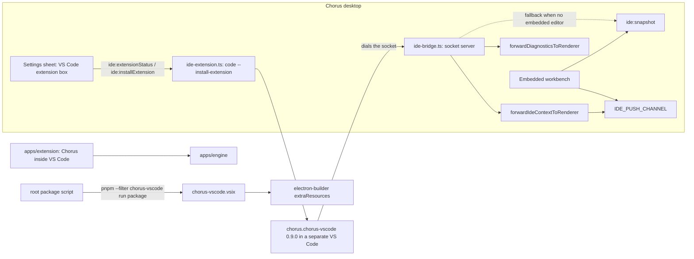
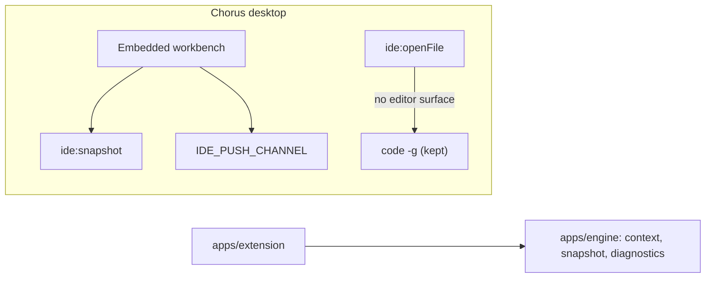
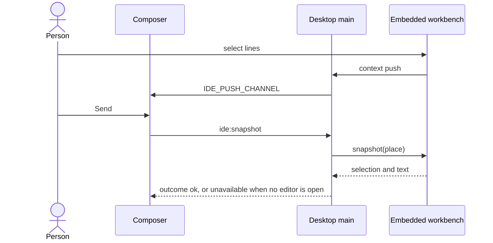

# Remove the old VS Code companion

## Status

| Unit           | Result                                                                                                                                                                                                                                                                             |
| -------------- | ---------------------------------------------------------------------------------------------------------------------------------------------------------------------------------------------------------------------------------------------------------------------------------- |
| Scope          | `apps/vscode-extension/` and everything in the desktop app that exists only to install or talk to it, plus the unreachable "Open in VS Code"                                                                                                                                       |
| Implementation | Done 2026-11-07; the folder was deleted by hand and `pnpm install` updated the lockfile                                                                                                                                                                                            |
| Verification   | 1 passed (`pnpm check`). 3 and 4 passed (`preview-selection-drive.mjs`, agent turn skipped: ALL HELD). 5 passed (`editor-drive.mjs`, 12/12). 6 passed (`pnpm package`, no VSIX in the bundle). 7 passed. 2 passed by hand in `pnpm dev`: Settings has no VS Code extension section |
| Decided        | 2026-11-07: "Open in VS Code" goes; the `code -g` fallback in `ide:openFile` stays                                                                                                                                                                                                 |

## Corrections found while implementing

- **The e2e suite still drove the bridge** (found after the merge, before running checks 2–7).
  `apps/desktop/e2e/fake-ide.mjs` was a pretend VS Code that dialled the deleted socket. Four specs
  existed only for that path and are gone: a problem sent from the editor, following the editor for
  its own project, a merge-request selection's version, and Send asking the editor again. The
  terminal spec lost its closing pill check, and `shots-rail.mjs` no longer stages an editor
  selection. `fake-ide.mjs` is deleted. `pnpm check` cannot see any of this, because the e2e suite
  is not part of it.
- **`apps/extension` still imported two source files from the old folder.** Plan 80 said the
  companion's editor-context and diagnostics code "moves to `extension/`", but it was imported
  across instead (`editor/index.ts`, `membership.ts`, `diagnostics.ts` and its test). Deleting the
  folder would have broken the extension. `editor-context.ts` and `diagnostic-pick.ts`, with their
  tests, moved to `apps/extension/src/editor/`, and the four imports now read `./…`.
- **The README and `docs/install-macos.md` described the companion.** The README's two paragraphs
  on following a VS Code selection from the desktop app are gone. The install doc's section now
  only says how to uninstall the old companion.
- **Four comments named deleted code.** `context.ts` and `workbench-ipc.ts` now say the barrel
  _used to_ re-export `endpoint.js`, since the bug they record is still history. `ipc.ts` no longer
  says `ide:openFile`'s reasons mirror `ide:openProject`'s, and `zip.mjs` no longer mentions
  `chorus-vscode.vsix.version`.
- **`zip.mjs` had a second user.** `apps/workbench-fixture/package.mjs` imported
  `../vscode-extension/zip.mjs`, so the file moved to `apps/workbench-fixture/zip.mjs` instead of
  being deleted, and the import now reads `./zip.mjs`.
- **`eslint.config.mjs` listed three of the companion's scripts.** Those lines are gone, and
  `apps/workbench-fixture/zip.mjs` joins the fixture's entries.
- **`pnpm-lock.yaml` has an importer for the folder.** `pnpm install` removes it once the folder is
  gone.
- **`protocol.ts` is untouched.** It turned out to be the whole socket protocol, about fifteen
  exports, and some of its schemas (`editorMetadata`, `IdeStatus`, `DiagnosticParams`) are still
  used elsewhere. Pruning it means checking every export, so it is left for a follow-up as unused
  but harmless code.
- **`isOlder` went too.** Only the status check and its tests used it.
- **Headers deleted, not rewritten.** `ide-extension.ts` and `packages/ide-protocol/src/index.ts`
  had header comments about the companion and about `endpoint.js`. Both were removed, because
  their premise was gone.
- **Four comments in `ipc-handlers.ts`** that said the external bridge was still there lost those
  sentences. Two that record past bugs stay as history.

## Current / Issue



The companion exists so the desktop app can read a selection from a separate VS Code window. The
embedded workbench and `apps/extension` both do that natively now, and plan 80 moved the companion's
editor-context and diagnostics code into `apps/extension`. The workbench plan's Phase 8
(`docs/plans/chorus-project-workbench-2026-08-22/plan.md:1104`) already called for this removal, and
`ipc-handlers.ts:961` still says the bridge "stays as the fallback until Phase 8 deletes it".

## Proposed



### Deliberately not doing

- **The `code -g` fallback in `ide:openFile`.** It is live: a file path clicked in a transcript
  (`Session.tsx:1179`) tries the embedded editor first, and `code -g` is what answers when the
  project's Editor switch is off. Phase 8 listed it for removal; removing it would make that click do
  nothing, which is a behaviour change rather than a cleanup.
- The shared channels: `IDE_PUSH_CHANNEL`, `DIAGNOSTIC_PUSH_CHANNEL`, `ide:context`, `ide:snapshot`,
  `ide:diagnostic`. The embedded workbench and `apps/engine` (`host.ts:259`) still use them.
- `Composer.tsx:1020`'s `ide.heading` branch, which covers non-workbench snapshots.
- Renaming `ide-extension.ts`, which keeps only the `code` CLI helpers.
- Uninstalling the companion from machines that have it. It is not installed on this Mac, and
  nothing tells anyone else.
- The CHANGELOG line, which belongs to the next release.

## Code Changes

### DELETE `apps/vscode-extension/`

All 20 tracked files.

### DELETE `apps/desktop/src/main/ide-bridge.ts` and `ide-bridge.test.ts`

### DELETE `packages/ide-protocol/src/endpoint.ts` and `endpoint.test.ts`

`runtimeDirectory`, `endpointFor`, `descriptorFor`, `endpointIsFile` and `descriptorIsPrivate` are
imported only by `ide-bridge.ts` and the companion. `packages/ide-protocol/src/index.ts` drops:

```ts
export * from './endpoint.js'
```

The framing exports `encodeFrame`, `decodeFrame`, `extensionMessage` and `MAX_FRAME_BYTES` have the
same two importers (`apps/engine` has its own in `wire.ts`), so they go with their tests.

### `package.json`

```json
"package": "pnpm run build && pnpm --filter @chorus/desktop run package",
```

### `apps/desktop/electron-builder.yml`

Delete the companion comment above `extraResources:` (lines 84–86) and both entries:

```yaml
- from: ../vscode-extension/chorus-vscode.vsix
  to: chorus-vscode.vsix
- from: ../vscode-extension/chorus-vscode.vsix.version
  to: chorus-vscode.vsix.version
```

with the comment between them.

### `.gitignore`

Delete the line-48 comment and `*.vsix.version`. `*.vsix` stays, because `apps/extension` and the
workbench fixture still produce VSIX files.

### `apps/desktop/src/main/index.ts`

Delete the `IdeBridge` import (`:18`), `attachIdeBridge` from the `./ipc.js` import, `let ideBridge`
(`:210`), the bridge's comment, `try` and `catch` (`:578–606`), and
the bridge's close in `shutDownEverything` (`:745–747`).

### `apps/desktop/src/main/ipc.ts`

Delete the `IdeBridge` import, `attachIdeBridge` from the re-exports, and both wrappers:
`forwardIdeContextToRenderer` and `forwardDiagnosticsToRenderer` (`:116–133`).

### `apps/desktop/src/main/ipc-handlers.ts`

Delete:

- `ideBridge` and `attachIdeBridge` (`:72–80`)
- `toPushFile` (`:98`), whose only caller is the context forwarder
- the `ide:extensionStatus`, `ide:installExtension` and `ide:openProject` handlers (`:859–864`)
- `forwardIdeContextToRenderer` (`:1512`) and `forwardDiagnosticsToRenderer` (`:1565`)
- the imports only these used

`ide:snapshot` ends at the embedded editor:

```ts
      runtime.log.info('editor snapshot', {
        source: embedded === undefined ? 'none' : 'workbench',
```

```ts
      if (embedded !== undefined) {
      }
      return { outcome: 'unavailable', reason: 'unavailable' } as const
    },
```

The braces stand for the existing embedded branch, unchanged. Everything from
`const bridge = ideBridge` (`:1032`) to the end of the handler goes. Its comment at `:955–962` loses
its "external bridge … until Phase 8" sentences.

### `apps/desktop/src/main/ide-extension.ts`

Keep `findCode`, `exec` and `openFileInEditor`. Delete `EXTENSION_ID`, `ExtensionNeed`,
`ExtensionStatus`, `parseInstalledVersion`, `extensionStatus`, `installBundledExtension`,
`openProjectInEditor` (`:154`), `resolveVsix` and `readBundledVersion`. `openFileInEditor`'s doc
comment (`:172`) defines it as "a sibling of `openProjectInEditor`", so that sentence goes with it.

```ts
export interface ExtensionDeps {
  readonly findCode: () => Promise<ResolvedCommand | null>
  readonly exec: (bin: string, args: readonly string[]) => Promise<{ stdout: string }>
}

export function defaultDeps(): ExtensionDeps {
  return {
    findCode: () => resolveCommand('code'),
    exec: async (bin, args) => {
      const { stdout } = await run(bin, [...args], { timeout: 60_000 })
      return { stdout }
    },
  }
}
```

The file's header comment is rewritten to describe what is left.

### `apps/desktop/src/main/ide-extension.test.ts`

Delete the status, install, `resolveVsix`, `readBundledVersion`, `parseInstalledVersion` and
`openProjectInEditor` (`:190`) cases; keep the `openFileInEditor` cases.

### `apps/desktop/src/main/desktop-ipc-host.ts`

```ts
import { defaultDeps } from './ide-extension.js'
```

```ts
    extensionDeps: () => defaultDeps(),
```

### `apps/engine/src/host.ts`

```ts
  extensionDeps(): ReturnType<IpcHost['extensionDeps']> {
    return {
      findCode: () => Promise.resolve(null),
      exec: () => Promise.reject(new Error('editor-unavailable')),
    }
  }
```

### `apps/desktop/src/shared/ipc.ts`

Delete the `ide:extensionStatus` schema with the doc comment above it (`:1968`),
`ide:installExtension` (`:1978–1981`) and `ide:openProject` with its comment (`:1983–1987`), and
from `ChorusApi`:

```ts
  readonly ideExtensionStatus: () => Promise<IpcResponse<'ide:extensionStatus'>>
  readonly ideInstallExtension: () => Promise<IpcResponse<'ide:installExtension'>>
  readonly ideOpenProject: (
    request: IpcRequest<'ide:openProject'>
  ) => Promise<IpcResponse<'ide:openProject'>>
```

### `apps/desktop/src/shared/create-chorus-api.ts`

```ts
    ideExtensionStatus: () => invoke('ide:extensionStatus')({}),
    ideInstallExtension: () => invoke('ide:installExtension')({}),
    ideOpenProject: invoke('ide:openProject'),
```

all three deleted.

### `apps/extension/src/parity.ts`

```ts
  ideExtensionStatus: 'vscode',
  ideInstallExtension: 'vscode',
  ideOpenProject: 'vscode',
```

all three deleted; the parity type then compiles against the smaller `ChorusApi`.

### `apps/desktop/src/renderer/src/Settings.tsx`

Delete the companion state and callbacks (`:1001–1044`: `ext`, `busy`, `note`, `refreshExt`,
`install`) and the `{ext !== null && (<fieldset …>)}` block (`:1061–1085`). The sheet body then
starts at the installed-agents fieldset. Imports that only this used go too.

### `apps/desktop/src/renderer/src/i18n/en.json`

Delete `ide.extension`, all eleven keys: `title`, `install`, `update`, `installed`, `missing`,
`none`, `outdated`, `working`, `done`, `failed` and `unavailable`. Also delete `ide.openProject`
("Open this project in VS Code", `:457`); the other `"openProject"` key at `:884` is a different
string and stays. `ide.openError.*` stays, because `ide:openFile` still returns those reasons.
`en.json` is the only locale.

### `apps/desktop/e2e/smoke-packaged.mjs`

Delete the VSIX check (`:99–102`) and the VSIX clause of the header comment (`:12`).

### `apps/desktop/e2e/packaged-windows.mjs`

Delete `checkVsix` (`:116–128`) and its call (`:147`).

### `BOARD.md`

- **C-036** (the extension speaks English): close it as moot, because the extension is gone.
- **C-035** (notebook cell editor context): repoint its `apps/vscode-extension/src/document-identity.ts`
  reference to `packages/ide-protocol/src/document-identity.ts`, where that code now lives.
- **C-046** (Chorus is not a VS Code fork): record that the companion and the bundled VSIX are
  removed, as Phase 8 asked.

### `docs/plans/chorus-project-workbench-2026-08-22/STATUS.md`

One line: plan 86 shipped Phase 8's companion, bundled VSIX and "Open in VS Code" removal. It kept
the `code -g` fallback in `ide:openFile` on purpose, so the exit criterion "no requirement for the
`code` CLI" stays unmet by choice.

## Verification, only when asked

| #   | Check                                                                                                       |
| --- | ----------------------------------------------------------------------------------------------------------- |
| 1   | `pnpm check` passes; typecheck is what finds any import left behind                                         |
| 2   | Desktop: Settings opens with no VS Code extension box                                                       |
| 3   | Desktop: the composer's editor pill and Send-with-selection still work from the embedded editor             |
| 4   | Desktop: a file path clicked in a transcript opens in the embedded editor                                   |
| 5   | VS Code extension: editor context and sending a problem to the composer still work                          |
| 6   | `pnpm package` succeeds, and the packaged app has no `chorus-vscode.vsix` in its resources                  |
| 7   | Searching outside `docs/plans/` and `CHANGELOG.md` for `chorus-vscode` and `vscode-extension` finds nothing |

## Final Flow


