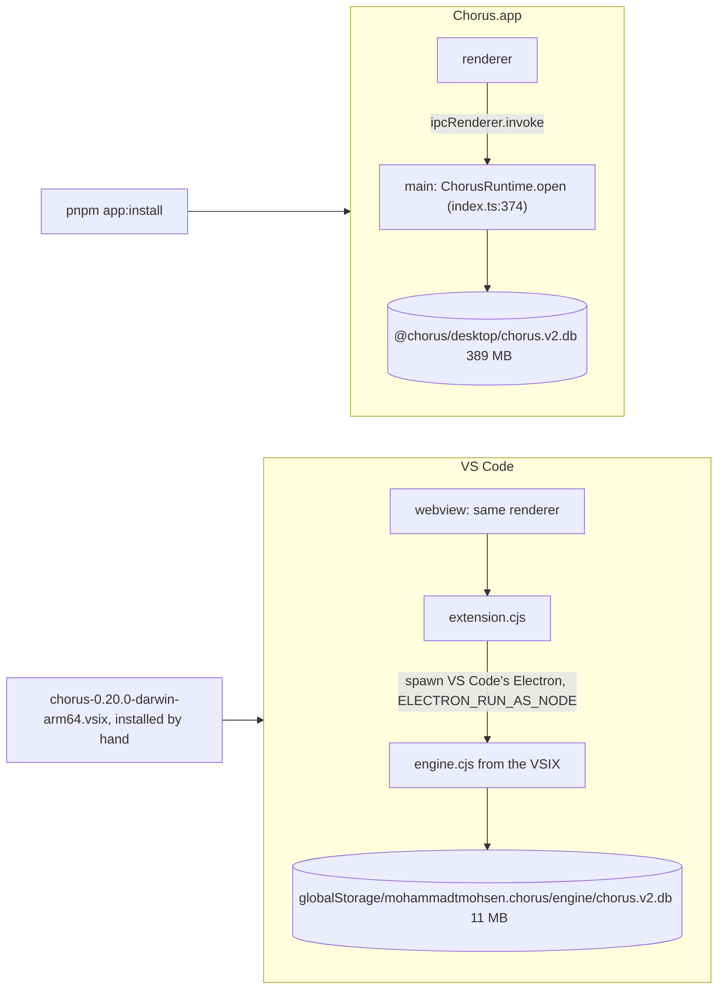
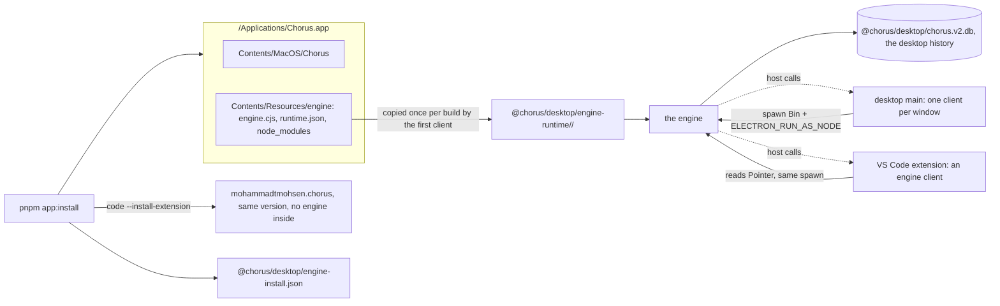

# One install, one version, one database

## Status

| Unit           | Result                                                                                                                                                                                                                                                                                                                                                                                                                                                                                                                                                                                                                                                                                                                                                                                                                                                                                                                                                                                                                                                                                                                                                                                                                                                                                                                                                                                                                                                                                                                                                                                                                                                                                                                                                                                                                                                                                                                                                                                                                                                                                                                                                                                                                                                                                                                                                                     |
| -------------- | -------------------------------------------------------------------------------------------------------------------------------------------------------------------------------------------------------------------------------------------------------------------------------------------------------------------------------------------------------------------------------------------------------------------------------------------------------------------------------------------------------------------------------------------------------------------------------------------------------------------------------------------------------------------------------------------------------------------------------------------------------------------------------------------------------------------------------------------------------------------------------------------------------------------------------------------------------------------------------------------------------------------------------------------------------------------------------------------------------------------------------------------------------------------------------------------------------------------------------------------------------------------------------------------------------------------------------------------------------------------------------------------------------------------------------------------------------------------------------------------------------------------------------------------------------------------------------------------------------------------------------------------------------------------------------------------------------------------------------------------------------------------------------------------------------------------------------------------------------------------------------------------------------------------------------------------------------------------------------------------------------------------------------------------------------------------------------------------------------------------------------------------------------------------------------------------------------------------------------------------------------------------------------------------------------------------------------------------------------------------------- |
| Scope          | The desktop app and the VS Code extension share one engine process, one data directory and one database; `pnpm app:install` installs both from one build                                                                                                                                                                                                                                                                                                                                                                                                                                                                                                                                                                                                                                                                                                                                                                                                                                                                                                                                                                                                                                                                                                                                                                                                                                                                                                                                                                                                                                                                                                                                                                                                                                                                                                                                                                                                                                                                                                                                                                                                                                                                                                                                                                                                                   |
| Approved       | 2026-11-08, with the recommended answers to the three open questions: the DMG does not install the extension yet; one code path on every platform, Windows and Linux tested on the VM before a release ships it; an approval raised with both apps closed waits for one to open                                                                                                                                                                                                                                                                                                                                                                                                                                                                                                                                                                                                                                                                                                                                                                                                                                                                                                                                                                                                                                                                                                                                                                                                                                                                                                                                                                                                                                                                                                                                                                                                                                                                                                                                                                                                                                                                                                                                                                                                                                                                                            |
| Spike 1        | **Passed** 2026-11-08: `ELECTRON_RUN_AS_NODE=1 /Applications/Chorus.app/Contents/MacOS/Chorus` (Electron 43.2.0, Node 24.18.0) ran the 0.20.0 VSIX's `engine.cjs` from a copy in `/tmp`, loaded both natives, opened a `.backup` copy of the desktop database (schema 21, 246,899 events), logged "engine ready" within a second, had no app registration in `lsappinfo` (no dock icon), killed 0 of 5 inspected agent processes in its sweep, and exited 0 after its 15-second idle timeout. node-pty spawned through the copied `spawn-helper` under the same binary. Not covered: a terminal opened by the engine on a client's request, and `stage.mjs`'s own output                                                                                                                                                                                                                                                                                                                                                                                                                                                                                                                                                                                                                                                                                                                                                                                                                                                                                                                                                                                                                                                                                                                                                                                                                                                                                                                                                                                                                                                                                                                                                                                                                                                                                                   |
| Implementation | **Done 2026-11-08, uncommitted.** Parts A–E written by codex and reviewed by claude, every changed file read; Part F written by claude. Review fixes applied: the terminal-env channel renamed, a legacy key's revision persisted only on acknowledgement and a failed acknowledgement no longer disconnecting, the picker's label and New Folder passed through, the restart string moved to `notice.engineRestartRequired`. Embedded-editor diagnostics deferred                                                                                                                                                                                                                                                                                                                                                                                                                                                                                                                                                                                                                                                                                                                                                                                                                                                                                                                                                                                                                                                                                                                                                                                                                                                                                                                                                                                                                                                                                                                                                                                                                                                                                                                                                                                                                                                                                                         |
| Verification   | 2026-11-08, asked for by the user: criterion 5 (the engine outlives the desktop app) **passed** and criterion 2 (the desktop history is the shared history) **passed** for tabs and a finished turn, by a driver (`/tmp/chorus-87-drive/quit-reopen.mjs`, not in the repo) on the dev build against a `.backup` copy of the desktop data: the desktop started its engine, all 10 open conversations were seeded and restored, a new conversation's `@claude` turn was still running when the app was quit with SIGTERM (the same graceful shutdown as quitting), the engine stayed up, the turn finished with the app closed, and the reopened app attached to the **same** engine (same pid and generation), restored all 10 conversations and the new one, and showed the finished reply. The message was sent through `window.chorus.awaitStart` and `sendMessage`, not by typing; typing Enter into the composer through CDP did not submit. **A message typed by hand** into the composer of `pnpm dev` (on `@chorus/desktop-dev`) then went through: `user.message` "hi there", `claude` session and turn started, the reply streamed and completed, all on the dev engine. So the CDP failure was the driver's. **`pnpm check` passed** after `pnpm format`: typecheck, lint, format check, workbench check, and 4,783 unit tests (4 skipped). Getting there took two type fixes, 15 lint fixes (three were narrowing-across-`await` false positives kept as runtime guards and read through `isClosed()`, `isDetached()` and `projectRefreshPending()`, plus two `process.versions.electron` reads kept for plain Node), and one test: "does not leave a lease behind when the window went away mid-acquire" now destroys the window _during_ the acquire, because Part C's new entry check refused an already-destroyed window before any lease was taken; it was shown to fail with the post-acquire release removed. **`pnpm app:install` succeeded** (criterion 1, install half): one command built a 2.18 MB VSIX with no engine in it, quit the running desktop app, installed `/Applications/Chorus.app` with `Resources/engine` (both natives, `codesign` clean), wrote the pointer, and VS Code lists `mohammadtmohsen.chorus@0.20.0`. Not run: typecheck, lint, format, unit tests, e2e suite, packaging, install, spikes 2–4, and every other criterion |
| Decided        | 2026-11-08, by the user: keep the **desktop** history; the engine keeps running when the desktop app quits; macOS only; "restart needed" during an update is acceptable; `pnpm dev` keeps its own data; each app keeps its own browser; the extension's current database file is left untouched                                                                                                                                                                                                                                                                                                                                                                                                                                                                                                                                                                                                                                                                                                                                                                                                                                                                                                                                                                                                                                                                                                                                                                                                                                                                                                                                                                                                                                                                                                                                                                                                                                                                                                                                                                                                                                                                                                                                                                                                                                                                            |
| Challenged     | 2026-11-08 by codex against the source, twice, before approval: the whole plan, then the designs that replaced what the first pass broke. Both passes' confirmed findings are folded in below and listed under "Corrections from the challenge"                                                                                                                                                                                                                                                                                                                                                                                                                                                                                                                                                                                                                                                                                                                                                                                                                                                                                                                                                                                                                                                                                                                                                                                                                                                                                                                                                                                                                                                                                                                                                                                                                                                                                                                                                                                                                                                                                                                                                                                                                                                                                                                            |

**This supersedes two decisions in plan 80** (`docs/plans/80-chorus-vscode-extension.md:850` and `:1056`): "the engine's data
… starts empty … and never opens the desktop's files" and "Sharing one live database between the desktop and the extension"
under not-doing. The single-writer rule itself stands; what changes is that both apps now go through the one writer.

## Corrections from the challenge

The first draft of this plan was wrong in these places, found by reading the source:

- **`app.asar.unpacked/engine/` cannot work.** node-pty rewrites `app.asar` to `app.asar.unpacked` unconditionally
  (`node_modules/.pnpm/node-pty@1.1.0/node_modules/node-pty/lib/unixTerminal.js:31`), so a module loaded from an
  already-unpacked path looks for `app.asar.unpacked.unpacked/…/spawn-helper`. And electron-builder's `asarUnpack`
  matches the _source_ path, not a `files` entry's destination (`app-builder-lib/out/asar/asarUtil.js:80-85`). The engine
  now ships as its own `extraResources` folder with its own `node_modules`.
- **Renaming a live bundle does not protect a running engine.** node-pty caches the helper's absolute path; after a
  rename that path names the new bundle, or nothing while it is being copied. Each engine now runs from its own copy in the
  data directory, which no install touches.
- **The client hashed the engine once, at construction** (`apps/extension/src/engine-client.ts:65`), and passed that
  hash with every later spawn. An old client could start the new file under its old label. Identity is now re-read before
  every attach or spawn, the engine checks its own, and an out-of-date client never replaces an engine.
- **Ignoring `null` in a hello also ignored deletions.** An explicit `secret` message goes through the same `loadSecrets`
  (`apps/engine/src/server.ts:415`). Fan-out alone also resurrects a rotated key when an app that was away reconnects. Keys
  now carry revisions.
- **One socket for the whole desktop app collapsed its windows.** Every peer is registered as `{ kind: 'main' }`
  (`server.ts:359-362`), and Traffic subscriptions are per sender (`traffic-ipc.ts:225`). Each desktop window is now its
  own engine client with its own role.
- **The desktop never reported presence**, so restored projects were absent from routing and replay stayed at zero, and
  **embedded-editor context lost its route to the engine** once the in-process forwarders went
  (`workbench-surface.ts:2184`, `ipc-handlers.ts:1337`). Both are now explicit.
- **`project:list` cannot stand in for `workbenchTarget`**: it has no canonical root and no existence check
  (`project-service.ts:271-284`), and a cache refreshed only by this app's own calls misses a project relocated or
  forgotten in VS Code. The desktop asks the engine, and the engine pushes `projects:changed` to everyone.
- **`choose(projectId)` prefers the peer of the request in progress** (`peers.ts:165-167`), which an agent's long-lived
  transport can inherit. Agent browser tools get a selector that ignores it.
- Smaller ones: the browser prune read web tabs from the root `open-projects.json` (`index.ts:468`), which goes stale after
  the seed; `stage-development.mjs:15` copies the `engine.cjs` the VSIX no longer has; an installed VSIX in a temporary
  e2e profile is `ExtensionMode.Production` and would have reached production data; `engine.disconnect()` does not exist
  (it is `dispose()`); `editor.previewEdit` and `openFile` are not plain renames of desktop functions; a protocol-2
  descriptor fails the new schema and would cause a respawn loop; a still-running old desktop app would be a second writer
  during the first install.

The second pass, on the replacements:

- **The build identity left out platform and architecture**, so an Intel and an Apple Silicon runtime could share one
  identity. `runtime.json` now names both and the native files' hashes.
- **An older desktop launched after an install rewrote the pointer** back to itself, after which the newer apps refused
  to replace its engine. Desktop main now registers only when that moves the pointer forward.
- **A current client meeting a busy engine of another version waited for a welcome that never came**, and timed out. It
  now settles into "restart needed" and checks back until the engine is idle.
- **Secret revisions could tie** (`Date.now()` twice, or a clock step back), legacy keys in both apps had no
  deterministic winner, and a restored value was not sent to apps already connected. Revisions now strictly increase, the
  desktop's legacy key wins once, and restores fan out.
- **A detached window's own client still saw every desktop conversation**, because main and detached windows share one
  client state. The server limits a detached peer to its project.
- **Deleting old runtime copies at start could race a client that was still copying.** Cleanup now waits, and skips
  anything recent.

## Corrections found while implementing

- **The client cannot load the lock code.** `lock.ts` opens SQLite, so importing it into `apps/engine/src/client.ts`
  would have put `better-sqlite3` back into the VSIX. The client probes the lock by running the app's engine with
  `--probe-lock` (`apps/engine/src/main.ts`): it checks its identity, takes and releases only the directory lock, and
  exits 0 when the lock was free and 2 when it was held. It never opens the event log. Results are reused for a second.
- **A cold start read as "restart needed".** Between a new engine taking its lock and writing `engine.json` (after the
  sweep and opening a 389 MB database), the client saw "lock held, no descriptor" and reported `restart-required`. Now a
  missing `engine.json` means "starting" and is waited out quietly; only one that exists and does not parse means an
  incompatible engine.
- **`projects:changed` is not pushed after `project:list` or `project:checkRemoteHost`.** Both are reads; pushing after
  them would have made every client that refreshes on the push refresh forever.
- **`ProjectConsoles.read` returns `string | Promise<string>`**, so the desktop's existing `BrowserConsoles` stays
  assignable until Part C removes it from main.
- **The two extension strings live in the shared `en.json`**, under `extension`, where the extension's `TEXT` already
  reads them.
- **The VS Code browser lands in `<data>/vscode-browser/browser/`**, because `BrowserSettingsStore` appends `browser`
  itself.
- **The extension's e2e harness spawns the engine on the desktop app's Electron**, from
  `apps/desktop/node_modules/electron`, because the engine's identity check rejects any other Electron version.
- **The embedded workbench has no diagnostics emitter**, so "diagnostics from the workbench go as `diagnostic`" in
  section C described nothing that exists. Deferred: adding one would be new behaviour, not a move.
- **`workbench:terminalEnv` was already the name of a native workbench surface channel.** Relaying the new engine
  channel under the same string would have registered two handlers. The engine channel is renamed
  `workbench:terminalEnvFor`, after the runtime method it calls.
- **A legacy API key could go missing after the first engine restart.** Adopting a revision-0 key gave it a fresh
  revision but never told the app it came from, so after a restart the engine knew a revision that no store held. The
  revision is now persisted only once the originating app acknowledges storing it.
- **The engine's `pickDirectory` passed only a title**, so the desktop's "Run agents here" picker lost its button
  label and its New Folder button. The label and `createDirectory` are now passed through.
- **No engine could start: its identity check required a subpath `better-sqlite3` does not export.**
  `createRequire(...)('better-sqlite3/lib/binding.js')` fails with `ERR_PACKAGE_PATH_NOT_EXPORTED`, because the package's
  `exports` map lists only `.`, the per-platform entries and `./package.json`. Every start and every `--probe-lock` logged
  "engine identity could not be read" and exited. Found by the first driven run; `main.ts` and the `client.test.ts`
  fixture now require `join(sqliteRoot, 'lib', 'binding.js')`, an absolute path the `exports` map does not govern. Fixed
  by claude; reviewed by codex with no findings (the resolved manifest and the loaded package are the same staged copy,
  the binary hash follows the package's own prebuild → Debug → Release order, and no other `exports`-blocked subpath
  import exists in `apps/engine`, `apps/desktop/src/main` or `apps/extension`).
- **electron-builder dropped the engine's `node_modules`.** Its copy filter returns `false` for a `node_modules` folder at
  the root of any copy source, before any pattern is consulted (`app-builder-lib/out/util/filter.js:42-43`), so
  `extraResources` from `../engine/dist/runtime` shipped only `engine.cjs` and `runtime.json`. `sign-adhoc.cjs`'s engine
  check stopped the first `pnpm app:install` before signing. A second entry copies
  `../engine/dist/runtime/node_modules` to `engine/node_modules`, where the packages are at the copy's root and pass.
  Fixed by claude, not reviewed by codex; the packaged engine then passed its own identity check on the packaged binary
  (`--probe-lock` exit 0).

## Current / Issue



Two runtimes, two databases, two installs:

- **Two runtimes.** Desktop main opens its own `ChorusRuntime` (`apps/desktop/src/main/index.ts:374`) with no lock
  (`runtime.ts:7350`). The extension starts a separate engine from its own VSIX, on VS Code's Electron, over its own folder
  (`apps/extension/src/extension.ts:119-131`, `engine-client.ts:97-105`), guarded by `engine-lock.sqlite`
  (`apps/engine/src/lock.ts:24`).
- **They cannot simply share the file.** Every runtime open closes all sessions the log believes are running as `crashed`
  (`runtime.ts:1329`, `packages/event-store/src/store.ts:1994`). A second runtime on the same file would mark the first
  one's live agents dead.
- **One version only at release.** `release.yml:62-86` requires root, desktop, extension and tag to agree, but on this Mac
  `pnpm app:install` installs the desktop app only (`apps/desktop/build/install-local.mjs`), and the VSIX is installed by
  hand. The engine's compatibility check compares protocol, the SHA-256 of `engine.cjs` and the client's Node version
  (`server.ts:340-344`); the product version is never compared. `__CHORUS_APP_VERSION__` comes from
  `apps/extension/package.json` (`apps/engine/build.mjs:35-38`).
- **Where the histories are.** Desktop's `chorus.v2.db` has the long history and was last written at 00:20 on 2026-11-08.
  The extension's was being written at 08:26 the same morning: **conversations held in VS Code since 2026-11-05, including
  the one that produced this plan, are in the extension's file**, and by the decision above they will not appear in the
  shared Chorus. The file stays where it is, so nothing is lost.

What makes the change smaller than it looks: the engine is already "desktop main without Electron". It imports the
desktop's `ChorusRuntime`, `buildHandlers`, `dispatch`, all nine `forward*` forwarders, `TrafficIpc`, `RunIpc`,
`ConsoleIpc` and `BrowserIpc` (`server.ts:1-48`), and the runtime reaches its host only through `HostPorts`
(`apps/desktop/src/main/host-ports.ts:50`) — editor, secrets and window services — which the engine already serves by
asking a connected client (`apps/engine/src/host.ts`, `peers.ts:165-194`). The runtime never spawns its own executable
(no `execPath` or `ELECTRON_RUN_AS_NODE` in `main/`, `packages/` or `engine/` beyond `workbench-host.ts:1304`, which
clears it for the REH), so once an engine has started it needs only its own folder on disk.

## Proposed



Four rules carry the whole design:

1. **One engine, shipped inside the desktop app.** `Contents/Resources/engine/` holds `engine.cjs`, its two native
   modules and a `runtime.json` naming what it was built from. The VSIX carries no engine, so the extension cannot start a
   second one by construction.
2. **Each engine runs from its own copy.** Before spawning, a client copies the shipped folder to
   `<data>/engine-runtime/<build>/` if it is not there, and spawns Chorus.app's binary as Node on that copy. An install
   replaces the bundle and never touches a running engine's files. A new engine deletes the copies of builds that are no
   longer running.
3. **One data directory: the desktop's.** The engine runs with `--data` set to the desktop's `userData`
   (`~/Library/Application Support/@chorus/desktop`, `-dev` for unpackaged builds, `index.ts:616`). The desktop's history,
   grants, settings and stash are already there. The desktop's own `open-projects.json` seeds the engine's session and
   per-client files once, so open tabs and resumable agent threads survive.
4. **One version.** The build identity is the hash of `runtime.json`, which covers `engine.cjs`, the Electron version and
   the native modules' versions. Clients re-read it before every attach. A client older than the installed app never
   starts or replaces an engine: it says it needs a restart. A VSIX whose version differs from the app's refuses to
   connect and says why.

### What lives where afterwards

| Piece                                                                                | Owner after this plan                                                 |
| ------------------------------------------------------------------------------------ | --------------------------------------------------------------------- |
| Event log, projections, projects registry, grants, settings, stash                   | Engine                                                                |
| Agents, approvals, terminals (global and project), Run, Traffic, adb, logcat         | Engine — keeps running when the desktop app quits                     |
| Embedded Code-OSS workbench, REH, `WebContentsView`s, detached windows, toasts, menu | Desktop main, unchanged                                               |
| Desktop browser, downloads, saved passwords, Console panel                           | Desktop main, unchanged                                               |
| VS Code browser (headless Chrome)                                                    | Engine; its profile and settings move to `<data>/vscode-browser/`     |
| Agents' `chorus_browser` tools                                                       | Engine, routed to the browser of the app last focused on that project |
| API keys                                                                             | Each app's own secure store, kept in step by revision                 |
| Notifications, dock badge, dialogs, clipboard                                        | Whichever app window the engine asks, as today in VS Code             |

### Deliberately not doing

- **Importing the extension's history.** Decided: the desktop history is kept; `globalStorage/…/engine/` is not opened,
  moved or deleted.
- **The released DMG installing the extension into VS Code by itself.** Not chosen. The DMG will carry the engine (the
  release already runs `pnpm package`, `release.yml:175`), so the shared engine works from a release, but installing the
  VSIX stays manual there. Listed under open questions.
- **Windows and Linux install.** `install-local.mjs` stays macOS-only (`:21`). The desktop app on those platforms becomes
  an engine client through the same code path, unverified there.
- **One browser for both apps.** Decided: each keeps its own.
- **A product-version election** beyond the rules above. The existing idle-replace and busy-"restart needed" behaviour
  (`engine-client.ts:156-175`) is what was accepted.
- **Automatic enrolment of a new conversation in the other app.** The engine enrols a conversation only in the client that
  opened it (`server.ts:242`, `:279`). Both apps see a conversation live once each has it open.
- **The CHANGELOG entry**, which belongs to the release.

## Code Changes

Order: **A** first (identity, protocol and packaging every other unit depends on), then **B**, **D** and **E** in
parallel, then **C** (needs A and B), then **F**.

### A. One engine identity, shipped in the app

#### NEW `apps/engine/stage.mjs`

Builds `apps/engine/dist/runtime/`: `engine.cjs`, `node_modules/` with `better-sqlite3` and `node-pty` and their runtime
dependencies, and `runtime.json`. The native staging moves here from `apps/extension/package.mjs:121-151`, which no
longer needs it, including the `spawn-helper` mode fix. `runtime.json`:

```json
{
  "version": "0.21.0",
  "platform": "darwin",
  "arch": "arm64",
  "engine": "<sha256 of engine.cjs>",
  "electron": "<version from node_modules/electron/package.json>",
  "natives": {
    "better-sqlite3": { "version": "13.0.2", "sha256": "<of prebuilds/darwin-arm64.node>" },
    "node-pty": { "version": "1.1.0", "sha256": "<of prebuilds/darwin-arm64/pty.node>" }
  }
}
```

Platform, architecture and the native files' own hashes are in it because the staging picks binaries by `process.arch`
(`apps/extension/package.mjs:153-167`): an Intel and an Apple Silicon payload would otherwise share one build identity.

`apps/engine/package.json`'s `build` runs `build.mjs` then `stage.mjs`.

#### `apps/engine/build.mjs`

`__CHORUS_APP_VERSION__` reads the root `package.json` (`:35-38`), the version the release gate already holds equal to
both apps.

#### `apps/desktop/electron-builder.yml`

```yaml
extraResources:
  - from: build/reh/workbench-server.tar.gz
    to: workbench-server.tar.gz
  - from: ../engine/dist/runtime
    to: engine
```

The first entry stands for the existing one at `:84-96`, unchanged. `Contents/Resources/engine/node_modules/node-pty`
contains no `app.asar`, so node-pty's rewrite is a no-op there. `build/sign-adhoc.cjs` asserts the copied `spawn-helper`
is executable before `codesign`, as it already does for the asar copy.

#### `apps/engine/src/protocol.ts`

Protocol 3. The client's Node version leaves the handshake; the Chorus version, the client kind and the window role join
it.

```ts
export const PROTOCOL_VERSION = 3

export const EngineClientKind = z.discriminatedUnion('kind', [
  z.object({ kind: z.literal('vscode') }),
  z.object({
    kind: z.literal('desktop'),
    electronVersion: z.string(),
    chromeVersion: z.string(),
  }),
])
export type EngineClientKind = z.infer<typeof EngineClientKind>

export const OfferedSecret = z.object({
  value: z.string().max(65536).nullable(),
  revision: z.number().int().nonnegative(),
})

export const EngineDescriptor = z.object({
  protocol: z.number().int(),
  build: z.string(),
  appVersion: z.string(),
  generation: z.string(),
  token: z.string().regex(/^[a-f0-9]{64}$/),
  socketPath: z.string(),
  pid: z.number().int().positive(),
})

export const Hello = z.object({
  kind: z.literal('hello'),
  token: z.string(),
  protocol: z.number().int(),
  build: z.string(),
  appVersion: z.string(),
  client: EngineClientKind,
  role: WindowRole,
  clientId: z.string().min(1).max(200),
  workspaceKey: z.string().min(1).max(1000),
  workspaceFolders: z.array(z.string().max(8192)).max(100),
  trusted: z.boolean(),
  secrets: z.record(SecretId, OfferedSecret),
  lastSeq: z.number().int().nonnegative().default(0),
  cold: z.boolean().default(false),
})
```

`WindowRole` is the schema of the type in `apps/desktop/src/shared/detached-window-ipc.ts:5`; add a Zod twin there if it
has none. The client `secret` message carries `OfferedSecret` too. The `restartRequired` message and every fixture that
names `runtimeVersion` change with it: `ServeOptions.runtimeVersion` (`server.ts:57`, `:186`), `protocol.ts:46`, `:56`,
`:141`, `server.test.ts:79`, `engine-client.test.ts:19-25`, `:71`.

#### `apps/engine/src/descriptor.ts`

Grows the pointer file the extension reads to find the app's engine, the runtime copy, and the identity check:

```ts
export const EngineInstall = z.object({
  version: z.string(),
  executable: z.string(),
  shipped: z.string(),
})
export type EngineInstall = z.infer<typeof EngineInstall>

export function readEngineInstall(dataDirectory: string): EngineInstall | null {
  try {
    return EngineInstall.parse(
      JSON.parse(readFileSync(join(dataDirectory, 'engine-install.json'), 'utf8')) as unknown
    )
  } catch {
    return null
  }
}
export function writeEngineInstall(dataDirectory: string, install: EngineInstall): void {
  const target = join(dataDirectory, 'engine-install.json')
  const temporary = `${target}.${String(process.pid)}.tmp`
  writeFileSync(temporary, JSON.stringify(install), { mode: 0o600 })
  renameSync(temporary, target)
}
export const RuntimeManifest = z.object({
  version: z.string(),
  platform: z.string(),
  arch: z.string(),
  engine: z.string(),
  electron: z.string(),
  natives: z.record(z.string(), z.object({ version: z.string(), sha256: z.string() })),
})
export type RuntimeManifest = z.infer<typeof RuntimeManifest>

export function readRuntimeManifest(runtimeDirectory: string): RuntimeManifest | null {
  try {
    return RuntimeManifest.parse(
      JSON.parse(readFileSync(join(runtimeDirectory, 'runtime.json'), 'utf8')) as unknown
    )
  } catch {
    return null
  }
}
export function compareVersions(a: string, b: string): number {
  const parts = (version: string): number[] =>
    version.split(/[.+-]/).map((part) => Number(part) || 0)
  const left = parts(a)
  const right = parts(b)
  for (let index = 0; index < Math.max(left.length, right.length); index += 1) {
    const difference = (left[index] ?? 0) - (right[index] ?? 0)
    if (difference !== 0) return Math.sign(difference)
  }
  return 0
}
export function buildOf(runtimeDirectory: string): string {
  return createHash('sha256')
    .update(readFileSync(join(runtimeDirectory, 'runtime.json')))
    .digest('hex')
}
export function runtimeCopy(
  dataDirectory: string,
  shipped: string
): { build: string; main: string } {
  const build = buildOf(shipped)
  const target = join(dataDirectory, 'engine-runtime', build)
  if (!existsSync(join(target, 'runtime.json'))) {
    const temporary = `${target}.${randomUUID()}.tmp`
    cpSync(shipped, temporary, { recursive: true, verbatimSymlinks: true })
    try {
      renameSync(temporary, target)
    } catch (error) {
      rmSync(temporary, { recursive: true, force: true })
      if (!existsSync(join(target, 'runtime.json'))) throw error
    }
  }
  return { build, main: join(target, 'engine.cjs') }
}
export function desktopDataDirectory(development: boolean): string {
  const name = development ? '@chorus/desktop-dev' : '@chorus/desktop'
  if (process.platform === 'darwin') return join(homedir(), 'Library', 'Application Support', name)
  if (process.platform === 'win32')
    return join(process.env['APPDATA'] ?? join(homedir(), 'AppData', 'Roaming'), name)
  return join(process.env['XDG_CONFIG_HOME'] ?? join(homedir(), '.config'), name)
}
```

`shipped` is `Contents/Resources/engine` for an installed app and `apps/engine/dist/runtime` for `pnpm dev`. The copy
preserves `spawn-helper`'s mode; `bootstrap.ts:7` keeps its `chmod`, which now touches the user's own copy.
`desktopDataDirectory` must match Electron's `app.getPath('userData')` for `@chorus/desktop`; desktop main logs if they
ever disagree.

#### MOVE `apps/extension/src/engine-client.ts` → `apps/engine/src/client.ts`

It imports only Node and engine modules (`engine-client.ts:1-15`). Its test moves with it. Changes:

- options: `dataDirectory`, `install: () => EngineInstall | null`, `appVersion`, `client`, `role`, `clientId`,
  `workspaceKey`, `workspaceFolders`, `trusted`, `secrets: () => Record<SecretId, OfferedSecret>`; no `engineMain`,
  `executable` or fixed `build`
- **before every attach or spawn** (`:112-137`): read `install()`. If it is `null`, report `stopped` with
  `not-installed`. If `install.version !== appVersion`, this client is out of date: it may attach to a running engine whose
  descriptor says the same `appVersion`, and otherwise reports `restart-required` without spawning or sending `shutdown`.
  Only an up-to-date client calls `runtimeCopy` and spawns `executable [main, '--data', dir, '--build', build]`.
- **an up-to-date client meeting a busy engine of another version** gets `restartRequired` and no welcome. Today that
  path waits for a welcome unless the protocol differs (`:144`, `:156-166`) and would time out after ten seconds. It now
  enters a stable `restart-required` state at once, sends `status` every five seconds (allowed before ready,
  `server.ts:378-392`), and when the engine reports no busy work, sends `shutdown` and spawns the new one. It never
  spawns while that engine is alive.
- **a descriptor that does not parse while the lock is held** (for example one written by protocol 2): probe with
  `acquireDirectoryLock`, release at once if it was free, and report `restart-required` instead of spawning in a loop
- `focus(...)` is unchanged (`:340`)

#### `apps/engine/src/main.ts` and `server.ts`

- At start, the engine compares `--build` with `buildOf(dirname(__filename))`, and `runtime.json`'s `engine` and
  `electron` with its own `engine.cjs` hash and `process.versions.electron`. On any mismatch it logs why and exits.
- The descriptor records `appVersion: ENGINE_VERSION` instead of `runtimeVersion` (`server.ts:189`).
- Compatibility (`server.ts:340-344`) compares `protocol` and `build`. A client with an older `appVersion` than the engine
  gets `restartRequired` and is never welcomed; the busy-same-protocol welcome (`:348`) applies to equal versions only.
- At start it also checks `runtime.json`'s `platform` and `arch` against `process.platform` and `process.arch`, and the
  two native files' hashes.
- After the lock is taken and before `ChorusRuntime.open` (`:71`): `seedFromDesktop` (B). One minute after the welcome of
  its first client, it deletes `<data>/engine-runtime/<build>` directories that are neither its own build nor the one the
  pointer names; `*.tmp` directories are deleted only when older than an hour. A client copying or starting at that
  moment is never working in a directory that qualifies.
- The engine watches the **data directory** for changes to `engine-install.json`, not the file itself, because the pointer
  is replaced by rename. On each change it re-reads the pointer and recomputes the build of the folder it names. When that
  differs from its own, it pushes `engine:update` with the new version to every peer, so apps that are already connected
  show the notice.
- Logs go to `<data>/engine/logs/`, because `<data>/logs/chorus.log` is desktop main's file (`logging.ts:42`):
  `createLogger(join(dataDirectory, 'engine'))`.

#### `apps/engine/src/browser-surfaces.ts`

The engine's Chrome profile and its browser settings both move from `<data>/browser/` (`:192`), which is the desktop
browser's folder (`browser-settings.ts:37`, holding `passwords.bin` and `settings.json`), to `<data>/vscode-browser/`.
Every use of `directory` for the browser root changes, and `BrowserSettingsStore` gets the same root. Sign-ins in the
VS Code browser start empty once.

### B. The engine serves two kinds of client

#### `apps/engine/src/peers.ts`

`EnginePeer` exposes `hello.client.kind` and `hello.role`. A new selector ignores the request in progress:

```ts
chooseByFocus(projectId: string): EnginePeer | null {
  return (
    this.clients()
      .filter((peer) => peer.projectIds.has(projectId))
      .sort((a, b) => b.focusedAt - a.focusedAt)[0] ?? null
  )
}
```

`choose` (`:165-173`) is unchanged for user actions.

#### `apps/engine/src/server.ts`

- Each peer registers with its own role: `traffic.registerShell(peer, peer.hello.role)`, and the same for `run`,
  `consoleIpc` and `browser` (`:359-362`). A detached desktop window keeps the access a detached window has today.
- A detached peer shares the desktop's `ClientState`, which holds every desktop conversation. So `conversation:active`,
  `conversation:restore` (`:242-256`) and replay (`replay.ts:66-68`) for a peer whose role is detached return only the
  conversations of `role.projectId`, as the old detached bootstrap did (`detached-windows.ts:370-377`). Only the main
  window's peer writes the workspace layout.
- After any successful `project:*` invoke from any peer, push `projects:changed` to every peer.
- **Agents' browser.** The runtime calls `consoles.read(projectId, request)` and `consoles.run(projectId, request)`
  (`runtime.ts:5072-5091`); the engine wires its own `BrowserConsoles` at `:126-127`. The runtime gets a router instead:

```ts
const desktopFor = (projectId: string): EnginePeer | null => {
  const peer = registry.chooseByFocus(projectId)
  return peer?.hello.client.kind === 'desktop' ? peer : null
}
const routed: ProjectConsoles = {
  read: (projectId, request) => {
    const peer = desktopFor(projectId)
    return peer === null
      ? Promise.resolve(consoles.read(projectId, request))
      : peer.requestHost('console.read', { projectId, request }).then(String)
  },
  run: (projectId, request) => {
    const peer = desktopFor(projectId)
    return peer === null
      ? consoles.run(projectId, request)
      : peer.requestHost('console.run', { projectId, request }).then(String)
  },
  dispose: (projectId) => {
    consoles.dispose(projectId)
    for (const peer of registry.clients())
      if (peer.hello.client.kind === 'desktop')
        void peer.requestHost('console.dispose', { projectId }).catch(() => undefined)
  },
}
runtime.attachBrowserConsoles(routed)
```

`runtime.ts`: the `browserConsoles` field (`:1100`) and `attachBrowserConsoles` (`:5048`) take `ProjectConsoles` — the
three members above, `read` returning a Promise — and `readBrowserConsole` becomes `async`. `browserAccessFor` already
wraps `read` in a Promise (`:5056-5060`). `ConsoleIpc` keeps the concrete `BrowserConsoles`, which has more members.

#### `apps/engine/src/host.ts`

- **`appInfo()`** (`:308-318`) answers for the peer in context: a desktop peer gets `DESKTOP_CAPABILITIES` from
  `desktop/src/shared/host-capabilities.ts` with the versions from its hello; anything else keeps
  `EXTENSION_CAPABILITIES`.
- **Secrets, one serialized path for hellos, external changes and saves.** The engine keeps
  `<data>/secret-revisions.json`, `{ [id]: { revision, set } }`, with no values. Each app stores `{ value, revision }`;
  a legacy plain value is revision 0.

```ts
private reconcile(peer: EnginePeer, id: SecretId, offered: OfferedSecret): void {
  const known = this.revisions.get(id)
  if (offered.revision === 0) {
    const desktopWins = peer.hello.client.kind === 'desktop' && known?.legacy === 'vscode'
    if (known === undefined || desktopWins) {
      if (offered.value === null && known === undefined) return
      const legacy = peer.hello.client.kind
      this.adopt(id, { value: offered.value, revision: this.nextRevision(known) }, legacy)
      this.fanOut(id, peer)
    } else this.repair(peer, id)
    return
  }
  const current = known?.revision ?? 0
  if (offered.revision > current) {
    this.adopt(id, offered, null)
    this.fanOut(id, peer)
  } else if (offered.revision < current) this.repair(peer, id)
  else if (known?.set === false) {
    if (offered.value !== null) this.repair(peer, id)
  } else if (offered.value !== null && !this.keys.has(id)) {
    this.keys.set(id, offered.value)
    this.fanOut(id, peer)
  }
}
private nextRevision(known: { revision: number } | undefined): number {
  return Math.max(Date.now(), (known?.revision ?? 0) + 1)
}
```

`revisions` maps an id to `{ revision, set, legacy: 'desktop' | 'vscode' | null }` in `<data>/secret-revisions.json`,
with no values. `adopt` sets or deletes the in-memory key and writes that entry. A cleared key keeps its entry with
`set: false`, which is the tombstone. `fanOut` sends `secret` with the current value and revision to every peer except
the one it came from. `repair` sends it to that one peer, and does nothing when the value is not in memory, because its
newer holder is away.

The rules this gives:

- **A save from Settings** (`updateSecret`, `:275-293`) takes `nextRevision`, which is strictly greater than the last,
  adopts, and fans out to every peer.
- **Keys that exist today carry no revision** (revision 0). The first one offered is adopted at a fresh revision and
  fanned out. A desktop's legacy key replaces a VS Code legacy key once, because the user chose the desktop as the
  source of truth; after any real save, legacy no longer applies.
- **An older offer whose newer value is not in memory** leaves the key unset rather than bringing back a rotated one.
  When an equal-revision offer later restores the value, it is fanned out to the peers that were left without it.

All of it runs on the existing `writes` chain. A failed write rolls back to the last acknowledged state, not to the value
captured when the call was queued. `loadSecrets` (`:264-270`) and the `secret` case in `server.ts:414-417` both call
`reconcile`.

- **Desktop-only host calls.** Today these are no-ops for VS Code (`:89-90`, `:348-356`). They now go to the desktop peers
  that hold the project, and stay no-ops for VS Code peers:

| `HostPorts` / `IpcHost` member | Host call                         |
| ------------------------------ | --------------------------------- |
| `editor.refreshTerminalEnv`    | `editor.refreshTerminalEnv`       |
| `editor.reopenProject`         | `editor.reopenProject`            |
| `applyTheme`                   | `applyTheme` (every desktop peer) |
| `prepareProjectClose`          | `editor.prepareProjectClose`      |
| `closeProject`                 | `editor.closeProject`             |

- **Strings.** Every `messages.extension.*` the host returns (`:98`, `:120`, `:142`, `:191`) is read with a desktop peer in
  mind; any that names VS Code gets a neutral key in `i18n/en.json`.

#### `apps/desktop/src/shared/ipc.ts` and `ipc-handlers.ts`

Three channels for what desktop main used to read from the runtime directly (`index.ts:388-395`), each handled by the
runtime method it replaces:

| Channel                   | Runtime method                                       |
| ------------------------- | ---------------------------------------------------- |
| `workbench:target`        | `projects.workbenchTarget(projectId)`                |
| `workbench:projectOpened` | `openProject(projectId)`                             |
| `workbench:terminalEnv`   | `terminalEnvFor(place)` / `ensureTerminalEnv(place)` |

They are called by desktop main only, not by the renderer's `ChorusApi`, so `apps/extension/src/parity.ts` does not
classify them (corrected while implementing: the first draft said it had to).

#### `apps/engine/src/state.ts` — the one-time seed

```ts
export const DESKTOP_WORKSPACE_KEY = 'chorus-desktop'

export function desktopClientDirectory(dataDirectory: string): string {
  return join(
    dataDirectory,
    'clients',
    createHash('sha256').update(DESKTOP_WORKSPACE_KEY).digest('hex')
  )
}

export function seedFromDesktop(dataDirectory: string): void {
  const sessions = join(dataDirectory, 'engine-sessions.json')
  const desktop = join(dataDirectory, 'open-projects.json')
  if (existsSync(sessions) || !existsSync(desktop)) return
  const saved = parseOpenProjects(readJson(desktop))
  const client = desktopClientDirectory(dataDirectory)
  mkdirSync(client, { recursive: true, mode: 0o700 })
  writeJson(join(client, 'open-projects.json'), { version: 1, ...saved })
  writeJson(sessions, OpenProjectsFile.parse({ version: 1, ...saved, workspace: null }))
}
```

Runs under the directory lock; `engine-sessions.json` is written last, so an interrupted seed runs again. Both files use
the `OpenProjectsFile` schema (`state.ts:5-9`, `open-projects.ts:84`). The desktop's `open-projects.json` is left in
place, and `ClientState` (`:35`) uses `desktopClientDirectory` for that key.

### C. Desktop main becomes an engine client

#### `apps/desktop/src/main/index.ts`

`ChorusRuntime.open` and everything at `:374-565` that takes `opened` go. On launch, main registers itself in the pointer
only if that moves it forward, then connects one client for the main window; each detached window gets its own when it
opens and disposes it when it closes:

```ts
const userData = app.getPath('userData')
const shipped = app.isPackaged
  ? join(process.resourcesPath, 'engine')
  : join(app.getAppPath(), '..', 'engine', 'dist', 'runtime')
const manifest = readRuntimeManifest(shipped)
const installed = readEngineInstall(userData)
const ours = manifest !== null && manifest.version === app.getVersion()
const ahead =
  !app.isPackaged ||
  installed === null ||
  !existsSync(installed.shipped) ||
  compareVersions(app.getVersion(), installed.version) > 0
if (ours && ahead)
  writeEngineInstall(userData, {
    version: app.getVersion(),
    executable: process.execPath,
    shipped,
  })
const connect = (role: WindowRole): EngineClient => {
  const client = new EngineClient({
    dataDirectory: userData,
    install: () => readEngineInstall(userData),
    appVersion: app.getVersion(),
    client: {
      kind: 'desktop',
      electronVersion: process.versions.electron,
      chromeVersion: process.versions.chrome,
    },
    role,
    clientId: randomUUID(),
    workspaceKey: DESKTOP_WORKSPACE_KEY,
    workspaceFolders: [],
    trusted: true,
    secrets: () => readAgentKeys(userData),
  })
  client.setHostHandler((method, params) => answerEngineHostCall(role, method, params))
  return client
}
```

- **Presence.** Each window's client calls `focus(focused, projectIds, lastSeq, focusedProjectId, attentive, visible)`,
  as `extension.ts:636-643` does, whenever the window gains or loses focus, is shown or hidden, or its renderer reports a
  change. The renderer reports its open project ids and focused project on a new local channel, `shell:presence`; `lastSeq`
  follows the `conversation:events` pushes that window receives.
- **Embedded-editor context.** Main installs `setWorkbenchContextSink` and `setWorkbenchSurfaceGoneSink` itself, as the
  removed forwarder did (`ipc-handlers.ts:1263-1361`). A report goes to the engine as `editorContext` on the client of the
  window that owns the surface; a surface that goes away sends an empty context for its place. On every reconnect, main
  re-sends the latest report per live surface. Diagnostics from the workbench go as `diagnostic`.
- **Projects.** `workbenchTarget` (`:388`, `:404`) becomes `workbench:target`. Its two synchronous callers,
  `workbench-surface.ts:766` and `detached-windows.ts:255`, become `async` up to the nearest handler; read both call chains
  first. The local `BrowserIpc` and `ConsoleIpc` `isAdopted` guards (`:529`, `:536`) read a project-id set filled from
  `project:list` on connect and refreshed on `projects:changed`.
- **Browser prune** (`:466-480`) takes project ids from that set and web-tab ids from
  `desktopClientDirectory(userData)/open-projects.json`, not the root file.
- `openProject` (`:390`) becomes `workbench:projectOpened`. `terminalEnvFor` and `ensureTerminalEnv` (`:394-395`) become
  `workbench:terminalEnv`; the synchronous `current` keeps the last answer per place, refreshed when the engine sends
  `editor.refreshTerminalEnv`.
- `window:detachedBootstrap` reads `conversation:active` on the detached window's own client
  (`detached-windows.ts:375-377`). `onConversationsChanged` (`detached-windows.ts:392`) becomes the engine's
  `conversations:changed` push.
- `TrafficIpc` and `RunIpc` (`:437-465`) leave main; their channels are relayed per window. `BrowserSurfaces`,
  `BrowserDownloads`, `BrowserIpc`, `ConsoleIpc` and the local `BrowserConsoles` stay; `opened.attachBrowserConsoles`
  (`:492`) goes.
- The window is created without waiting; relayed calls wait for the first `connected` state.
- Quit calls `dispose()` on every client and never sends `shutdown`. Agents, terminals and Run keep going. Anything in the
  app that says quitting stops them is now untrue and is reworded.

#### `apps/desktop/src/main/ipc.ts`

`registerIpcHandlers(clientFor)` registers every channel of `IPC_CONTRACT`, the Traffic contract and the Run contract on
`ipcMain.handle`. Each keeps the `isShellSender` check (`:21`) and becomes `clientFor(event.sender).invoke(channel,
request)`, where `clientFor` maps a window's `webContents` to its client. `app:getInfo` is relayed; the engine answers it
for a desktop peer. Every engine `push` goes to that client's window only. The nine `forward*` wrappers (`:43-110`) and
the `CONVERSATION_NOTE_JOURNAL_CHANNEL` `sendSync` handler (`:28-38`) go.

#### `apps/desktop/src/preload/index.ts`

`noteJournal` uses `MirroredJournalBackend` from `shared/mirrored-journal.ts` instead of `ipcRenderer.sendSync`
(`:24-27`), built with the same four options the webview passes (`apps/extension/src/webview/main.ts:102-110`): `read`
and `compare` over a new async channel relayed to the engine's `journal` message, and `backup` and `save` in the
renderer's `localStorage`, so a pending write survives a reload and is replayed after a reconnect.

#### `apps/desktop/src/main/desktop-host-ports.ts`

Becomes `answerEngineHostCall(role, method, params)`, answering for the window `role` names. The bodies it already has
move under method names:

| Host call                                                                                                | Desktop answer                                                                                                                                     |
| -------------------------------------------------------------------------------------------------------- | -------------------------------------------------------------------------------------------------------------------------------------------------- |
| `pickDirectory`, `pickFiles`                                                                             | `dialog.showOpenDialog` on that window                                                                                                             |
| `clipboard`, `revealInFolder`, `openExternal`                                                            | `clipboard.writeText`, `shell.showItemInFolder`, `shell.openExternal`                                                                              |
| `notify`, `attention`                                                                                    | `Notification`, `app.setBadgeCount`                                                                                                                |
| `secret`                                                                                                 | `writeAgentKey` / `clearAgentKey` with the revision                                                                                                |
| `reveal`                                                                                                 | focus that window                                                                                                                                  |
| `openFile`                                                                                               | today's `ide:openFile` path (workbench, else `code -g`), answering the boolean `host.ts:368` expects                                               |
| `editor.askDiff`, `editor.edit`, `editor.snapshot`                                                       | `requestWorkbenchAskDiff`, `requestWorkbenchEdit`, `requestWorkbenchSnapshot`                                                                      |
| `editor.previewEdit`                                                                                     | `{ ok: false, editorUnavailable }`: the desktop has no preview path today, and the engine falls back as it does with no editor (`host.ts:139-142`) |
| `editor.refreshTerminalEnv`, `editor.reopenProject`, `editor.prepareProjectClose`, `editor.closeProject` | the `workbench-surface.ts` functions `desktopIpcHost` calls today                                                                                  |
| `applyTheme`                                                                                             | `applyTheme`                                                                                                                                       |
| `console.read`, `console.run`, `console.dispose`                                                         | the local `BrowserConsoles`                                                                                                                        |
| `browser.pickFiles`                                                                                      | refused: the engine's browser is not this app's                                                                                                    |

Unknown methods are refused, as the extension does (`extension.ts:1002-1003`). `agent-secrets.ts` stores
`{ value, revision }` and gains `readAgentKeys(userData)` for the hello.

#### `apps/desktop/src/main/desktop-ipc-host.ts`

Keeps what the host-call table and push delivery use. The `IpcHost` it built for an in-process `buildHandlers` has no
caller left.

#### Engine status in the window

Main sends each client's state on `engine:status`, and forwards `engine:update`. On `restart-required` or an update, the
renderer shows the existing `engineRestartRequired` string (`i18n/en.json:1403`) in the app's existing top-level notice.
If that string sits under an extension-only key, it moves to a shared one.

#### `package.json` — `dev`

```json
"dev": "node scripts/fix-spawn-helper.mjs && turbo run build --filter=@chorus/engine && pnpm --filter @chorus/desktop dev"
```

A change to runtime code now needs `pnpm --filter @chorus/engine build` and a desktop restart. The client then meets a
new build and, when idle, replaces the dev engine. That is slower than electron-vite restarting main by itself, and it is
the main cost of this plan to day-to-day work.

### D. The extension uses the app's engine

#### `apps/extension/src/extension.ts`

`:119-131` change from the VSIX's engine and `globalStorageUri` to the pointer:

```ts
const override = process.env['CHORUS_ENGINE_DATA']
const directory =
  override !== undefined && override !== ''
    ? override
    : desktopDataDirectory(context.extensionMode !== vscode.ExtensionMode.Production)
const version = String(context.extension.packageJSON.version)
this.engineDirectory = directory
this.images = vscode.Uri.file(join(directory, 'note-images'))
this.client = new EngineClient({
  dataDirectory: directory,
  install: () => readEngineInstall(directory),
  appVersion: version,
  client: { kind: 'vscode' },
  role: { kind: 'main' },
  clientId,
  workspaceKey,
  workspaceFolders,
  trusted: vscode.workspace.isTrusted,
  secrets: () => this.offeredSecrets(),
})
```

- When the client reports `not-installed`, or a version different from `install.version`, the extension shows one of two
  new strings where engine start failures are shown today (`extension.ts:652`, `:693`): "Install the Chorus app first:
  run `pnpm app:install`." and "Chorus for VS Code is {{extension}} but the Chorus app is {{app}}. Run
  `pnpm app:install` to update both." Read how `TEXT` is built before adding them.
- Secrets in `SecretStorage` become `{ value, revision }` JSON; a plain string is revision 0. The `onDidChange` handler
  (`:257`) skips a change whose revision it just wrote at the engine's request, so it does not echo.

#### `apps/extension/build.mjs`, `package.mjs` and `stage-development.mjs`

The VSIX stops carrying an engine. `build.mjs` drops the `engine.cjs` copy (`:33`). `package.mjs` drops the engine and
native staging (`:121-151`, `:314-323`, now in `apps/engine/stage.mjs`), the `dependencies` rewrite (`:205-265`) and the
engine build (`:267-275`). `stage-development.mjs` drops `engine.cjs` from its copy list and the
`node_modules` link to `../engine/node_modules` (`:15-18`). `--target` stays, so `release.yml:244-294` keeps producing
its four files.

#### `apps/extension/e2e/integration-harness.mjs`

Each run sets `CHORUS_ENGINE_DATA` to its temporary directory, writes `engine-install.json` there pointing at the built
`apps/engine/dist/runtime`, and at teardown waits for that directory's engine generation to exit before deleting it
(`:34`, `:195`).

### E. One install

#### `package.json` — `app:install`

```json
"app:install": "turbo run build --filter=@chorus/desktop^... --filter=@chorus/engine --filter=@chorus/extension... && pnpm --filter @chorus/extension run package --skip-build && pnpm --filter @chorus/desktop run app:install"
```

#### `apps/desktop/build/install-local.mjs`

1. **The first install of this change.** If the installed bundle has no `Contents/Resources/engine`, the running app is
   the old in-process runtime on the same database. It must quit before the new engine can open the file, so
   `CHORUS_INSTALL_KEEP_RUNNING` is refused for this one install with a line saying why, and the normal quit path
   (`:118-129`) runs.
2. After `ditto` and `codesign --verify` (`:144-145`), **write the pointer** into the production data directory:
   `executable: <dest>/Contents/MacOS/Chorus`, `shipped: <dest>/Contents/Resources/engine`, and the version from
   `apps/desktop/package.json`. Same shape as `descriptor.ts`, inlined, since this is a plain Node script.
3. **Install the extension.** Find `code` on `PATH`, else
   `/Applications/Visual Studio Code.app/Contents/Resources/app/bin/code`, then run
   `code --install-extension apps/extension/dist/chorus-<version>-darwin-<arch>.vsix` with arguments as an array (prior
   art: `git show 24d0e88^:apps/desktop/src/main/ide-extension.ts:85-144`). **No `--force`**: VS Code's CLI reinstalls the
   same version without it, and `--force` only bypasses its downgrade guard. If `code` is not found, print one line and
   still exit 0, because the app itself installed.

A running engine is left alone: it runs from its own copy. Already-connected apps get `engine:update`. The next
up-to-date client to connect replaces the engine if it is idle; if it is busy, both apps say "Chorus needs to restart"
until the work finishes. Apps still running the old version say they need a restart and never replace the engine.

### F. The record

- `docs/plans/80-chorus-vscode-extension.md`: one line under `:850` and `:1056` saying plan 87 superseded them on
  2026-11-08.
- `apps/extension/README.md`: install is `pnpm app:install`; the "API keys stored by the desktop app are not readable
  here" line (`:52`) goes.
- `CLAUDE.md`: "Where things live" says `apps/engine` is the only process that opens the event log, and desktop main is a
  client of it.
- `docs/install-macos.md`: one install command.

## Final Flow

```mermaid
sequenceDiagram
    participant I as pnpm app:install
    participant D as Desktop main
    participant E as Engine (Chorus.app binary as Node)
    participant V as VS Code extension
    I->>I: build engine runtime, extension, app; ditto Chorus.app
    I->>I: write engine-install.json, code --install-extension
    D->>D: copy Resources/engine to engine-runtime/<build>
    D->>E: no engine.json: spawn on the copy, --data @chorus/desktop
    E->>E: check own identity, seed once, open chorus.v2.db
    D->>E: hello per window (desktop, 0.21.0, build)
    E-->>D: welcome, replay
    V->>V: read engine-install.json, versions agree
    V->>E: hello (vscode, 0.21.0, same build)
    E-->>V: welcome, replay
    Note over D,V: one log: a conversation open in both apps streams to both
    D->>E: quit: dispose every client
    Note over E,V: agents keep running, VS Code keeps working
    V->>E: VS Code closes
    E->>E: no clients, no work for 5 minutes: exit
```

Update while busy: an install changes `runtime.json`, so the installed build differs from the running engine's. The engine
sees the pointer change and pushes `engine:update`; both apps show the notice. Once nothing is running, the next
up-to-date client replaces the engine with one started from the new copy.

## Spikes, before C and D are written

| Spike                           | Question                                                                                                                                                                                                | If it fails                                                                   |
| ------------------------------- | ------------------------------------------------------------------------------------------------------------------------------------------------------------------------------------------------------- | ----------------------------------------------------------------------------- |
| Engine on Chorus.app's binary   | Does `ELECTRON_RUN_AS_NODE=1 Chorus.app/Contents/MacOS/Chorus <data>/engine-runtime/<build>/engine.cjs` boot, load both natives, open a terminal and open a copy of the desktop database? No dock icon? | Ship a pinned Node in `Resources/engine` instead; the rest of the plan stands |
| Bundle replaced under an engine | Install while that engine runs a turn and a terminal: does it keep working and open new terminals?                                                                                                      | Keep the old bundle under `.replaced-*` until its engine exits                |
| Started from VS Code            | The same spawn from the extension host: environment, `PATH` after `adoptShellPath`, survival when VS Code quits                                                                                         | Compare with today's VSIX engine, which already does it                       |
| Two hops for the desktop        | A long agent turn: renderer → main → socket → engine and back. Time to first delta and dropped deltas against today                                                                                     | Batched pushes for hot channels, as plan 80 allowed for the webview           |

## Open questions

1. **The released DMG installing the extension on launch.** Left out above. Doing it means bundling the VSIX in
   `extraResources` and running step E3 from desktop main on the first launch after an update.
2. **Windows and Linux desktop.** One code path makes the desktop app an engine client everywhere, unverified there. The
   alternative, keeping the in-process runtime off macOS, is two architectures to keep in step. Recommended: one path,
   tested on the Windows VM brief (`docs/windows-test-brief.md`) before a release ships it.
3. **Notifications with no app open.** An approval raised while both apps are closed has no client to notify
   (`peers.ts:190-194`). It waits until an app connects. Acceptable for now?

## Risks

- **e2e.** Every desktop e2e launch also starts an engine in its temporary data directory. The harness must wait for it
  to exit before deleting the directory, including when a launch fails, or engines accumulate and later runs attach to
  the wrong one. The harness already learned this with its debugging port (CLAUDE.md, "The e2e harness used to attach to
  whatever owned port 9800").
- **A dev engine on production data.** Prevented on both sides: unpackaged desktop uses `@chorus/desktop-dev`
  (`index.ts:616`), an extension outside Production mode reads that folder, and test harnesses set `CHORUS_ENGINE_DATA` or
  `CHORUS_USER_DATA`.
- **A key whose newest value is in an app that is away** is unavailable until that app connects. That is deliberate:
  the alternative brings back a key the user rotated or deleted.

## Verification, only when asked

| #   | Acceptance criterion                      | How                                                                                                                                                                                                |
| --- | ----------------------------------------- | -------------------------------------------------------------------------------------------------------------------------------------------------------------------------------------------------- |
| 1   | One command installs both, one version    | `pnpm app:install`; `code --list-extensions --show-versions` shows `mohammadtmohsen.chorus@<root version>`; the app's About shows the same                                                         |
| 2   | The desktop history is the shared history | Open the app: conversations from before are there, and the open tabs come back                                                                                                                     |
| 3   | One engine, one writer                    | With both apps open, `ps` shows one engine with `--data …/@chorus/desktop`; `lsof chorus.v2.db` lists one process                                                                                  |
| 4   | Both apps show a conversation live        | Open the same conversation in both apps, then watch a turn stream in each                                                                                                                          |
| 5   | The engine outlives the desktop app       | Quit the app mid-turn; the turn finishes and VS Code shows it                                                                                                                                      |
| 6   | Idle exit                                 | Both apps closed, nothing running: the engine is gone after five minutes                                                                                                                           |
| 7   | Version mismatch refuses clearly          | Install a VSIX with another version: the extension shows the mismatch line and does not connect                                                                                                    |
| 8   | Update while busy                         | Reinstall during a turn: both apps show "Chorus needs to restart"; the turn completes; new terminals still open; the next connect runs the new engine                                              |
| 9   | Dev stays separate                        | `pnpm dev` starts its own engine on `@chorus/desktop-dev`; the production engine is untouched                                                                                                      |
| 10  | The extension's old database is untouched | Once the old VSIX engine has finished its work and exited, its database's size and mtime stay the same across the cutover                                                                          |
| 11  | Desktop features unchanged                | Editor, browser, downloads, saved passwords, Console panel, agent browser tool on the desktop browser, Traffic, Run, terminals, detached windows with their own Traffic, notifications, dock badge |
| 12  | API keys stay in step                     | Save a key in one app, read it in the other; delete it in one with the other closed, open the other: it stays deleted                                                                              |
| 13  | The gate                                  | `pnpm check`                                                                                                                                                                                       |
