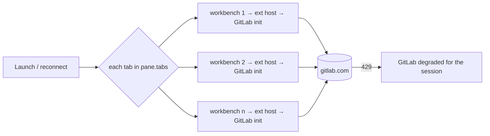
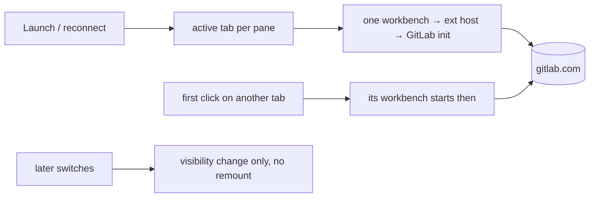

# Start a project's workbench the first time its tab is shown

## Status

| Unit           | Result                                                                                                                                                                                                                   |
| -------------- | ------------------------------------------------------------------------------------------------------------------------------------------------------------------------------------------------------------------------ |
| Scope          | `EditorPane.tsx` mounts `PaneWorkbench` only for the visible project tab and projects already started this run; `store.ts` holds which have started                                                                      |
| Implementation | Done 2026-11-08: `store.ts`, `EditorPane.tsx`, `PaneWorkbench.tsx`, and `hooks.ts` (`selectActions` returns every `WorkspaceActions` member, so it gained `markProjectStarted` — the plan missed this file)              |
| Verification   | Not run — no typecheck, tests or app launch yet                                                                                                                                                                          |
| Decided        | 2026-11-08: fix the startup burst in Chorus (option B), not by turning extensions off. Plan approved; the first sentence of `PaneWorkbench.tsx`'s header and of the `EditorPane.tsx` slot note are updated; no unit test |

## Corrections from review

Codex challenged the first draft; both findings were checked against the source and hold.

- **A pane-local set loses started projects on a split.** `LayoutView` (`Workspace.tsx:653`)
  renders a leaf as `EditorPane` and a branch as a `div`, so splitting or collapsing remounts the
  pane and resets its `useState`. Today every tab remounts and re-adopts its parked surface; with a
  pane-local set only the active one would, and `WorkbenchFrame`'s 100 ms release timer
  (`WorkbenchFrame.tsx:104`) would close the rest. The set now lives in the workspace store as
  runtime state, beside `planning`.
- **A project behind a browser tab is not shown.** With `webShowing`, the pane's `activeTabId` is
  still a project, but the tab strip treats it as inactive (`PaneTabStrip.tsx:117`) and browser
  visibility survives a relaunch. Counting it as shown would start a hidden editor at launch.
  Eligibility is now `id === projectId && !webShowing`.

## Current / Issue

Every project tab in a pane mounts its workbench at once, so every project's extension host starts
in the same second. `PaneWorkbench.tsx` says so in its header: chosen "for two or three open
projects; if that grows into eight, this is the decision to revisit". Six are open now.

`apps/desktop/src/renderer/src/workspace/EditorPane.tsx:550`:

```tsx
{pane.tabs.map(
  (id) =>
    PaneWorkbench !== null && (
      <PaneWorkbench key={id} projectId={id} active={id === projectId && !webShowing} … />
    )
)}
```

What that did on 2026-11-08, from `workbench-server/server/data/logs/20261108T072222`:

| Moment           | Extension hosts started                                                    | GitLab 429s that minute |
| ---------------- | -------------------------------------------------------------------------- | ----------------------- |
| 07:22            | 5 in one second                                                            | 146                     |
| 08:36:53         | 6 in one second, while the previous 6 lived 30 s more (reconnection grace) | 183                     |
| any other minute | —                                                                          | ~6 in total             |

Each host runs the GitLab Workflow extension, which fires its startup calls together (`/version`
several times, the project GraphQL lookup, merge requests, pipelines). Three tabs are clones of
`TAPDev/tpa-operation-web` and two of `TAPDev/mobile-tpa`, so most of that burst asks the same
questions. A host whose startup calls get 429 stays degraded for the session — "Found 0 projects",
"Could not parse version from undefined" — which is why the MR view does not load and refreshing
does not help until the extension restarts.



## Proposed

Mount a project's workbench the **first** time its tab is visible, then keep it mounted for the
rest of the run — across tab switches, splits and collapses. Launch starts one workbench per pane
instead of one per tab, and none for a pane showing a browser tab. A tab switch to a project
already started stays a compositing change, so `PaneWorkbench`'s reason for existing — no remount
on switch — is kept.

**Deliberately not doing:**

- No staggered start. It keeps every host warm but only spreads the burst, and how far it must be
  spread depends on gitlab.com limits this repo cannot see.
- No unmounting of background workbenches (a bounded cache). Once shown, a project keeps its
  open files and terminal for the run, exactly as now.
- No change to the 30 s reconnection grace after a relaunch, the GitLab extension, its settings,
  or the Windows remote host whose GitLab language server crashed.

**What changes for the person:** a project tab that has not been shown this run has no workbench
yet — no extension host, no language servers, no workbench terminal. It starts when the tab is first
clicked, with the boot that a first open already costs. An agent's `editor_edit` in such a project
gets the existing "no editor open" refusal and the approval card carries the diff
(`runtime.ts:7229`), the same path as the embedded editor being switched off.

## Code Changes

Two files.

**`apps/desktop/src/renderer/src/workspace/store.ts`** — runtime state, shaped like `planning`. It
is not in `WorkspaceSnapshot`, so it is never persisted, and `hydrate` leaves it alone: a second
hydrate without a shell reload must not forget surfaces that are still alive, and a shell reload
starts a fresh store anyway.

```ts
// WorkspaceState
readonly startedProjects: Readonly<Record<string, true>>

// WorkspaceActions
markProjectStarted: (projectId: string) => void

// initial state
startedProjects: {},

// action
markProjectStarted: (projectId) => {
  set((state) =>
    state.startedProjects[projectId] === true
      ? state
      : { startedProjects: { ...state.startedProjects, [projectId]: true } }
  )
},
```

**`apps/desktop/src/renderer/src/workspace/EditorPane.tsx`** — the visible project mounts in the
render that makes it visible; an effect records it, because a store update from inside another
component's render is not allowed. The hook sits above any early return.

```tsx
const visibleProjectId = projectId !== null && !webShowing ? projectId : null
const startedProjects = useWorkspaceStore((state) => state.startedProjects)
const markProjectStarted = useWorkspaceStore((state) => state.markProjectStarted)
useEffect(() => {
  if (visibleProjectId !== null) markProjectStarted(visibleProjectId)
}, [visibleProjectId, markProjectStarted])
```

```tsx
{pane.tabs
  .filter((id) => id === visibleProjectId || startedProjects[id] === true)
  .map(
    (id) =>
      PaneWorkbench !== null && (
        <PaneWorkbench key={id} projectId={id} active={id === projectId && !webShowing} … />
      )
  )}
```

A closed tab leaves `pane.tabs`, so the filter unmounts it as today. Its id staying in the set is
harmless for a tab reopened by clicking, which is visible and mounts anyway.

Unchanged: `apps/extension` renders with `PaneWorkbench: null`, `WorkbenchProbe`, main's surface
code and the editor port.

## Final Flow



## Acceptance criteria

1. At launch, `workbench-server.log` shows one `Launched Extension Host Process` per pane, not one
   per tab.
2. First click on another project tab starts its workbench; switching back and forth afterwards
   launches no further extension host and keeps open files.
3. Open projects A, B and C in one pane, select A, split C into a new pane: B's workbench survives
   with its open files, and no extension host is launched for it.
4. A pane relaunched with a browser tab showing starts no workbench until a project tab is shown.
5. Closing a project tab still disposes its workbench.
6. Opening tpa-web-1 alone: its GitLab log has no 429 at startup, shows "Found 1 projects", the MR
   view loads, and **GitLab: Refresh Sidebar** shows MR changes. Not guaranteed if something else
   (glab, VS Code, another machine) is spending the same gitlab.com quota — that is outside Chorus.
7. Agent `editor_edit` in a project not yet shown refuses as "no editor open" and the approval card
   still carries the diff.

## Open decisions

- **`PaneWorkbench.tsx`'s header and `EditorPane.tsx:539`'s note both say every tab is mounted.**
  After this change that is false. Update their first sentence, or leave them as written?
- **A unit test in `EditorPane.test.tsx`** that only the active tab mounts at first, and a shown
  tab stays mounted. Written, not run, until testing is asked for — or skipped.
