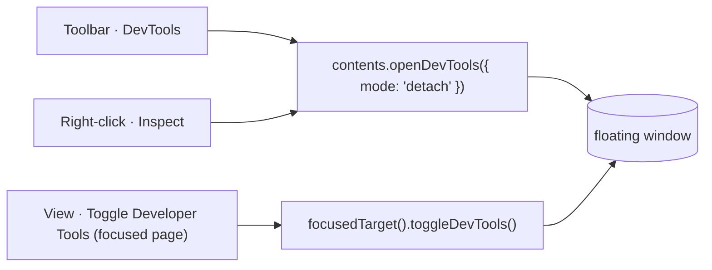
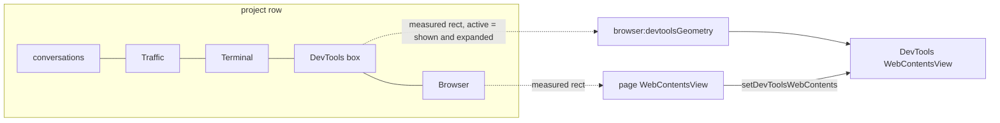
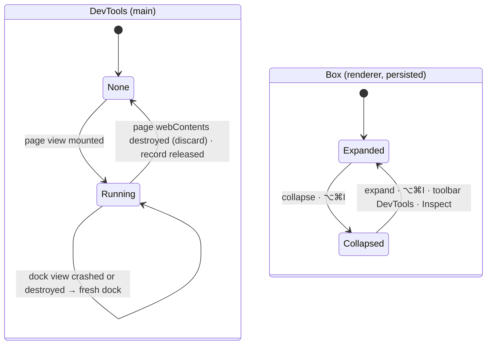
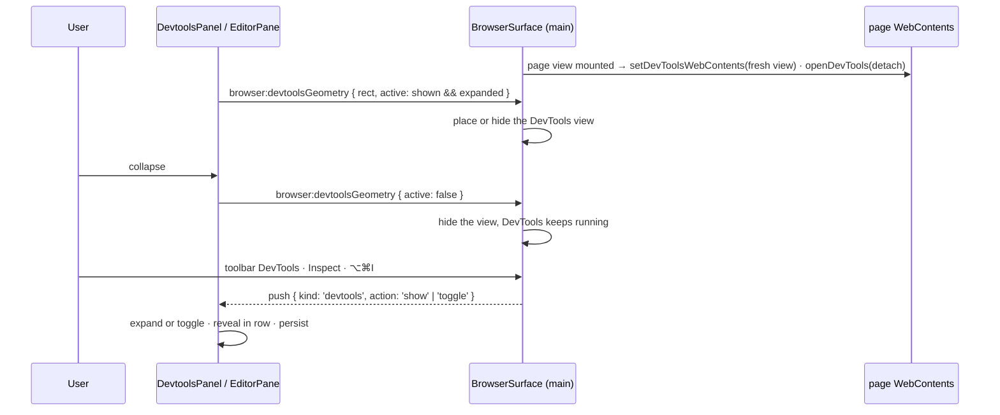

# DevTools as a box in the project row

## Status

| Unit           | Result                                                                                                                                                                                                                       |
| -------------- | ---------------------------------------------------------------------------------------------------------------------------------------------------------------------------------------------------------------------------- |
| Scope          | The project Browser box's page only, desktop app only. A DevTools box sits after Terminal and before Browser; web tabs keep their floating DevTools window                                                                   |
| Decided        | 2026-11-08: DevTools is always running for a project page that is loaded; the box's collapse button only hides it. Collapse and width are remembered per project; a project starts expanded                                  |
| Decided        | 2026-11-08: toolbar DevTools and right-click Inspect expand the box and scroll to it; ⌥⌘I on the page or its DevTools toggles the collapse; no pop-out; desktop only                                                         |
| Review         | 2026-11-08: codex challenged the first draft; findings checked against Electron v43.2.0 source and folded in below                                                                                                           |
| Implementation | Done 2026-11-08 by codex, reviewed by claude by reading the full diff: 24 files changed plus the new `DevtoolsPanel.tsx`. Deviations listed below                                                                            |
| Verification   | 2026-11-08 `pnpm check`: typecheck, lint, Prettier and tests (4,783) pass after two gate fixes; `workbench:check` blocked by GitHub's release edge returning 504. App not installed or launched — packaging hit the same 504 |

## Where the code differs from this plan

- `DevtoolsDock` also holds its `OverlayParticipant`, so `devtoolsGeometry` can re-apply visibility.
- `routeFocusedDevtools` matches the dock's own `webContents`, not only the page's
  `devToolsWebContents`, so ⌥⌘I works before Electron publishes the latter.
- `browser-surface.test.ts` needed more than a shape change: its fake `WebContentsView` now marks
  views built with options as `primary`, so the options-free dock does not overwrite the page's
  recorded events, bounds and closes, and dock participants are kept out of `harness.participants`.
- `resetProjectWidths` resets the DevTools width and keeps its collapse.

## Corrections from review

Each was checked against `electron/electron@v43.2.0` or this repo before being accepted. The first
draft opened DevTools on expand and closed it on collapse; the lifecycle facts below still govern
the always-on version, because a dock is still built when a page mounts and torn down when it goes.

- **`isDevToolsOpened()` is always false for a custom target.** `WebContents::IsDevToolsOpened`
  (`electron_api_web_contents.cc:3122`) returns `IsDevToolsViewShowing()`, which requires
  `managed_devtools_web_contents_` (`inspectable_web_contents.cc:471`). Guarding `closeDevTools()`
  with it would skip the reset of the frontend dispatcher, and the next `openDevTools` would be a
  no-op (`:422-426`). `closeDock` calls `closeDevTools()` unconditionally on a live page.
- **`devtools-closed` is late and not ours to trust.** For a custom target `CloseDevTools()` emits
  nothing (`:454-469`); `devtools-closed` fires only when the DevTools webContents is destroyed
  (`:1010-1022`), and `webContents.close()` destroys asynchronously. The dock watches its own view's
  `destroyed` and `render-process-gone`, guarded by identity. Rebuilding right after a teardown is
  safe at the Electron level: `AttachTo` detaches the previous client first (`:479-486`) and
  `Observe` moves to the new target. Inferred from source, not reproduced.
- **The Console read the same false predicate.** `electron-browser-source.ts:56` used
  `isDevToolsOpened()`, which `browser-console.ts` consults on detach (`:1458`), navigation
  (`:1472`) and failed attach (`:1197`). With a docked DevTools it would say "cannot reach this
  page" where today it says "paused". It now also reads `contents.devToolsWebContents`, which
  Electron sets on `devtools-opened` and clears on `devtools-closed` for both target kinds
  (`electron_api_web_contents.cc:2481,2501,4159`).
- **The Console's real contract.** `browser-console.ts:1156-1161` ignores DevTools opening while
  the Console's debugger is still attached. So with DevTools always running, the Console — and the
  agents' `read_console` / `run_javascript` — either keep working, or show "Paused while DevTools
  is open" for as long as the page is loaded. Electron's debugger is not exclusive
  (`electron_api_debugger.cc:103`), so working is likely; it is not verified. Accepted by the user.
- **Registration hides the new dock.** `registerOverlayParticipant` applies visibility immediately
  (`workbench-surface.ts:538`), before `record.devtools` points at the view. `openDock` calls
  `applyParticipant` again after assigning and placing.
- **A crash does not release the page view.** `render-process-gone` (`browser-surface.ts:1428`)
  keeps it; only `destroyed` → `discard` → `releaseView` does (`:1040`, `:1436`).
- **Files the first draft missed**: `main/browser-port.ts`, `main/electron-browser-port.ts`,
  `apps/engine/src/browser-surfaces.ts` on the IPC path; scale changes (`browser-surface.ts:288`)
  must re-place the dock; the menu route must work outside `routeOwner()`; the push switch is in
  `web-pages.ts:252`; `parity.test.ts:17` lists accepted waivers; the panel wrapper needs CSS; three
  fixtures assert exact shapes.

## Current / Issue

Every way into DevTools for the project Browser's page opens a separate floating window that sits
over Chorus and is not part of the project at all.



`apps/desktop/src/main/browser-surface.ts:534` and `:1196`:

```ts
case 'devtools':
  contents.openDevTools({ mode: 'detach' })
  break
case 'inspect':
  contents.openDevTools({ mode: 'detach' })
  contents.inspectElement(params.x, params.y)
  break
```

The row today, `EditorPane.tsx:654-789`: conversations → Traffic → Terminal (only with a run
command) → Browser.

## Proposed

A `devtools-box` between Terminal and Browser, shaped like Traffic: a dock header, a collapse
toggle, the row divider resizes it, width and collapse remembered per project. Main hosts the page's
DevTools in a fresh `WebContentsView` it owns (`setDevToolsWebContents`, `electron.d.ts:18386`) the
moment the page's view mounts, and places it over the box's body exactly as it places the page over
the Browser body. Collapsing, or showing another project tab, only hides that view.



DevTools lives exactly as long as the page view. The box's collapse is layout, owned by the
renderer like Traffic's:



With no page loaded the expanded box shows a placeholder ("DevTools shows here once this Browser
has a page open"). It sits behind the native view, so it needs no state. A page renderer crash
keeps the view, and DevTools reattaches on reload.

**What it costs:** one DevTools renderer per loaded project page, including project tabs that are
not showing. A project browser that never loaded a page has none.

**Deliberately not doing:**

- Web tabs: their toolbar button (`WebTabStage.tsx:408`), their Inspect and ⌥⌘I on a shown web tab
  (`routeDevtools`) keep the floating window.
- The VS Code extension: no native views there, so no box. Its new API method is `waived`.
- No way to turn DevTools off for a page, no pop-out, no dock-side switching. `detach` mode is the
  one that cannot be re-docked from inside DevTools (`OpenDevToolsOptions.mode`).
- No horizontal-swipe-to-scroll-the-row over DevTools; the page has a row-wheel bridge, DevTools
  does not get one.
- DevTools' own state (selected panel, breakpoints) does not survive the page view going away: a
  relaunch, a pane split (which re-attaches the browser and releases the record,
  `browser-surface.ts:396`) or a closed tab starts a fresh DevTools.
- No refactor of `BrowserPanel`'s geometry loop; the box carries its own smaller copy.
- No new tests. Three existing fixtures get the new shape so they keep matching; nothing is run.

## Code Changes

### `apps/desktop/src/shared/browser-ipc.ts`

```ts
export const BrowserDevtoolsGeometryRequest = BrowserTarget.extend({
  revision: BrowserRevision,
  rect: BrowserRect,
  active: z.boolean(),
}).strict()

'browser:devtoolsGeometry': {
  request: BrowserDevtoolsGeometryRequest,
  response: z.object({ revision: BrowserRevision }).strict(),
},

z.object({
  kind: z.literal('devtools'),
  browserId: BrowserId,
  action: z.enum(['show', 'toggle']),
}).strict(),

readonly setBrowserDevtoolsGeometry: (
  request: BrowserRequest<'browser:devtoolsGeometry'>
) => Promise<BrowserResponse<'browser:devtoolsGeometry'>>
```

A separate push kind rather than a `BrowserWebCommand`: those are web-tab menu commands, consumed by
`Workspace.tsx` and `web-pages.ts`.

The path a call travels, each gaining the one method:

| File                                  | Change                                                                    |
| ------------------------------------- | ------------------------------------------------------------------------- |
| `shared/create-chorus-api.ts`         | `setBrowserDevtoolsGeometry: invokeBrowser('browser:devtoolsGeometry')`   |
| `main/browser-ipc.ts`                 | `this.handle('browser:devtoolsGeometry', …)` beside `'browser:geometry'`  |
| `main/browser-port.ts`                | `'devtoolsGeometry'` in the `BrowserSurfacePort` pick                     |
| `main/electron-browser-port.ts`       | forwarder, shaped like `geometry`                                         |
| `apps/engine/src/browser-surfaces.ts` | `devtoolsGeometry: (_owner, request) => ({ revision: request.revision })` |
| `apps/extension/src/parity.ts`        | `'waived'`                                                                |
| `apps/extension/src/parity.test.ts`   | added to the accepted-waiver list                                         |

`BrowserPush` gains `case 'devtools':` as a no-op in `BrowserPanel.tsx:128` and
`workspace/web-pages.ts:252`; `DevtoolsPanel` is the one that acts on it.

### `apps/desktop/src/main/browser-surface.ts`

```ts
interface DevtoolsDock {
  readonly view: WebContentsView
  readonly unregister: () => void
}

devtools: DevtoolsDock | null
devtoolsRect: BrowserRect | null
devtoolsRevision: number
devtoolsShown: boolean
```

```ts
private openDock(record: BrowserRecord): void {
  if (record.scope.kind !== 'project' || record.devtools !== null) return
  const contents = this.contents(record)
  const parent = BrowserWindow.fromWebContents(record.owner)
  if (contents === null || contents.isDestroyed() || parent === null || parent.isDestroyed()) return
  const view = new WebContentsView()
  view.setBounds({ x: 0, y: 0, width: 0, height: 0 })
  view.setVisible(false)
  parent.contentView.addChildView(view)
  contents.setDevToolsWebContents(view.webContents)
  contents.openDevTools({ mode: 'detach', activate: false })
  const participant: OverlayParticipant = {
    id: `${record.id}:devtools`,
    owner: record.owner,
    view,
    shown: () => record.devtoolsShown && record.devtools?.view === view,
  }
  const lost = (): void => {
    if (record.devtools?.view !== view) return
    this.closeDock(record)
    this.openDock(record)
  }
  view.webContents.once('destroyed', lost)
  view.webContents.on('render-process-gone', lost)
  record.devtools = { view, unregister: registerOverlayParticipant(participant) }
  this.placeDock(record)
  applyParticipant(participant)
}

private closeDock(record: BrowserRecord): void {
  const dock = record.devtools
  if (dock === null) return
  record.devtools = null
  dock.unregister()
  const contents = this.contents(record)
  if (contents !== null && !contents.isDestroyed()) contents.closeDevTools()
  const parent = record.owner.isDestroyed() ? null : BrowserWindow.fromWebContents(record.owner)
  if (parent !== null && !parent.isDestroyed()) parent.contentView.removeChildView(dock.view)
  if (!dock.view.webContents.isDestroyed()) dock.view.webContents.close()
}
```

Registration applies visibility before `record.devtools` points at the view, so it hides it; the
explicit `applyParticipant` after assignment and placement is what shows it. Each dock is a fresh
view: the target must have done no navigation, and a used DevTools leaves its view navigated.
`closeDock` clears `record.devtools` first, so the `destroyed` it causes finds a different view and
does nothing; only a dock lost on its own is rebuilt.

Hooks into what exists:

| Where                               | Change                                                                                                        |
| ----------------------------------- | ------------------------------------------------------------------------------------------------------------- |
| `mountView`                         | project scope: after mounting, `this.openDock(record)`                                                        |
| `releaseView`                       | `this.closeDock(record)` while `record.view` is still set                                                     |
| `act` `'devtools'` (`:534`)         | project scope → push `{ kind: 'devtools', action: 'show' }`; web scope unchanged                              |
| `menuAction` `'inspect'` (`:1196`)  | project scope → `inspectElement`, then push `show`; web scope unchanged                                       |
| `onScaleChange` (`:288`)            | also `placeDock` for records with a dock                                                                      |
| new `devtoolsGeometry`              | mirrors `geometry`: revision check, store rect, `devtoolsShown = active`, `placeDock`, `applyParticipant`     |
| new `placeDock`                     | `place`'s arithmetic over `devtoolsRect` and the dock view                                                    |
| new `routeFocusedDevtools(focused)` | focused is a project page or that page's `devToolsWebContents` → push `toggle`; returns whether it handled it |

### `apps/desktop/src/main/electron-browser-source.ts:56`

```ts
isInspectorOpen: () => contents.isDevToolsOpened() || contents.devToolsWebContents !== null,
```

### `apps/desktop/src/main/index.ts:745`

```ts
devtools: () => {
  if (browserSurfaces.routeFocusedDevtools(webContents.getFocusedWebContents())) return true
  const owner = routeOwner()
  return owner !== null && browserSurfaces.routeDevtools(owner.webContents)
},
```

Before `routeOwner()`, so a project page in a detached window is covered too.

### Layout state — `shared/workspace-layout.ts`, `workspace/layout.ts`, `store.ts`, `hooks.ts`, `row-drag.ts`

Shaped like `trafficPanels`, at every place that field is touched:

```ts
export const DEVTOOLS_WIDTH = { default: 600, min: 400 } as const

export const DevtoolsPanelState = z.object({
  width: z.number(),
  collapsed: z.boolean(),
})

devtoolsPanels: z.record(z.string(), DevtoolsPanelState).default({}),
devtoolsPanel: DevtoolsPanelState.optional(),

export const DEFAULT_DEVTOOLS: DevtoolsPanelState = { width: DEVTOOLS_WIDTH.default, collapsed: false }
```

| File                    | Where                                                                                                                                           |
| ----------------------- | ----------------------------------------------------------------------------------------------------------------------------------------------- |
| `workspace-layout.ts`   | `DevtoolsPanelState`, `WorkspaceSnapshot`, `ProjectLayoutSlice`                                                                                 |
| `workspace/layout.ts`   | `DEFAULT_DEVTOOLS`, `EMPTY_WORKSPACE` (`:161-167`), slice out/in (`:185-221`), normalisation and width clamping (`:426-450`), pruning (`:1331`) |
| `workspace/store.ts`    | state, the handwritten snapshot (`:492-506`), `setDevtoolsWidth`, `setDevtoolsCollapsed`; `resetProjectWidths` resets the width                 |
| `workspace/hooks.ts`    | `useDevtoolsPanel(projectId)` → `DEFAULT_DEVTOOLS` when absent; both actions on both sides of the selector                                      |
| `workspace/row-drag.ts` | `RowItemKind` `'devtools'` for `.devtools-box`, minimum `DEVTOOLS_WIDTH.min`, `RowWidths.devtools`                                              |

### `apps/desktop/src/renderer/src/workspace/EditorPane.tsx`

```tsx
const devtoolsPanels = useWorkspaceStore((state) => state.devtoolsPanels)
const devtools = useDevtoolsPanel(projectId)
const devtoolsCollapsed = devtools.collapsed
const devtoolsWidth = devtoolsCollapsed
  ? COLLAPSED_TOOL_WIDTH
  : Math.max(devtools.width, DEVTOOLS_WIDTH.min)
const setDevtools = (id: string, collapsed: boolean): void => {
  markRowTouched(id)
  flushSync(() => {
    setDevtoolsCollapsed(id, collapsed)
  })
  if (!collapsed && id === projectId) revealInRow(devtoolsBox.current)
  commitLayout()
}
```

```tsx
{
  projectId !== null && capabilities.nativeBrowserViews && (
    <>
      {rowSash}
      <section
        className="devtools-box"
        ref={devtoolsBox}
        data-collapsed={devtoolsCollapsed}
        data-min-width={DEVTOOLS_WIDTH.min}
        style={{ flex: `0 0 ${String(devtoolsWidth)}px` }}
      >
        {pane.tabs.map((id) => (
          <DevtoolsPanel
            key={id}
            projectId={id}
            browserId={browserLinks[id]?.attachment?.browserId ?? null}
            active={id === projectId && !webShowing}
            collapsed={devtoolsPanels[id]?.collapsed === true}
            scroller={scroller}
            onCollapse={(collapsed) => {
              setDevtools(id, collapsed)
            }}
          />
        ))}
      </section>
    </>
  )
}
```

Placed between the Terminal block and the Browser block. A tab that is not the active one is
`hidden` and sends `active: false`, so only one project's DevTools view shows at a time.
`onBrowserAttached` is passed to
`BrowserPanel` always, not only when streamed, so `browserLinks` carries the desktop browser id; the
callback only reports the existing attachment. `applyRow` sets `row.devtools`.

### `apps/desktop/src/renderer/src/DevtoolsPanel.tsx` — new

Its own file because it owns hooks per project tab: the push listener and the geometry loop.

- Root `.devtools-panel`, `hidden={!active}`.
- Header: `conversation-dock` with title `t('devtools.title')` and the `conversation-dock-toggle`
  (`▸` / `◂`, `t('devtools.expand')` / `t('devtools.collapse')`) → `onCollapse(!collapsed)`.
- `window.chorus.onBrowser` → `push.kind === 'devtools' && push.browserId === browserId`:
  `show` → `onCollapse(false)`; `toggle` → `onCollapse(!collapsed)`, read through a ref so the
  listener does not resubscribe.
- Body `.devtools-body`, hidden when collapsed: the placeholder `t('devtools.empty')`, or the
  overlay still `useWorkbenchStill(`${browserId}:devtools`)`. Measured with `browserViewport` and
  sent through `setBrowserDevtoolsGeometry` on resize, row scroll, row children and window resize;
  `active: false` when the tab is hidden, the box is collapsed, or the panel unmounts.

### `i18n/en.json`, `styles.css`

`devtools.title` "DevTools", `devtools.expand`, `devtools.collapse`, `devtools.empty`.

`.devtools-box` joins the four `.traffic-box, .project-terminal-box` rules (`styles.css:12864-12886`).
`.devtools-panel` and `.devtools-panel[hidden]` copy `.browser-panel` (`:13104-13120`);
`.devtools-body` copies `.browser-body` sizing, and the still reuses `.browser-still` /
`.workbench-still`.

### Fixtures — shape only, nothing run

`main/open-projects.test.ts:74` (snapshot gains `devtoolsPanels: {}`),
`workspace/row-drag.test.ts:195` (`RowWidths` gains `devtools: null`),
`main/browser-surface.test.ts:206` (its contents fake gains `setDevToolsWebContents`,
`closeDevTools` and `devToolsWebContents`).

## Final Flow



## Acceptance criteria

1. The row reads Traffic → Terminal → DevTools → Browser; with no run command, Traffic → DevTools →
   Browser. A project seen for the first time has it expanded.
2. Loading a page in the project Browser brings its DevTools into the box with no click.
3. Collapse, inspect something else, expand: DevTools is exactly as left — same panel, same
   selection, console history intact.
4. Collapse and width survive a relaunch, per project.
5. Toolbar DevTools and right-click Inspect on the project page expand the box if collapsed and
   scroll it into view; Inspect selects the clicked element. No floating window opens.
6. ⌥⌘I with the project page or its DevTools focused toggles the collapse, in the main or a
   detached window.
7. The Console panel is never "cannot reach this page" because of DevTools; it is either working or
   "Paused while DevTools is open".
8. A Chorus dialog over the row hides the DevTools view and shows its still, as for the page.
9. Two project tabs in one pane: each has its own DevTools; switching tabs swaps which one shows.
10. With no page loaded the expanded box shows the placeholder.
11. Changing Chorus's zoom keeps DevTools aligned with the box.
12. Web tabs: DevTools still opens in a floating window from their toolbar, Inspect and ⌥⌘I.
13. VS Code extension: no DevTools box, nothing else changed.

## Open decisions

- None. Questions answered 2026-11-08: always running (A); collapse and width remembered, starts
  expanded; toolbar and Inspect show the box; ⌥⌘I toggles it.
