# Git box: branches, merge requests and MR review in the project row

## Status

| Unit           | Result                                                                                                                                                                                                                                                                                                                                                                                                                                                                                                                                                                                                                                                                                                                                                                                                                                                                                                                                                                                                                                                                                                                                                                                                                                                                                                                                                                                                                                                                                                                                                                                                                                                                                                                                                                                                                                                                                                                                                                                                                                                                                                                                                                                                                                                                                                                                                                                                                                                                                                                                                                                                                                                                                                                                                                                                                                                                                                                                                                                                                                                                                                                                                                                                                                                                                                                                                                                                                                                                                                                                                                                                                                                                                                                                                                                                                                                                                                                                                                                                                                                                                                                                                                                                                                                                                                                                                                                                                                                                                                                                                                                                                                                                                                                                                                                                                                                                                                                                                                                                                                                                                                                                                                                                                                                                                                                                                                                                                                                                                                                                                                                                                                                                                                                                                                                                                                                                                                                                                                                                                                                                                                                                                                                                                                                                                                                                                                                                                                                                        |
| -------------- | ----------------------------------------------------------------------------------------------------------------------------------------------------------------------------------------------------------------------------------------------------------------------------------------------------------------------------------------------------------------------------------------------------------------------------------------------------------------------------------------------------------------------------------------------------------------------------------------------------------------------------------------------------------------------------------------------------------------------------------------------------------------------------------------------------------------------------------------------------------------------------------------------------------------------------------------------------------------------------------------------------------------------------------------------------------------------------------------------------------------------------------------------------------------------------------------------------------------------------------------------------------------------------------------------------------------------------------------------------------------------------------------------------------------------------------------------------------------------------------------------------------------------------------------------------------------------------------------------------------------------------------------------------------------------------------------------------------------------------------------------------------------------------------------------------------------------------------------------------------------------------------------------------------------------------------------------------------------------------------------------------------------------------------------------------------------------------------------------------------------------------------------------------------------------------------------------------------------------------------------------------------------------------------------------------------------------------------------------------------------------------------------------------------------------------------------------------------------------------------------------------------------------------------------------------------------------------------------------------------------------------------------------------------------------------------------------------------------------------------------------------------------------------------------------------------------------------------------------------------------------------------------------------------------------------------------------------------------------------------------------------------------------------------------------------------------------------------------------------------------------------------------------------------------------------------------------------------------------------------------------------------------------------------------------------------------------------------------------------------------------------------------------------------------------------------------------------------------------------------------------------------------------------------------------------------------------------------------------------------------------------------------------------------------------------------------------------------------------------------------------------------------------------------------------------------------------------------------------------------------------------------------------------------------------------------------------------------------------------------------------------------------------------------------------------------------------------------------------------------------------------------------------------------------------------------------------------------------------------------------------------------------------------------------------------------------------------------------------------------------------------------------------------------------------------------------------------------------------------------------------------------------------------------------------------------------------------------------------------------------------------------------------------------------------------------------------------------------------------------------------------------------------------------------------------------------------------------------------------------------------------------------------------------------------------------------------------------------------------------------------------------------------------------------------------------------------------------------------------------------------------------------------------------------------------------------------------------------------------------------------------------------------------------------------------------------------------------------------------------------------------------------------------------------------------------------------------------------------------------------------------------------------------------------------------------------------------------------------------------------------------------------------------------------------------------------------------------------------------------------------------------------------------------------------------------------------------------------------------------------------------------------------------------------------------------------------------------------------------------------------------------------------------------------------------------------------------------------------------------------------------------------------------------------------------------------------------------------------------------------------------------------------------------------------------------------------------------------------------------------------------------------------------------------------------------------------------------------------------- |
| Scope          | Desktop app, local projects. A Git box sits between the conversation columns and Traffic: branches, checkout, Sync, the project's open merge requests, and reviewing one without leaving Chorus. It replaces the GitLab Workflow extension in the workbench                                                                                                                                                                                                                                                                                                                                                                                                                                                                                                                                                                                                                                                                                                                                                                                                                                                                                                                                                                                                                                                                                                                                                                                                                                                                                                                                                                                                                                                                                                                                                                                                                                                                                                                                                                                                                                                                                                                                                                                                                                                                                                                                                                                                                                                                                                                                                                                                                                                                                                                                                                                                                                                                                                                                                                                                                                                                                                                                                                                                                                                                                                                                                                                                                                                                                                                                                                                                                                                                                                                                                                                                                                                                                                                                                                                                                                                                                                                                                                                                                                                                                                                                                                                                                                                                                                                                                                                                                                                                                                                                                                                                                                                                                                                                                                                                                                                                                                                                                                                                                                                                                                                                                                                                                                                                                                                                                                                                                                                                                                                                                                                                                                                                                                                                                                                                                                                                                                                                                                                                                                                                                                                                                                                                                   |
| Decided        | 2026-11-08, the user took every recommendation: review renders **in the box**; GitLab first (a GitHub repo gets branches, checkout and Sync, no PR list); **manual Sync only**; a dirty tree refuses checkout; v1 adds cross-clone awareness, "changed since my last review", failed pipeline → agent, and a checkout guard while an agent works                                                                                                                                                                                                                                                                                                                                                                                                                                                                                                                                                                                                                                                                                                                                                                                                                                                                                                                                                                                                                                                                                                                                                                                                                                                                                                                                                                                                                                                                                                                                                                                                                                                                                                                                                                                                                                                                                                                                                                                                                                                                                                                                                                                                                                                                                                                                                                                                                                                                                                                                                                                                                                                                                                                                                                                                                                                                                                                                                                                                                                                                                                                                                                                                                                                                                                                                                                                                                                                                                                                                                                                                                                                                                                                                                                                                                                                                                                                                                                                                                                                                                                                                                                                                                                                                                                                                                                                                                                                                                                                                                                                                                                                                                                                                                                                                                                                                                                                                                                                                                                                                                                                                                                                                                                                                                                                                                                                                                                                                                                                                                                                                                                                                                                                                                                                                                                                                                                                                                                                                                                                                                                                              |
| Decided        | 2026-11-08: Chorus owns the GitLab token, encrypted. "Use my GitLab Workflow token" imports it only when that account is a pasted token — an OAuth sign-in is never copied, because two refresh owners of one grant break each other                                                                                                                                                                                                                                                                                                                                                                                                                                                                                                                                                                                                                                                                                                                                                                                                                                                                                                                                                                                                                                                                                                                                                                                                                                                                                                                                                                                                                                                                                                                                                                                                                                                                                                                                                                                                                                                                                                                                                                                                                                                                                                                                                                                                                                                                                                                                                                                                                                                                                                                                                                                                                                                                                                                                                                                                                                                                                                                                                                                                                                                                                                                                                                                                                                                                                                                                                                                                                                                                                                                                                                                                                                                                                                                                                                                                                                                                                                                                                                                                                                                                                                                                                                                                                                                                                                                                                                                                                                                                                                                                                                                                                                                                                                                                                                                                                                                                                                                                                                                                                                                                                                                                                                                                                                                                                                                                                                                                                                                                                                                                                                                                                                                                                                                                                                                                                                                                                                                                                                                                                                                                                                                                                                                                                                          |
| Decided        | 2026-11-08: agent-drafted review comments are a later phase with its own approval. Retiring GitLab Workflow is the last phase and the person does it by hand — the extension directory is shared by every project                                                                                                                                                                                                                                                                                                                                                                                                                                                                                                                                                                                                                                                                                                                                                                                                                                                                                                                                                                                                                                                                                                                                                                                                                                                                                                                                                                                                                                                                                                                                                                                                                                                                                                                                                                                                                                                                                                                                                                                                                                                                                                                                                                                                                                                                                                                                                                                                                                                                                                                                                                                                                                                                                                                                                                                                                                                                                                                                                                                                                                                                                                                                                                                                                                                                                                                                                                                                                                                                                                                                                                                                                                                                                                                                                                                                                                                                                                                                                                                                                                                                                                                                                                                                                                                                                                                                                                                                                                                                                                                                                                                                                                                                                                                                                                                                                                                                                                                                                                                                                                                                                                                                                                                                                                                                                                                                                                                                                                                                                                                                                                                                                                                                                                                                                                                                                                                                                                                                                                                                                                                                                                                                                                                                                                                             |
| Research       | 2026-11-08: claude and codex, read-only. GitLab Workflow 7.4.3 read from its bundle and source map; GitLab API shapes from docs.gitlab.com; no provider API was called                                                                                                                                                                                                                                                                                                                                                                                                                                                                                                                                                                                                                                                                                                                                                                                                                                                                                                                                                                                                                                                                                                                                                                                                                                                                                                                                                                                                                                                                                                                                                                                                                                                                                                                                                                                                                                                                                                                                                                                                                                                                                                                                                                                                                                                                                                                                                                                                                                                                                                                                                                                                                                                                                                                                                                                                                                                                                                                                                                                                                                                                                                                                                                                                                                                                                                                                                                                                                                                                                                                                                                                                                                                                                                                                                                                                                                                                                                                                                                                                                                                                                                                                                                                                                                                                                                                                                                                                                                                                                                                                                                                                                                                                                                                                                                                                                                                                                                                                                                                                                                                                                                                                                                                                                                                                                                                                                                                                                                                                                                                                                                                                                                                                                                                                                                                                                                                                                                                                                                                                                                                                                                                                                                                                                                                                                                        |
| Review         | 2026-11-08: codex challenged the first draft — two blockers and fourteen should-fix findings, each checked against the source or docs.gitlab.com before being folded in; see Corrections from review                                                                                                                                                                                                                                                                                                                                                                                                                                                                                                                                                                                                                                                                                                                                                                                                                                                                                                                                                                                                                                                                                                                                                                                                                                                                                                                                                                                                                                                                                                                                                                                                                                                                                                                                                                                                                                                                                                                                                                                                                                                                                                                                                                                                                                                                                                                                                                                                                                                                                                                                                                                                                                                                                                                                                                                                                                                                                                                                                                                                                                                                                                                                                                                                                                                                                                                                                                                                                                                                                                                                                                                                                                                                                                                                                                                                                                                                                                                                                                                                                                                                                                                                                                                                                                                                                                                                                                                                                                                                                                                                                                                                                                                                                                                                                                                                                                                                                                                                                                                                                                                                                                                                                                                                                                                                                                                                                                                                                                                                                                                                                                                                                                                                                                                                                                                                                                                                                                                                                                                                                                                                                                                                                                                                                                                                          |
| Implementation | Phase 1 done 2026-11-08 by codex, reviewed by claude by reading every changed file: 4 new (`main/git-box.ts`, `main/git-ipc.ts`, `shared/git-ipc.ts`, `GitPanel.tsx`) and 19 modified. Two review corrections applied (Prettier wrapping, zero track counts hidden). Phase 2 written 2026-11-08 by codex on `feat/git-box-mrs` and reviewed by claude file by file; three review corrections applied (one failed MR detail no longer empties the list, the split panel components folded back into `GitPanel.tsx` per the one-component-per-file rule, no MR re-read on a tab switch). Phase 3a (read: versioned snapshot, review marks, the box's file tree, read-only editor diffs over `chorus-review:`) written 2026-11-09 by codex on `feat/git-box-review` and reviewed by claude file by file; one correction applied (a failed approvals read degrades to "Approvals unavailable" instead of hiding the review). Then, at the user's request, "Open all changes": `@codingame/monaco-vscode-multi-diff-editor-service-override@33.0.9` added (installed by claude; registered in `workbench/services.ts`) and `git:openAllDiffs` sends every readable file of the reviewed version, up to 16 MiB of text, to one multi-diff tab on the same `chorus-review:` provider, counting the rest as skipped. Tried 2026-11-09 after the engine handover (the first relaunch kept the old engine, pid 96431, alive, so the new app rejected its MR rows and showed "GitLab could not be reached"): Review on !310 showed the overview, "0 of 8 viewed" and the compacted folder tree, and a file opened as a read-only diff tab in the project's editor. Open all changes opened one tab, "!310 changes (8 files)", with every file and folded unchanged lines. **Defect seen there:** every file header showed "R" and a struck-through original name, because the two sides' URIs differ in path (`/<iid>/<version>/original/…` vs `/modified/…`) and the multi-diff editor reads a path change as a rename; the same path segments also fill the breadcrumb. Fixed the same day: both sides now use the real file path (the original side the MR's `old_path`, so a true rename still differs) with MR, version and side in the authority (`original-<iid>-<version>`, `modified-…`, `all-…`); verified in the installed source that the multi-diff header flags "R" only when `modifiedUri.path !== originalUri.path` (`diffEditorItemTemplate.js:234`) and that `RegisteredFileSystemProvider` keeps one root per authority (`files-service-override/index.js:244`). Also: "No approvals required" when none are, and the box says "Chorus needs to restart to finish updating" when a Git call fails as a malformed response or `channel-refused` — the app and engine are different builds. Before 3a's commit: typecheck, lint (after codex fixed 20 errors without changing meaning), format and 4,857 tests passed; `workbench:check` was blocked twice by GitHub's release edge returning 504 for the pinned VSCodium checksum, which this branch does not touch. Phase 3b researched 2026-11-09 by codex, read-only, on `feat/git-box-editor`; claude checked the cited lines in the installed source; design under Phase 3 → 3b. Step 3b.1 written 2026-11-09 by codex and reviewed by claude file by file: the view's title is translated in main (`mainT`) and carried in the workbench descriptor as `reviewLabels.title`, because `workbench.html` keeps i18n out of that document on purpose; one correction applied (an `await` codex put between the handler registrations in `entry.ts` moved out, since that block must register before anything can ask). Installed and tried by the user: after a review file opened, a "Merge Request" section appeared in the editor's Source Control below Graph and GitLens with the static `src/example.ts`, and its checkbox toggled. Step 3b.2 written 2026-11-09 by codex and reviewed by claude file by file; codex stopped once to keep `preparing` and `failed` distinguishable from a closed review, settled as an `outcome` on the `git:review` reply beside the envelope. Three review corrections: editors re-read only when the engine reconnects, not on every status change (each would otherwise have shown "Git could not complete the operation" during every handover); folders start open as in the box; a cosmetic leftover in `review-diff.ts` reverted. Installed and seen by the user: the editor section listed the MR's real files. Then, at the user's request, both checkboxes removed, viewed marks deleted, files coloured by status and "seen" recorded on Review (see 3b → "Changed 2026-11-09"). `pnpm check` passed (typecheck, lint after three fixes — `deferred<undefined>` twice and `String#includes` — format, `workbench:check`, 4,862 tests). Installed and confirmed by the user: the colours in both trees and the editor section working. Edit mode written 2026-11-09 by codex and reviewed by claude file by file; one correction applied (the "branch differs" note used an unstyled class, now `git-note`). Codex also carried `mr.fork` into the review snapshot, put each file's mode into the multi-diff's identity so a branch switch cannot reuse a read-only tab, and gave an editable file's base the workspace path so an unrenamed file shows no false "R". Installed and confirmed by the user on `tpa-web-1`'s source branch: the right side opened editable. A reverted block reached disk only after ⌘S. Why auto-save did not fire is **not confirmed**: the workbench defaults `files.autoSave` to `afterDelay` only when `isWeb` (`files.contribution._configuration.js:219`), and `isWeb` is false whenever the page can see a Node `process` (`platform.js:22–28, 50`); whether this view can is unchecked, so the `services.ts` comment assuming the web default is unverified rather than known wrong. Then the box's rows were restyled to the editor's layout (confirmed matching by the user), the editor section became a native source control after the contributed view kept filing one folder's children under another, and the SCM id patch followed when that source control knocked Git out (see 3b). Installed and confirmed by the user: Source Control works with Git and the MR side by side. Everything since the last `pnpm check` (edit mode onward) is unchecked by the gate; not committed. Phases 3c, 4 and 6 not started |
| Verification   | 2026-11-08, installed with `app:install` and tried by the user: the box loads the branch list, the cross-clone badge shows on `develop` for two other clones, and a non-zero track ("↓ 4 behind") renders while zero counts stay hidden. The first load failed because the engine from before the install was still serving: an engine only hands over when idle, and an app restart does not restart it. Checkout of a local branch that was "↓ 4 behind" worked; the Sync fast-forward after it is **not** confirmed — `tpa-web-1`'s reflog shows the checkout at 15:58:12, a switch away at 15:58:28 and no fast-forward of that branch, which was still `[behind 4]`. Retried with a clean tree: Sync said "Fetched origin and fast-forwarded this branch", and the reflog shows `merge @{upstream}: Fast-forward` at 16:07:03 with the branch level with `origin`. The dirty refusal worked: Checkout refused and listed the one modified file. Checkout of a remote-only branch (`TPA-938_manufacturers-page` in `tpa-web-1`) created the local branch tracking `origin`: it became Current, the workbench status bar followed, and the header showed no "No upstream". Second install (fresh engine, after the Turbo cache had shipped a stale one): Refresh answered "Fetched origin." with "Updated Nov 8, 04:53 PM" in the header; the current branch was pinned first; every row showed its last-change date and time; the list ran newest first across local and origin-only rows. "Checked out in TPA-3 → Open" switched to that project's tab, by the user's report. Agent-busy refusal, driven by claude through computer use (accessibility click, at the user's request): Checkout on `feat/devtools-row-scroll` in the Chorus project's Git box, pressed while claude itself was mid-turn there, answered "Checkout refused while an agent is working in this project." — the busy guard, not the dirty one, though the tree was also dirty — and the repo stayed on `main`. Every phase 1 behaviour has now been seen working in the app. Phase 2, installed 2026-11-09: the GitLab Workflow token imported, and the Merge requests tab listed the project's four open MRs under Review requested, with authors, branches, passed pipelines, comment counts, Checkout and Open on GitLab. Then, at the user's request, GitLab labels became coloured chips (`with_labels_details=true` on the list; detail parsing omits labels, which that endpoint returns as plain names) and every time in the box became 24-hour (`hourCycle: 'h23'` in the one formatter); installed, and the running engine confirmed byte-identical to it. `pnpm check` passed before phase 2's commit (4,807 tests, including the new GitLab client and token-import tests) after three lint fixes and Prettier. `pnpm check` passed before the first commit (typecheck, lint, format, `workbench:check`, 4,783 tests) after four lint fixes (`prefer-optional-chain` ×3, `no-confusing-void-expression`), Prettier on five files, and stubbing `GitPanel` in `EditorPane.test.tsx` as every other panel there is                                                                                                                                                                                                                                                                                                                                                                                                                                                                                                                                                                                                                                                                                                                                                                                                                                                                                                                                                                                                                                                                                                                                                                                                                                                                                                                                                                                                                                                                                                                                                                                                                                                                                                                                                                                                                                                                                                                                                                                                                                                                                                                                                                                                                                                                                                                                                                                                                                                                                                                                                                                                                                                                                                                                                                                                                                                                                                                                                                                                                                                                                                                                                                                                                                                                                                                                                                 |

## Where phase 1's code differs from this plan

- **No GitLab type in phase 1.** `git-box.ts` exports a `GitProviderPort` (`handles`, `connected`,
  `requestOf`) and `server.ts` passes `null`; Phase 2's `GitLabDirectory` implements that port.
- **No `tab` field yet.** `GitPanelState` is `{ width, collapsed }`; `GitPanel` draws the branch list
  only. Phase 2 adds `tab` as **optional**, so a layout file saved by phase 1 still parses.
- **Branch names come from full refs.** `readBranchInventory` reads `%(refname)` and `%(upstream)`
  and strips `refs/heads/` / `refs/remotes/` itself, so a local branch named like a remote ref cannot
  be mistaken for one. Only a remote's `HEAD` pointer is skipped.
- **Checkout re-checks twice.** Busy and clean are read once before resolving the target and again —
  with the branch — after it, both inside the root lock. Settled lock entries are removed.
- **Extra states.** Refresh on a failed read and on an unavailable repository, "no branches" and "no
  branch matches this filter", and ahead/behind shown only when non-zero.
- **The current branch is pinned first** (user's request after trying it): `GitPanel` sorts its filtered
  copy by `head`, a stable sort, so every other row keeps the engine's order. Renderer only.
- **Order is "last changed, locally or on origin"** (user's request): `GitBranch.committedAt` became
  `changedAt` — the newer of a branch's local tip and its remote counterpart's tip (its upstream, else
  `origin/<name>`) — and `rowsOf` sorts local and origin-only rows together by it, newest first. A
  checkout or a branch created from origin adds no commit and does not move a row. Engine change.
- **Refresh is fetch-only** (user's request): a fourth channel, `git:fetch`, runs Sync's
  `fetchBranches` and nothing after it — no lock, no busy check, because it moves remote-tracking refs
  and never files — then answers the re-read state with the `fetched` note. It sits beside Sync in the
  header, always visible; both disable while any action runs.
- **Dates** (user's request): each row shows its `changedAt` (unix seconds) as date and time, and the
  header says "Updated <date, time>" from `syncedAt` (milliseconds), set by Refresh and Sync. One
  formatter adds the year only when it is not the current one.

## Corrections from review

Both blockers were confirmed against the source before the plan changed.

- **A review is one GitLab diff version, not five parallel reads.** The draft read the MR, `/diffs`,
  discussions and drafts side by side, so a push between responses could mix versions; matching
  threads on `head_sha` alone also missed a moved base. The snapshot is now
  `GET …/versions/:version_id` — one response carrying `head_commit_sha`, `base_commit_sha`,
  `start_commit_sha` **and** the `diffs`. Its `id` and three SHAs travel with every draft, viewed
  mark and approval; a thread attaches only when all three of its position SHAs match. Writes that
  name a version re-read the MR's newest version **uncached** first.
- **Sync could move files under a working agent.** The draft guarded checkout but not the
  fast-forward, and `projectBusy` copied only the `working` half of `activeWork()`
  (`runtime.ts:4210-4239` also counts asides and each participant's background work). Now every
  tree-moving step — switch and fast-forward — runs under one per-root lock, re-reads busy, clean
  and branch **inside** the lock, and passes `--no-autostash` so a `merge.autoStash` in the person's
  config cannot stash a change that arrived after the clean check. Fetch still runs while an agent
  works: it moves remote-tracking refs and no file.

Should-fix, each verified:

| Finding                                                                                                                                   | Correction                                                                                                                                                                                                   |
| ----------------------------------------------------------------------------------------------------------------------------------------- | ------------------------------------------------------------------------------------------------------------------------------------------------------------------------------------------------------------ |
| A deleted upstream reads as up to date: `parseStatus` keeps `# branch.upstream` and defaults ahead/behind to 0 (`status.ts:65-98`)        | The header's track comes from the head row of `readBranchInventory`, whose `%(upstream:track)` says `[gone]`                                                                                                 |
| A pipeline's SHA does not prove it is the MR's — shared commits, merged-results pipelines, fork projects                                  | No SHA matching. The row's dot comes from that MR's own `head_pipeline` (with its `project_id`), read lazily per visible row and reused by the review                                                        |
| Cached MR data survives a token change                                                                                                    | Every cache key and in-flight entry is scoped to a fingerprint of the token; a new token is a new client                                                                                                     |
| A write invalidates the MR's keys but not the list, and an older in-flight GET can write stale data back                                  | A per-project generation: writes bump it, a GET caches only if the generation it started under is current; Sync refreshes the list with the TTL bypassed                                                     |
| `switch --track origin/x` is refused when the clone's fetch refspec does not map it (single-branch clones), even after the explicit fetch | Remote rows are `origin` only, and a `track` failure on a narrowed `remote.origin.fetch` returns `unsupported-remote` with git's sentence                                                                    |
| Checkout passed a display string and stripped `origin/`                                                                                   | The target is `{ kind: 'local', name }` or `{ kind: 'remote', name }` from the row itself; upstreams on a remote other than `origin` get the `other-remote` note                                             |
| A fork MR detached at a SHA read separately from the fetched ref                                                                          | The request carries the reviewed SHA; after `fetchRef`, `FETCH_HEAD` must equal it or the answer is `head-moved`                                                                                             |
| No tty is not enough: an askpass program can prompt without one                                                                           | `SSH_ASKPASS_REQUIRE=never` beside `GIT_TERMINAL_PROMPT=0` — refuses askpass without overriding `core.sshCommand`; the 60 s bound stays                                                                      |
| `diff_refs` is empty on a fresh MR; an older draft can be published under a newer review                                                  | `git:review` answers `preparing` with a Refresh; each draft shows the version it was written on, and publishing an older one never writes `review_seen`                                                      |
| `diff --git a/${path} b/${path}` misparses a path containing ` b/` (`diff.ts:52` is lazy)                                                 | The synthetic header uses placeholder paths; GitLab's `old_path`/`new_path` are attached after parsing                                                                                                       |
| An empty textual diff (binary, mode-only) would keep a stale "viewed"                                                                     | The digest adds `a_mode`, `b_mode` and the flags; a binary or mode-only file also hashes the version's `head_commit_sha`, so any new version unmarks it                                                      |
| The PAT import had a host handler and no caller                                                                                           | A `settings:importGitlabToken` channel → engine → host request → `host.secrets.write('gitlab', …)`; Settings gets only `imported` / `none` / `oauth-only` / `several`                                        |
| Pagination returned success at its page bound                                                                                             | `getAll` returns `{ items, complete }`; an incomplete file list cannot satisfy "all files viewed", and discussions and drafts page too                                                                       |
| `response.json()` could throw outside the error handling; a job trace is text                                                             | Body read and decode are inside the handled path; a separate `text(path, maxBytes)` keeps only a trace's tail                                                                                                |
| 5,000 lines per file across every file, with inline `renderAfter` closures                                                                | One file is drawn at a time (the list beside it), the existing 600-line cap stays, `onPickLine` is the gutter's accessible button, callbacks are `useCallback`ed                                             |
| Review states were left open                                                                                                              | Preparing, partial publish (per-draft result), cooldown with its time, approval unavailable or needing re-authentication (GitLab link), and git's own error sentence                                         |
| Missing touch points                                                                                                                      | `normalizeWorkspace` (`layout.ts:452`), `ReviewMarksStore` export and injection (`runtime.ts:1359`), Git release/close (`server.ts:636`, `:694`), hello fixtures (`client.test.ts:140`, `server.test.ts:92`) |
| Phase 1 constructed a Phase 2 class                                                                                                       | `GitBoxDeps.gitlab` is `GitLabDirectory \| null` until Phase 2                                                                                                                                               |
| Sync's 60 s fetch is already inside the 180 s invoke timeout                                                                              | No person-paced channel. A `429` keeps the **longest** known cooldown; a non-numeric `Retry-After` means 60 s                                                                                                |

Codex's checks that came back clean: desktop forwarding to the engine's dispatcher, the parity
waiver, `SecretId` having no production switch beyond the two lists, the Workflow secret's key and
PAT/OAuth split, `embeddedEditor` as a fixed desktop capability, ordinary switch and track, the
literal `@{upstream}` argument, git's own refusal of a branch held by another worktree, the explicit
refspec disabling configured tag pruning (`builtin/fetch.c`), `scope=reviews_for_me`, single-draft
publish, approve's `409`, `positionFor`'s line rule, and `<tr>` fragments.

## Current / Issue

Merge requests are read today by GitLab Workflow 7.4.3, running inside **every** project's workbench
extension host. Four tabs are clones of `TAPDev/tpa-operation-web` and two of `TAPDev/mobile-tpa`,
so the same questions go to gitlab.com once per clone. Plan 88 (start workbenches on first open)
measured 146 and 183 `429`s in the launch minutes; a host whose startup calls are refused stays
degraded for the session and its MR view never loads.

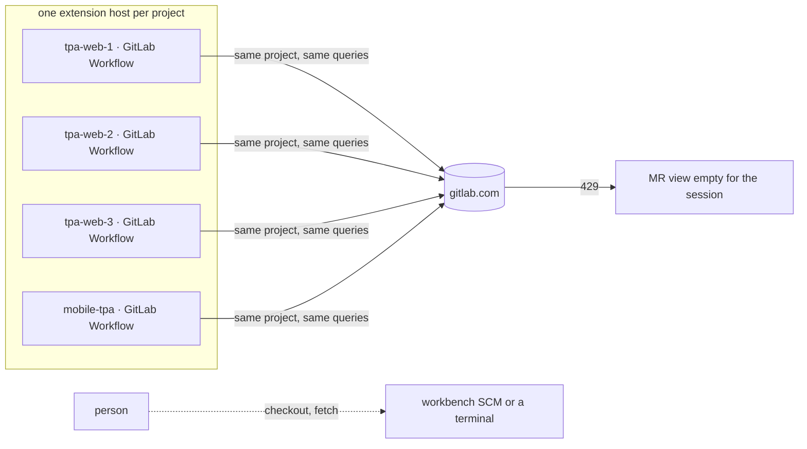

What the extension does and does not give, from its own `package.json` and bundle
(`workbench-server/extensions/gitlab.gitlab-workflow-7.4.3-universal`):

| Has                                                                        | Lacks                                                                     |
| -------------------------------------------------------------------------- | ------------------------------------------------------------------------- |
| MR tree, current-branch MR, overview webview                               | Drafts — the one inline command is "Add Comment Now" (`package.json:406`) |
| Diff in the editor over `gl-review:` URIs, inline threads via Comments API | An approve button (only `/approve` typed as a comment)                    |
| Reply, edit, delete, resolve and reopen                                    | Checkout of a fork MR (excluded in code)                                  |
| Viewed checkboxes keyed to a hash of the file's diff                       | Any awareness that another clone already has the branch                   |
| Current-branch pipeline status                                             | A single client — it is one per extension host                            |

`packages/workspace/src/git.ts` already reads branches (`readBranches`, `:279`), fetches a ref
(`fetchRef`, `:316`) and refuses unsafe refs (`isSafeRef`, `:84`), and nothing in `apps/` calls
them since the Changes panel was deleted on 2026-08-28.

## Proposed

One engine-side service answers every clone. Git runs in the project's own root; GitLab is one
client per host and account, shared by every project whose `origin` names the same GitLab project.

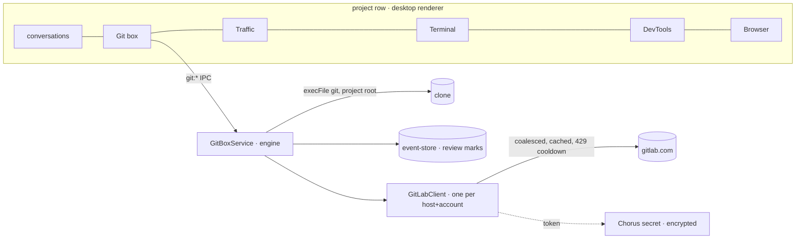

The box, collapsed to the dock like Traffic, with two lists and a review view that replaces them:

```text
┌ Git ───────────────────────────── ◂ ┐
│ ⎇ feature/TPA-812  ↑2 ↓0   ⟳ Sync  · synced 4 min ago │
│ [ Merge requests ]  [ Branches ]                          │
│  Review requested · Mine · All open                        │
│  !431 Claims export  ● pipeline  ✓1/2  💬3  ⟲ updated     │
│        in tpa-web-2 → Open      Review   Checkout   ↗      │
│  …                                                         │
└────────────────────────────────────────────────────────────┘
```

**Sync** is a person's click and nothing else does it — `git.ts`'s header already records why a
fetch never runs on a timer: it can prompt for a passphrase, on someone else's connection.

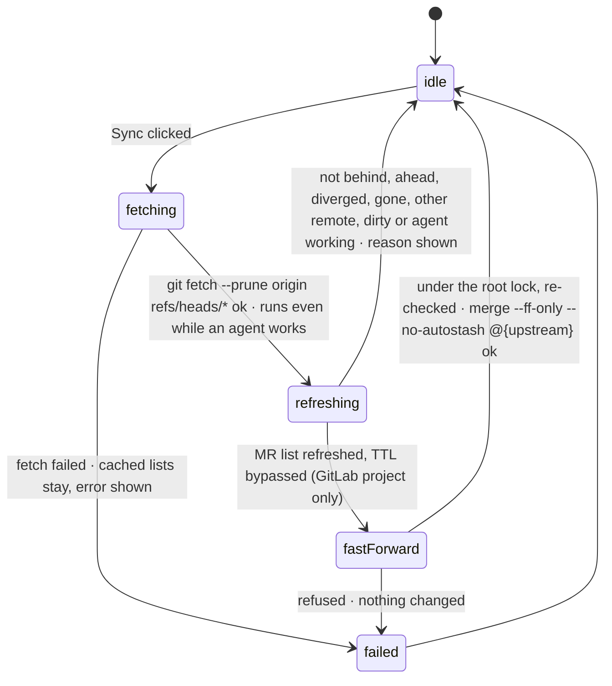

**Checkout** refuses rather than guesses:

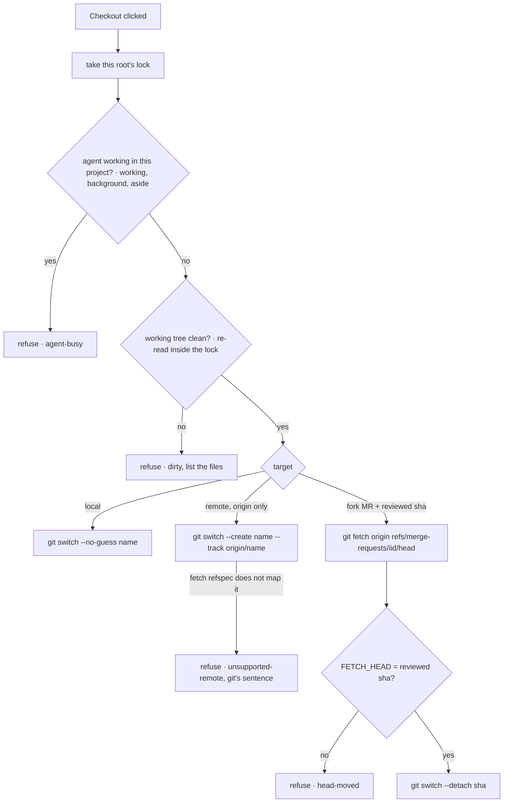

A row already checked out in another clone shows **in tpa-web-2 → Open** beside Checkout; both
stay available. Git itself refuses a branch held by another worktree, and its sentence is shown.

**Reviewing** reads one immutable snapshot — a GitLab **diff version**, whose single response
carries its three SHAs and its diffs together — and every comment, viewed mark and approval names
that version, so a push can never re-point an old line number at new content:

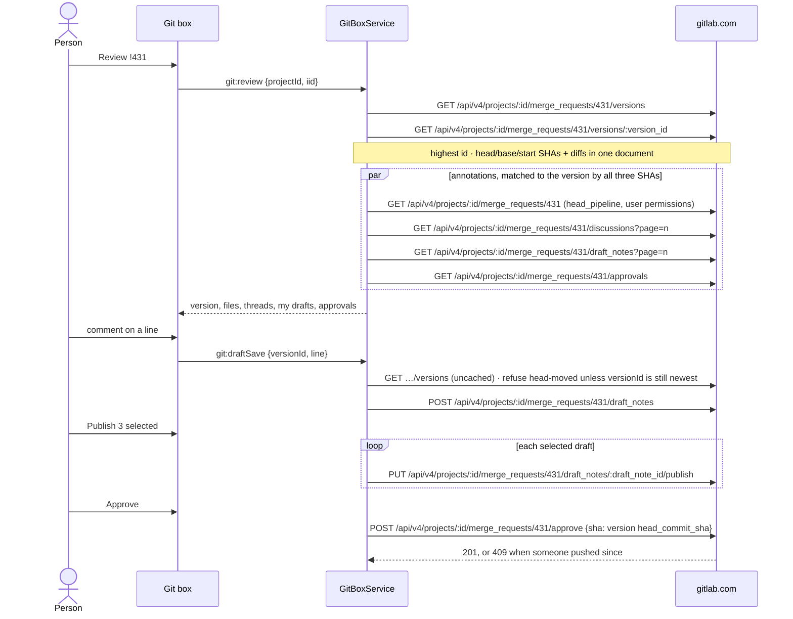

### The exception this needs, recorded in `CLAUDE.md`

**Superseded 2026-11-09:** the user moved MR diffs into the editor itself (Phase 3 below), so the
review no longer draws diffs in the box and this exception is not needed. Kept as the record of the
first design.

"The editor owns what the editor owns" deleted the Changes and review panels because two readers
of **one repository** have to be kept in step. A merge request is not that repository: it is a
remote, immutable snapshot with threads the workbench never had once GitLab Workflow is gone. The
exception is that and only that — local working-tree changes stay the workbench's SCM view.

It lands with Phase 3, as one paragraph after "So Chorus does not rebuild any of that…":

```markdown
**One exception: a provider's merge request.** The Git box (plan 90) reviews a GitLab MR —
its diff, threads, drafts and approval — inside the row. That is not a second reader of the
repository: it is a remote snapshot pinned to the MR's head SHA, which the workbench has no
view of once GitLab Workflow is retired. Local changes are still reviewed in the workbench's
SCM view and nowhere else.
```

### Deliberately not doing

- No fetch, pull or MR poll on a timer. The box reads cached state when shown; Sync refreshes.
- No push, merge commit, rebase, reset, stash, branch delete or force checkout — ever, from here.
- No `POST …/draft_notes/bulk_publish`: it publishes every pending draft of the user on that MR,
  including ones written in another client. Publishing is one `PUT …/publish` per chosen draft.
- No GitHub PR list or review in v1; no `glab` (its OAuth refresh is broken on this Mac today and
  1.128 has no `auth token`); no reuse of an OAuth grant.
- No VS Code extension box (GitLab Workflow still exists natively there) and no SSH projects.
- No pipeline retry or cancel, no applying suggestions, no image comments, no MR version history,
  no worktrees.
- No GraphQL in v1. The cost that hurt was N identical clients, not REST's call count.

## Phases

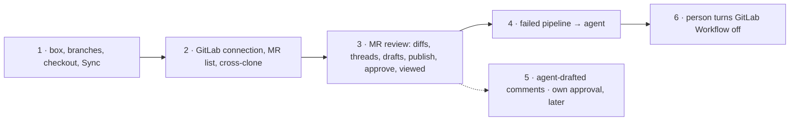

Phase 1 is useful on every repo, GitHub included, and touches no provider.

## Code Changes

### Phase 1 — the box, branches, checkout and Sync

#### `packages/workspace/src/git.ts`

`readBranches` stays for its tests and gains a richer sibling; one `for-each-ref` call carries
everything a row draws. The `git` helper gains `GIT_TERMINAL_PROMPT=0` so an https remote with no
cached credential fails inside the bound instead of waiting on a prompt nobody can see. It is one
added option in each module's `git` helper (`git.ts:51`, `git-write.ts:57`); the existing comments
there stay:

```ts
const { stdout } = await run('git', [...args], {
  cwd: options.cwd,
  timeout: options.timeoutMs ?? 15_000,
  maxBuffer: options.maxBytes ?? 32 * 1024 * 1024,
  env: { ...process.env, GIT_TERMINAL_PROMPT: '0', SSH_ASKPASS_REQUIRE: 'never' },
})
```

`GIT_TERMINAL_PROMPT=0` covers git's own https prompt; `SSH_ASKPASS_REQUIRE=never` stops ssh from
running an askpass program, which needs no terminal at all. Neither overrides `core.sshCommand` or
an agent-held key, so a key in `ssh-agent` still works. The 60 s bound holds for anything else —
a credential helper that blocks, a VPN that hangs. Inferred from the OpenSSH and git docs, not
reproduced. A shallow clone that cannot fetch reports git's sentence; nothing here unshallows.

```ts
export type BranchTrack =
  | { readonly kind: 'none' }
  | { readonly kind: 'gone' }
  | { readonly kind: 'tracking'; readonly ahead: number; readonly behind: number }

export interface BranchEntry {
  readonly name: string
  readonly remote: boolean
  readonly head: boolean
  readonly sha: string
  readonly committedAt: number
  readonly upstream: string | null
  readonly track: BranchTrack
}

const TRACK = /^\[(?:ahead (\d+))?(?:, )?(?:behind (\d+))?\]$/

export function parseTrack(upstream: string, track: string): BranchTrack {
  if (upstream === '') return { kind: 'none' }
  if (track === '[gone]') return { kind: 'gone' }
  const match = TRACK.exec(track)
  return { kind: 'tracking', ahead: Number(match?.[1] ?? 0), behind: Number(match?.[2] ?? 0) }
}

export async function readBranchInventory(
  options: GitOptions
): Promise<Result<BranchEntry[], GitError>> {
  const result = await git(options, [
    'for-each-ref',
    '--format=%(HEAD)%00%(refname)%00%(refname:short)%00%(objectname)%00%(committerdate:unix)%00%(upstream:short)%00%(upstream:track)',
    '--sort=-committerdate',
    'refs/heads',
    'refs/remotes',
  ])
  if (!result.ok) return result
  const branches: BranchEntry[] = []
  for (const line of result.value.split('\n')) {
    const [marker, refname, name, sha, date, upstream, track] = line.split('\0')
    if (refname === undefined || name === undefined || sha === undefined) continue
    if (refname.endsWith('/HEAD')) continue
    branches.push({
      name,
      remote: refname.startsWith('refs/remotes/'),
      head: marker === '*',
      sha,
      committedAt: Number(date ?? 0),
      upstream: upstream === undefined || upstream === '' ? null : upstream,
      track: parseTrack(upstream ?? '', track ?? ''),
    })
  }
  return ok(branches)
}

export interface RemoteLocation {
  readonly host: string
  readonly path: string
}

const SCP_REMOTE = /^[^@\s/]+@([^:\s/]+):(.+)$/

export function parseRemoteUrl(url: string): RemoteLocation | null {
  const trimmed = url.trim()
  const scp = SCP_REMOTE.exec(trimmed)
  const parts = scp !== null ? { host: scp[1], path: scp[2] } : urlParts(trimmed)
  if (parts === null || parts.host === undefined || parts.path === undefined) return null
  const path = parts.path
    .replace(/^\/+/, '')
    .replace(/\/+$/, '')
    .replace(/\.git$/, '')
  return path.includes('/') ? { host: parts.host.toLowerCase(), path } : null
}

function urlParts(value: string): { host: string; path: string } | null {
  try {
    const parsed = new URL(value)
    return ['https:', 'http:', 'ssh:'].includes(parsed.protocol)
      ? { host: parsed.hostname, path: decodeURIComponent(parsed.pathname) }
      : null
  } catch {
    return null
  }
}

export async function readRemoteUrl(
  options: GitOptions & { readonly remote: string }
): Promise<Result<string, GitError>> {
  if (!isSafeRef(options.remote)) return err(refused(options.remote, options))
  const result = await git(options, ['remote', 'get-url', options.remote])
  return result.ok ? ok(result.value.trim()) : result
}

export async function fetchBranches(
  options: GitOptions & { readonly remote: string }
): Promise<Result<void, GitError>> {
  if (!isSafeRef(options.remote)) return err(refused(options.remote, options))
  const result = await git({ ...options, timeoutMs: options.timeoutMs ?? 60_000 }, [
    'fetch',
    '--quiet',
    '--no-tags',
    '--prune',
    options.remote,
    `+refs/heads/*:refs/remotes/${options.remote}/*`,
  ])
  return result.ok ? ok(undefined) : result
}

export async function readFetchRefspecs(
  options: GitOptions & { readonly remote: string }
): Promise<Result<string[], GitError>> {
  if (!isSafeRef(options.remote)) return err(refused(options.remote, options))
  const result = await git(options, ['config', '--get-all', `remote.${options.remote}.fetch`])
  return result.ok ? ok(result.value.split('\n').filter((line) => line !== '')) : result
}

export function mapsBranch(refspecs: readonly string[], remote: string, branch: string): boolean {
  return refspecs.some((spec) => {
    const [source, destination] = spec.replace(/^\+/, '').split(':')
    return (
      (source === 'refs/heads/*' && destination === `refs/remotes/${remote}/*`) ||
      (source === `refs/heads/${branch}` && destination === `refs/remotes/${remote}/${branch}`)
    )
  })
}
```

`switch --track origin/x` is checked against the clone's own `remote.origin.fetch` before it runs:
a single-branch clone maps only its one branch, and git refuses to track anything else even after
the explicit fetch has brought it down. That clone gets `unsupported-remote`, not a raw failure.

The explicit refspec is what scopes `--prune` to branches: a `remote.origin.tagOpt` or a
`fetch.pruneTags` in the person's config cannot reach tags through it.

#### `packages/workspace/src/git-write.ts`

```ts
const FULL_SHA = /^[0-9a-f]{40}(?:[0-9a-f]{24})?$/

export type SwitchTarget =
  | { readonly kind: 'local'; readonly name: string }
  | { readonly kind: 'track'; readonly remote: string; readonly name: string }
  | { readonly kind: 'detach'; readonly sha: string }

function switchArgs(target: SwitchTarget): string[] | null {
  switch (target.kind) {
    case 'local':
      return isSafeRef(target.name) ? ['switch', '--no-guess', target.name] : null
    case 'track':
      return isSafeRef(target.remote) && isSafeRef(target.name)
        ? ['switch', '--create', target.name, '--track', `${target.remote}/${target.name}`]
        : null
    case 'detach':
      return FULL_SHA.test(target.sha) ? ['switch', '--detach', target.sha] : null
  }
}

export async function switchTo(
  options: GitOptions & { readonly target: SwitchTarget }
): Promise<Result<void, GitError>> {
  const args = switchArgs(options.target)
  if (args === null) return err(new GitError('refusing that checkout target', options.cwd))
  const result = await git(options, args)
  return result.ok ? ok(undefined) : result
}

export async function fastForward(options: GitOptions): Promise<Result<void, GitError>> {
  const result = await git(options, [
    'merge',
    '--ff-only',
    '--no-autostash',
    '--quiet',
    '@{upstream}',
  ])
  return result.ok ? ok(undefined) : result
}

export async function fetchedHead(options: GitOptions): Promise<Result<string, GitError>> {
  const result = await git(options, ['rev-parse', '--verify', 'FETCH_HEAD^{commit}'])
  return result.ok ? ok(result.value.trim()) : result
}
```

`--no-guess` keeps a local switch local: without it `git switch name` silently creates a tracking
branch when only `origin/name` exists, which is the `track` kind's job and must be asked for.
`switch` without `--force` already refuses to overwrite a conflicting change; the service refuses
**any** dirty tree before it gets here, because carrying unrelated edits onto another branch is
the surprise this box exists to prevent.

#### Layout state — `shared/workspace-layout.ts`, `workspace/layout.ts`, `store.ts`, `hooks.ts`, `row-drag.ts`

Shaped exactly like `devtoolsPanels`, at the same nine places plan 89 (DevTools box) touched:

```ts
export const GIT_WIDTH = { default: 520, min: 380 } as const

export const GitPanelState = z.object({
  width: z.number(),
  collapsed: z.boolean(),
  tab: z.enum(['requests', 'branches']),
})

gitPanels: z.record(z.string(), GitPanelState).default({}),
gitPanel: GitPanelState.optional(),

export const DEFAULT_GIT: GitPanelState = { width: GIT_WIDTH.default, collapsed: false, tab: 'requests' }
```

| File                            | Where                                                                                                                                                                                                                            |
| ------------------------------- | -------------------------------------------------------------------------------------------------------------------------------------------------------------------------------------------------------------------------------- |
| `shared/workspace-layout.ts`    | `GIT_WIDTH` beside `DEVTOOLS_WIDTH` (`:52`), `GitPanelState`, `WorkspaceSnapshot` (`:285`, with `.default({})` — a missing default empties the whole file), `ProjectLayoutSlice` (`:302`)                                        |
| `workspace/layout.ts`           | `DEFAULT_GIT` (beside `:985`), `EMPTY_WORKSPACE` (`:163`), `sliceOf` / `mergeSlice` (`:185-232`), `clampGitWidth` + `normalizeGitPanel` (beside `:990-997`) **and its call in `normalizeWorkspace` (`:452`)**, pruning (`:1365`) |
| `workspace/store.ts`            | the handwritten `snapshot()` (`:505`), `setGitWidth`, `setGitCollapsed`, `setGitTab`; `resetProjectWidths` (`:1235`) resets the width and keeps collapse and tab                                                                 |
| `workspace/hooks.ts`            | `useGitPanel(projectId)` → `DEFAULT_GIT`; the three actions on both sides of `selectActions` (`:67-212`)                                                                                                                         |
| `workspace/row-drag.ts`         | `RowItemKind` `'git'` for `.git-box`, minimum `GIT_WIDTH.min`, `RowWidths.git`                                                                                                                                                   |
| `workspace/row-drag.test.ts`    | `git: null` in all nine expected `RowWidths` literals                                                                                                                                                                            |
| `main/open-projects.test.ts`    | `gitPanels: {}` in the fixture that names every snapshot field (`:69`)                                                                                                                                                           |
| `shared/detached-window-ipc.ts` | nothing — it carries `ProjectLayoutSlice`, which gains `gitPanel`                                                                                                                                                                |

#### `apps/desktop/src/renderer/src/workspace/EditorPane.tsx`

Before Traffic, desktop only (`capabilities.embeddedEditor` is the desktop-true flag that already
means "this host has its own workbench", which is what makes a Git box worth having):

```tsx
const git = useGitPanel(projectId)
const gitBox = useRef<HTMLElement>(null)
const gitBodyId = useId()
const gitCollapsed = git.collapsed
const gitWidth = gitCollapsed ? COLLAPSED_TOOL_WIDTH : Math.max(git.width, GIT_WIDTH.min)

const applyRow = (id: string) => (row: RowWidths) => {
  setConversationWidths(id, row.boxes)
  if (row.git !== null) setGitWidth(id, row.git)
  if (row.traffic !== null) setTrafficWidth(id, row.traffic)
  if (row.terminal !== null) setProjectTerminalWidth(id, row.terminal)
  if (row.console !== null) setConsoleWidth(id, row.console)
  if (row.devtools !== null) setDevtoolsWidth(id, row.devtools)
}
```

```tsx
{
  projectId !== null && capabilities.embeddedEditor && (
    <>
      {rowSash}
      <section
        className="git-box"
        ref={gitBox}
        data-collapsed={gitCollapsed}
        data-min-width={GIT_WIDTH.min}
        style={{ flex: `0 0 ${String(gitWidth)}px` }}
      >
        <div className="conversation-dock">
          <div className="conversation-dock-tabs">
            <div className="conversation-dock-tab" data-active="true">
              <span className="conversation-dock-tab-main">
                <span className="conversation-dock-tab-title">{t('git.tabTitle')}</span>
              </span>
            </div>
          </div>
          <button
            type="button"
            className="conversation-dock-toggle"
            aria-expanded={!gitCollapsed}
            aria-controls={gitBodyId}
            aria-label={gitCollapsed ? t('git.expand') : t('git.collapse')}
            title={gitCollapsed ? t('git.expand') : t('git.collapse')}
            onClick={() => {
              markRowTouched(projectId)
              flushSync(() => {
                setGitCollapsed(projectId, !gitCollapsed)
              })
              if (gitCollapsed) revealInRow(gitBox.current)
              commitLayout()
            }}
          >
            <span aria-hidden="true">{gitCollapsed ? '▸' : '◂'}</span>
          </button>
        </div>
        <div id={gitBodyId} className="conversation-body" hidden={gitCollapsed}>
          <GitPanel
            key={projectId}
            projectId={projectId}
            tab={git.tab}
            collapsed={gitCollapsed}
            onTab={(tab) => {
              setGitTab(projectId, tab)
              commitLayout()
            }}
            onOpenProject={(id) => {
              useWorkspaceStore.getState().openProject(id)
            }}
          />
        </div>
      </section>
    </>
  )
}
```

The Traffic pattern, not DevTools': the box is plain DOM, so only the active project's panel is
mounted and `key={projectId}` gives each project its own state. The lists live in the engine, so
remounting on a tab switch re-reads a cache rather than re-asking git or GitLab.

#### `apps/desktop/src/renderer/src/styles.css`

`.git-box` joins the four `.traffic-box, .devtools-box, .project-terminal-box` rules
(`:12864-12890`); `.conversation-body > .git-panel` takes Traffic's body override (`:13938`).

#### `apps/desktop/src/renderer/src/i18n/en.json`

A top-level `git` block: `tabTitle`, `expand`, `collapse` ("Shrink Git to 100px"), `loading`,
`detached`, `sync`, `syncing`, `syncedAt`, `ahead_one`/`_other`, `behind_one`/`_other`, `gone`,
`tabs.requests`, `tabs.branches`, `filter`, `checkout`, `checkedOutIn`, one `syncNote.*` per
`GitSyncNote`, and one `failure.*` per `GitFailure` (`failure.dirty_one`/`_other` take the count).
`en.test.ts:106-137` fails the gate on any literal key missing here.

#### NEW: `apps/desktop/src/shared/git-ipc.ts`

The `run-ipc.ts` shape — a strict request keyed on `projectId`, one contract map, a failure enum.
Phase 1 channels shown; later phases add theirs to the same map.

```ts
import { z } from 'zod'

export const GitProject = z.object({ projectId: z.string().min(1) }).strict()

export const GitFailure = z.enum([
  'not-local',
  'not-a-repository',
  'dirty',
  'agent-busy',
  'refused-target',
  'unsupported-remote',
  'git-failed',
  'no-token',
  'unauthorized',
  'forbidden',
  'not-found',
  'rate-limited',
  'network',
  'head-moved',
  'not-gitlab',
])
export type GitFailure = z.infer<typeof GitFailure>

export const GitClone = z.object({ projectId: z.string().min(1), name: z.string() })

export const GitTrack = z.discriminatedUnion('kind', [
  z.object({ kind: z.literal('none') }),
  z.object({ kind: z.literal('gone') }),
  z.object({
    kind: z.literal('tracking'),
    ahead: z.number().int().nonnegative(),
    behind: z.number().int().nonnegative(),
  }),
])

export const GitBranch = z.object({
  name: z.string().min(1),
  kind: z.enum(['local', 'remote']),
  head: z.boolean(),
  sha: z.string(),
  committedAt: z.number().int(),
  upstream: z.string().nullable(),
  track: GitTrack,
  elsewhere: z.array(GitClone),
})

export const GitProvider = z.discriminatedUnion('kind', [
  z.object({
    kind: z.literal('gitlab'),
    host: z.string(),
    path: z.string(),
    connected: z.boolean(),
  }),
  z.object({ kind: z.literal('other'), host: z.string().nullable() }),
])

export const GitSyncNote = z.enum([
  'fast-forwarded',
  'up-to-date',
  'ahead',
  'diverged',
  'dirty',
  'no-upstream',
  'gone',
  'other-remote',
  'agent-busy',
])

export const GitBoxState = z.object({
  available: z.boolean(),
  failure: GitFailure.nullable(),
  branch: z.string().nullable(),
  track: GitTrack,
  dirty: z.array(z.string()).max(50),
  dirtyCount: z.number().int().nonnegative(),
  branches: z.array(GitBranch),
  provider: GitProvider,
  syncedAt: z.number().int().nullable(),
  syncNote: GitSyncNote.nullable(),
  error: z.string().nullable(),
})
export type GitBoxState = z.infer<typeof GitBoxState>

export const GitCheckoutTarget = z.discriminatedUnion('kind', [
  z.object({ kind: z.literal('local'), name: z.string().min(1) }),
  z.object({ kind: z.literal('remote'), name: z.string().min(1) }),
  z.object({
    kind: z.literal('mr'),
    iid: z.number().int().positive(),
    sha: z.string().regex(/^[0-9a-f]{40}$/),
  }),
])

export const GIT_CONTRACT = {
  'git:state': { request: GitProject, response: GitBoxState },
  'git:sync': { request: GitProject, response: GitBoxState },
  'git:checkout': {
    request: GitProject.extend({ target: GitCheckoutTarget }).strict(),
    response: z.object({ state: GitBoxState, failure: GitFailure.nullable() }),
  },
} as const

export type GitContract = typeof GIT_CONTRACT
export type GitChannel = keyof GitContract
export type GitRequest<C extends GitChannel> = z.infer<GitContract[C]['request']>
export type GitResponse<C extends GitChannel> = z.infer<GitContract[C]['response']>
export const GIT_CHANNELS = Object.keys(GIT_CONTRACT) as GitChannel[]
```

No channel is person-paced: Sync's fetch is bounded at 60 s and the rest is local, well inside the
engine's 180 s invoke timeout (`engine/src/client.ts:576-585`).

`GitBranch.name` is the branch name without `origin/` for both kinds; remote rows are
`refs/remotes/origin/*` only, and a remote branch that also exists locally folds into the local
row, which keeps its own track. The row hands back `{ kind, name }` exactly as it was given.

#### NEW: `apps/desktop/src/main/git-box.ts` — the engine service

One instance for every window and client. Guards run **here**, never only in the renderer.

```ts
import {
  fastForward,
  fetchBranches,
  fetchedHead,
  fetchRef,
  mapsBranch,
  parseRemoteUrl,
  readBranchInventory,
  readFetchRefspecs,
  readRemoteUrl,
  readStatus,
  switchTo,
  type BranchEntry,
  type RemoteLocation,
  type SwitchTarget,
} from '@chorus/workspace'
import { LOCAL_HOST, type Project } from '@chorus/event-store'
import type {
  GitBoxState,
  GitBranch,
  GitFailure,
  GitRequest,
  GitSyncNote,
} from '../shared/git-ipc.js'
import type { GitLabDirectory } from './gitlab-client.js'

export interface GitBoxDeps {
  readonly project: (projectId: string) => Project | null
  readonly projects: () => readonly Project[]
  readonly projectBusy: (projectId: string) => boolean
  readonly gitlab: GitLabDirectory | null
  readonly now: () => number
}

interface Clone {
  readonly projectId: string
  readonly name: string
  readonly branch: string | null
}

interface Outcome {
  readonly state: GitBoxState
  readonly failure: GitFailure | null
}

type Resolved = { readonly target: SwitchTarget } | { readonly failure: GitFailure }

export class GitBoxService {
  private readonly synced = new Map<string, number>()
  private readonly locks = new Map<string, Promise<unknown>>()

  constructor(private readonly deps: GitBoxDeps) {}

  async state(projectId: string, note: GitSyncNote | null = null): Promise<GitBoxState> {
    const cwd = this.localRoot(projectId)
    if (cwd === null) return unavailable('not-local')
    const [status, branches, origin] = await Promise.all([
      readStatus({ cwd }),
      readBranchInventory({ cwd }),
      readRemoteUrl({ cwd, remote: 'origin' }),
    ])
    if (!status.ok || !branches.ok) return unavailable('not-a-repository')
    const location = origin.ok ? parseRemoteUrl(origin.value) : null
    const clones = await this.clonesOf(projectId, location)
    const head = branches.value.find((entry) => entry.head && !entry.remote)
    const gitlab = this.deps.gitlab
    return {
      available: true,
      failure: null,
      branch: status.value.branch,
      track: head?.track ?? { kind: 'none' },
      dirty: status.value.files.slice(0, 50).map((file) => file.path),
      dirtyCount: status.value.files.length,
      branches: rowsOf(branches.value, clones),
      provider:
        gitlab !== null && location !== null && gitlab.handles(location.host)
          ? {
              kind: 'gitlab',
              host: location.host,
              path: location.path,
              connected: gitlab.connected(location.host),
            }
          : { kind: 'other', host: location?.host ?? null },
      syncedAt: this.synced.get(projectId) ?? null,
      syncNote: note,
      error: null,
    }
  }

  async sync(projectId: string): Promise<GitBoxState> {
    const cwd = this.localRoot(projectId)
    if (cwd === null) return unavailable('not-local')
    const fetched = await fetchBranches({ cwd, remote: 'origin' })
    if (!fetched.ok) {
      return {
        ...(await this.state(projectId)),
        failure: 'git-failed',
        error: fetched.error.message,
      }
    }
    this.synced.set(projectId, this.deps.now())
    const outcome = await this.exclusive(cwd, async (): Promise<Outcome> => {
      const note = await this.forwardable(projectId, cwd)
      if (note !== null) return { state: await this.state(projectId, note), failure: null }
      const forwarded = await fastForward({ cwd })
      return forwarded.ok
        ? { state: await this.state(projectId, 'fast-forwarded'), failure: null }
        : {
            state: { ...(await this.state(projectId)), error: forwarded.error.message },
            failure: 'git-failed',
          }
    })
    return { ...outcome.state, failure: outcome.failure }
  }

  checkout(projectId: string, target: GitRequest<'git:checkout'>['target']): Promise<Outcome> {
    const cwd = this.localRoot(projectId)
    if (cwd === null)
      return Promise.resolve({ state: unavailable('not-local'), failure: 'not-local' })
    return this.exclusive(cwd, async (): Promise<Outcome> => {
      if (this.deps.projectBusy(projectId)) return this.refused(projectId, 'agent-busy')
      const status = await readStatus({ cwd })
      if (!status.ok) return this.refused(projectId, 'not-a-repository')
      if (!status.value.clean) return this.refused(projectId, 'dirty')
      const resolved = await this.resolveTarget(cwd, target)
      if ('failure' in resolved) return this.refused(projectId, resolved.failure)
      const switched = await switchTo({ cwd, target: resolved.target })
      return switched.ok
        ? { state: await this.state(projectId), failure: null }
        : {
            state: { ...(await this.state(projectId)), error: switched.error.message },
            failure: 'git-failed',
          }
    })
  }

  async clonesOf(projectId: string, wanted: RemoteLocation | null): Promise<Clone[]> {
    if (wanted === null) return []
    const others = this.deps
      .projects()
      .filter((project) => project.id !== projectId && project.host === LOCAL_HOST)
    const clones = await Promise.all(others.map((project) => cloneOf(project, wanted)))
    return clones.filter((clone): clone is Clone => clone !== null)
  }

  private async forwardable(projectId: string, cwd: string): Promise<GitSyncNote | null> {
    const [status, branches] = await Promise.all([
      readStatus({ cwd }),
      readBranchInventory({ cwd }),
    ])
    const head = branches.ok
      ? branches.value.find((entry) => entry.head && !entry.remote)
      : undefined
    if (!status.ok || head === undefined || head.upstream === null) return 'no-upstream'
    if (!head.upstream.startsWith('origin/')) return 'other-remote'
    if (head.track.kind === 'gone') return 'gone'
    if (head.track.kind !== 'tracking') return 'no-upstream'
    if (head.track.behind === 0) return head.track.ahead > 0 ? 'ahead' : 'up-to-date'
    if (head.track.ahead > 0) return 'diverged'
    if (!status.value.clean) return 'dirty'
    return this.deps.projectBusy(projectId) ? 'agent-busy' : null
  }

  private async resolveTarget(
    cwd: string,
    target: GitRequest<'git:checkout'>['target']
  ): Promise<Resolved> {
    if (target.kind === 'local') return this.resolveBranch(cwd, target.name, 'local')
    if (target.kind === 'remote') return this.resolveBranch(cwd, target.name, 'remote')
    const request =
      this.deps.gitlab === null ? null : await this.deps.gitlab.requestOf(cwd, target.iid)
    if (request === null) return { failure: 'not-gitlab' }
    if (!request.fork) return this.resolveBranch(cwd, request.sourceBranch, 'any')
    const fetched = await fetchRef({
      cwd,
      remote: 'origin',
      ref: `refs/merge-requests/${String(target.iid)}/head`,
    })
    if (!fetched.ok) return { failure: 'git-failed' }
    const fetchedSha = await fetchedHead({ cwd })
    return fetchedSha.ok && fetchedSha.value === target.sha
      ? { target: { kind: 'detach', sha: target.sha } }
      : { failure: 'head-moved' }
  }

  private async resolveBranch(
    cwd: string,
    name: string,
    kind: 'local' | 'remote' | 'any'
  ): Promise<Resolved> {
    const branches = await readBranchInventory({ cwd })
    if (!branches.ok) return { failure: 'not-a-repository' }
    const local = branches.value.some((entry) => !entry.remote && entry.name === name)
    if (local && kind !== 'remote') return { target: { kind: 'local', name } }
    const remote = branches.value.some((entry) => entry.remote && entry.name === `origin/${name}`)
    if (!remote || kind === 'local') return { failure: 'refused-target' }
    const specs = await readFetchRefspecs({ cwd, remote: 'origin' })
    return specs.ok && mapsBranch(specs.value, 'origin', name)
      ? { target: { kind: 'track', remote: 'origin', name } }
      : { failure: 'unsupported-remote' }
  }

  private exclusive<T>(root: string, run: () => Promise<T>): Promise<T> {
    const next = (this.locks.get(root) ?? Promise.resolve()).then(run, run)
    this.locks.set(
      root,
      next.catch(() => undefined)
    )
    return next
  }

  private async refused(projectId: string, failure: GitFailure): Promise<Outcome> {
    return { state: await this.state(projectId), failure }
  }

  private localRoot(projectId: string): string | null {
    const project = this.deps.project(projectId)
    if (project === null) throw new Error(`No project ${projectId}`)
    return project.host === LOCAL_HOST ? project.canonicalRoot : null
  }
}

async function cloneOf(project: Project, wanted: RemoteLocation): Promise<Clone | null> {
  const cwd = project.canonicalRoot
  const [origin, status] = await Promise.all([
    readRemoteUrl({ cwd, remote: 'origin' }),
    readStatus({ cwd }),
  ])
  const location = origin.ok ? parseRemoteUrl(origin.value) : null
  if (location === null || location.host !== wanted.host || location.path !== wanted.path)
    return null
  return {
    projectId: project.id,
    name: project.name,
    branch: status.ok ? status.value.branch : null,
  }
}

function rowsOf(entries: readonly BranchEntry[], clones: readonly Clone[]): GitBranch[] {
  const local = entries.filter((entry) => !entry.remote)
  const named = new Set(local.map((entry) => entry.name))
  const remote = entries
    .filter((entry) => entry.remote && entry.name.startsWith('origin/'))
    .map((entry) => ({ ...entry, name: entry.name.slice('origin/'.length) }))
    .filter((entry) => !named.has(entry.name))
  return [...local, ...remote].map(({ remote: isRemote, ...entry }) => ({
    ...entry,
    kind: isRemote ? 'remote' : 'local',
    elsewhere: clones
      .filter((clone) => clone.branch === entry.name)
      .map((clone) => ({ projectId: clone.projectId, name: clone.name })),
  }))
}

function unavailable(failure: GitFailure): GitBoxState {
  return {
    available: false,
    failure,
    branch: null,
    track: { kind: 'none' },
    dirty: [],
    dirtyCount: 0,
    branches: [],
    provider: { kind: 'other', host: null },
    syncedAt: null,
    syncNote: null,
    error: null,
  }
}
```

- **The lock is per root, not per project.** Two Chorus projects on one directory would otherwise
  race each other; the lock covers the switch and the fast-forward, and every check that decides
  them is re-read inside it. The fetch is outside it on purpose — it moves refs, not files, and
  runs even while an agent works.
- **Same-project MR checkout is a branch checkout** of its `source_branch`, local or `origin`. A
  fork MR is the only detach, and only at the SHA the person reviewed.
- **The "in tpa-web-2" badge is read fresh** on every `git:state` — two local git reads per other
  clone, milliseconds each — so a checkout made in a terminal or the workbench SCM can never leave
  it pointing at the wrong clone.
- `localRoot` throws for an unknown project because `GitIpc.mayInspect` has already refused one;
  reaching it is a bug, not a state to draw.

#### NEW: `apps/desktop/src/main/git-ipc.ts`

`RunIpc` (`main/run-ipc.ts`) line for line — `register` validates both sides, `role` /
`mayInspect` keep a detached window to its own project — dispatching to `GitBoxService`. No push
channel: every answer is a response to the person's own click.

#### `apps/engine/src/server.ts`, `main/ipc.ts`, `shared/create-chorus-api.ts`, `shared/ipc.ts`, `apps/extension/src/parity.ts`

```ts
const git = new GitIpc(
  {
    service: new GitBoxService({
      project: (id) => runtime.projects.get(id),
      projects: () => runtime.projects.list(),
      projectBusy: (id) => runtime.projectBusy(id),
      gitlab: null,
      now: Date.now,
    }),
    isAdopted: (id) => runtime.projects.get(id) !== null,
  },
  registrar
)
```

Phase 2 replaces `gitlab: null` with
`new GitLabDirectory({ token: (gitlabHost) => (gitlabHost === 'gitlab.com' ? host.secrets.read('gitlab') : null), marks: runtime.reviewMarks() })`.
`git.releaseShell(peer)` joins the other services' release on disconnect (`server.ts:636`) and
`git.close()` their close (`:694`).

| File                                                             | Change                                                                                                                 |
| ---------------------------------------------------------------- | ---------------------------------------------------------------------------------------------------------------------- |
| `apps/engine/src/server.ts` (`:119-143`, `:481`, `:636`, `:694`) | build `GitIpc` beside `RunIpc`; register on hello, release on disconnect, close with the rest                          |
| `apps/desktop/src/main/ipc.ts` (`:15-19`)                        | `...Object.keys(GIT_CONTRACT)` joins the forwarded channels                                                            |
| `apps/desktop/src/shared/create-chorus-api.ts`                   | `invokeGit` beside `invokeRun` (`:178-187`); `readGitState`, `syncGit`, `checkoutGit`                                  |
| `apps/desktop/src/shared/ipc.ts` (`:2523`)                       | `ChorusApi extends … GitApi`                                                                                           |
| `apps/extension/src/parity.ts` + `parity.test.ts`                | every Git method `'waived'` and listed in the accepted waivers (`parity.test.ts:17-32`); not added to `SHELL_CHANNELS` |
| `apps/desktop/src/main/runtime.ts`                               | `projectBusy(projectId)` — below                                                                                       |

```ts
projectBusy(projectId: string): boolean {
  for (const [id, conversation] of this.active) {
    if (conversation.projectId !== projectId) continue
    if (
      conversation.working.size > 0 ||
      this.liveReplies.pendingReplies(id).length > 0 ||
      (this.startupOwners.get(id)?.size ?? 0) > 0 ||
      [...conversation.participants.values()].some(
        (participant) => (this.backgroundWork.get(participant.service) ?? 0) > 0
      )
    )
      return true
  }
  for (const [id, aside] of this.asides) {
    if (this.active.get(aside.parentId)?.projectId !== projectId) continue
    if (this.store.transcriptState(id).working.length > 0) return true
  }
  return false
}
```

`activeWork()` (`runtime.ts:4210-4239`) is the same test across every project — working agents,
live replies, background work per participant, asides — and this is it filtered by project, plus
the conversation's own startup work (`startupOwners`, `:1021`), so "an agent is working" means one
thing in both places.

#### NEW: `apps/desktop/src/renderer/src/GitPanel.tsx`

One component, the box body. It owns the two lists and, from Phase 3, swaps itself for the review
view by rendering `GitReview` — a second file because it owns its own state and effects.

```tsx
export function GitPanel(props: {
  readonly projectId: string
  readonly tab: 'requests' | 'branches'
  readonly collapsed: boolean
  readonly onTab: (tab: 'requests' | 'branches') => void
  readonly onOpenProject: (projectId: string) => void
}): React.JSX.Element {
  const { t } = useTranslation()
  const [state, setState] = useState<GitBoxState | null>(null)
  const [busy, setBusy] = useState<'sync' | 'checkout' | null>(null)
  const [failure, setFailure] = useState<GitFailure | null>(null)
  const [filter, setFilter] = useState('')

  useEffect(() => {
    if (props.collapsed) return undefined
    let live = true
    window.chorus
      .readGitState({ projectId: props.projectId })
      .then((next) => {
        if (live) setState(next)
      })
      .catch(() => {
        if (live) setFailure('git-failed')
      })
    return () => {
      live = false
    }
  }, [props.projectId, props.collapsed])

  const act = async (
    kind: 'sync' | 'checkout',
    run: () => Promise<{ state: GitBoxState; failure: GitFailure | null }>
  ): Promise<void> => {
    setBusy(kind)
    setFailure(null)
    try {
      const result = await run()
      setState(result.state)
      setFailure(result.failure)
    } catch {
      setFailure('git-failed')
    } finally {
      setBusy(null)
    }
  }

  const sync = (): Promise<void> =>
    act('sync', async () => {
      const next = await window.chorus.syncGit({ projectId: props.projectId })
      return { state: next, failure: next.failure }
    })

  const checkout = (target: GitCheckoutTarget): Promise<void> =>
    act('checkout', () => window.chorus.checkoutGit({ projectId: props.projectId, target }))

  if (state === null) {
    return (
      <p className="git-panel muted">
        {t(failure === null ? 'git.loading' : 'git.failure.git-failed')}
      </p>
    )
  }
  if (!state.available) {
    return (
      <p className="git-panel muted">{t(`git.failure.${state.failure ?? 'not-a-repository'}`)}</p>
    )
  }
  const shown = state.branches.filter((branch) => branch.name.includes(filter.trim()))
  return (
    <div className="git-panel">
      <header className="git-head">
        <span className="git-branch">{state.branch ?? t('git.detached')}</span>
        {state.track.kind === 'tracking' && (
          <span className="git-track">
            {t('git.ahead', { count: state.track.ahead })}{' '}
            {t('git.behind', { count: state.track.behind })}
          </span>
        )}
        <button type="button" disabled={busy !== null} onClick={() => void sync()}>
          {busy === 'sync' ? t('git.syncing') : t('git.sync')}
        </button>
        {state.syncedAt !== null && (
          <span className="muted">
            {t('git.syncedAt', {
              time: new Date(state.syncedAt).toLocaleTimeString([], {
                hour: '2-digit',
                minute: '2-digit',
              }),
            })}
          </span>
        )}
      </header>
      {failure !== null && (
        <div role="alert" className="git-failure">
          <p>{t(`git.failure.${failure}`, { count: state.dirtyCount })}</p>
          {failure === 'dirty' && (
            <ul>
              {state.dirty.map((path) => (
                <li key={path}>{path}</li>
              ))}
            </ul>
          )}
          {state.error !== null && <pre className="git-error">{state.error}</pre>}
        </div>
      )}
      {state.syncNote !== null && <p className="muted">{t(`git.syncNote.${state.syncNote}`)}</p>}
      {props.tab === 'branches' && (
        <ul className="git-branches">
          {shown.map((branch) => (
            <li key={`${branch.kind}:${branch.name}`} className="git-row" data-head={branch.head}>
              <span className="git-row-name">{branch.name}</span>
              {branch.track.kind === 'gone' && <span className="muted">{t('git.gone')}</span>}
              {branch.elsewhere.map((clone) => (
                <button
                  key={clone.projectId}
                  type="button"
                  className="git-elsewhere"
                  onClick={() => props.onOpenProject(clone.projectId)}
                >
                  {t('git.checkedOutIn', { name: clone.name })}
                </button>
              ))}
              {!branch.head && (
                <button
                  type="button"
                  disabled={busy !== null}
                  onClick={() => void checkout({ kind: branch.kind, name: branch.name })}
                >
                  {t('git.checkout')}
                </button>
              )}
            </li>
          ))}
        </ul>
      )}
    </div>
  )
}
```

The tab strip, the filter input and the MR list are JSX in this same file; nothing here is a
component of its own. git's own sentence is shown under the failure — "already checked out at
'/path'" from another worktree, a shallow clone's refusal — because the failure key alone cannot
say which of git's reasons it was.

### Phase 2 — GitLab connection, MR list, cross-clone

**Decided 2026-11-08, before building, on top of what phase 1 actually shipped:**

- **The token is importable.** GitLab Workflow's account here is `type: 'token'` on
  `https://gitlab.com` (its non-secret `glAccounts` in the workbench's `storage.json`), so "Use my
  GitLab Workflow token" works in one click.
- **One MR list call serves every view.** `GET …/merge_requests?state=opened&scope=all` (all pages)
  plus `GET /api/v4/user` once per token. Each row carries `mine` (author is me) and
  `reviewRequested` (I am in `reviewers`), so "Review requested", "Mine" and "All open" are filters on
  one cached list instead of three calls.
- **Pipelines come from each MR's own detail,** read for at most the first 40 rows, four at a time,
  cached 60 s and shared by every clone; the rest show "unknown". No SHA matching.
- **The !MR badge on branch rows** (user's request): a local or origin branch that is the
  `source_branch` of an open same-project MR shows `!<iid>`, opening the MR on GitLab. Fork MRs are
  not matched to branches — their source lives in another project.
- **`GitBoxDeps.gitlab` becomes a `GitLabDirectory`,** which implements phase 1's `GitProviderPort`
  (`handles`, `connected`, `requestOf`) and adds the list read. Refresh and Sync invalidate the
  project's GitLab cache, and the box re-reads the list after them.
- **The tab arrives as `tab: z.enum(['requests', 'branches']).optional()`** on `GitPanelState`, so a
  layout saved by phase 1 still parses. Unset means Merge requests when GitLab is connected,
  Branches otherwise; a choice is remembered per project.
- **"Updated since your review" waits for phase 3,** which owns the review marks it reads.

#### Token — `apps/engine/src/protocol.ts`, `main/host-ports.ts`, `shared/ipc.ts`, `main/ipc-handlers.ts`, `Settings.tsx`

The DeepSeek key's path end to end, with one more id:

| File                                                               | Change                                                                                                                                           |
| ------------------------------------------------------------------ | ------------------------------------------------------------------------------------------------------------------------------------------------ |
| `apps/engine/src/protocol.ts` (`:20-27`)                           | `SecretId` gains `'gitlab'`                                                                                                                      |
| `apps/desktop/src/main/host-ports.ts` (`:12`)                      | the same id in the host's `SecretId`                                                                                                             |
| `apps/desktop/src/shared/ipc.ts` (`:187-197`, `:1938`)             | `settings:write` takes `gitlabToken?: string` (empty clears); `SettingsWithSecrets` gains `gitlabTokenSet: boolean` — the value never comes back |
| `apps/desktop/src/main/ipc-handlers.ts` (`:686-716`, `:113`)       | the `deepseekApiKey` branch, copied for `gitlabToken` → `ports.secrets.write('gitlab', …)` / `clear('gitlab')`                                   |
| `apps/desktop/src/renderer/src/Settings.tsx` (`:381-396`, `:1075`) | a `SECRETS.gitlab` entry rendered through the existing `ApiKeyField`, plus one "Use my GitLab Workflow token" button                             |

`apps/engine/src/client.test.ts:140` and `apps/engine/src/server.test.ts:92` build hello fixtures
naming every `SecretId`; both gain `gitlab`.

**Importing GitLab Workflow's token is one round trip, and the token never reaches a renderer:**

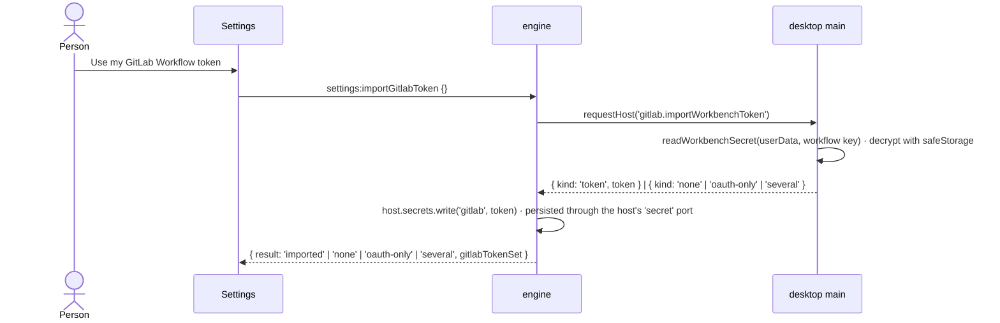

`settings:importGitlabToken` joins `IPC_CONTRACT` (`shared/ipc.ts`) with request `{}` and response
`{ result, gitlabTokenSet }`; the engine handler sits beside `settings:write` in `ipc-handlers.ts`.
The desktop answer is a new case in `desktop-host-ports.ts` beside `'secret'` (`:110`):

```ts
case 'gitlab.importWorkbenchToken':
  return importableGitLabToken(readWorkbenchSecret(userData, GITLAB_WORKFLOW_SECRET), 'https://gitlab.com')
```

```ts
export const GITLAB_WORKFLOW_SECRET =
  '{"extensionId":"gitlab.gitlab-workflow","key":"gitlab-tokens"}'

const WorkflowSecrets = z.record(
  z.string(),
  z.object({ token: z.string().min(1), refreshToken: z.string().optional() }).passthrough()
)

export type WorkflowImport =
  | { readonly kind: 'token'; readonly token: string }
  | { readonly kind: 'none' | 'oauth-only' | 'several' }

export function importableGitLabToken(raw: string | null, instanceUrl: string): WorkflowImport {
  if (raw === null) return { kind: 'none' }
  let decoded: unknown
  try {
    decoded = JSON.parse(raw)
  } catch {
    return { kind: 'none' }
  }
  const parsed = WorkflowSecrets.safeParse(decoded)
  if (!parsed.success) return { kind: 'none' }
  const forHost = Object.entries(parsed.data).filter(([accountId]) =>
    accountId.startsWith(`${instanceUrl}|`)
  )
  const tokens = forHost.filter(([, secret]) => secret.refreshToken === undefined)
  if (tokens.length > 1) return { kind: 'several' }
  const only = tokens[0]
  if (only !== undefined) return { kind: 'token', token: only[1].token }
  return { kind: forHost.length > 0 ? 'oauth-only' : 'none' }
}
```

The secret is `Record<accountId, {token} | {token, refreshToken, expiresAtTimestampInSeconds}>`
keyed `${instanceUrl}|${userId}` (GitLab Workflow's `account_service.ts`, `gitlab_account.ts`).
`oauth-only` says "Signed in through the browser — paste a token instead"; `several` says "More
than one GitLab account — paste the one to use". `host.secrets.write` is the public path
(`host.ts:215-224`); the private `updateSecret` behind it persists to `agent-secrets.json`.

#### NEW: `apps/desktop/src/main/gitlab-client.ts`

One client per host **and token**, shared by every project the engine serves. Same key → same
in-flight promise; a `429` cools the host, so six clones back off together; a GET caches only if no
write to that project happened while it was in flight.

```ts
import { createHash } from 'node:crypto'
import { z } from 'zod'

export type GitLabFailure =
  | 'no-token'
  | 'unauthorized'
  | 'forbidden'
  | 'not-found'
  | 'conflict'
  | 'rate-limited'
  | 'network'
  | 'invalid-response'

export type GitLabResult<T> =
  | { readonly ok: true; readonly value: T; readonly fetchedAt: number }
  | { readonly ok: false; readonly failure: GitLabFailure; readonly retryAt: number | null }

export interface Paged<T> {
  readonly items: T[]
  readonly complete: boolean
}

const FAILURE_BY_STATUS: Readonly<Record<number, GitLabFailure>> = {
  401: 'unauthorized',
  403: 'forbidden',
  404: 'not-found',
  409: 'conflict',
}

const PAGE = 100

export function fingerprint(token: string): string {
  return createHash('sha256').update(token).digest('hex').slice(0, 16)
}

export class GitLabClient {
  private readonly inflight = new Map<string, Promise<GitLabResult<unknown>>>()
  private readonly cache = new Map<string, { readonly at: number; readonly value: unknown }>()
  private readonly generations = new Map<string, number>()
  private coolUntil = 0

  constructor(
    private readonly host: string,
    private readonly token: string,
    private readonly now: () => number = Date.now,
    private readonly request: typeof fetch = fetch
  ) {}

  get<T>(
    project: string,
    path: string,
    schema: z.ZodType<T>,
    ttlMs: number
  ): Promise<GitLabResult<T>> {
    const cached = this.cache.get(path)
    if (cached !== undefined && this.now() - cached.at < ttlMs) {
      return Promise.resolve({ ok: true, value: cached.value as T, fetchedAt: cached.at })
    }
    const running = this.inflight.get(path)
    if (running !== undefined) return running as Promise<GitLabResult<T>>
    const generation = this.generationOf(project)
    const started = this.send('GET', path, undefined, schema).then((result) => {
      if (result.ok && this.generationOf(project) === generation) {
        this.cache.set(path, { at: result.fetchedAt, value: result.value })
      }
      return result
    })
    this.inflight.set(path, started)
    void started.finally(() => this.inflight.delete(path))
    return started
  }

  async getAll<T>(
    project: string,
    path: string,
    item: z.ZodType<T>,
    ttlMs: number,
    maxPages = 20
  ): Promise<GitLabResult<Paged<T>>> {
    const items: T[] = []
    let fetchedAt = this.now()
    const separator = path.includes('?') ? '&' : '?'
    for (let page = 1; page <= maxPages; page += 1) {
      const result = await this.get(
        project,
        `${path}${separator}per_page=${String(PAGE)}&page=${String(page)}`,
        z.array(item),
        ttlMs
      )
      if (!result.ok) return result
      items.push(...result.value)
      fetchedAt = Math.min(fetchedAt, result.fetchedAt)
      if (result.value.length < PAGE)
        return { ok: true, value: { items, complete: true }, fetchedAt }
    }
    return { ok: true, value: { items, complete: false }, fetchedAt }
  }

  async write<T>(
    project: string,
    method: 'POST' | 'PUT' | 'DELETE',
    path: string,
    body: unknown,
    schema: z.ZodType<T>
  ): Promise<GitLabResult<T>> {
    this.invalidate(project)
    const result = await this.send(method, path, body, schema)
    this.invalidate(project)
    return result
  }

  invalidate(project: string): void {
    this.generations.set(project, this.generationOf(project) + 1)
    const prefix = `/projects/${project}/`
    for (const key of this.cache.keys()) if (key.startsWith(prefix)) this.cache.delete(key)
  }

  async text(path: string, maxBytes: number): Promise<GitLabResult<string>> {
    const response = await this.fetchRaw('GET', path, undefined)
    if (!response.ok) return response
    try {
      const reader = response.value.body?.getReader()
      const chunks: Uint8Array[] = []
      let held = 0
      while (reader !== undefined) {
        const { done, value } = await reader.read()
        if (done) break
        chunks.push(value)
        held += value.byteLength
        while (held - (chunks[0]?.byteLength ?? 0) >= maxBytes)
          held -= chunks.shift()?.byteLength ?? 0
      }
      const tail = Buffer.concat(chunks).subarray(-maxBytes)
      return { ok: true, value: tail.toString('utf8'), fetchedAt: this.now() }
    } catch {
      return { ok: false, failure: 'network', retryAt: null }
    }
  }

  private generationOf(project: string): number {
    return this.generations.get(project) ?? 0
  }

  private async send<T>(
    method: string,
    path: string,
    body: unknown,
    schema: z.ZodType<T>
  ): Promise<GitLabResult<T>> {
    const response = await this.fetchRaw(method, path, body)
    if (!response.ok) return response
    let decoded: unknown
    try {
      decoded = response.value.status === 204 ? null : await response.value.json()
    } catch {
      return { ok: false, failure: 'invalid-response', retryAt: null }
    }
    const parsed = schema.safeParse(decoded)
    return parsed.success
      ? { ok: true, value: parsed.data, fetchedAt: this.now() }
      : { ok: false, failure: 'invalid-response', retryAt: null }
  }

  private async fetchRaw(
    method: string,
    path: string,
    body: unknown
  ): Promise<GitLabResult<Response>> {
    if (this.now() < this.coolUntil)
      return { ok: false, failure: 'rate-limited', retryAt: this.coolUntil }
    let response: Response
    try {
      response = await this.request(`https://${this.host}/api/v4${path}`, {
        method,
        headers: {
          'PRIVATE-TOKEN': this.token,
          ...(body === undefined ? {} : { 'Content-Type': 'application/json' }),
        },
        ...(body === undefined ? {} : { body: JSON.stringify(body) }),
        signal: AbortSignal.timeout(20_000),
      })
    } catch {
      return { ok: false, failure: 'network', retryAt: null }
    }
    if (response.status === 429) {
      const seconds = Number(response.headers.get('Retry-After'))
      const until = this.now() + (Number.isFinite(seconds) && seconds > 0 ? seconds : 60) * 1000
      this.coolUntil = Math.max(this.coolUntil, until)
      return { ok: false, failure: 'rate-limited', retryAt: this.coolUntil }
    }
    if (!response.ok) {
      return { ok: false, failure: FAILURE_BY_STATUS[response.status] ?? 'network', retryAt: null }
    }
    return { ok: true, value: response, fetchedAt: this.now() }
  }
}
```

`GitLabDirectory` (same file) holds one `GitLabClient` per `host` and `fingerprint(token)`, read
from `token(host)` on every call: a changed or cleared token is a different key, so the previous
account's cached MRs, drafts and in-flight reads are unreachable the moment the secret changes, and
the stale client is dropped. It answers `handles(host)` (v1: `gitlab.com` only — the TPA remotes)
and `connected(host)`, and owns the MR reads below. `project` in every path is
`encodeURIComponent(location.path)`, so every clone of `TAPDev/tpa-operation-web` shares one cache.

**The MR list is one list call, and each row's pipeline is that MR's own:**

```ts
const MrListItem = z.object({
  iid: z.number().int(),
  title: z.string(),
  web_url: z.string(),
  draft: z.boolean(),
  sha: z.string().nullable(),
  source_branch: z.string(),
  target_branch: z.string(),
  source_project_id: z.number().int(),
  target_project_id: z.number().int(),
  updated_at: z.string(),
  user_notes_count: z.number().int(),
  blocking_discussions_resolved: z.boolean(),
  author: z.object({ username: z.string(), name: z.string() }),
})

const MrDetail = MrListItem.extend({
  description: z.string().nullable(),
  diff_refs: z
    .object({ base_sha: z.string(), start_sha: z.string(), head_sha: z.string() })
    .nullable(),
  head_pipeline: z
    .object({
      id: z.number().int(),
      project_id: z.number().int(),
      sha: z.string(),
      status: z.string(),
      web_url: z.string(),
    })
    .nullable(),
})
```

```text
GET /api/v4/projects/:id/merge_requests?state=opened&scope=reviews_for_me|created_by_me|all&order_by=updated_at
GET /api/v4/projects/:id/merge_requests/:iid        one per visible row, at most 4 at a time
```

The list endpoint carries no `head_pipeline`, and a project's pipeline list cannot say which MR a
pipeline belongs to — a commit can sit on several refs, a merged-results pipeline runs on a
synthetic commit, a fork's runs in another project. So the dot comes from each MR's own
`head_pipeline`, read for the rows on screen with a concurrency of four and a 60 s TTL, and that
same cached `MrDetail` is the first read of its review. `head_pipeline.project_id` is kept, so
Phase 4 asks the project that ran the job. Until a row's detail arrives its dot is "unknown".
Approvals are not in the list — they show in the review view. `blocking_discussions_resolved: false`
draws the unresolved-threads mark.

**Sync refreshes MRs as well as branches**: `git:sync` ends by calling `invalidate(project)` and
the box re-reads `git:requests`, so the list a person sees after Sync is never one cached before it.

`git:requests {projectId, scope}` returns rows with `fork: source_project_id !== target_project_id`,
`reviewedSha` from the review marks (Phase 3), `pipeline` (or `null` until known), and `elsewhere` —
`GitBoxService.clonesOf` matched on the MR's `source_branch`. A list longer than one page says so;
`getAll`'s `complete: false` is drawn as "showing the first 2,000".

`requestOf(cwd, iid)` returns `{ fork, sourceBranch }` from `MrDetail` for the service's checkout.

### Phase 3 — MR review

**Redesigned 2026-11-09 at the user's request: diffs open in the editor, with a file tree in both
the box and the editor.** This supersedes the in-box diff below (`FileDiff` changes, `onPickLine`,
the stacked or side-by-side layout question) — the versioned snapshot, positions, drafts, publish,
approve and review marks below still hold.

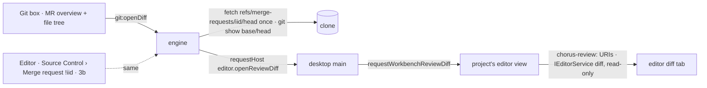

- **One owner.** The engine holds the open review per project — the version, its files and the
  viewed marks; the box's tree (3a) and the editor's Source Control tree (3b) both draw from it.
- **Content comes from git, not GitLab.** Opening a file fetches `refs/merge-requests/<iid>/head`
  once per version and reads both sides with `readFileAt` (the version's `base_commit_sha` for
  `old_path`, `head_commit_sha` for `new_path`; empty for an added or removed side). Binary or
  over 2 MB answers "not shown in the editor" with the GitLab link.
- **The editor path is the agents' approval-diff path** (`ask-diff.ts`, `editor.askDiff` →
  `requestWorkbenchAskDiff`): a new host method `editor.openReviewDiff` carries the two texts to
  the project's editor view, which opens a read-only diff tab on `chorus-review:` URIs keyed by MR,
  version, side and path, so each file is its own tab and reopening focuses it. A project whose
  editor has not started answers "open this project's editor first".
- **"Open all changes" is out of 3a:** the multi-file diff editor's code ships in
  `@codingame/monaco-vscode-api` but no installed package registers it (searched 2026-11-09).
  Whether it can be switched on is a separate question.

| Step                  | Contents                                                                                                                                                                                                                                                                    |
| --------------------- | --------------------------------------------------------------------------------------------------------------------------------------------------------------------------------------------------------------------------------------------------------------------------- |
| 3a — read             | `git:review` (versioned snapshot, overview, approvals, files with status, +/−, thread counts, viewed), `git:viewed`, `git:openDiff`; review marks (migration 22); "updated since your review" on MR rows; `GitReview.tsx` in the box with a folder tree like Source Control |
| 3b — editor extension | a small Chorus extension in the editor: a "Merge request !iid" section inside Source Control mirroring the box's tree, and existing threads in the editor margin, read-only                                                                                                 |
| 3c — write            | reply, draft comments, resolve, publish selected, Approve — the channels below                                                                                                                                                                                              |

#### 3b — the editor extension

**Researched 2026-11-09 by codex, read-only; claude checked the cited lines in the installed 33.0.9
source.** No VSIX, no extensions directory and no REH change: the extension is registered inside the
editor view's own renderer.

**Decided 2026-11-09, the user took every recommendation:**

- **Back closes the review in both places** — the box's review and the editor's section. Collapsing
  the box, switching project tabs or unmounting a view does not close it.
- **Opening a review never takes over the editor's side bar.** The section appears in Source Control,
  collapsed the first time; the workbench remembers its state after that.
- **Two new files:** `workbench/git-review-extension.ts` for the extension, and
  `renderer/src/git-review-model.ts` for the folder tree and the 24-hour formatter, moved out of
  `GitReview.tsx` and `GitPanel.tsx` so the editor can use them without React or the app bridge.
  (Later folded back — see "native source control" below.)
- **Three steps, each tried by the user before the next;** codex writes, claude reviews every file.

**Changed 2026-11-09, after the user saw 3b.2: no viewed marks anywhere.** Both trees lost their
checkbox, and with it the box's "x of y viewed" and "changed since you viewed it". Files are coloured
by status the way Git colours them — the editor through a `FileDecorationProvider` on the same
`chorus-review:` URIs the diff tabs use (so an open diff tab takes the colour too), the box through
`data-status` and the theme's diff and ANSI tokens. "Updated since your review" now means new
commits since the person last pressed Review: opening a ready review records it seen, and the flag
shown for that session is the one read before the record. `git:viewed`, the per-file `viewed`
field, `fileDigest` and the marks store's viewed half are deleted; `review_viewed` stays in the
database, unused, because migrations only add.

**The box's rows follow the editor's layout, decided 2026-11-09 at the user's request:** a folder is
chevron, folder icon and name; a file is its name in the status colour, the counts muted, the status
letter right-aligned, and a removed file struck through. **No file-type icons in the box** — the
user's choice: `FileIcon` reads languages from Monaco, which nothing else in the main renderer
loads, so it would add `monaco-editor` (about 4.87 MB, measured earlier) for an icon the editor
already shows.

**The editor's section became a native source control, decided 2026-11-09 by the user.** The
contributed tree view showed `tests/…/baskets` with `src/…/BasketWizard`'s three files. Stable
string keys did not fix it, which retired the first diagnosis (element identity in the extension
host's cache). The likely cause is the workbench's own batching: `TreeDataSource.getChildren`
(`treeView.js:1112–1140`) gathers requests made in one tick, answers each by its index, and resets
the shared promise when a new batch starts — so a request whose timer fires after a newer batch began
is answered by that batch's result at its own index. A renderer-local extension host answers fast
enough to land a new batch between two timers of the old one; `tests/…/baskets` sat at index 1 next
to `src/…/baskets`, and index 1 of the next batch (`api`, `BasketWizard`, `utils`) is exactly what it
showed. The user wanted nested folders open by default, so instead of flattening or collapsing,
the MR is now `scm.createSourceControl('chorus.gitReview', 'Merge request !iid', …)` with one group
named by the MR's title, its input box hidden and `count` 0. The Source Control view draws a group
from resources held in the workbench (`scmViewPane.js:1963–1965`), with no per-folder request to
race, and gives Git's own rendering: nested folders following the person's view mode, the letter and
colour from the existing `FileDecorationProvider`, `strikeThrough` on a removed file, and a click that
runs the same `openDiff` command. The `+added −removed` counts move to each file's tooltip, since a
resource state has no description. The contributed `views.scm` entry and its context key are gone,
and `git-review-model.ts` went back into `GitReview.tsx`, its only remaining user.

**That source control then knocked Git out of the editor, and a dependency patch fixed it
(2026-11-09, the user's choice).** The workbench names a source control `scm${handle}`
(`mainThreadSCM.js:311–312`), each extension host numbers its source controls from 0
(`extHostSCM.js:491–492`), and `SCMService.registerSCMProvider` throws "SCM Provider scm0 already
exists" for the second (`scmService.js:309–310`). Git runs on the REH host and this extension on the
renderer-local one, so both were `scm0`; because the engine holds the review across restarts, the
local one registered first on every start and Git's registration was refused — "No source control
providers registered" after Back, although Git's own log shows `Opened repository … tpa-web-1`.
`patches/@codingame__monaco-vscode-extensions-service-override@33.0.9.patch` (pnpm
`patchedDependencies`, beside the two existing `@codingame` patches) keys ids by host: the first host
seen keeps `scm${handle}`, every later one gets `scm${host}-${handle}`, and `parentId` goes through
the same function so Git's worktree and submodule parents still resolve. Re-check it on every
`@codingame/monaco-vscode-*` upgrade.

**3b.3, decided 2026-11-09 — the user took every recommendation.** Threads are **read-only**;
writing — a new comment on a line as a GitLab draft, replies, resolve, publish — stays in 3c, so
nothing reaches GitLab by accident. **Resolved threads show, collapsed** and marked resolved, as
GitLab shows them. **Anchors stay on the MR's line numbers**: in edit mode a thread sits on the
workspace file and does not follow lines the person inserts until the review is reloaded; tracking
edits belongs with writing. Because a file's diff may open read-only (`chorus-review:` on both
sides) or editable (the workspace file on the right), threads are created on the exact URIs the
diff used: `review-diff.ts` reports each opened file's two URIs to the extension, which creates
that file's threads on them once per review version.

**3c reshaped 2026-11-09 by the user: no drafts.** A comment is posted the moment it is submitted,
so `git:draftSave`, `git:draftDelete`, `git:publish`, the drafts read and the drafts tray in the
"Channels added" table below are dropped. What stays: a new comment on a diff line (`POST
…/discussions` with the version's three SHAs and the position the "Positions" rule computes), a
reply (`POST …/discussions/:id/notes`), resolve and reopen (`PUT …/discussions/:id`), and Approve
(`POST …/approve` with `sha` = the version's head). The Source Control rows moved to their own
`chorus-merge-request:` scheme: once any diff opens, the read-only file provider registered for the
whole `chorus-review:` scheme made every row read-only, and the workbench's lock replaced the
status letter and colour.

**Edit mode, decided 2026-11-09 — the user took every recommendation.** When the project has the
MR's source branch checked out and the MR is not from a fork, a diff's modified side is the real
file in the project's workspace — editable, saved to disk, with language features — and the original
side stays the version's base from `chorus-review:`. On any other branch, or for a fork, both sides
stay read-only as before. The engine decides per open, from the branch checked out at that moment.
A removed file, a path that does not resolve inside the project root, or a file missing on disk
stays read-only. When the branch is the source branch but its HEAD is not the reviewed version's
head (unpushed commits, or MR commits not pulled), the diff still opens editable, comparing base to
the file on disk, and the box says "Your branch differs from the merge request. Sync to match."
"Open all changes" follows the same rule file by file. Built before 3b.3, because threads will sit
on the workspace file in edit mode and can drift while the person types.

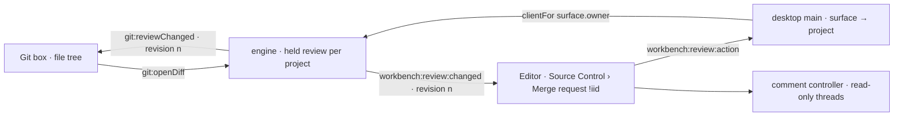

- **Host.** `workbench/services.ts` already imports
  `@codingame/monaco-vscode-extension-api/localExtensionHost`.
  `registerExtension(manifest, ExtensionHostKind.LocalProcess, { system: true })` hands back
  `getApi()` in the renderer. The worker host stays off; the 2026-09-02 decision in `services.ts` is
  untouched.
- **The section.** `contributes.views.scm` with `when: chorus.gitReview.active`
  (`viewsExtensionPoint.js:219`, mapped to the Source Control container at `:663`). It is its own
  section in Source Control, not rows inside Git's Changes, and a contributed Source Control section
  starts collapsed (`showCollapsed`, `:671`).
- **The tree.** `window.createTreeView`, folders compacted and open as in the box, each file
  carrying its `chorus-review:` URI so the icon theme and the status colour apply. A click calls
  `git:openDiff`; both trees redraw from the engine's push.
- **Threads.** `comments.createCommentController`, one `createCommentThread` per positioned
  discussion, `canReply = false` and no commenting-range provider, so nothing can be written in 3b.
  Bodies are `MarkdownString` with `isTrusted: false` and `supportHtml: false`. The modified side
  anchors at `new_line − 1` and the original side at `old_line − 1`, never crossed. URIs are the ones
  `review-diff.ts` already builds, because a thread matches by the whole URI including its authority
  (`mainThreadComments.js:403`). The time goes in `Comment.label` through the 24-hour formatter: the
  native timestamp is `toLocaleString(language)` with no hour cycle (`timestamp.js:53`).
- **Data.** Discussions keep their bodies; today `gitlab-client.ts` keeps only enough to count. Kept:
  discussion and note ids, each non-system note's body, author and `created_at`, `resolved`, and the
  position (three SHAs, both paths, old and new line). Matching stays 3a's — all three SHAs and the
  path — and `file.threads` stays a count. No new GitLab call.
- **Sync.** One envelope, `{ projectId, iid, versionId, revision, review | null }`, with `revision`
  monotonic in the engine. Both trees subscribe before their first read and drop an older revision,
  so a late answer cannot overwrite a newer push. The editor's bridge is bound in main to its
  surface's project — the surface gains a trusted project id — and exposes no generic engine call and
  no token.

| Channel                                           | Purpose                                                      |
| ------------------------------------------------- | ------------------------------------------------------------ |
| `git:activeReview`                                | the box reads the held review without a GitLab call          |
| `git:reviewChanged`                               | push, including the close                                    |
| `git:closeReview`                                 | Back in the box                                              |
| `workbench:review:state` · `:changed` · `:action` | the editor's read, its push, and its one action (`openDiff`) |

| Step | Contents                                                         | Seen working when                                                                           |
| ---- | ---------------------------------------------------------------- | ------------------------------------------------------------------------------------------- |
| 3b.1 | the extension registered with a static folder, file and checkbox | the section appears in Source Control once a review file opens, and its checkbox toggles    |
| 3b.2 | the engine-fed tree, the envelope, both trees in step            | the editor lists the MR's files coloured by status, a click opens the diff, Back hides it   |
| 3b.3 | read-only threads                                                | a thread on each side of one diff, and in an "Open all changes" cell scrolled away and back |

Known limits:

- **An inline diff hides original-side threads** (`commentsController.js:707`), so a thread on a
  deleted line shows only side by side. The editor drops to inline by itself when the pane is narrow.
- **A thread with no line** — an image, an anchor GitLab cannot place — stays on GitLab; no line is
  invented for it.
- **"Open all changes" cells** are plain `DiffEditorWidget`s, not the embedded editor the comments
  controller skips (`commentsController.js:550`), so threads should show there. Inferred from the
  source (`diffEditorItemTemplate.js:78`), not seen.

#### The snapshot is a diff version

```ts
const MrVersionItem = z.object({
  id: z.number().int(),
  head_commit_sha: z.string(),
  base_commit_sha: z.string(),
  start_commit_sha: z.string(),
  state: z.string(),
})

const MrDiffItem = z.object({
  old_path: z.string(),
  new_path: z.string(),
  a_mode: z.string(),
  b_mode: z.string(),
  diff: z.string(),
  new_file: z.boolean(),
  renamed_file: z.boolean(),
  deleted_file: z.boolean(),
  collapsed: z.boolean().optional(),
  too_large: z.boolean().optional(),
})

const MrVersion = MrVersionItem.extend({ diffs: z.array(MrDiffItem) })

export interface ReviewVersion {
  readonly id: number
  readonly headSha: string
  readonly baseSha: string
  readonly startSha: string
}
```

```text
GET /api/v4/projects/:id/merge_requests/:iid/versions                 the highest id is the newest
GET /api/v4/projects/:id/merge_requests/:iid/versions/:version_id     SHAs and diffs, one document
```

The docs do not state the list's order, so the newest is the **highest `id`**, never `[0]`. An MR
with no version yet — GitLab fills `diff_refs` asynchronously after creation — answers
`{ kind: 'preparing' }`, drawn as "GitLab is preparing this diff" with Refresh.

#### Channels added to `GIT_CONTRACT`

Every request that names a line or a commit carries the `versionId` the person is looking at; the
engine re-reads `…/versions` **uncached** and refuses `head-moved` unless that id is still the
newest. The renderer never sends SHAs — the engine holds the version it served.

| Channel           | Request                                                                                                 | GitLab call (`:id` = encoded path)                                                                                              |
| ----------------- | ------------------------------------------------------------------------------------------------------- | ------------------------------------------------------------------------------------------------------------------------------- |
| `git:review`      | `{projectId, iid}`                                                                                      | `…/versions`, `…/versions/:version_id`, `…/merge_requests/:iid`, `…/discussions` and `…/draft_notes` (all pages), `…/approvals` |
| `git:draftSave`   | `{projectId, iid, versionId, draftId?, body, at: {fileIndex, kind, before?, after?} \| null, replyTo?}` | `POST …/draft_notes`, or `PUT …/draft_notes/:draft_note_id`                                                                     |
| `git:draftDelete` | `{projectId, iid, draftId}`                                                                             | `DELETE …/draft_notes/:draft_note_id`                                                                                           |
| `git:publish`     | `{projectId, iid, versionId, draftIds}`                                                                 | `PUT …/draft_notes/:draft_note_id/publish`, one per id; the answer is one result per id                                         |
| `git:reply`       | `{projectId, iid, discussionId, body}`                                                                  | `POST …/discussions/:discussion_id/notes`                                                                                       |
| `git:resolve`     | `{projectId, iid, discussionId, resolved}`                                                              | `PUT …/discussions/:discussion_id` with `resolved`                                                                              |
| `git:approve`     | `{projectId, iid, versionId, approve}`                                                                  | `POST …/approve` with `sha` = the version's `head_commit_sha`, or `POST …/unapprove`                                            |
| `git:viewed`      | `{projectId, iid, versionId, path, viewed}`                                                             | none — the review marks below; the engine computes the digest from the version it served                                        |

A reply, resolve or delete of one's own draft needs no version guard: none of them names a line.
Approve still meets GitLab's own `409` for a push in the last instant, and a project that requires
re-authentication to approve answers in a way the API cannot complete — both say so and link the
MR on GitLab. `user_can_approve: false` disables the button with its reason.

#### Diffs — GitLab's hunks through the existing parser

`parseDiff` needs a `diff --git` header, and its header pattern is lazy (`diff.ts:52`), so a real
path containing ` b/` would split in the wrong place. The synthetic header carries placeholders and
GitLab's own path fields are attached after parsing — the parser and its line numbering stay the
transcript's:

```ts
export function hunksOf(file: z.infer<typeof MrDiffItem>): DiffFile | null {
  const head = ['diff --git a/file b/file']
  if (file.new_file) head.push(`new file mode ${file.b_mode}`)
  if (file.deleted_file) head.push(`deleted file mode ${file.a_mode}`)
  const parsed = parseDiff(`${head.join('\n')}\n${file.diff}`)[0]
  return parsed === undefined ? null : { ...parsed, path: file.new_path, oldPath: file.old_path }
}
```

`collapsed` or `too_large` files are listed with their path and an "Open on GitLab" link, never
drawn empty. A version whose `diffs` were cut by GitLab's own limits says so.

#### Positions — one function decides old/new line, from the docs' rule

```ts
export function positionFor(
  version: ReviewVersion,
  file: { readonly path: string; readonly oldPath: string },
  at: {
    readonly kind: 'context' | 'added' | 'removed'
    readonly before?: number
    readonly after?: number
  }
): Record<string, string | number> | null {
  const position: Record<string, string | number> = {
    base_sha: version.baseSha,
    start_sha: version.startSha,
    head_sha: version.headSha,
    position_type: 'text',
    old_path: file.oldPath,
    new_path: file.path,
  }
  if (at.kind !== 'added') {
    if (at.before === undefined) return null
    position.old_line = at.before
  }
  if (at.kind !== 'removed') {
    if (at.after === undefined) return null
    position.new_line = at.after
  }
  return position
}
```

Added → `new_line` only; removed → `old_line` only; unchanged → both (Discussions API). The
renderer sends `fileIndex` and the line; paths and SHAs come from the version the engine served.

A thread attaches to a line **only when all three of its position SHAs equal the version's**. Any
other diff note lists under its file as "on an earlier version", never re-pointed at a line that now
means something else. A draft written on an older version shows that version beside it; publishing
it is allowed, and it never counts as reviewing the current one.

#### Review marks — `packages/event-store/src/migrations.ts`, NEW `packages/event-store/src/review-marks.ts`

Not history, so not the log; tables beside `conversation_note`, which is the same kind of thing:

```ts
{
  version: 22,
  name: 'a-review-remembers-what-was-read',
  up: `
    CREATE TABLE review_viewed (
      host       TEXT    NOT NULL,
      project    TEXT    NOT NULL,
      iid        INTEGER NOT NULL,
      path       TEXT    NOT NULL,
      digest     TEXT    NOT NULL,
      viewed_at  INTEGER NOT NULL,
      PRIMARY KEY (host, project, iid, path)
    );
    CREATE TABLE review_seen (
      host       TEXT    NOT NULL,
      project    TEXT    NOT NULL,
      iid        INTEGER NOT NULL,
      version_id INTEGER NOT NULL,
      head_sha   TEXT    NOT NULL,
      seen_at    INTEGER NOT NULL,
      PRIMARY KEY (host, project, iid)
    );
  `,
},
```

```ts
export function fileDigest(version: ReviewVersion, file: z.infer<typeof MrDiffItem>): string {
  const textless = file.diff === '' || file.collapsed === true || file.too_large === true
  return createHash('sha256')
    .update(
      JSON.stringify([
        file.old_path,
        file.new_path,
        file.a_mode,
        file.b_mode,
        file.new_file,
        file.deleted_file,
        file.renamed_file,
        file.diff,
        textless ? version.headSha : '',
      ])
    )
    .digest('hex')
}
```

- A file whose digest still matches stays viewed; a different one shows **changed since you viewed
  it** — the "changed since my last review" feature, per file. A binary, mode-only, collapsed or
  too-large file has no text to compare, so its digest includes the version's head and any new
  version unmarks it.
- `review_seen` is written when the person approves the current version, publishes a draft written
  on it, or marks every file of it viewed — and "every file" requires a complete version. The MR row
  shows **updated since your review** when its `sha` differs from `review_seen.head_sha`.
- `ReviewMarksStore` is exported from `packages/event-store/src/index.ts`, constructed in
  `runtime.ts` on the shared database beside the note stores (`:1359`), and handed to
  `GitLabDirectory` as `marks` through `runtime.reviewMarks()`.

#### `apps/desktop/src/renderer/src/FileDiff.tsx`

Two optional props; every existing caller passes neither and is unchanged, including the 600-line
cap:

```tsx
export const FileDiff = memo(function FileDiff({
  file,
  path,
  onPickLine,
  renderAfter,
}: {
  file: DiffFileView
  path?: string | undefined
  onPickLine?: ((line: DiffLineView) => void) | undefined
  renderAfter?: ((line: DiffLineView) => React.ReactNode) | undefined
}): React.JSX.Element {
  …
          {hunk.lines.map((line, j) => (
            <Fragment key={j}>
              <tr className={`line line--${line.kind}`}>
                <td className="gutter">
                  {onPickLine !== undefined && line.kind !== 'meta' ? (
                    <button type="button" className="gutter-pick" aria-label={t('git.review.commentOn', { line: line.after ?? line.before })} onClick={() => onPickLine(line)}>
                      {line.before ?? ''}
                    </button>
                  ) : (
                    (line.before ?? '')
                  )}
                </td>
                …
              </tr>
              {renderAfter?.(line)}
            </Fragment>
          ))}
```

The review draws **one file at a time** — the file list on the left of the box's body, the picked
file's `FileDiff` beside it — so the mounted rows are one file's, at most 600, never the whole MR.
Past 600 the existing "lines not shown" note links to GitLab. `onPickLine` and `renderAfter` are
`useCallback`ed in `GitReview` against the picked file and its threads, so `memo` holds while a
comment is being typed; the comment editor's text lives in `GitReview`, not in the rows.

#### NEW: `apps/desktop/src/renderer/src/GitReview.tsx`

The review view, rendered by `GitPanel` in place of the lists; Back returns to them.

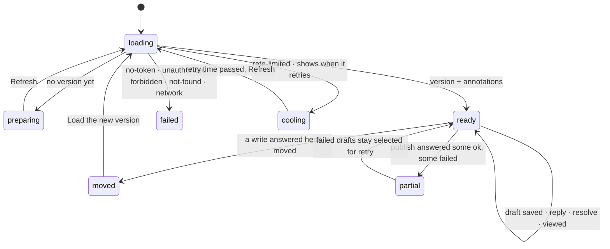

- Header: title, author, `source → target`, the pipeline (status links to GitLab), approvals
  (`approved_by`, `approvals_left`), and **Approve `a1b2c3d`** naming the version's head.
- The drafts tray lists the person's pending drafts with a checkbox each, the version each was
  written on, and **Publish selected**. A partial publish keeps the failed ones selected with
  their reason.
- An unsaved comment survives a project tab switch: its text is held in a module-level map keyed by
  `projectId:iid:fileIndex:line`, the same idea as `SessionCarry`, and cleared on save or discard.
- Empty: an MR with no changed files says so. `not-gitlab`, `no-token` and `unauthorized` point to
  Settings → GitLab.

### Phase 4 — failed pipeline → agent

`git:failedJobs {projectId, iid}`, against the project that ran the pipeline
(`head_pipeline.project_id`, which is the fork's for a fork MR):

```text
GET /api/v4/projects/:pipeline_project_id/pipelines/:pipeline_id/jobs?scope[]=failed
GET /api/v4/projects/:pipeline_project_id/jobs/:job_id/trace
```

The trace goes through `GitLabClient.text(path, 65_536)`, which streams the body and keeps only its
last 64 KB; ANSI escapes are stripped and the last 150 lines returned with the job's `name`,
`stage`, `failure_reason` and `web_url`. A job with no log answers `404` and says "no log".

"Ask an agent" stages — never sends — a block into the project's focused conversation, the path the
editor's diagnostics already take: `diagnostic-staging.ts` becomes generic over its payload, and
`Session.tsx` (`:1140-1154`) subscribes a second queue that calls `composer.current?.insert(text)`.
The person reads the block, adds a sentence, and sends it. `EditorPane` passes
`activeConversationId` (`:317`) down to `GitPanel` for the target; with no conversation open the
button says "Open a conversation first".

### Phase 5 — agent-drafted review comments (later, own approval)

Out of v1. The shape is recorded so v1 does not paint it into a corner: an agent's findings arrive
as `git:draftSave` calls the person triggers from a proposal card, each carrying the `versionId` it
was written against, so they are ordinary GitLab drafts the person edits and publishes with the
rest — and an agent's finding on an old version is labelled exactly as a person's would be.

### Phase 6 — retire GitLab Workflow (the person, by hand)

After the box has covered a real review: Extensions → GitLab Workflow → Disable (or Uninstall) in
any project's workbench. One `--extensions-dir` serves every project (`workbench-host.ts:597`), so it
goes from all of them at once, and with it the per-host startup burst plan 88 measured.

## Final Flow

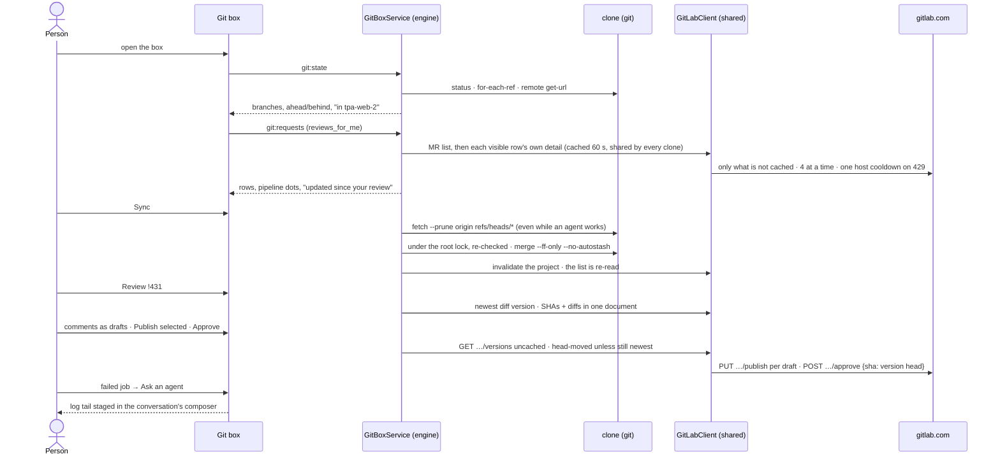

## Later verification (when asked)

| What                                       | How                                                                                                                                                                                                                                                                                                             |
| ------------------------------------------ | --------------------------------------------------------------------------------------------------------------------------------------------------------------------------------------------------------------------------------------------------------------------------------------------------------------- |
| `parseTrack`, `parseRemoteUrl`             | `git.test.ts` cases: `[ahead 2]`, `[behind 1]`, `[ahead 1, behind 3]`, `[gone]`, empty; scp, `ssh://` with port, https with `.git`, subgroup paths, a credential in the URL                                                                                                                                     |
| `switchTo`, `fastForward`, `fetchBranches` | `git-write.test.ts` / `git.test.ts` against a temp repo with a bare remote, as the existing tests do                                                                                                                                                                                                            |
| `GitBoxService` guards                     | dirty → `dirty`; `projectBusy` → `agent-busy` for checkout and for Sync's fast-forward; remote project → `not-local`; diverged, ahead, gone and other-remote never merge; two checkouts on one root serialise; a single-branch clone → `unsupported-remote`; a fork MR whose `FETCH_HEAD` moved → `head-moved`  |
| `projectBusy`                              | true for a working agent, a live reply, background work, a working aside and startup work in that project; false for another project's                                                                                                                                                                          |
| `GitLabClient`                             | coalescing (two `get`s, one fetch); a GET in flight across a write does not repopulate the cache; host cooldown keeps the longest `Retry-After` and treats a non-numeric one as 60 s; a body that is not JSON → `invalid-response`; `getAll` reports `complete: false` at its bound; `text` keeps only the tail |
| `GitLabDirectory`                          | a changed or cleared token cannot read the previous token's cache                                                                                                                                                                                                                                               |
| `hunksOf`, `positionFor`, `fileDigest`     | recorded version diffs → line numbers, including a path containing ` b/`; added/removed/context positions match the Discussions API rule; a mode-only or binary change unmarks a viewed file                                                                                                                    |
| Version guard                              | `git:draftSave`, `git:publish`, `git:approve` and `git:viewed` refuse `head-moved` when a newer version exists; a thread whose base SHA differs is listed as earlier                                                                                                                                            |
| `importableGitLabToken`                    | one PAT → `token`; OAuth only → `oauth-only`; two PATs → `several`; malformed JSON or another instance → `none`                                                                                                                                                                                                 |
| Box in the app                             | a driver in `apps/desktop/e2e/` opening the box, Sync, checkout refused while dirty, a review of a real MR — by hand or when the person asks                                                                                                                                                                    |
