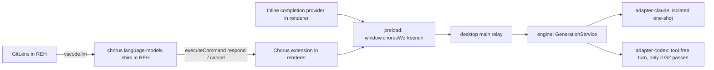

# Claude and Codex as editor models, and autocomplete without an API key

## Status

| Unit           | Result                                                                                                                                                                                                                                                                                                                                                                                                                                                                                                                                                                                                                                                                                                                                                                                                                                                                                                                                                                                                                                                                                                                                                                                                                                                                                                                                                                                                                                                                                                                                                                                                                                                                                                                                                                                                                                                                                           |
| -------------- | ------------------------------------------------------------------------------------------------------------------------------------------------------------------------------------------------------------------------------------------------------------------------------------------------------------------------------------------------------------------------------------------------------------------------------------------------------------------------------------------------------------------------------------------------------------------------------------------------------------------------------------------------------------------------------------------------------------------------------------------------------------------------------------------------------------------------------------------------------------------------------------------------------------------------------------------------------------------------------------------------------------------------------------------------------------------------------------------------------------------------------------------------------------------------------------------------------------------------------------------------------------------------------------------------------------------------------------------------------------------------------------------------------------------------------------------------------------------------------------------------------------------------------------------------------------------------------------------------------------------------------------------------------------------------------------------------------------------------------------------------------------------------------------------------------------------------------------------------------------------------------------------------ |
| Scope          | Desktop app. Make the user's signed-in `claude` and `codex` CLIs answer two things in the project editor: VS Code language-model requests from extensions in the remote extension host (first consumer: GitLens "Generate commit message"), and inline autocomplete after a pause in typing.                                                                                                                                                                                                                                                                                                                                                                                                                                                                                                                                                                                                                                                                                                                                                                                                                                                                                                                                                                                                                                                                                                                                                                                                                                                                                                                                                                                                                                                                                                                                                                                                     |
| Decided        | 2026-11-11, the user: extension requests run in the background — no tools, nothing in any conversation, nothing in the event log. Autocomplete appears after a pause, from whichever of Claude's and Codex's low-cost models is faster. Wiring is VS Code's real model service only — no chat panel, no `monaco-vscode-chat-service-override`.                                                                                                                                                                                                                                                                                                                                                                                                                                                                                                                                                                                                                                                                                                                                                                                                                                                                                                                                                                                                                                                                                                                                                                                                                                                                                                                                                                                                                                                                                                                                                   |
| Research       | 2026-11-11: claude (editor side, model service, existing autocomplete) and codex with three read-only subagents (service dependencies, GitLens 19.6.0's consumer path, Agent SDK 0.3.220 and codex app-server 0.147.0 bindings). Read only; nothing run.                                                                                                                                                                                                                                                                                                                                                                                                                                                                                                                                                                                                                                                                                                                                                                                                                                                                                                                                                                                                                                                                                                                                                                                                                                                                                                                                                                                                                                                                                                                                                                                                                                         |
| Review         | 2026-11-11: codex challenged the first draft — one blocker (the authentication gate), seven should-fix, three nits. All eleven accepted and folded in below. Cross-host commands, the generated REH extension, the real model service, engine placement and the `auto`/debounce split were checked and found sound.                                                                                                                                                                                                                                                                                                                                                                                                                                                                                                                                                                                                                                                                                                                                                                                                                                                                                                                                                                                                                                                                                                                                                                                                                                                                                                                                                                                                                                                                                                                                                                              |
| Decided        | 2026-11-11, the user: **Codex first, alone, provided it passes G2.** Claude is deferred until its G4 is settled. Phase 0 runs for Codex only: G2, then G4 for OpenAI, G5, G3, G1.                                                                                                                                                                                                                                                                                                                                                                                                                                                                                                                                                                                                                                                                                                                                                                                                                                                                                                                                                                                                                                                                                                                                                                                                                                                                                                                                                                                                                                                                                                                                                                                                                                                                                                                |
| G2 (Codex)     | 2026-11-11, **FAIL on paper** for the planned route — stock `codex-cli 0.164.0`, per-thread `thread/start` config. Feature switches remove shell, web search, view_image, apps, plugins, MCP, collaborator agents, plan and user-input tools. They do not remove what the model's own metadata registers. `gpt-6-luna` declares `apply_patch_tool_type: freeform`, `tool_mode: code_mode_only` and `experimental_supported_tools: [send_user_message_async, clock]`; `gpt-5.6-luna` the same without the extra tools (read from `~/.codex/models_cache.json`, `client_version 0.164.0`). Codex's internal `ToolPolicy.allowed_tools = Some([])` would allow zero tools, but app-server exposes no request field for it. Untested alternative: a separately launched app-server with a rewritten `model_catalog_json` (a startup-only override). No model request was made. **Runtime test of that alternative, 2026-11-11: inconclusive.** The catalog was rewritten (`apply_patch_tool_type: null`, `tool_mode: direct`, `experimental_supported_tools: []`, `multi_agent_version: null`), all 14 MCP servers were disabled, and requests went through a local capture relay. The app-server exited before initialization with `Operation not permitted` in all six attempts, under a guard that blocked writes outside `/tmp`. 0 of 2 requests spent. `config.toml` and `auth.json` hashes unchanged. Artifacts are in `/tmp/codex-g2-spike/run.oUSlB7/`. **The single approved retry, with Codex's normal `~/.codex` writes allowed, was also inconclusive:** the app-server initialized, then the turn failed in 11 ms with `workspace routing discovery failed`, before any request reached the relay. The likely cause is the custom capture provider; this is unconfirmed. 0 of 2 requests spent, protected hashes unchanged, no process left. **The test is closed; G2 stays unproven.** |
| Decided        | 2026-11-11, the person chose **route (c): Claude only**, after Codex's G2 stayed unproven. Anthropic's terms for this use (G4, Claude) are accepted as the person's own call. Codex is deferred until a provably tool-free route exists. Everything below that names Codex is out of scope for now.                                                                                                                                                                                                                                                                                                                                                                                                                                                                                                                                                                                                                                                                                                                                                                                                                                                                                                                                                                                                                                                                                                                                                                                                                                                                                                                                                                                                                                                                                                                                                                                              |
| G1 probe       | 2026-11-11, **2 more requests (7 of 30 spent); Phase 2 is not viable as specified.** • **Thinking is proven:** with `effort: 'low'` added (CLI arguments `--thinking disabled --effort low`) and a 256-token cap, both calls streamed a `thinking` block (`thinking_delta`, `signature_delta`, `system/thinking_tokens`) before their text. Thinking took about 230 of each call's 223–236 output tokens, for about 10 tokens of answer. • **Too slow:** first text at 1,797 and 1,765 ms, total 1,861 and 1,828 ms. That misses the 1.5 s median before any refill wait or load. • **Correct when it answers:** one API call each, no retries, `end_turn`, and both suggestions exact. • **Hidden extra call still present:** about 2.8k input and 18–23 output tokens beyond each call's own usage. • **Quota:** the weekly window read 86% (it was 81%); other sessions share that plan. Raw results are in `/tmp/claude-g1/results-probe.json`.                                                                                                                                                                                                                                                                                                                                                                                                                                                                                                                                                                                                                                                                                                                                                                                                                                                                                                                            |
| Hidden call    | 2026-11-11, identified by reading, **not confirmed by a run.** • **What:** the extra call is the CLI's automatic session title. `sdk.d.ts:2024-2031` says the `title` option uses the given title "instead of auto-generating one from the first user message". The installed CLI 2.1.303 carries a long session-naming prompt under `querySource:"generate_session_title"`. Each of our requests is a new session with no `title`. • **The numbers fit:** it shows in `modelUsage` but not in the call's own `usage` — about 2.9k uncached input and 18–23 output tokens, same model, roughly constant in size. • **Not prompt suggestions:** those are suppressed on a first turn (`sdk.d.ts:1782`). • **Fix:** set a fixed `title` in `generate.ts`'s startup options. One request would then confirm it. • **Applied 2026-11-12, approved by the person:** `title: 'Chorus'` in `generate.ts:62` (`startup()` takes `options?: Options`, `sdk.d.ts:6758`; `Options.title` at `:2031`). **Not yet installed.** • **Confirmed 2026-11-12 by 1 request (8 of 30 spent):** with `title: 'Chorus'`, `modelUsage` equals `usage` on input (8), output (1,024), cache read (0) and cache creation (10,160). The same case without a title had shown +2,908 input and +23 output. • **How the title travels:** inside the SDK's `initialize` control request, not as a CLI argument. • **That request itself failed:** Haiku spent the 256-token cap on thinking in each of 4 calls and returned `is_error` after 8.8 s. The same case had succeeded at 236 tokens in the previous probe, so the amount of thinking varies from run to run, which further rules out a fixed-cap autocomplete. • **Quota:** the weekly window read 88%.                                                                                                                                    |
| G5 (Claude)    | 2026-11-11, **passes on paper.** The installed `claude` 2.1.303 reads `CLAUDE_CODE_MAX_OUTPUT_TOKENS` (7 occurrences in the binary, including "cannot raise this limit"). The SDK passes `env` to the CLI at startup (`sdk.d.ts:1451`), so the cap is fixed per warm worker — which the worker keying already requires. That a low value really lowers output is confirmed during G1.                                                                                                                                                                                                                                                                                                                                                                                                                                                                                                                                                                                                                                                                                                                                                                                                                                                                                                                                                                                                                                                                                                                                                                                                                                                                                                                                                                                                                                                                                                            |
| G3 (half)      | 2026-11-11: **GitLens runs in the REH** — the editor server's `logs/20261109T221334/exthost9/remoteexthost.log` shows `_doActivateExtension eamodio.gitlens … activationEvent: 'onStartupFinished'`. Not yet observed: an REH extension's `executeCommand` returning from a renderer-registered command. Source review supports it (`mainThreadCommands.js:42`).                                                                                                                                                                                                                                                                                                                                                                                                                                                                                                                                                                                                                                                                                                                                                                                                                                                                                                                                                                                                                                                                                                                                                                                                                                                                                                                                                                                                                                                                                                                                 |
| Decided        | 2026-11-11, the person: G3's second half is checked first, once Phase 1 is built. G1 is approved as proposed (the thresholds in Phase 0; at most 30 Haiku requests, run from `/tmp`, no Chorus changes). Phase 1 is built in parallel with G1.                                                                                                                                                                                                                                                                                                                                                                                                                                                                                                                                                                                                                                                                                                                                                                                                                                                                                                                                                                                                                                                                                                                                                                                                                                                                                                                                                                                                                                                                                                                                                                                                                                                   |
| G1 (Claude)    | 2026-11-11, **inconclusive; stopped at 5 of 30 requests.** • **Access:** `haiku` resolved to `claude-haiku-5-5` on the subscription login. • **Failure:** in 4 of 5 completions the CLI emitted thinking events and no text, though `thinking: { type: 'disabled' }` was passed. Each API call stopped at `max_tokens` = 64. The CLI then retried by itself (4 calls, 4× the cap billed) and ended with `is_error`: "response exceeded the 64 output token maximum" after 3.9–4.3 s. • **The one success:** full text at 1,007 ms, first text at 725 ms. It doubled the prefix's `%(`, so it was wrong. • **Timings:** cold start 471 ms; refill 463–624 ms; a finished worker exits 0.5–0.8 s after its result. • **G5 is only partly true:** `CLAUDE_CODE_MAX_OUTPUT_TOKENS` caps each API call, but hitting the cap means retries and an error, not truncated text. • **Isolation is partial:** `init` still listed 19 built-in skills, 3 built-in plugins, 5 agents and 55 slash commands, despite `skills: []` and `plugins: []`. • **Hidden call:** about 3k extra input tokens per query in `modelUsage` point to a second model call the run did not identify. • **Cache:** every call writes about 2.5k cache tokens and reads none. • **Quota:** the weekly plan window was at 81% (`allowed_warning`, `seven_day`). • **Environment:** the worker stripped 11 of the parent session's `CLAUDE_CODE_*` and `CLAUDE_*` variables from `env`; Phase 1 must do the same. Raw results are in `/tmp/claude-g1/`.                                                                                                                                                                                                                                                                                                                                           |
| Phase 1 code   | 2026-11-11, written by codex and reviewed by claude by reading every changed file. **Nothing compiled or run.** • **New files:** `packages/adapter-claude/src/generate.ts`, `main/generation-service.ts`, `main/generation-ipc.ts`, `shared/language-model-ipc.ts`, `main/workbench-language-models.ts` (the REH shim generator), `renderer/src/workbench/language-model-extension.ts`. • **Wired in:** `runtime.ts`, `apps/engine/src/server.ts`, `main/index.ts`, `workbench-surface.ts`, `preload/workbench.ts`, `shared/workbench-ipc.ts`, `services.ts`, `entry.ts`, `workbench-host.ts`, `en.json`, the adapter index. • **Review corrections applied:**  – a fixed CLI cap of 8,192, because G1 showed that hitting the cap means retries and an error, and the per-request limit no longer splits workers;  – the engine cuts the answer off at the request's bound and returns it as success;  – idle spares expire after 5 minutes;  – the CLI runs in `userData/generation`;  – the clipped text lives on the request, so the strict lint preset does not see a dead condition. • **Advertised limits:** 16,384 estimated input tokens and 2,048 output tokens; requests are bounded to 65,536 characters. • **Unchanged pending the probe:** `thinking: { type: 'disabled' }` and no `effort`. • **Any REH extension can use the `chorus` models without a consent prompt**, because a stable-only provider has none.                                                                                                                                                                                                                                                                                                                                                                                                                               |
| Phase 1b code  | 2026-11-11, written by codex and reviewed by claude; **nothing compiled or run.** • **Files:** `main/workbench-language-models.ts` (manifest and `extension.cjs` template), `renderer/src/workbench/services.ts`, `en.json`. • **Proposal permission:** `scm/inputBox` is proposed API in this build (`menusExtensionPoint.js:145`). The generated manifest declares `contribSourceControlInputBoxMenu`, and `productConfiguration.extensionEnabledApiProposals` grants it to `chorus.language-models` only. • **Copilot ✨:** `chatSetupHidden` is set by a service pre-initialize participant. The registered entitlement service is a stub that never writes the key (`missing-services.js:7061`, `:7091`, `:7099`). • **Git API:** members taken from upstream `git.d.ts` (`getAPI(1)`, `getRepository`, `diff(cached)`, `log({ maxEntries })`, `inputBox.value`) and checked against the installed `git/dist/main.js`; no local `git.d.ts` ships. • **Review fix:** notifications are no longer awaited, so a toast left open can't hold the spinner and the run-once lock.                                                                                                                                                                                                                                                                                                                                                                                                                                                                                                                                                                                                                                                                                                                                                                                                  |
| Verification   | 2026-11-11, installed and tried by the person: **the Chorus ✨ in the commit box generated a commit message with Claude Haiku**, in the repository's `type(scope): subject` style, with a body. This proves G3's second half — an REH command reaching the renderer and the engine and coming back — and Phase 1b end to end. Only Chorus's ✨ was visible, so the Copilot setup action is hidden. With nothing staged, it read the unstaged diff, cut to the input limit, and missed untracked files, so it described only part of a mixed working tree. GitLens's own button stays untested: it needs GitLens Pro. Typecheck and lint have not been run.                                                                                                                                                                                                                                                                                                                                                                                                                                                                                                                                                                                                                                                                                                                                                                                                                                                                                                                                                                                                                                                                                                                                                                                                                                       |
| New files      | 2026-11-11, the person asked that the ✨ also describe untracked files. Written by codex and reviewed by claude; **not yet installed or tried.** • **Only when nothing is staged** — the commit then contains whatever you stage, so a staged commit is described from the staged diff alone. The fallback adds untracked files from `repository.state.untrackedChanges` and `workingTreeChanges` with status `7` (`Status.UNTRACKED`), covering both `git.untrackedChanges` modes (installed `git/dist/main.js:22`, `:39`, `:72`). • **Paths:** up to 200 listed under "New files:", then "…and N more new files". • **Contents:** shown as added lines, at most 4,000 characters per file. • **Skipped contents (path still listed):** files over 1,000,000 bytes (checked with `stat` before reading), binary files, and unreadable files. • **Budget:** new-file contents take at most a third of the prompt space after the header, and reading stops there. The tracked diff gets the rest. • **Label:** "no changes to describe" now fires only when there is nothing staged, unstaged or untracked. • **Verified 2026-11-11, installed and tried by the person.** With nothing staged, the ✨ produced "feat(editor): generate commit messages with Claude in Source Control", with a body describing the language-model work, which lives mostly in untracked files. The working tree still mixes two features (the Git box work and plan 91), so one message cannot describe both.                                                                                                                                                                                                                                                                                                                                                                                |
| Decided        | 2026-11-12, the person: **Phase 2 is dropped.** G1 failed. Haiku 5.5 thinks on every call whatever `thinking` and `effort` say, and only the thinking delays text to about 1.8 s. A fixed cap turns a variable amount of thinking into errors of up to about 9 s. The weekly plan window rose to 88% during testing. 8 of the 30 approved G1 requests were spent; the other 22 will not be. Phases 1 and 1b stand.                                                                                                                                                                                                                                                                                                                                                                                                                                                                                                                                                                                                                                                                                                                                                                                                                                                                                                                                                                                                                                                                                                                                                                                                                                                                                                                                                                                                                                                                               |
| Gate           | 2026-11-12, `pnpm check` passes: typecheck (12 packages), lint, format, workbench check, and vitest with 4925 passed and 4 skipped. Getting there took: • 10 lint fixes in `generation-service.ts`, `generate.ts` and `review-diff.ts`, with no change in behaviour; • Prettier on four files, plan 91 included; • declaring `generateLanguageModel` and `cancelLanguageModel` in `preload/workbench.test.ts`'s list of exposed workbench methods. That list exists to make a new capability deliberate, and this one is the approved Phase 1 bridge. The `title` fix is not installed yet.                                                                                                                                                                                                                                                                                                                                                                                                                                                                                                                                                                                                                                                                                                                                                                                                                                                                                                                                                                                                                                                                                                                                                                                                                                                                                          |
| Implementation | Phase 1 (Claude only) started 2026-11-11 by codex; code complete as above. **G1's findings change Phase 1, to be applied in review:** • Never rely on `CLAUDE_CODE_MAX_OUTPUT_TOKENS` as a hard cap: leave it generous for `lm`, and let the engine's character backstop bound the answer. • Strip the parent session's `CLAUDE_CODE_*` variables. • Thinking control is unresolved; `effort: 'low'` (`sdk.d.ts:1664`) is the candidate. Remaining gates: the other half of G3 (an REH extension reaches a renderer command) and G1 (Claude latency, quality and quota). Both need a real run and the person's go-ahead; G1 also needs the thresholds confirmed.                                                                                                                                                                                                                                                                                                                                                                                                                                                                                                                                                                                                                                                                                                                                                                                                                                                                                                                                                                                                                                                                                                                                                                                                                        |
| G4 (OpenAI)    | 2026-11-11: OpenAI's app-server docs let existing local or open-source applications keep using app-server login, and exclude commercial or hosted services. Chorus is public and MIT-licensed (`gh repo view`). Codex's reading: Chorus fits. The person confirms.                                                                                                                                                                                                                                                                                                                                                                                                                                                                                                                                                                                                                                                                                                                                                                                                                                                                                                                                                                                                                                                                                                                                                                                                                                                                                                                                                                                                                                                                                                                                                                                                                               |
| Verification   | Not started.                                                                                                                                                                                                                                                                                                                                                                                                                                                                                                                                                                                                                                                                                                                                                                                                                                                                                                                                                                                                                                                                                                                                                                                                                                                                                                                                                                                                                                                                                                                                                                                                                                                                                                                                                                                                                                                                                     |

## The outcome

Two things the person sees, both answered by the CLIs they are already signed into:

1. **GitLens's ✨ "Generate commit message" works.** With `gitlens.ai.model: "vscode"` and `gitlens.ai.vscode.model: "chorus:<family>"`, GitLens lists Chorus's models, sends the diff, and gets a message back. Other extensions running in the same remote extension host (REH) get the same models. Extensions in the renderer's local host do not — see _Host scope_.
2. **Ghost text appears after a pause.** Stop typing, and a suggestion arrives from the fastest permitted low-cost model. It is slower than Copilot by design. G1 decides whether it is fast enough to ship at all.

Neither is a conversation. Neither appears in a transcript, writes to the event log, marks the project busy, or runs a tool.

## What the research found

### The editor's model service is a stub, and the real one is already installed

`ILanguageModelsService` is registered from `missing-services.js:5687`: `registerLanguageModelProvider` returns `Disposable.None` and `selectLanguageModels` throws. That is why GitLens's `vscode` option finds nothing today.

The real class ships inside the installed `@codingame/monaco-vscode-api@33.0.9` at `vscode/src/vs/workbench/contrib/chat/common/languageModels.js`. The chat package only registers it (`index.js:176`) alongside ~60 chat services Chorus does not want.

Its nine constructor dependencies (`languageModels.js:1442`) are already supplied by Chorus's overrides, except `ILanguageModelsConfigurationService`, whose stub is enough. The real service calls only:

- `onDidChangeLanguageModelGroups` (`:249`; the stub returns `Event.None`);
- `getLanguageModelsProviderGroups` (`:419`; the stub returns `[]`).

Registration, select and send make no configuration-service calls (`:554`, `:574`). One `SyncDescriptor` in `services.ts` replaces the stub. A contributed vendor is activated before its information is collected (`:152`, `:376`), so no proposal flag is needed.

`selectChatModels`, `registerLanguageModelChatProvider`, `sendRequest` and provider token counting are stable API in this build (`extHost.api.impl.js:1905`). The per-extension access consent prompt exists only for providers that set the **proposed** `requiresAuthorization` (`extHostLanguageModels.js:147`). A stable-only provider shows none.

### Host scope: the provider must live where GitLens lives

The first shape put the provider in a Chorus extension inside the renderer's local extension host, the way `git-review-extension.ts` is registered. **That does not work across hosts**, verified by reading:

- Model metadata is cached only in the providing host: `_localModels` is filled at `extHostLanguageModels.js:212`, inside `$provideLanguageModelChatInfo`.
- Main-thread selection returns identifiers only (`mainThreadLanguageModels.js:131`).
- A consumer in another host looks the identifier up in **its own** cache (`extHostLanguageModels.js:338`), misses, re-selects (`:354`), and misses again. Token counting has the same shape (`:539`).

GitLens is a workspace extension, so it runs in the REH. The provider therefore runs **in the REH too**. That serves REH consumers only. Making models usable from every host would mean repairing the metadata and token-count bridge itself, which this plan does not do.

Chorus already writes an extension of its own into the REH at startup: `main/workbench-process-owner.ts:38-64` generates `chorus.workbench-process-owner-1.0.0/{package.json,extension.cjs}` before the REH spawns (`workbench-host.ts:1142`). The model provider follows that pattern as a second generated extension: a thin shim with no logic. The whole pattern is copied:

- other registry entries are preserved;
- this extension's registration is updated;
- its `.obsolete` entry is cleared (`workbench-process-owner.ts:101`).

The shim reaches the engine through **VS Code commands**, which are global across extension hosts. The command registry routes a call to the registering host and awaits its result (`mainThreadCommands.js:42`). Plain JSON arguments and results fit the serializer. Commands do not carry a nested cancellation token, so cancellation is a separate command. No socket, credential or transport is added to the REH.

### GitLens's exact contract

From the installed bundle (`eamodio.gitlens-19.6.0-universal/dist/ai.js`, minified, no source maps):

- It lists models with an unfiltered `lm.selectChatModels()` and shows each as `vendor:family`. Later it re-selects with `{ vendor, family }` and takes the first match. **Each selectable model needs its own family**, or two collide in its picker.
- It maps assistant messages to Assistant and everything else, its own system prompt included, to User. It passes `modelOptions.outputTokens`, temperature, a justification, cancellation and sometimes tools. It reads `response.stream`, which a single text part satisfies.
- It does not call `countTokens`. It uses `maxInputTokens`.
- It declares its VS Code provider tool-capable whatever the model. **The shim must reject tool and image parts itself**; advertising `toolCalling: false` is not enough.

### The CLIs can make one-shot calls, with gates

**Claude.** The installed Agent SDK 0.3.220 accepts a fully isolated call (`sdk.d.ts:1422`, `:1900`, `:1953`):

- `model: 'haiku'` and a replacement `systemPrompt`;
- `tools: []`, `settingSources: []`, `skills: []`;
- `mcpServers: {}`, `strictMcpConfig: true`, `plugins: []`;
- `hooks: {}`, `settings: { disableAllHooks: true }`;
- `persistSession: false`, `thinking: { type: 'disabled' }`, `abortController`.

Isolation matters. Conversations deliberately omit `settingSources` so agents inherit the person's hooks, MCP servers and skills; a model call must load none of them.

**It must use the installed CLI, not the SDK's bundled one.** The SDK defaults to its bundled executable when no path is given (`sdk.d.ts:1727`). Chorus deliberately excludes those binaries (`pnpm-workspace.yaml:23`). The adapter resolves the installed path and owns the process tree (`claude-adapter.ts:1557`, `:1694`).

So the one-shot call lives **inside the adapter packages**: it reuses executable resolution and process ownership, and it is a separate entry point from the conversation `SessionOpts`. The conversation adapter cannot simply be reused anyway: its `toolPolicy: 'none'` lacks `skills: []`, and its `instructions` _append_ to the Claude Code preset (`claude-adapter.ts:1729`, `:1763`).

**Warm processes are configured at startup.** `startup()` takes the options and pre-starts a CLI; `WarmQuery.query()` takes only the prompt and is single-use (`sdk.d.ts:6757`, `:7123`). So the system prompt, model and startup-scoped settings are fixed per warm worker, and each worker serves exactly one request.

- A consumed query's ordinary `close()` no longer works; the active query owns cleanup.
- Cleanup can take about two seconds (`sdk.mjs:137`, `sdk.d.ts:6729`).
- One long-lived streaming query would avoid repeated startup, but it keeps history and has no reset contract. It is not used.

**There is no output-token option.** The SDK's `maxOutputTokens` is returned usage metadata, not a query option (`sdk.d.ts:1265`). `maxTurns`, `maxBudgetUsd` and `taskBudget` mean other things. Gate G5 settles how output is bounded.

**Codex.** app-server 0.147.0 supports ephemeral threads, custom instructions, per-turn model and effort, and interrupt (`ThreadStartParams.ts:12`, `TurnStartParams.ts:13`, `TurnInterruptParams.ts:5`). Its supported efforts come from model metadata (`Model.ts:11`); `"minimal"` is not assumed. It has:

- **no `tools: []` contract** — the adapter throws on `toolPolicy: 'none'` (`codex-adapter.ts:1186`), and read-only sandboxing still runs inspection commands;
- **no output-token cap**;
- **no chat roles** — input is `UserInput` (`UserInput.ts:7`).

Gate G2 decides whether Codex takes part at all.

### Autocomplete already has the right front end

`completion.ts` already packs context, snoozes, cancels by request id and rejects stale replies. The VS Code extension already sends completions to the engine (`apps/extension/src/extension.ts:203` → `apps/engine/src/server.ts:589`). The desktop app still answers them in main's `CompletionClient` (`workbench-surface.ts:2348`, `main/completion-core.ts`), with a 2 s deadline and a 64-token cap (`completion-core.ts:25`).

The renderer is told only `{ configured, text }` (`workbench-ipc.ts:586`), so it cannot know which source is selected today. The `services.ts:761` default that once suppressed inline suggestions is gone (`STATUS.md:157`). The provider sets no `debounceDelayMs`, so VS Code's adaptive delay applies; an explicit value replaces it rather than adding to it (`inlineCompletionsSource.js:184`).

The only latency on record is old fork TTFT: Claude 4.2–5.1 s, Codex 4.5–8.6 s (`docs/plans/ask-on-the-fly-2026-08-09/STATUS.md:60`). That was a cold, full-agent workload, so it bounds nothing here.

## The shape

**Two layers.** Each adapter package gains an isolated one-shot entry point, `generate`, that owns its CLI process. `GenerationService` in `apps/desktop/src/main/` (engine-bundled, plan 87) is the provider-neutral coordinator. It is **not** `ConversationService`, whose path appends session and delta events and can mark the project busy (`conversation-service.ts:230`, `runtime.ts:4217`).

**One request, one buffered answer.** `generate` takes `{ requestId, provider, feature, family, messages, outputLimit, signal }` and returns `{ text }` once the reply is finished.

- Deltas are buffered in the engine, and time to first token is measured there.
- There is no request-correlated streaming plumbing in the first version. `executeCommand` settles once anyway, and GitLens reads one text part from `response.stream`.
- Request and response sizes are bounded well below the engine's 64 MiB frame ceiling.

**Message serialization.** Every request becomes **one** prompt; history is never replayed as extra inference turns.

- The feature's fixed system prompt goes into the worker's startup options.
- The incoming messages are serialized in order, each under a role label, into the single user input.

**Warm workers.**

- Ready workers are keyed by `{ provider, feature, family/model, system prompt, startup options }`.
- **Starting, ready, active and closing** workers together are capped at a small fixed bound, starting at 3. One request per feature does not by itself bound subprocesses, and no SDK-wide ceiling exists.
- A worker is checked out on request and owned by that request until its cleanup finishes.
- If a request is cancelled while its worker is still starting, the startup is abandoned and closed when it completes.
- A startup that finishes after its request is gone is closed, not kept.
- Refill is suppressed during cooldown and disposal.

**Engine activity, not project busy.** Active requests and their request-owned cleanup count in the engine's `activeWork().busy` (`runtime.ts:4279`), so a replacement engine never kills a generation mid-flight (`client.ts:338`, `server.ts:533`). Idle ready workers do not count, so they never block idle shutdown. Engine close cancels a disconnected client's requests and awaits the pool's disposal (`runtime.ts:6744`). Nothing touches `projectBusy`.

**Failure behaviour.**

- Each feature has its own timeout.
- A rate-limit or authentication error starts a cooldown during which the feature refuses fast.
- Logs carry provider, model, timing and outcome, never prompt or output text, matching the completion feature's existing rule.

## Phases

### Phase 0 — gates. Nothing else is promised until these pass

| Gate | Question                                                                                                   | Passes when                                                                                                                                                                                                                                    | If it fails                                                                   |
| ---- | ---------------------------------------------------------------------------------------------------------- | ---------------------------------------------------------------------------------------------------------------------------------------------------------------------------------------------------------------------------------------------- | ----------------------------------------------------------------------------- |
| G4   | On what authentication basis may Chorus make background calls with the person's Claude and ChatGPT logins? | The supported basis is established for each provider, including whether Anthropic's prior approval is required. **This is separate from the quota decision**, which the person makes on its own.                                               | That provider is dropped from this plan. If both are dropped, the plan stops. |
| G2   | Can a Codex app-server turn be made truly tool-free?                                                       | A documented config or protocol option stops all tool calls. Prompt wording and read-only sandboxing do not count.                                                                                                                             | Codex is removed from both features. Claude serves alone.                     |
| G5   | Can output length be enforced, and is the control startup-scoped?                                          | An installed-CLI control limits output for each remaining provider. Otherwise the documented fallback applies: the engine aborts the worker once the buffered text passes the request's limit, and the contract says the limit is approximate. | The fallback is used, and the plan says so.                                   |
| G3   | Does an REH extension reach a renderer command, and does GitLens run in the REH here?                      | A throwaway shim's `executeCommand` returns from a renderer-registered command, and the REH host log shows GitLens.                                                                                                                            | The shim moves to wherever GitLens runs, and the plan is re-argued.           |
| G1   | Is CLI autocomplete fast, cheap and good enough?                                                           | Measured on this Mac, against the thresholds below, with access to each model confirmed by a successful call first.                                                                                                                            | Autocomplete is cut or made on-demand only. The model service is unaffected.  |

**Order.** G4 first: it needs no code and can end the plan. Then G2, G5 and G3, which are small spikes. G1 runs last, only for the providers still standing.

**G4 note.** Anthropic's Agent SDK overview says third-party products may not offer claude.ai login or rate limits without prior approval. Its legal page separately allows people to sign into an unmodified CLI. OpenAI documents app-server login for local and open-source applications, with different terms for commercial and hosted services.

Whether a background model service inside Chorus falls on the permitted side is **not settled** by Chorus already driving conversations. Nor is it settled by the person accepting quota use. This plan does not decide it.

**G1 thresholds — proposed, confirmed by the person before G1 runs:**

- **Speed:** ghost text visible after a pause, median ≤ 1.5 s and p90 ≤ 3 s.
- **Cancellation:** a keystroke stops the in-flight worker within 0.5 s.
- **Quality:** at least 14 of 20 scripted pauses give an insertion that applies cleanly — no fences, no repeated prefix or suffix, indentation kept.
- **Usage:** the plan-quota use per suggestion is recorded and accepted by the person.

**G1 workload:** repeated typing pauses rather than isolated prepared calls, so the warm-pool refill wait shows up. It also covers cancellation mid-request, and a commit-message request arriving during autocomplete under the process bound.

**The Codex model for G1** is whatever is named in the model metadata the installed app-server reports. Codex's reading of OpenAI's docs found `gpt-6-luna`, with `gpt-5.4-mini` retired from subscriptions. **Neither name has been confirmed by a real request.** `haiku` is an alias whose resolution on the person's plan is likewise unconfirmed until a call succeeds.

### Phase 1 — the generation layer and the editor model service

1. **Adapter entry points:** `generate` in `packages/adapter-claude` and, only if G2 passed, `packages/adapter-codex`. Each uses the installed CLI's resolved path and owns its process.
2. **`GenerationService`** in `apps/desktop/src/main/`, wired in `runtime.ts` and `apps/engine/src/server.ts`. It owns the worker pool, its bound, cancellation, cooldown and engine-activity accounting.
3. **IPC:** request/response `lm:generate` and `lm:cancel` with zod contracts in `shared/`, relayed by main to the engine. A new `ChorusApi` method, if one is added, is classified in `apps/extension/src/parity.ts`.
4. **The real model service:** one `SyncDescriptor(LanguageModelsService, [], true)` in `renderer/src/workbench/services.ts`.
5. **Renderer Chorus extension**, registered like `git-review-extension.ts`. It registers the commands `chorus.languageModels.respond` and `chorus.languageModels.cancel`. They take bounded plain JSON, `{ requestId, family, messages: { role, text }[], outputLimit }`, and call `window.chorusWorkbench`.
6. **REH shim**, generated by main exactly as `workbench-process-owner.ts` does it:
   - contributes `languageModelChatProviders` with vendor `chorus`;
   - lists one model per family (`claude-haiku`, plus `codex-<efficient>` if G2 passed), with conservative `maxInputTokens` and `maxOutputTokens` in its provider information;
   - rejects tool and image parts;
   - forwards a response request to `respond` and reports the returned text as one `LanguageModelTextPart`;
   - wires cancellation to `cancel`;
   - implements `provideTokenCount` as a **labelled estimate** (characters ÷ 4). Neither CLI exposes a token counter.

Done when GitLens, set to `vscode` + `chorus:claude-haiku`, writes a commit message for staged changes, and nothing new appears in any transcript or the event log.

### Phase 1b — Chorus's own commit-message button

**Why.** GitLens 19.6 gates "Generate Commit Message" behind GitLens Pro or a trial whatever the model: `sendRequest` calls `ensureFeatureAccess` first (`gitlens-19.6.0/dist/gitlens.js`). The ✨ in the commit box was never GitLens's either. It is the editor's Copilot setup action (`scmInput.js`, `SCMInputWidgetCommandId.SetupAction`), which runs Copilot's chat setup, gets nothing in Chorus, and stops.

**Decided 2026-11-11, the person, every recommendation:**

1. **What is summarised:** staged changes, falling back to all changes when nothing is staged.
2. **Message style:** match the repository's recent commits, using the last 10 subjects as examples — a subject line, plus a short body when the change warrants one.
3. **A draft already in the box** is replaced, and used as a hint.
4. **The dead Copilot ✨ is hidden**, by setting the editor's `chatSetupHidden` flag at startup (`chatEntitlementService.js:39`).

**Shape.** The REH shim gains a command, `chorus.generateCommitMessage`, shown with `$(sparkle)` in `scm/inputBox` for `scmProvider == git`. It runs in the same host as VS Code's git extension and uses its API there:

- the repository comes from the `SourceControl` argument's `rootUri`;
- the diff is `diff(true)`, then `diff(false)`;
- the examples come from `log({ maxEntries: 10 })`;
- the draft is `inputBox.value`.

It calls the same `chorus.languageModels.respond` path as Phase 1, under a Source Control progress indicator, with one run at a time. On success it writes the result into `inputBox.value`; a failure shows its message. No GitLens, no `vscode.lm` consumer and no new engine code. Untracked files are not in `git diff` and are not described.

### Phase 2 — autocomplete from the winner of G1

**Dropped 2026-11-12** — see the Status table. What follows is kept as the record of what was planned.

1. **Routing:** desktop completions for a CLI source go to the engine, as the VS Code extension's already do. API-key sources stay in main exactly as they are, and CLI selection stays outside the API credential resolver.
2. **Settings:** `completionProvider` gains explicit CLI values (`shared/ipc.ts:174`, `:1920`, `main/settings.ts:122`, `main/completion-core.ts:14`, `:264`, `renderer/src/Settings.tsx:334`, `i18n/en.json`). **`auto` keeps meaning "an API key if one is set"**, and never starts spending a subscription silently.
3. **Policy bridge:** the renderer learns the selected source's policy — `{ source, debounceDelayMs }` only — through a small read-and-update channel. It reads the policy at start and updates on settings change. The provider sets `debounceDelayMs` for CLI sources, starting at 600 ms and tuned by G1, and leaves it unset for API sources.
4. **Request rules:**
   - one in-flight request, cancelled on the next keystroke;
   - a timeout taken from G1;
   - the cooldown on rate-limit errors;
   - the output limit from G5.
5. **The prompt:** sends language, bounded context, prefix and suffix as data. It asks for only the text between them: no explanation, no code fences, no repeated prefix or suffix, indentation kept, empty allowed. It is a separate worker key and system prompt from the commit-message feature.

Done when, with the CLI source selected, pausing in a file shows ghost text within G1's thresholds, `Tab` accepts it, and typing cancels the in-flight request.

## What this deliberately is not

- **Not VS Code's chat.** No chat panel, inline chat, agent mode, Copilot sign-in, or `monaco-vscode-chat-service-override`. Only the model service.
- **Not every extension host.** Models serve REH consumers. Renderer-host extensions do not see them.
- **Not a conversation.** No `conversationId`, transcript entry, approval, event-log append or project busy state. Engine activity is counted; that is a different thing.
- **No tools, ever.** Requests that carry tools are refused, not partly honoured.
- **Not a replacement for the API-key completion.** DeepSeek and Codestral stay, unchanged.
- **Not exact token counting.** Counts are estimates and are named as such.
- **Not streamed, in the first version.** One buffered answer per request.
- **Not a model-management UI.** The configuration service stays a stub; models are fixed by Chorus.

## Acceptance criteria

- GitLens `vscode` + `chorus:claude-haiku` produces a commit message; cancelling in GitLens stops the CLI worker.
- `vscode.lm.selectChatModels({ vendor: 'chorus' })` from an REH extension returns one model per family with its `maxInputTokens`. The provider information for each model carries both input and output limits.
- A request with tool or image parts fails with a clear error and no CLI call.
- No event-log rows, transcript entries or project busy state come from either feature. An active generation does count as engine activity, and idle spare workers do not.
- A model call loads none of the person's hooks, MCP servers, skills or plugins, and runs the installed CLI.
- Starting, ready, active and closing workers never exceed the bound.
- Autocomplete from the CLI source is cancelled by typing, never overlaps itself, and backs off after a rate-limit error.
- `auto` with no API key does not use a CLI.
- A provider that failed G2 or G4 is offered nowhere.

## Verification, when asked

Phase 0 spends the person's plan quota, so it runs only with their go-ahead. Phases 1 and 2 are proven in the installed app: GitLens's button, and ghost text in a real file. The `apps/desktop/e2e/` driver covers the shim's model listing and the no-transcript guarantee.

## Open questions

- **G1's thresholds and quota budget.** The figures above are proposals. The person confirms them, and how many suggestions an hour is acceptable, before G1 runs.
- **Refreshing the model list.** Should the shim follow the CLI's own models, or stay fixed in Chorus? Fixed is simpler, and it breaks when an alias retires.
- **Choosing per feature.** The commit-message family need not be the autocomplete winner. GitLens picks its own family.
- **All-host support.** If a renderer-host extension ever needs these models, the metadata and token-count bridge in `extHostLanguageModels.js` has to be repaired. That is out of scope here.
